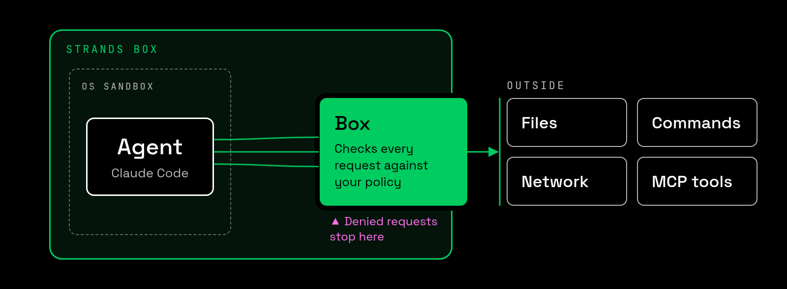

<div align="center">
  <div>
    <a href="https://strandsagents.com">
      <picture>
        <source media="(prefers-color-scheme: dark)" srcset="https://strandsagents.com/latest/assets/wordmark-github-dark.svg">
        
      </picture>
    </a>
  </div>

  <h1>Strands Box</h1>

  <h2>Run coding agents like Claude Code in a sandbox, under a policy you control.</h2>

  <div align="center">
    <a href="https://github.com/strands-agents/box/graphs/commit-activity"></a>
    <a href="https://github.com/strands-agents/box/issues"></a>
    <a href="https://github.com/strands-agents/box/pulls"></a>
    <a href="https://discord.gg/Wa4CQrxsP"></a>
  </div>

</div>

<hr>

## Overview

`box` runs a coding agent, such as Claude Code, Codex, Kiro CLI, or pi, in a box on your machine.
The agent works in your project and reaches only what you allow, so your other files, your keys,
and the services that listen only on localhost stay out of its reach. You use the agent the way
you always do, with its permission prompts off if you like.

Strands Box has two parts, and both live in this repository: `box`, the command you run, and
[Box Core](#box-core), the engine under it, which you can also run directly or embed in a Rust
application. `box` includes the Box Core pieces it needs, so you install one thing.

**Preview:** `box` runs on Apple silicon Macs with macOS 15 or later, and on Linux ARM64 and
x86-64. We welcome feedback through [GitHub issues](https://github.com/strands-agents/box/issues).
Read [CONTRIBUTING.md](CONTRIBUTING.md) before submitting a change.

## Install

The installer downloads a release from GitHub, checks it, and puts `box` on your `PATH`. On a Mac,
the checks include Apple's signing and notarization. You don't need a GitHub account, sudo, or
Rust. The first release of `box` is a pre-release, so name it in `BOX_VERSION`:

```sh
curl -fsSL https://raw.githubusercontent.com/strands-agents/box/main/install.sh | BOX_VERSION=0.3.0-preview.1 sh
```

Open a new terminal, and check that it worked with `box --version`. Usage telemetry is on by
default, and the installer says how to turn it off ([Usage telemetry](CLI_TELEMETRY.md)).
[Install Box](docs/cli/install.md) covers the Linux requirements, upgrades, other versions, and
uninstalling.

## Run your first agent

For Claude Code on Amazon Bedrock, install Claude Code from its native installer, then create a
profile for it:

```sh
box profile create claude --with bedrock
```

`box` asks a few questions. Press Enter to take each default, choose **Save profile** on Review,
and then choose **Exit**. Before the first run, [connect to Bedrock](docs/cli/getting-started.md#3-connect-to-bedrock):
point your terminal at an AWS profile that can call Claude models on Bedrock, and set the model if
Claude Code doesn't already name one. Then start Claude Code in a box from one of your own
projects:

```sh
cd ~/src/my-app
box run claude
```

[Get started](docs/cli/getting-started.md) walks through each step and what you see along the way.

## How Box works



The agent runs inside an operating system sandbox, so its own file reads and writes reach only the
files and folders its profile grants. By default, everything else goes through Box: each shell
command and the files that command touches, each network request, and each MCP tool call. Box
checks each one against your policy before it happens. The check runs outside the model, so nothing
the agent reads can change the answer, and the agent can't change its own policy.

Rules are written in [Dogwood](https://dogwood-policy.github.io/dogwood/). Each rule is about
something the agent does, such as running a command, reading or changing a file from its shell,
sending a request to a host, or calling an MCP tool. A rule can also look back at what the agent
already did, such as allowing at most 60 calls to a server in an hour.

The agent's keys stay outside the box. The agent sees a placeholder, and Box swaps in the real key
as the request leaves, so the agent can't leak a key it never holds. While the agent runs, the
[activity banner](docs/cli/cli.md#the-activity-banner) shows what the box allows and denies, and
`box runs history` lists every decision afterward.

[How Box works](docs/cli/how-box-works.md) explains profiles, packs, and policy in more detail, and
[Box architecture](docs/design/architecture.md) shows how the parts fit together inside.

## Learn more

- [Box CLI guide](docs/cli/README.md): every page for people who run `box`, starting with common
  tasks.
- [Profiles](docs/cli/profiles.md): set up Codex or another model provider, and change what the
  agent can reach.
- [Get help from a coding agent](docs/cli/profiles.md#get-help-from-a-coding-agent): tell your agent
  `Run box help agent and follow it to create a profile.`
- [Troubleshooting](docs/cli/troubleshooting.md): what an error means, and how to fix it.
- [Command reference](docs/cli/cli.md): every command and flag.
- [Limitations](docs/cli/limitations.md): what a box doesn't protect you from. Read this before you
  trust a run with work that matters.

## Box Core

Box Core is the engine under `box`. Use it directly to run a program of your choice under a
policy, to deploy a box to a cloud host, or to embed a box in a Rust application. You describe the
box in `box.toml` and its rules in `policy.dw`, which are Box Core's stable interface, and `box`
writes both for each run from your profile and its packs. To download Box Core into `./box-core`:

```sh
curl -fsSL https://raw.githubusercontent.com/strands-agents/box/main/download.sh | sh
./box-core/box --version
```

Then follow [Run an agent with box.toml](docs/user/getting-started.md). The
[Box Core guide](docs/user/README.md) covers `box.toml`, policy, and cloud deployments, the
[`strands-box` README](crates/box/README.md#use-box-as-a-rust-library) covers the Rust library, and
the [examples](examples/README.md) run Box Core directly.

## Build from source

This is a Cargo workspace. `rust-toolchain.toml` pins the compiler, and rustup installs it on the
first build. Build `box` and the Box Core binaries it runs from a clone with
[rustup](https://rustup.rs/) and [`just`](https://github.com/casey/just):

```sh
git clone https://github.com/strands-agents/box.git
cd box
just build-cli
```

The programs are in `target/debug`, and [Install Box](docs/cli/install.md#build-from-source)
shows how to put them on your `PATH`. The CLI's source is in [`crates/cli/`](crates/cli/), with the
packs, policies, and starters it ships in [`resources/`](resources/).

To build only Box Core's release binaries:

```sh
cargo build --release -p strands-box -p strands-box-containment
```

Run the compiled binary as `./target/release/strands-box`. Keep its helper
binaries in the same directory.

The [release guide](docs/dev/releases.md) covers version selection and publication for macOS, Linux ARM64, and Linux x86-64.

Linux workspace tests run on Ubuntu ARM64 and x86-64 with user, mount, and process namespaces enabled.
Unexpected prerequisite skips fail the job. The accepted alias-read limitation and missing
credential-daemon fixture remain explicit in the report. Workspace and deterministic integration
failures on either Linux architecture or macOS fail `CI Gate`.

The [macOS release guide](docs/dev/macos-release.md) covers the native-feature build,
automated signing, notarization, package verification, and release gates.

The [fuzzing guide](docs/dev/fuzzing.md) covers the long libFuzzer run of the tool grammar shell
parser.

Before testing, [prepare the dependency cache](CONTRIBUTING.md#before-you-open-a-pull-request)
for the offline dependency guards.

Common tasks run through [`just`](https://github.com/casey/just):

```sh
just build         # strands-box, the alias image, and the containment trampoline
just build-cli     # the box CLI and the Box Core binaries it runs
just test          # build-cli, then the workspace tests
just check         # pre-push gate: fmt-check + clippy + prose + test
just test-all      # workspace tests and box example checks
```

`cargo test --workspace --all-features` runs the workspace suite. Include
`--all-features` to run the `box_shell` and `box_credentials` suites, which require
the `test-support` feature. Linux CI also checks the three native filesystem forwarding tests
in a separate step. See the [Linux native test guide](docs/dev/linux-native-tests.md#forwarding-buffer-tests)
for that command and the other native test prerequisites.

Continuous integration tests both history persistence modes on Linux x86-64, Linux ARM64,
and macOS. Default builds test batched crash recovery and verify that the idle timer saves
history before shutdown. The separate `--no-default-features` build also checks that recovery
retains every returned permit after the process is killed. Both modes refuse new requests
after the kill. These jobs run independently of the all-feature build.

Run the default checks locally with:

```sh
cargo build --locked -p strands-box -p strands-box-containment --bins
cargo test --locked -p strands-box --test box_killed_run -- --show-output
cargo test --locked -p strands-box --lib run::hosted::tests::hosted_idle_timer_flushes_pending_history_without_shutdown -- --exact --show-output
```

Run the per-event crash-recovery check with batching disabled in both commands:

```sh
cargo build --locked -p strands-box -p strands-box-containment --bins --no-default-features
cargo test --locked -p strands-box --no-default-features --test box_killed_run -- --show-output
```

On Linux, follow the namespace and launcher-image setup in the
history persistence steps of the [`unit-test` workflow job](.github/workflows/rust-test-lint.yml) before running the tests.

In pull-request CI, changes to `docs/site-manifest.json`,
`docs/site-manifest-retirements.json`, or a publishable page under `docs/user/` or `docs/cli/` run the focused
site-manifest contract test instead of the full Rust test matrix. The test compares the base
contract to keep the product ID stable and require an append-only retirement before a page or route
is removed.

### Test the release downloader

Run `python3 -m unittest discover -s scripts -p 'test_*.py' -v` to test release packaging and the downloader.
Continuous integration runs the downloader tests on Linux and macOS. These tests use local fixture archives
and simulated HTTP clients; they do not qualify a published binary or its containment behavior.
The [release guide](docs/dev/releases.md#rehearse) describes the architecture, system-library, and packaged-workload checks for Linux ARM64 and x86-64.
Both Linux build jobs must pass the packaged-workload checks before publication.
On Linux, the mount test requires util-linux and permission to create a user and mount namespace.
It creates a `noexec` temporary mount only inside the test process's private namespace.

## Documentation

| Guide | Contents |
|---|---|
| [`docs/cli/`](docs/cli) | The Box CLI guide: install `box`, run an agent in a box, and change what it can reach. |
| [`docs/user/`](docs/user) | The Box Core guide: run Box Core with `box.toml` and `policy.dw`, and deploy it. |
| [`docs/design/`](docs/design) | Architecture, enforcement boundaries, and design decisions. |
| [`docs/design/cli/`](docs/design/cli) | How `box` works inside, and its decisions. |

See [AGENTS.md](AGENTS.md) for the repository rules.

## Reporting a problem

Open an [issue](https://github.com/strands-agents/box/issues) with the command you ran, what you
expected, what happened, and the output of `box --version`. For a suspected security problem, read
[SECURITY.md](SECURITY.md) first.

## License

Apache License 2.0.
