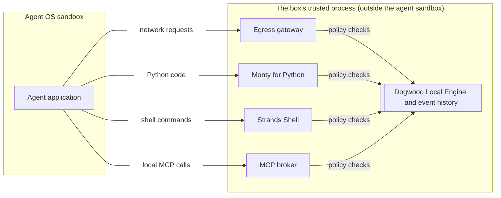

<div align="center">
  <div>
    <a href="https://strandsagents.com">
      <picture>
        <source media="(prefers-color-scheme: dark)" srcset="https://strandsagents.com/latest/assets/wordmark-github-dark.svg">
        
      </picture>
    </a>
  </div>

  <h1>Strands Box</h1>

  <h2>Run coding agents like Claude Code in a sandbox, under a policy you control.</h2>

  <div align="center">
    <a href="https://github.com/strands-agents/box/graphs/commit-activity"></a>
    <a href="https://github.com/strands-agents/box/issues"></a>
    <a href="https://github.com/strands-agents/box/pulls"></a>
    <a href="https://discord.gg/Wa4CQrxsP"></a>
  </div>

</div>

<hr>

## Overview

`box` runs a coding agent, such as Claude Code, Codex, Kiro CLI, or pi, in a box on your machine.
The agent works in your project and reaches only what you allow, so your other files, your keys,
and the services that listen only on localhost stay out of its reach. By default, Box checks the
agent's shell commands, network requests, and MCP tool calls against a policy written in
[Dogwood](https://dogwood-policy.github.io/dogwood/) before they happen. The check runs outside the
model, so nothing the agent reads can change the answer
([How Box works](docs/cli/how-box-works.md)).

Strands Box has two parts, and both live in this repository: `box`, the command you run, and
[Box Core](#box-core), the engine under it, which you can also run directly or embed in a Rust
application. `box` includes the Box Core pieces it needs, so you install one thing.

**Preview:** `box` runs on Apple silicon Macs with macOS 15 or later, and on Linux ARM64 and
x86-64. We welcome feedback through [GitHub issues](https://github.com/strands-agents/box/issues).
Read [CONTRIBUTING.md](CONTRIBUTING.md) before submitting a change.

## Install

The installer downloads a release from GitHub, checks it, and puts `box` on your `PATH`. On a Mac,
the checks include Apple's signing and notarization. You don't need a GitHub account, sudo, or
Rust. The first release of `box` is a pre-release, so name it in `BOX_VERSION`:

```sh
curl -fsSL https://raw.githubusercontent.com/strands-agents/box/main/install.sh | BOX_VERSION=0.3.0-preview.1 sh
```

Open a new terminal, and check that it worked with `box --version`. Usage telemetry is on by
default, and the installer says how to turn it off ([Usage telemetry](CLI_TELEMETRY.md)).
[Install Box](docs/cli/install.md) covers the Linux requirements, upgrades, other versions, and
uninstalling.

## Run your first agent

For Claude Code on Amazon Bedrock, install Claude Code from its native installer, then create a
profile for it:

```sh
box profile create claude --with bedrock
```

`box` asks a few questions. Press Enter to take each default, choose **Save profile** on Review,
and then choose **Exit**. Before the first run, [connect to Bedrock](docs/cli/getting-started.md#3-connect-to-bedrock):
point your terminal at an AWS profile that can call Claude models on Bedrock, and set the model if
Claude Code doesn't already name one. Then start Claude Code in a box from one of your own
projects:

```sh
cd ~/src/my-app
box run claude
```

[Get started](docs/cli/getting-started.md) walks through each step and what you see along the way.

## Learn more

- [Box CLI guide](docs/cli/README.md): every page for people who run `box`, starting with common
  tasks.
- [Profiles](docs/cli/profiles.md): set up Codex or another model provider, and change what the
  agent can reach.
- [Get help from a coding agent](docs/cli/profiles.md#get-help-from-a-coding-agent): tell your agent
  `Run box help agent and follow it to create a profile.`
- [Troubleshooting](docs/cli/troubleshooting.md): what an error means, and how to fix it.
- [Command reference](docs/cli/cli.md): every command and flag.
- [Limitations](docs/cli/limitations.md): what a box doesn't protect you from. Read this before you
  trust a run with work that matters.

## Key capabilities

- **File, program, and network restrictions.** The agent's sandbox limits its
  direct access. Box reports the configured grants at startup.
- **Semantic and temporal policies.** Dogwood rules can depend on the requested
  operation, its arguments, earlier actions, and elapsed time. Operations checked
  by the policy engine are denied unless a rule permits them.
- **Policy across code and tools.** Strands Shell, Monty for Python, the egress
  gateway, and the MCP broker use one policy engine and event history. A file read
  through one interpreter can affect whether a later network request is allowed.
- **Request and tool-call checks.** The egress gateway checks connections and
  HTTP requests, including their method and path. The MCP integration checks
  configured tool calls and their arguments.
- **Credential injection.** The gateway authenticates permitted requests with
  configured API credentials or AWS SigV4 signing. The agent does not receive the
  underlying secrets.
- **Decision records.** Box records policy decisions in OTLP JSON, and `box runs history` lists
  what a run allowed and denied.

## Architecture

Box runs the Dogwood Local Engine and its enforcement components outside the
agent's sandbox, in either the Box command's process or the calling Rust
application's process. Strands Shell, Monty, the egress gateway, and the MCP broker
check operations with the engine before allowing them.
They also record events that later policy decisions can use.



When the agent uses a program such as `git` or `cargo`, or a local MCP server,
Box checks the launch against policy and runs the program in its own sandbox.
You configure which files each program can read or change. The agent can send
requests to Box's interpreters, but external programs and local MCP servers
cannot. Box receives their output and exit status, and their
network traffic goes through Box's gateway by default. See the
[security model](docs/user/security.md) for details.

For each part, where it runs, what it decides, and how one request moves through them, read
[Box architecture](docs/design/architecture.md).

## Box Core

Box Core is the engine under `box`. Use it directly to run a program of your choice under a
policy, to deploy a box to a cloud host, or to embed a box in a Rust application. Box Core is
harness-agnostic: you choose the agent program or binary to run, configure its access in
`box.toml`, and write its policies in `policy.dw`. These two files are Box Core's stable interface.
`box` writes both for each run from your profile and its packs, so you write `box.toml` yourself
only when you use Box Core directly. The [Box Core guide](docs/user/README.md) covers both files.

The host OS enforces the direct access restrictions in `box.toml`. Strands Shell,
Monty for Python, the egress gateway, and the MCP broker send the operations
they handle to the embedded Dogwood Local Engine, which evaluates the rules in
`policy.dw`. Box enforces its allow or deny decisions outside the agent process.

Dogwood uses `permit` and `forbid` rules. Operations checked by the engine are
denied by default: a matching `permit` must allow the operation, and a matching
`forbid` overrides that permission.

Box's interpreters and gateways share an event history, so rules can use earlier
actions and elapsed time to decide what is allowed next. For example, a file read
through Shell or Python can cause the gateway to deny a later outbound HTTP request.

Direct filesystem grants in `box.toml` are enforced by the OS and do not produce
individual Dogwood decisions. To apply a policy to file operations, use the
interpreters and keep those files out of the agent's direct grants. See
[filesystem access](docs/user/security.md) and [policy](docs/user/policy.md).

By default, Box Core writes its decision records to
`<box_dir>/private/telemetry/records.jsonl`.

Box Core supports local execution on Linux ARM64, Linux x86-64, and macOS with Apple
silicon. See the [Linux download instructions](docs/user/getting-started.md#linux) for release
selection and the [Linux requirements](docs/user/linux-requirements.md) for tested configurations.

### Download Box Core

Follow [Run an agent with box.toml](docs/user/getting-started.md) to download Box Core for macOS, Linux ARM64, or Linux x86-64.
The Strands CLI walkthrough uses macOS.
For that walkthrough, you need macOS 15 or later on Apple silicon and Node.js 22.21 or later from Homebrew.
You also need access to Claude Opus 5 on Amazon Bedrock in `us-west-2`.

The download script checks the release checksum and unpacks the binaries into
`./box-core`. It does not change your `PATH` or system directories:

```sh
curl -fsSL https://raw.githubusercontent.com/strands-agents/box/main/download.sh | sh
./box-core/box --version
```

The downloader selects the archive for your operating system and CPU architecture. For Linux, select a release
that includes `box-<tag>-linux-arm64.tar.gz` or `box-<tag>-linux-x86_64.tar.gz` for your CPU, with its `SHA256SUMS.txt` entry.
Set `BOX_VERSION` to that release tag when running the script. Set `BOX_DOWNLOAD_DIR` to change
the destination. A release can omit Linux or x86-64 assets. If the x86-64 archive or its checksum is missing,
the download stops; the script does not substitute an ARM64 archive.

The script verifies the checksum and extracts into temporary storage before changing destination files.
Linux packages must contain executable `box`, `strands-box-sock-alias`, and `strands-box-contain-trampoline` files.
The [Linux requirements](docs/user/linux-requirements.md) list the libraries, operating system permissions, and checks needed to run a workload.
Before replacing files, the downloader runs the candidate's `box --version` in a private directory inside an existing destination.
For a new destination, it uses the parent directory. This staging location must be writable and allow execution.
Temporary download storage can prohibit execution (`noexec`).
A failed version check reports the loader error and leaves existing destination files unchanged.
The final extraction can partially update the destination if it fails. Use a fresh `BOX_DOWNLOAD_DIR`
to retain a previous installation.

Keep the entire download together in `./box-core`, including `Box.app` in signed macOS packages.
The [macOS requirements](docs/user/macos-requirements.md) list the package requirements, workload dependencies, and startup checks.
You can also [build from source](#build-from-source). Then follow the guide to
write `box.toml` and `policy.dw`, and run the box.

### Change what the box allows

Edit `box.toml` to change the agent's environment and direct access grants. Edit
`policy.dw` to change the rules for operations Box checks through its interpreters
and gateways. You can give your coding agent the policy-authoring skill for help
with Dogwood syntax and Box's supported actions:

```
https://raw.githubusercontent.com/strands-agents/box/main/.agents/skills/authoring-box-policy/SKILL.md
```

### Use Box Core as a Rust library

Link the `strands-box` package in `crates/box`, then call:

```rust,no_run
let exit_code = strands_box::run("/absolute/box.toml".into(), Vec::new(), Default::default());
```

This runs the existing Box command in the calling process and waits until it finishes.
By default, it uses the process's terminal and returns its exit
code. The second argument appends arguments to `[agent] command`.
Use `RunOptions::terminal` to supply the workload's terminal and `RunOptions::on_ready`
to start host threads after hardening and signal registration, before workload setup.
Use `RunOptions::policy_decisions` to receive each policy decision in memory as the box makes it
(see [the library section](crates/box/README.md#policy-decisions-for-a-library-caller)).
Use `RunOptions::box_id` to give a new box your own ID, such as
`my-app-3f9a1c0e7b2d4a6f`: a prefix of 1 to 15 letters, digits, `.`, `_`, or `-`, then `-` and 16
lowercase hexadecimal digits. Box stores it, prints it, and labels telemetry with it. A box that
already has an ID refuses a different one. Without `box_id`, Box generates `box-` and 16
hexadecimal digits.
Call it before starting application threads or loading secrets, and use one Box workload
per host process. Later `run` calls fail, even if the first call failed, unless `run` refused a
malformed `box_id`.
Ship the matching Box helper binaries beside the host application.

To replace the running box's policy from a host thread:

```rust,no_run
strands_box::reload(&[strands_box::Policy {
    origin: "policy.dw".into(),
    text: new_policy_text,
}])?;
```

`reload` waits until the change takes effect. Invalid policy returns `ReloadRefused` and leaves
the current policy in place. An empty list denies all policy requests. Policy files and the
OS sandbox stay unchanged. A box must be open; `on_ready` runs too early.
Use `ReloadRefused::is_not_running()` to distinguish that case from a rejected policy.
A rule for an MCP tool can reload only after Box loads that server's tool definitions.
Without them, even reloading the unchanged policy is refused. If policy blocks discovery,
waiting will not help. The current policy stays in place.

To generate policy schemas:

```rust,no_run
let exit_code = strands_box::generate_policy_schema(
    "/absolute/box.toml".into(),
    "/absolute/schemas".into(),
);
```

### Examples

These examples run Box Core directly.

Run the [Strands Python SDK example](examples/strands-box/strands-sdk-agent/) for a small
agent whose three tools use Shell.

See the [example index](examples/README.md) for dependencies and run instructions.

## Build from source

This is a Cargo workspace. `rust-toolchain.toml` pins the compiler, and rustup installs it on the
first build. Build `box` and the Box Core binaries it runs from a clone with
[rustup](https://rustup.rs/) and [`just`](https://github.com/casey/just):

```sh
git clone https://github.com/strands-agents/box.git
cd box
just build-cli
```

The programs are in `target/debug`, and [Install Box](docs/cli/install.md#build-from-source)
shows how to put them on your `PATH`. The CLI's source is in [`crates/cli/`](crates/cli/), with the
packs, policies, and starters it ships in [`resources/`](resources/).

To build only Box Core's release binaries:

```sh
cargo build --release -p strands-box -p strands-box-containment
```

Run the compiled binary as `./target/release/strands-box`. Keep its helper
binaries in the same directory.

The [release guide](docs/dev/releases.md) covers version selection and publication for macOS, Linux ARM64, and Linux x86-64.

Linux workspace tests run on Ubuntu ARM64 and x86-64 with user, mount, and process namespaces enabled.
Unexpected prerequisite skips fail the job. The accepted alias-read limitation and missing
credential-daemon fixture remain explicit in the report. Workspace and deterministic integration
failures on either Linux architecture or macOS fail `CI Gate`.

The [macOS release guide](docs/dev/macos-release.md) covers the native-feature build,
automated signing, notarization, package verification, and release gates.

The [fuzzing guide](docs/dev/fuzzing.md) covers the long libFuzzer run of the tool grammar shell
parser.

Before testing, [prepare the dependency cache](CONTRIBUTING.md#before-you-open-a-pull-request)
for the offline dependency guards.

Common tasks run through [`just`](https://github.com/casey/just):

```sh
just build         # strands-box, the alias image, and the containment trampoline
just build-cli     # the box CLI and the Box Core binaries it runs
just test          # build-cli, then the workspace tests
just check         # pre-push gate: fmt-check + clippy + prose + test
just test-all      # workspace tests and box example checks
```

`cargo test --workspace --all-features` runs the workspace suite. Include
`--all-features` to run the `box_shell` and `box_credentials` suites, which require
the `test-support` feature. Linux CI also checks the three native filesystem forwarding tests
in a separate step. See the [Linux native test guide](docs/dev/linux-native-tests.md#forwarding-buffer-tests)
for that command and the other native test prerequisites.

Continuous integration tests both history persistence modes on Linux x86-64, Linux ARM64,
and macOS. Default builds test batched crash recovery and verify that the idle timer saves
history before shutdown. The separate `--no-default-features` build also checks that recovery
retains every returned permit after the process is killed. Both modes refuse new requests
after the kill. These jobs run independently of the all-feature build.

Run the default checks locally with:

```sh
cargo build --locked -p strands-box -p strands-box-containment --bins
cargo test --locked -p strands-box --test box_killed_run -- --show-output
cargo test --locked -p strands-box --lib run::hosted::tests::hosted_idle_timer_flushes_pending_history_without_shutdown -- --exact --show-output
```

Run the per-event crash-recovery check with batching disabled in both commands:

```sh
cargo build --locked -p strands-box -p strands-box-containment --bins --no-default-features
cargo test --locked -p strands-box --no-default-features --test box_killed_run -- --show-output
```

On Linux, follow the namespace and launcher-image setup in the
history persistence steps of the [`unit-test` workflow job](.github/workflows/rust-test-lint.yml) before running the tests.

In pull-request CI, changes to `docs/site-manifest.json`,
`docs/site-manifest-retirements.json`, or a publishable page under `docs/user/` or `docs/cli/` run the focused
site-manifest contract test instead of the full Rust test matrix. The test compares the base
contract to keep the product ID stable and require an append-only retirement before a page or route
is removed.

### Test the release downloader

Run `python3 -m unittest discover -s scripts -p 'test_*.py' -v` to test release packaging and the downloader.
Continuous integration runs the downloader tests on Linux and macOS. These tests use local fixture archives
and simulated HTTP clients; they do not qualify a published binary or its containment behavior.
The [release guide](docs/dev/releases.md#rehearse) describes the architecture, system-library, and packaged-workload checks for Linux ARM64 and x86-64.
Both Linux build jobs must pass the packaged-workload checks before publication.
On Linux, the mount test requires util-linux and permission to create a user and mount namespace.
It creates a `noexec` temporary mount only inside the test process's private namespace.

## Documentation

| Guide | Contents |
|---|---|
| [`docs/cli/`](docs/cli) | The Box CLI guide: install `box`, run an agent in a box, and change what it can reach. |
| [`docs/user/`](docs/user) | The Box Core guide: run Box Core with `box.toml` and `policy.dw`, and deploy it. |
| [`docs/design/`](docs/design) | Architecture, enforcement boundaries, and design decisions. |
| [`docs/design/cli/`](docs/design/cli) | How `box` works inside, and its decisions. |

See [AGENTS.md](AGENTS.md) for the repository rules.

## Reporting a problem

Open an [issue](https://github.com/strands-agents/box/issues) with the command you ran, what you
expected, what happened, and the output of `box --version`. For a suspected security problem, read
[SECURITY.md](SECURITY.md) first.

## License

Apache License 2.0.
