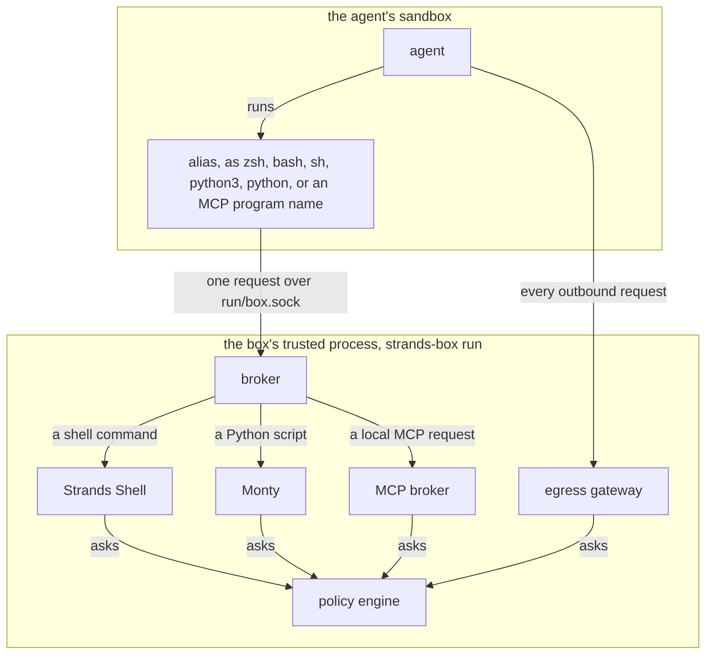
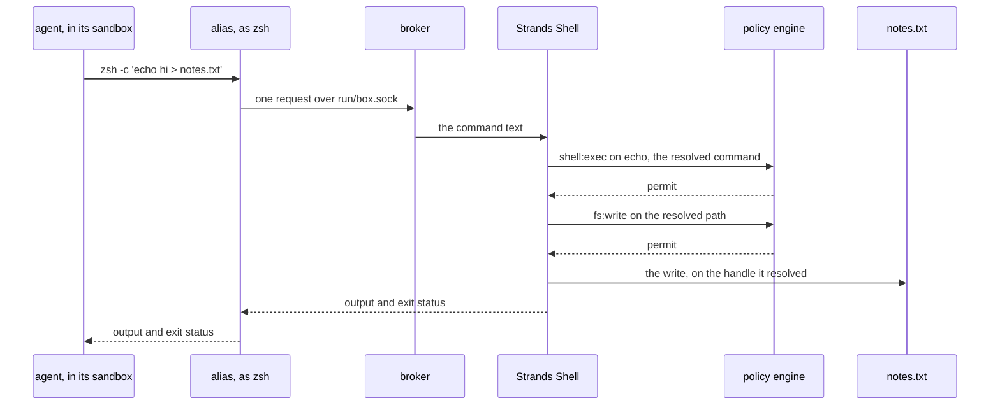

# Box architecture

A box consists of the agent's sandbox, a sandbox for each tool or local MCP server, and the
box's trusted process, which runs outside every sandbox. Operating system enforcement limits what
sandboxed processes can access through their own system calls. Policy decides each request the
agent sends to the trusted process. [How Box contains a process](containment.md) explains the
sandbox restrictions, and [policy](policy.md) explains how Box decides requests.

This page explains where each part runs and what it does. It follows a shell command from the agent
to a file, then describes startup and shutdown. For the risks Box and the operator each own, read
[security model and shared responsibility](security.md).

## The parts

### The box's trusted process

The box's trusted process is `strands-box run` or an application that calls the Box library.
The operator starts it, and it starts the other parts outside or inside their sandboxes.
It holds the policy engine and four enforcement points that ask the engine for decisions:
Strands Shell, Monty, the egress gateway, and the MCP broker. The broker routes the agent's requests
to an enforcement point. The collector records the decisions.

Two helper programs connect the trusted process to the sandboxes. The trampoline applies a sandbox
to itself, then becomes the program that will run there. The alias runs inside the agent's sandbox
and sends requests to the broker.

[Each box has one trusted process](decisions.md#one-trusted-process-per-box), which holds that
box's policy engine, interpreters, gateway, certificate authority, and secrets. A shared process
would expose every box's plaintext secrets and signing keys to one memory-safety failure.
The trusted process holds an exclusive lock inside the box directory for the whole run.
A second `run` using that directory fails before it can open another engine, so
[one `run` owns one box directory](decisions.md#one-run-owns-one-box-directory).
The caller stops a box by ending the process and deletes it by removing the directory.

### The policy engine

The policy engine authorizes requests the workload makes through the trusted process.
[Policy is the only decision authority](decisions.md#the-authored-policy-is-the-only-decision-authority).
Other checks can refuse an operation, but they cannot grant one that policy denies.
A box can start with a policy that grants nothing. It then refuses operations that need a policy
permit.

[Every enforcement point shares one policy engine](decisions.md#one-policy-engine-per-box).
Its shared history lets a rule connect a file read through Strands Shell with a later request through
the gateway. [History persists across runs of the same
box](decisions.md#history-is-durable-per-box-and-has-no-rewind). [Policy](policy.md) explains how
the engine decides a request and what a history rule can see.

### The broker

The broker accepts connections from the alias on `run/box.sock` in the box directory. It checks
the protocol version and routes each request by type. Strands Shell handles shell commands, Monty
handles Python scripts, and the MCP broker handles requests to local MCP servers. The broker does
not authorize requests itself.

The alias is part of the untrusted workload. The broker therefore treats its input as hostile, as
described in [why interpreters run outside the workload](decisions.md#interpreters-are-brokered-aliases).

### Strands Shell

[Strands Shell](shell.md) runs shell commands the agent sends through an alias.
For a command it implements, it asks policy to decide `shell:exec` on the resolved command and an
`fs:*` action for each file operation. For an external program, it asks policy to decide
`shell:spawn`. A permitted program runs in [its own sandbox](#the-sandboxes), separate from the agent's.

### Monty

[Monty](monty.md) runs Python and performs no input or output of its own. It pauses at each file
operation so Box can ask policy for a decision. Box performs the permitted operation.
A script accesses the network through `fetch()`.

[Neither interpreter keeps state between calls](decisions.md#no-state-crosses-a-call-boundary).
A variable exported in one shell command is unset in the next.
Both interpreters run in the trusted process, which also holds the policy engine, certificate
authority key, and resolved secrets. This placement lets Box check their operations against policy,
but a memory-safety defect in either interpreter can give an attacker code execution in the trusted
process. The [decision to run the interpreters there](decisions.md#the-interpreters-run-in-the-trusted-process)
accepts that risk.

### The egress gateway

The gateway handles outbound traffic. Box configures sandboxed processes to use it through
standard proxy environment variables, including `HTTPS_PROXY`. The sandbox blocks direct network
access, so a client that ignores the proxy settings cannot connect to an external destination.
An operator can [declare a network exception](decisions.md#native-egress-is-an-operator-declared-leaf-escape)
for a tool or stdio MCP server. That program can then bypass the gateway and its policy checks.

[The gateway terminates every connection](decisions.md#no-connection-is-opaque-to-the-boundary)
so it can inspect the requests inside it. It asks policy to decide `net:connect` for each destination
and `http:request` for each request. It has no allowlist of its own.

The gateway also adds credentials to requests. For a bound secret, the
[workload gets a placeholder token](decisions.md#the-workload-holds-a-phantom-and-the-gateway-holds-the-secret).
The gateway replaces it with the real secret on a permitted request to the bound destination.
[A credential binding does not authorize access](decisions.md#a-credential-binding-is-configuration-not-a-policy-action).
Policy must still permit the connection and the request. [Credentials](credentials.md) explains
how Box handles secrets, and [outbound traffic](egress.md) explains the network route and its checks.

### The MCP broker

The MCP broker handles requests to local MCP servers within the broker. Each stdio server runs in
its own sandbox. It starts when the agent invokes the server's alias with matching arguments and
policy permits `shell:spawn`. The command comes from
[the server's configuration table](decisions.md#an-mcp-server-is-one-configuration-table).

The MCP broker asks policy to decide `mcp:call` for requests to the server. A permit covers every
tool on that server. A rule on a tool's own action can narrow that permit, as described in
[the two checks on an MCP tool call](decisions.md#mcp-authorization-is-two-gates).
Requests to a remote MCP server go through the gateway, which asks policy to decide the same
`mcp:call` action. [How Box runs MCP servers](mcp.md) explains both routes.

### The collector

By default, the collector writes each decision to [a file the workload cannot
access](decisions.md#every-box-records-by-default). The enforcement point submits the record after
all checks finish. The record therefore includes any refusal by the reachable paths check, even
when policy permitted the operation. This is why
[the record describes the effective decision](decisions.md#the-effective-decision-is-the-canonical-record).

The collector also accepts telemetry spans from the agent. Its receiver runs in the trusted process
and accepts input from the workload. [Telemetry](telemetry.md) explains how Box separates that input
from its own records and protects those records from forgery and suppression.

### The trampoline

On macOS, a process that applies a sandbox to itself cannot remove it. The trusted process therefore
starts `strands-box-contain-trampoline` to apply the sandbox in a separate process. The trampoline
then becomes the target program, which inherits the restrictions.
[Box uses this trampoline for every contained process](decisions.md#one-trampoline-spawns-every-contained-process).
The trampoline applies the configuration it receives and makes no authorization decisions.
[The box binaries](binaries.md) explains how Box verifies the trampoline before starting it.

### The sandboxes

A box has two kinds of sandbox. The trampoline applies both.

The agent's sandbox starts with the run, without a policy decision. The agent can execute only its
configured `command`, programs its `exec` list names, and the aliases that connect it to
`run/box.sock`. Only the agent's sandbox has those aliases and access to the broker socket.

A tool's sandbox or a local MCP server's sandbox starts after policy permits `shell:spawn`.
It uses filesystem grants from its own `[tool.<name>]` or `[mcp.<name>]` table.
It has no alias or access to `run/box.sock`, so the program cannot ask the broker to act for it.
Its file operations do not produce `fs:*` decisions. The operating system enforces its filesystem
grants, and one `shell:spawn` decision admits the whole process tree.
Network traffic still goes through the gateway unless the operator declares a network exception.
The decision to [run a host binary in its own sandbox](decisions.md#a-host-binary-runs-in-a-leaf-box-and-the-policy-is-the-only-allowlist)
explains this separation.
[How Box contains a process](containment.md#the-agents-box-and-leaf-boxes) covers how the two
differ.

### The alias

A harness, the product that drives the agent, expects to find a shell and Python on its `PATH`.
The alias receives those invocations and sends them to Box's interpreters outside the sandbox.
It cannot open the policy or serve requests. Box installs it in the box directory's `bin/` as
`zsh`, `bash`, `sh`, `python3`, and `python`, plus the program names used by local MCP servers.
Servers that use the same program share an alias.

The alias connects only to its own box's socket, as described in [the box binaries](binaries.md).
The caller cannot select another socket. Tools and local MCP servers have no aliases, so
`python3` in their sandboxes runs the host OS's Python.

## How the parts fit together

| Part | Runs in | Lifetime | What it decides |
|---|---|---|---|
| The box's trusted process | Outside every sandbox | The whole run | Runs the policy engine and enforcement points |
| Policy engine | The trusted process | The whole run; history persists across runs | Authorizes mediated requests |
| Broker | The trusted process, its own thread | The whole run | Nothing. It routes each request. |
| Strands Shell | The trusted process | One command | Asks policy for `shell:exec` or `shell:spawn`, and `fs:*` for interpreted file operations |
| Monty | The trusted process | One script | Asks policy for `fs:*` for file operations |
| Egress gateway | The trusted process | The whole run | Asks policy for `net:connect`, `http:request`, and `mcp:call` for remote servers |
| MCP broker | The trusted process, within the broker | The whole run | Asks policy for `shell:spawn` to start a local server, then `mcp:call` for requests |
| Collector | The trusted process | Opens before the policy engine; drains after shutdown | Records decisions |
| Trampoline | Outside the sandbox | Until it becomes the contained program | Nothing |
| Alias | Inside the agent's sandbox | One command, or one MCP connection | Nothing |

Requests through the broker and gateway use the same policy engine:

After policy permits an operation and the remaining checks pass, the enforcement point performs it.
Strands Shell and Monty perform file operations, the MCP broker relays requests to local servers,
and the gateway forwards network requests.

## One command, from the agent to the file

Suppose policy permits `shell:exec` and `fs:write` in the workspace, and the agent runs
`zsh -c 'echo hi > notes.txt'`.

The command needs more than one decision. Policy first decides `shell:exec` on `echo`, the command
Strands Shell resolved. The `zsh` invocation selected the alias. The redirect needs a separate
`fs:write` permit. If policy permits the command but denies the write, the command fails before
`echo` runs.

Strands Shell resolves `notes.txt` against the working directory and follows symlinks before asking
policy to decide the write. It then acts on the resolved object. A symlink swap between the decision
and the write cannot redirect the operation because
[the resolved token binds the object](decisions.md#a-resolved-token-binds-the-object-it-names).

The reachable paths check runs after policy and can still refuse the operation. It rejects paths
outside the operator's home, the agent's home, and the workspace. It also rejects paths inside the
box directory and the configuration and policy files loaded for this run. A policy permit cannot
override these restrictions.

That check does not protect credentials elsewhere in the operator's home. An `fs:read` permit with
no path condition can expose files under `~/.ssh`, because
[no credential check sits beneath the interpreters](decisions.md#no-credential-floor-sits-beneath-the-interpreters).
File access rules therefore need path conditions. [How Box runs shell commands](shell.md) explains
the reachable paths check.

For this command, the trusted process opens and writes the file. The alias sends the request over
the socket and receives the result. This is how Box checks the file operation, and why the
interpreters are part of the code the operator must trust.

## How a run comes up, and how it ends

`strands-box run` starts the parts in a fixed order. A failure at any step stops startup.

1. It [hardens the trusted process](decisions.md#the-trusted-processs-memory-is-a-defended-asset)
   against memory access by other processes running as the same user. This adds protection but
   does not guarantee it. Root can bypass it.
2. It reads `box.toml`, prepares the box directory, and takes the run lock. It records the
   canonical path and filesystem identity of each source file it opens.
   [Later steps use the validated identities](decisions.md#a-run-validates-once-then-acts-on-the-identity-it-approved),
   so replacing a source file cannot substitute a new configuration.
3. It opens the collector to record the steps that follow. A telemetry secret read from AWS
   Secrets Manager prints one line on stderr, which says the read was signed with the host's
   ambient AWS identity.
4. It installs the policy. Parsing or validation errors stop startup. Box also
   [rejects rules it can prove will never match](decisions.md#a-rule-that-cannot-fire-is-refused-at-load-and-an-uncertain-one-warns).
   It warns when it finds a rule that may never match but cannot prove it.
   Box then binds each experimental tool grammar to the program file of each `[tool]` it covers,
   using the file identity opened by the run. It declares each stdio `[mcp.<name>]` program.
   For each `[tool]` or stdio `[mcp.<name>]` entry covered by a grammar, Box prints a line on stderr.
   Rules for `shell:spawn` do not apply to a spawn of those programs by the bound name.
   Box also prints, for each bare name a `[tool]` answers to, the file the Shell runs for it.
5. It resolves bound secrets and starts the gateway with its own certificate authority.
   It checks each process specification's filesystem grants, then binds the broker socket.
   A grant it cannot check stops startup.
6. It builds and discloses the sandbox grants for each tool, then for the agent.
   Box [prints every direct filesystem grant to stderr](decisions.md#direct-filesystem-reach-is-declared-and-disclosed)
   because those accesses do not produce `fs:*` decisions. If Box cannot build a tool's sandbox
   grants, startup fails before the agent starts. On macOS, `file-attributes` adds a line for each
   sandbox that states which attributes its write grants can set.

   On Linux, `interpreter aliases for configured access` lists preserved interpreter spellings
   before the runtime-minimum section. Each line maps a spelling to a file the process's existing
   grants authorize. These mappings add no executable or library access. The
   [configuration reference](../user/config.md#agentfilesystem-and-toolnamefilesystem) shows the output.
7. It starts the trampoline, which becomes the agent, and waits for the workload to end.

During shutdown, Box stops and reaps the workload before closing the broker and gateway.
It then removes the record that identifies the running box and releases the run lock.
Holding the lock until this point prevents a second run from taking over while the first still
serves requests. The collector drains and exports its queued records after the lock is released.

## Why this shape

### The boundary is the operating system's own sandboxing

Box uses [the surrounding OS's sandboxing](decisions.md#the-boundary-is-the-surrounding-os-not-a-virtual-machine)
so the workload can use the operator's existing environment and paths. It does not boot a guest
operating system. A microVM would provide stronger isolation, but it would require a separate
environment. With Box's approach, a kernel escape defeats operating system enforcement.

### Box decides outside the harness

A harness may have its own allowlist and approval prompt. Those checks run inside the untrusted
agent process and judge tool calls. Box checks the resulting operations in the trusted process,
where the agent cannot change the checks. This is why
[Box decides outside the harness](decisions.md#box-decides-outside-the-harness)
and does not read or rely on the harness's approval rules.

## See also

- [Security model and shared responsibility](security.md): which risks belong to Box, the operator,
  and the surrounding environment.
- [How Box contains a process](containment.md): what a sandbox guarantees and where its reach comes
  from.
- [The box binaries](binaries.md): what each of the three binaries is and where it runs.
- [Policy](policy.md): how one engine decides each request, and what its history guarantees.
- [How Box runs MCP servers](mcp.md): the two decisions a server needs, and how Box learns its tools.
- [How Box keeps credentials out of the box](credentials.md): where each secret sits, and how the
  gateway puts it on a request.
- [Telemetry](telemetry.md): what a box records, and what the workload cannot do to it.
- [Limits of Box's protection](limitations.md): what an allowed action can still do.
- [Decisions](decisions.md): the reason for each part of this design, by anchor.
