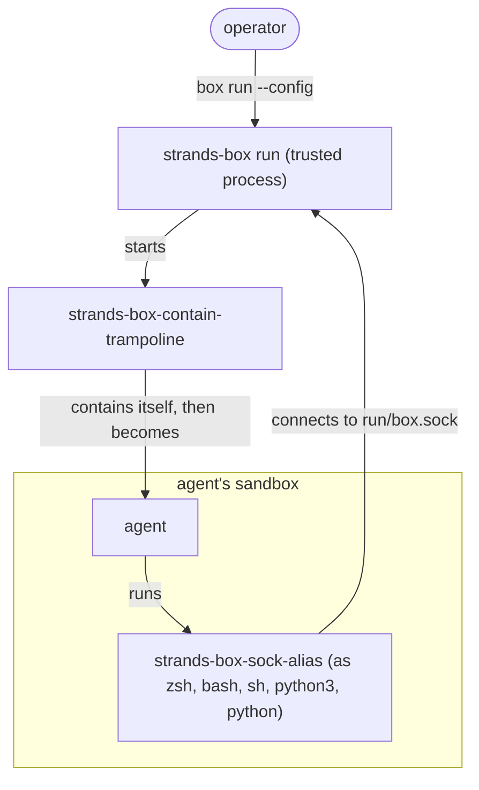

# The box binaries

A box uses three binaries. `strands-box` runs outside the sandboxes and makes the security
decisions. The trampoline starts each contained process. The alias runs inside the agent's sandbox
and sends requests to the trusted process.

## The three binaries

- `strands-box` is the entry point and the [trusted process](terminology.md). The operator starts
  it, and it starts everything else. It never runs inside a sandbox.
- `strands-box-contain-trampoline` starts each workload inside its sandbox.
- `strands-box-sock-alias` lets the workload reach the interpreters from inside its sandbox.

The release archive ships `strands-box` under the name `box`, so the operator types `box run`. This
page uses the binary's real name.

### Box: `strands-box`

When the operator runs `box run`, `strands-box` reads the configuration and policy, prepares the box
directory, and starts the egress gateway and broker. It then uses `strands-box-contain-trampoline`
to start the agent in its sandbox and waits for the agent to exit.

`strands-box` holds the policy, the egress gateway, and the interpreters that run shell and Python
commands for the workload. These components run outside the sandbox. The workload can send them
requests over a socket but cannot access them directly. Each box has its own `strands-box run`
process. See [one trusted process per box](decisions.md#one-trusted-process-per-box) and [the
interpreters run in the box's trusted
process](decisions.md#the-interpreters-run-in-the-trusted-process).

The trampoline and alias binaries must sit next to `strands-box`. If a required helper is missing,
`strands-box` stops. On macOS, Box asks the operating system for the running executable's location.
If the operator started it through a symlink, changing that link to another release does not change
where the running process finds its helpers.

### Trampoline: `strands-box-contain-trampoline`

On macOS, `sandbox_init` permanently restricts the process that calls it. The trampoline makes that
call so `strands-box` can remain outside the sandbox. `strands-box` starts one trampoline for the
agent and one for each program it starts in a [separate sandbox](terminology.md). This includes
every host binary admitted by `shell:spawn` and every stdio MCP server. See [the sandbox ends with
the contained process](decisions.md#containment-ends-with-the-contained-process) and [one trampoline
spawns every contained process](decisions.md#one-trampoline-spawns-every-contained-process).

`strands-box` passes the sandbox grants to the trampoline in an open file, together with a SHA-256
digest of its contents. The trampoline reads that file through the open handle and checks the digest
before parsing it. Replacing the file's path cannot substitute another file. See [the configuration
crosses the exec boundary bound by a
digest](decisions.md#the-configuration-crosses-exec-as-digest-bound-json). The trampoline applies
the sandbox and becomes the target program. It keeps only the environment that `strands-box` built.
The target starts contained and cannot remove the restrictions.

A setup-status channel distinguishes setup failures from workload exit codes. The trampoline reports
completed preparation only after the sandbox, target environment, and working directory are ready.
It keeps the failure channel open through the executable launch attempt. Box waits for the channel
to close and reports any failure stage, including a launch failure after the preparation marker. On
Linux, the namespace reaper sends a separate marker after its own setup. Box requires both markers.
The launcher and reaper close their copies before waiting for the workload to exit, so a
long-running workload cannot keep the setup reader waiting through them.

If the channel closes before all required preparation markers arrive, setup is incomplete. Buffered
and streaming execution both report an error. If a signal kills the agent launcher, Box preserves
its signal exit status, unless a reported setup failure or malformed marker takes priority. Closure
after the required marker means preparation completed without a reported launch failure. It does not
prove application readiness or a successful executable launch. Abrupt death between the marker and
launch also closes the channel. Buffered and streaming execution use the same status reader. It
rejects the obsolete completion marker immediately, so an old helper cannot leave streaming
execution waiting for setup.

The trampoline makes no authorization decisions. `strands-box` writes the configuration that selects
the sandbox grants for the agent, a tool, or a local MCP server.

At startup, Box opens its executable, trampoline, and socket-alias image. It records their file
identities and hard-link names. In the macOS package layout, it also records an executable regular
file named `box` beside `Box.app` as the package launcher. A standalone application bundle does not
require that wrapper. Other nearby entries named `box` do not become package launchers.

A hard link gives the same file another filesystem name. Box inventories these names in each
program's installation directory and its immediate `deps` directory, which supports Cargo builds.
Startup fails if the inventory cannot account for every hard link.

On Linux, Box also maps these files through the current mount table and verifies each accessible
file identity. This covers file and directory bind mounts that expose existing files at other paths.
Box refreshes these aliases for each grant check and hosted mutation. When permissions prevent
inspection, Box protects the possible alias and its enclosing paths without refusing unrelated
operations. This also protects aliases that a workload could make accessible by changing directory
permissions. Other inspection errors and unstable inventories still cause a refusal. On macOS, Box
also checks verified spellings through the Data volume. Mounted aliases do not increase the hard-link
count.

These programs start containment or route workload operations to Box's checks, so Box protects them
from workload writes. See [installed Box programs resist workload
writes](decisions.md#installed-box-programs-resist-workload-writes). Every process's writable grants
must exclude the files, their recorded names, and enclosing directories. Strands Shell and Monty
also refuse changes to them, even when policy permits the operation. [Installation
integrity](../user/config.md#installation-integrity) describes the refusals.

Before each contained launch, Box checks the recorded file identities and link counts. It uses the
trampoline file opened at startup. Linux executes that file through a descriptor, an operating
system handle for an open file. On macOS, Box copies its bytes into `private/trampoline/`, names the
copy by its SHA-256 digest, and runs the copy. When Box creates aliases, it also hashes and copies
through one retained readable descriptor without reopening the source path.

Box checks the trampoline's native executable format and embedded public marker. The marker
identifies the artifact kind but does not authenticate the release. These checks assume the operator
trusts the installed binaries at startup. Box constrains workload writes. It does not protect the
installation from writers outside Box or detect a prior compromise. The operator updates the
installation between runs.

### Alias: `strands-box-sock-alias`

Agent harnesses expect `zsh` and `python3` on their `PATH`. Box's interpreters run in the trusted
process, so `strands-box-sock-alias` forwards those invocations to it. The alias is the only Box
program inside the agent's sandbox. It cannot open the policy or serve requests.

`strands-box` installs the alias in the box directory's `bin/` under the names `zsh`, `bash`, `sh`,
`python3`, and `python`. The library defines these names in `INTERPRETER_ALIASES`. It also installs
one alias for each program name used to start a declared MCP server. Servers that use the same
program share an alias, and no MCP server can take one of the five interpreter names.

`bin/` comes first on the agent's `PATH`, so a harness that runs `zsh` gets the alias. Tools and
local MCP servers get neither the alias nor `bin/` on their `PATH`. The alias uses its invocation
name to select an interpreter. For an MCP program name, it also sends the arguments. `strands-box`
starts the server whose declared command matches that name and those arguments, or refuses the
launch.

The alias derives `run/box.sock` from its own location. The caller cannot select another socket. The
broker in `strands-box` accepts the connection. See [an interpreter runs beside the
workload](decisions.md#interpreters-are-brokered-aliases). The alias is part of the untrusted
workload, so the broker treats every alias as hostile. See [the broker
protocol](decisions.md#the-broker-protocol-is-framed-versioned-and-refuses-with-a-reason-code).

Each box has its own alias image at `bin/.alias-image`. Box clones the installed file when the
filesystem supports clones and otherwise copies it byte for byte. Every alias name is a hard link to
this copy. Box records the installed file's SHA-256 in `private/alias-image.stamp` and replaces the
copy and its links when the digest changes. It replaces nothing while the workload runs. The alias
and broker use the same protocol code. The broker refuses a request with a different protocol
version.

## How the three fit together

| Binary | Where it runs | Started by | Lifetime |
|---|---|---|---|
| `strands-box` | Outside every sandbox, as the box's trusted process | The operator, as `box run` | The whole run |
| `strands-box-contain-trampoline` | Outside the sandbox until it applies the restrictions and becomes its target | `strands-box`, once for each contained process | Until it becomes its target |
| `strands-box-sock-alias` | Inside the agent's sandbox | The workload, as `zsh`, `bash`, `sh`, `python3`, `python`, or an MCP program name | One shell or Python command, or one MCP connection |

## See also

- [Getting started](../user/getting-started.md) explains how to download the binaries and run an
  agent in a box.
- [Decisions](decisions.md) records the reasons for this design under stable anchors.
- [Terminology](terminology.md) defines trusted process, sandbox, alias, and the other terms used
  here.
