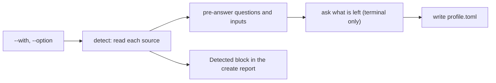

# Detection

When a starter creates a profile, it reads how the agent is already set up on this host, and
answers its questions and inputs from that. `box run claude` on a host where Claude Code uses
Bedrock in `us-east-2` then writes a profile with `@box/bedrock` and `bedrock.region = "us-east-2"`.
It still asks the [policy question](starters.md#the-policy-question), and each input that has a
`warning` and no value, such as `claude.import-mcp` and `claude.import-hooks`
([Answer](starters.md#answer)). [Starters](starters.md) holds the rest of the create step.

## Flow



Detection runs once, in `NewProfile::answer`, before the first prompt. A run never detects: the
profile states each detected choice, and a run reads it only from the profile
([decisions](decisions.md#box-run-takes-no-option-values)). A source is in the starter's
`starter.toml`, which no run reads.

## The starter keys

Each key is in the starter's `starter.toml`.

```toml
[[source]]
id = "use-bedrock"
label = "Provider"
places = [
  { file = "~/.claude/settings.json", kind = "json", key = ["env", "CLAUDE_CODE_USE_BEDROCK"] },
  { env = "CLAUDE_CODE_USE_BEDROCK" },
]

[[source]]
id = "aws-region"
label = "Region"
input = "bedrock.region"
places = [
  { file = "~/.claude/settings.json", kind = "json", key = ["env", "AWS_REGION"] },
  { env = "AWS_REGION" },
]

[[question.choice]]
id = "bedrock"
label = "Amazon Bedrock"
packs = ["@box/bedrock"]
options = { "claude.host" = "bedrock" }
detect = { source = "use-bedrock", equals = ["1", "true", "True", "TRUE", "yes", "on"] }
```

The example reads two host values, and each one ends up in the profile a different way:

- `use-bedrock` answers the provider question. Its `detect` picks the `bedrock` choice, which
  adds `@box/bedrock`.
- `aws-region` fills `bedrock.region`, an input of `@box/bedrock`, with the value it reads.

### `[[source]]`

A source is one host value that the agent reads, with each place the agent reads it from.
[The `starter.toml` keys](../../cli/starters-reference.md#the-startertoml-keys) lists the keys of a
source, a place, and `detect`, and the values each one takes. A source with `input` fills that
input ([Inputs](#a-source-that-fills-an-input)). A source without `input` exists for the `detect`
of a choice.

A place reads either a key path in a file or a variable in the environment of `box`. `file`,
`kind`, and `key` are one shape: a value at a key path in a file of a kind. An `[[mcp-servers]]`
row and a `[[storage.files]]` `keep` path use the same shape, and the reader parses with
`mcp::Format`.

- The reader reads `places` in order and stops at the first place that gives a value, so the
  starter lists them in the agent's own order. [The `starter.toml`
  keys](../../cli/starters-reference.md#the-startertoml-keys) says which places give no value. A
  value that is not a string, a number, or a bool gives no value and is reported.
- The new root of a `directory-env` place must be absolute, without `..`, and outside refused
  locations before the file name is joined to it.
- A place `when` skips the place on the other OS
  ([decisions](decisions.md#a-bool-input-switches-with-when)).

### `detect` on a choice

A `detect` holds when its source gives one of the listed strings. A number or a bool compares as
its text (`1`, `true`). `equals` can be a list because one fact can have more than one spelling,
such as `1` and `true`. It is still one condition on one value, not an expression
([decisions](decisions.md#a-bool-input-switches-with-when)).

### A source that fills an input

`input` names a declared input. For a `string` input, the input must have `pattern` or `values`,
and `check_value` checks the detected value. For a `bool` input, the source also has `equals`, a
string or a list. The input is `true` when the source gives one of the listed strings, and `false`
when it gives any other value. The detected value itself is never written or printed, only `true`
or `false`. A source with no value leaves the input to its default.

The input can come from a pack in `[starter] packs` or from a pack that only a choice adds (`bedrock.region` comes with `@box/bedrock`). So the step
applies the value after the questions are answered and the packs are merged. When no merged pack
declares the input, because the choice that adds its pack was not chosen, the source is not used
and the report has no line for it. A source with `input` can also name a `pack`. Its value applies
only when the selected profile imports that pack or its local replacement. Such a source cannot
choose a pack through `detect`. A Claude profile with `anthropic` then gets no `bedrock.region`,
and the report does not print a region.

## Pre-answer

`starter::answer` runs these steps:

1. Collect the `env://` names and write grants from the profile and every candidate pack,
   including the packs they extend, so a refusal covers a pack that a choice or a flag adds later.
   Do not merge mutually exclusive choices.
2. Read each source once, with the refusals in [What detection never reads](#what-detection-never-reads).
3. After `--with`, for each question that has no answer and whose `when` holds: when exactly one
   choice has a `detect` that holds, that choice is the answer. When none or two hold, detection
   leaves the question unanswered.
4. After the questions, merge the chosen packs as today. For each source with an `input` that the
   merge declares, and that `[starter] options`, a chosen choice, and `--option` do not set: a
   detected value that passes `check_value` is the input's value. Then the Inputs step asks for
   what is left.

Order of precedence: `--with` and `--option`, then a detected answer, then the prompt. A detected
answer is the same at a terminal and without one, so one host gives one profile from both
([decisions](decisions.md#box-asks-only-at-a-terminal)). A detected input value is written to
`[options]` also when it equals the default, because it states a host fact, not a pack default.

## What detection never reads

- **A value that nothing accepts.** A source value is used, written, or printed only when it is
  one of a choice's `equals` strings, or when it passes the `pattern` or `values` of its source's
  `input`. Any other value stays in `box`, and the report names only its place.
  A settings file can hold a secret under any name (Claude Code settings hold
  `ANTHROPIC_AUTH_TOKEN`, and a URL can hold a password), so a name check alone cannot keep one
  out ([decisions](decisions.md#an-env-reference-cannot-read-a-credential)).
- **A routed credential.** `starter::answer` refuses a place whose `env`, `directory-env`, or last `key`
  element, is a variable that an `env://` `secret.ref` or a `secret.env` in any candidate layer
  names, or that a `pass-secret-env` entry of a secret source in one holds
  (`reference::Credentials`). It stops before
  it reads any place.
- **A file a box can write.** The reader skips a `file` that `Refusals::reach` refuses: the
  current directory, `~/.strands/box`, or a write grant of any candidate layer, as written or real. A current
  directory that holds the home folder, compared through links, is not a project: the rule that
  `compile` enforces with `Error::ProjectHoldsHome`
  ([decisions](decisions.md#the-workspace-is-the-current-directory)). So a create from `~` still
  reads `~/.claude/settings.json`. A grant
  is read with `${{ home }}`, `${{ workspace }}`, and each `${{ workspace.parent }}` step filled
  in. An entry table with a `when` counts whether or not its `when` holds, because the
  answers are not known yet
  ([decisions](decisions.md#no-file-a-box-can-write-is-an-input)). A grant with any other
  placeholder, such as `${{ inputs.<name> }}` or `${{ root }}`, a grant with `*`, and a list
  written as `{ value, when }` do not count, and the reader reads the file under them unless it
  lies in `~/.strands/box`, which is refused anyway. So a `${{ storage.<dir> }}` or `${{ pack }}` grant
  leaves no gap. A pack with
  such a grant over a settings folder keeps it read-only with `deny_write`
  ([packs](../../cli/packs.md#keep-settings-files-out-of-a-write-grant)).
- **A path that a secret source protects.** The reader also skips a `file` that is, holds, or lies
  in a `reads` or `deny` path of a secret source in any candidate layer (`Refusals::protects`,
  filled from `reference::Credentials::protected`), as written or real.
- **The output of a program.** The reader parses files and reads variables. It runs no agent and
  no wrapper ([decisions](decisions.md#a-pack-reads-a-host-file-for-now)).

## The report

`report::summary` prints a `Detected` block after `Found on this machine`. It has one line for each
source that gives a value and is used, with the place, and the answer it made:

```text
Detected
  Provider      Amazon Bedrock   env.CLAUDE_CODE_USE_BEDROCK in ~/.claude/settings.json
  Region        us-east-2        env.AWS_REGION in ~/.claude/settings.json
```

The left column is the source's `label`. A file place prints its key path and file, and an `env`
place prints `<NAME> in the environment`. A source value that answers no choice, or that fails
`check_value`, prints the place and `matches no choice` or `is not a valid <input>`, never the
value. A skipped place prints its refusal. A run from `box run` prints the same
block.

## Measured sources

These are the places each committed agent reads, measured on a host and checked against the
agent's documentation. Each pack copies the order.

### Claude Code

| Value | Places, highest first |
| --- | --- |
| Provider | `CLAUDE_CODE_USE_BEDROCK` (also `CLAUDE_CODE_USE_VERTEX`, `CLAUDE_CODE_USE_FOUNDRY`) in the `env` table of `~/.claude/settings.json`, then the shell. |
| Endpoint | `ANTHROPIC_BASE_URL`, in the same places. |
| Region | `AWS_REGION`, then `AWS_DEFAULT_REGION`, each in the same places. |

- Managed settings (`/Library/Application Support/ClaudeCode/` on macOS, `/etc/claude-code/` on
  Linux: `managed-settings.json`, then the drop-ins in `managed-settings.d/` in name order) rank
  above every other file. Detection does not read them yet. On a host where managed settings set
  the provider, detection reads the lower files, so it can find no answer or a different one, and
  the report names the place it used.
- An `env` table in a settings file replaces the same variable from the shell.
- `--settings` on the command line, and the project files `.claude/settings.json` and
  `.claude/settings.local.json`, also rank above `~/.claude/settings.json`. Detection reads none of
  them: a launcher's flags are not a file, and the project files are in the workspace.
- `CLAUDE_CONFIG_DIR` moves `~/.claude`.

`@box/claude` maps `CLAUDE_CODE_USE_BEDROCK` to its `bedrock` choice and the region to
`bedrock.region`. When no place gives an accepted region, the create step asks for
`bedrock.region`, which is in the starter's `ask`, and Enter or a script keeps the default of
`@box/bedrock`. The `anthropic` choice has no `detect`. A Vertex or Foundry switch, or an
`ANTHROPIC_BASE_URL` other than `api.anthropic.com` (a gateway), matches no choice, so the starter
asks and the report names the place.

Detection does not read the permission mode. The settings copy brings `permissions` into
storage on the profile's first run, so `agent.skip-permissions` stays an override that the
operator sets.

### Codex

| Value | Places, highest first |
| --- | --- |
| Provider | `model_provider` in `$CODEX_HOME/config.toml` (default `~/.codex/config.toml`). |
| Region | `model_providers.<selected provider>.aws.region` in the same file, then `AWS_REGION` in the shell. |

- A profile file applies only with `codex -p`, and a project `.codex/config.toml` is in the
  workspace. Detection reads neither.

`amazon-bedrock-runtime` selects `@box/bedrock`, and `openai` selects `@box/openai`.
`amazon-bedrock` selects `@box/bedrock-mantle`, which is also the default when neither a flag nor
a host setting selects a provider. With no `model_provider`, Codex uses OpenAI, but the host may
sign in with ChatGPT, which the box does not bring in, so only an explicit `openai` selects it.

### Not detected

- The credential. A Bedrock profile signs with the host's default AWS identity unless it picks a
  key (`bedrock.sign-in`). Detection does not check that the identity exists or can call the model,
  and a profile that picks `api-key` still needs the key that the create report's Next list names.
- The model, and an AWS profile's region (`~/.aws/config` is INI, which `kind` does not read).
- `CLAUDE_CONFIG_DIR`: the Claude starter reads only the default location.
- Kiro CLI's sign-in. `@box/kiro` has no source: a Kiro API key is in a variable, which detection
  does not read, and a host login is in Kiro's database, which `kind` does not read.

## Tests

- `starter::parse`: an unknown place key, two place forms in one place, a duplicate source `id`,
  and a `detect` that names an unknown source.
- The reader, with files in a temporary home: the first place that holds a value wins, the last
  empty string gives no value, a refused file is skipped with its reason, and `when` skips a place
  on the
  other OS.
- Pre-answer: a place that reads a credential that only a choice's pack routes stops the step, a
  source `input` with no `pattern` or `values` stops the step, one `detect` holds, none holds, two
  hold, `--with` beats a detected choice, `--option` beats a detected input, a detected value that
  fails `check_value` is not used, and a source whose input no chosen pack declares is not used
  and has no report line.
- A `bool` source: a listed value gives `true`, another value gives `false` and is not printed, no
  value leaves the default, and `equals` on a source whose input is not `bool` stops the step.
- `@box/claude`: `defaultMode = "bypassPermissions"` in `~/.claude/settings.json` sets no
  `agent.skip-permissions` in the profile, and the report does not name the mode.
- Without a terminal, a detected answer answers a question that would otherwise return
  `StarterUnanswered`.
- The report: each `Detected` line form, and a value that nothing accepts is not in the output.
