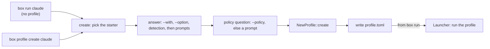

# Starters

A starter is a `starter.toml` file, its own kind of file beside packs and policy starters
([decisions](decisions.md#one-kind-per-file)). It holds the questions that turn
`box profile create <name>` into a complete profile, so the operator does not have to know which
provider packs an agent needs. `box run <name>` for a missing profile calls the same create step,
then runs the profile. The operator guides are [starters.md](../../cli/starters.md), for creating
a profile, and [starters.md](../../cli/starters.md), for writing a starter.

## Flow



A starter produces only the `packs` list and the `options` table of a profile. These are the two
values that `box profile create` sets through `--with` and `--option`. The
[policy question](#the-policy-question) that follows it, through `--policy`, copies a policy
starter into the profile folder and sets `policies`.

`@box/<name>` is the starter that `box` ships in `resources/starters/<name>/starter.toml`, beside
`resources/packs/` and `resources/policies/`. `<name>` is the operator's starter in
`~/.strands/box/starters/<name>/starter.toml`. Any other `@<scope>/<name>` is the starter in
`~/.strands/box/external/<scope>/starters/<name>/starter.toml`, as for a pack
([Lookup](profile-language.md#lookup)). The short name of a starter is the last segment of its
name: `@box/claude` has the short name `claude`, and `@acme/claude` has it too. A starter and a
pack can have the same name, and `@box/claude` is both.

`starter::resolve` gives the full starter name of a short name, in this order:

1. The operator's starter of that name.
2. Nothing, when the operator has a pack of that name. An operator pack `claude` hides the starter
   `@box/claude` from the short name, as it hides the pack `@box/claude` (`Lookup::full_name`).
3. `@box/<name>`.

A collection's starter is never a short name's answer: `--with` and the menu name it in full, such
as `@acme/claude`.

`Menu::spelling` gives the `--with` entry that names a starter, and `Lookup::spelling` the one that
names a pack. Each hint that prints a `--with` entry uses them, never the short name, so the hint
names the starter or the pack it means.

## The starters list

`~/.strands/box/config.toml` holds the settings of `box` itself
([decisions](decisions.md#base-is-reserved)), and
[Where box keeps its files](../../cli/files.md#custom-packs-starters-and-policies) names its
tables. This section is about `[starters]`, [The policy question](#the-policy-question) about
`[policy-starters]`, and [Whether a run shows the banner](profiles.md#whether-a-run-shows-the-banner)
about `[banner]`. The
built-in menu is `[starters]` in `resources/config.toml`, beside the packs.
[Set the starter menu](../../cli/starters.md#set-the-starter-menu) states the keys
that a user `config.toml` sets in `[starters]`, and how each one changes the menu.

Each key holds one fact, so no key changes the meaning of another. A boolean `replace` next to
one list was rejected for this reason. A placeholder entry for "the built-in list" was rejected
because it is a small expression language.

`starter::Menu::load` starts from the built-in `only`. Then it applies the `[starters]` of each
collection's `collection.toml`, in the order of the collections' folder names: its `remove`, then
its `add`. A collection with no `collection.toml` changes no menu.
Last it applies the user `[starters]`, whose `remove` can also take out what a collection added.
`collection::read` refuses a collection `add` that is not in the collection's own scope and a
collection `remove` that is not an `@box/` name, and a collection has no `only`. The load refuses:

- `only` together with `add` or `remove`.
- A `remove` entry that is not in the menu so far.
- An `add` entry that is already in the menu.
- Two entries in the merged menu with the same short name. The check runs after each collection
  too, so a collection that adds `@acme/claude` removes `@box/claude`.
- A scoped entry whose scope has no folder in `~/.strands/box/external/`.
- An unknown key in `config.toml`, in `collection.toml`, or in `[starters]`.

These steps call `starter::Menu::load`: `NewProfile::answer`,
`Launcher::starters` for `profile list`, `Launcher::is_starter` for `box run`, and the
`ProfileMissing` hint. So a bad `config.toml`, a bad `collection.toml`, or an entry in `external/`
that is not a valid collection folder stops
each of them except `profile list`, including a `profile create` that uses no starter. A run of a profile that exists
does not need the menus, but `Launcher::display_for` loads the starters menu, runs
`PolicyMenu::check_config`, and reads `[banner]` before it decides the display. So each error
above, and each error in `[policy-starters]` itself, stops every `box run` too, whatever the flags
say. A malformed `config.toml` stops each command that reads it. A run opens no policy folder: a
missing or broken `~/.strands/box/policies/<name>/` that the list names stops only `box profile create`,
because each profile holds its own copy of its policy.

## The starter file

[The `starter.toml` keys](../../cli/starters-reference.md#the-startertoml-keys) lists each key, where
it goes, and the values it takes. This section says what `box` does with the keys. A short
starter has this shape:

```toml
[starter]
name = "@box/claude"
label = "Claude Code"
packs = ["@box/claude"]
ask = ["bedrock.region"]

[[source]]
id = "use-bedrock"
label = "Provider"
places = [{ env = "CLAUDE_CODE_USE_BEDROCK" }]

[[question]]
id = "provider"
prompt = "Which model provider should Claude Code use?"

[[question.choice]]
id = "bedrock"
label = "Amazon Bedrock"
packs = ["@box/bedrock"]
options = { "claude.host" = "bedrock" }
detect = { source = "use-bedrock", equals = "1" }
```

`[starter] name` is the name the folder gives, as `[policy] name` is for a policy starter.

`[starter] packs` is the start of the packs list of each profile that the starter writes. No
pack is implied, so the starter names its agent pack. A change to a pack in it reaches each
profile that imports the pack. A change to the starter reaches only the profiles that it writes
later.

An agent pack's own starter is the starter with the agent pack's name: `@box/claude` for the pack
`@box/claude`. For guided edit and the agent menu, your starter `claude` is also the own starter
of `@box/claude`, which it replaces (`starter::owns`), as an operator pack stands for the shipped
pack of its short name. The create report names the agent with the `label` of that starter, else of the
own starter of the pack it extends that runs an agent, so a pack that extends `@box/claude` is
reported as Claude Code. With neither, the report uses the agent pack's short name. The menu does
not change the name, so a team starter that lists `@box/claude` never names the agent, and
removing `@box/claude` from the menu leaves it Claude Code. The create report names no agent in
code.

`[starter] options` is the start of the `options` table of each profile that the starter writes.
An input that it sets has a value, so the Inputs step does not ask for it. A starter with no
question still prompts for each input that the [Inputs step](#answer) asks for and that its
`options` leave unset, such as an input of `@box/claude` that has a `warning`. A starter whose
`options` set all of them writes its profile with no prompt.

A question's `when` has the shape of the pack `when` gate
([decisions](decisions.md#a-bool-input-switches-with-when)), but the starter evaluates it, and
`answers.<id>` is the choice `id` picked for that question.

`Starter::load` refuses a symbolic link at `starter.toml`, at its folder, or at the `starters/`
folder, and a `starter.toml` with more than one hard link, so a link cannot make a file in the
workspace a starter
([decisions](decisions.md#no-file-a-box-can-write-is-an-input)). `Starter::parse` refuses a file
that breaks a rule in [The `starter.toml` keys](../../cli/starters-reference.md#the-startertoml-keys).
It does not check names against packs: an `ask` entry, or a key of
`[starter] options` or of a choice's `options`, that no pack declares passes the parser.
`NewProfile::create` refuses an option that no pack declares, and a pack that does not exist. The
source and `detect` checks are in [detection](detection.md#the-starter-keys).

A pack that holds a `[starter]` table is refused as a pack with an unknown key. No run reads a
starter, and a pack that extends `@box/claude` gets none of its questions.

## The create step

`NewProfile::answer` runs before `NewProfile::create`. It takes a `Terminal` (the input and output
streams), or `None` when there is no terminal, and reads `--force` from `NewProfile::force`. It picks the starter, and replaces the profile's packs and options with the answered ones.
`starter::answer` does the work. It refuses an existing profile before the first prompt, unless
`--force` is given or `NewProfile::edit` opens the saved profile. A command that asks nothing
leaves that check to `CreatedProfile::write`.

An edit asks the questions of the first starter in the menu that is the own starter of a pack
that the profile imports and that runs an agent. A team starter is no pack's own starter, so it
never answers an edit, and an edit never loses the agent's own questions. With none, guided
setup is not available, and the operator edits `profile.toml`. The agent menu lists the existing
profiles of a starter by the same test. An edit starts from the saved packs and options. It preserves custom profile content and
refuses changes to choices inherited through another pack, including a local replacement for
a shipped pack. A replacement policy uses a new file and keeps the existing files. A save
refuses a profile whose text changed after the editor opened it.

### Pick the starter

For a new profile, the step resolves each `--with` entry as a starter first, through
`starter::resolve`, and then as a pack, through `Lookup`.

1. A `--with` entry that resolves to a starter in the starters list selects that starter, and the
   entry is not a pack. A second such entry is an error. Each other entry is a pack, and a pack
   that does not exist is an error.
2. If no `--with` entry selects a starter, the profile name selects the starter that it resolves
   to.
3. At a terminal, `box profile create` with no `--with` and no matching name asks the operator
   to choose an agent. Otherwise, if neither selects a starter, the step asks only the
   [policy question](#the-policy-question), and each input that has a `warning` and no `--option`
   value. Without a terminal it records that input's default (`starter::answer_warnings`). It builds
   the profile from `--with` and `--option` as `NewProfile::create` does.

### Answer

1. **`--with`.** Each other entry selects the choice whose `packs` holds that pack. An operator
   pack `<name>` that shadows `@box/<name>` also selects the choice that holds `@box/<name>`, and the
   profile gets the operator pack in its place. An entry that matches no choice stays in the packs
   list, so `--with node` works beside a starter. An entry
   that matches choices in two questions is an error that names them.
2. **Detection.** The step reads the starter's host sources and answers each question and input
   that they decide ([detection](detection.md)).
3. **Prompts.** The step asks each question that has no answer and whose `when` holds, in file
   order. A `--with` entry that answers a question whose `when` does not hold is an error, so a
   profile never gets half a choice. A question with one choice takes that choice and shows no
   prompt. For a new profile, Enter picks the question's `default` or, if it has no `default`,
   its none choice when present. An edit keeps the saved selection as its preset.
4. **Inputs.** The step merges the packs as `NewProfile::create` merges them. An input has a value
   when `[starter] options`, a chosen choice, or `--option` sets it. The step asks for each
   declared input that has no value, no `default`, and no `from`. A run reads an input with `from`
   from the host. It also asks for each input that `ask` names
   and that has no value, and for each input of any merged pack that has a `warning` and no value.
   It skips an `ask` entry that no merged pack declares, or that names an
   input with `from`. The prompt shows
   `<description> (<name>)`, then each `warning` as `Warning: <text>`, then `values` as a numbered list, then the `default` in brackets. `check_value` checks the answer. On a
   bad answer, the step asks again. Enter on the default writes nothing, so a profile from a terminal
   and a profile from a script hold the same options, and the profile gets a later change to the
   pack's default ([decisions](decisions.md#base-is-reserved)). An input with a `warning` is the
   exception: the step writes each answer, the default included, so a later change to the pack's
   default does not change what the operator answered.

An option never answers a question. An `--option` for a key in the `options` of a chosen choice
replaces that value, and the step does not check that the two agree.

### Without a terminal

`box` asks only when stdin and stderr are terminals
([decisions](decisions.md#box-asks-only-at-a-terminal)). A detected answer is the answer without
one, and the preset of its question at one. Without one:

- An input with a `default` takes the default, including an input in `ask`. The step writes the
  default of an input with a `warning` to the profile.
- An unanswered question takes its `default`, or the none choice if it has no `default`.
- A question with no answer, or an input with no default and no value, stops the step with
  `Error::StarterUnanswered`. The message names the command, then one line for each choice of the
  question with the `--with` of its first pack, or the `--option <name>=<value>` of the input:

  ```text
  box profile create claude needs an answer to "Which model provider should Claude Code use?"
    --with bedrock     Amazon Bedrock
    --with anthropic   The Anthropic API
  ```

- The [policy question](#the-policy-question) with no `--policy` stops the step the same way,
  with one `--policy <name>` line for each policy starter. Its default is for Enter only.

### Write

The packs list is `[starter] packs`, then the `packs` of each chosen choice, then the other
`--with` entries. The list keeps the first place of each pack and drops a repeat. `options` is
`[starter] options`, then the `options` of each chosen choice, then each detected input value, then
each input answer, then `--option`. A later value replaces an
earlier value for the same key. `NewProfile::create` builds the profile and
`CreatedProfile::write` writes it.

In `create.rs`, the type `Draft` is a profile that is not yet written. "Starter" names only a
`starter.toml` and what it holds.

## The policy question

A policy starter is a folder in `resources/policies/`, named `@box/<folder>`, in the operator's
`~/.strands/box/policies/`, named `<folder>`, or in a collection's `policies/`, named
`@<scope>/<folder>`. `policy.toml` holds `[policy]` with `name` (that name),
`label`, and `description`. `policy.dw` holds the rules, with a comment for
each, since the operator reads the copy. A shipped one's `README.md` says what it holds, for the
operator. `PolicyStarter::load` and `rules` read both files the way `Starter::load` reads
`starter.toml`, refusing a symbolic link at the file, at its folder, or at `policies/`, and a file
with more than one hard link, so a link cannot make rules a box can write into the policy the next profile copies. The shipped
ones are in `resources/policies/`, and each one's `policy.dw` holds its rules.
[Pick the agent's policy](../../cli/starters.md#pick-the-agents-policy) links that folder on GitHub instead of listing them, and
[`[policy-starters]`](../../cli/config.md#policy-starters) states the keys
of `[policy-starters]` in `config.toml`, the built-in default, and which entry Enter picks. `resources/config.toml` holds the built-in `[policy-starters]`.

`policy_starter::full_name` resolves each entry as `Lookup::full_name` resolves a pack: a plain name
is the operator's folder when it exists, else `@box/<name>`, and never a collection's.
`PolicyStarter::flag_name` then spells a shipped policy starter that an operator one shadows as
`@box/<name>`.

`PolicyMenu::listed` builds the list in the order of the starters list: the built-in `only`, then
each collection's `remove` and `add` in the order of the collections' folder names, then the user's `remove` and
`add`, or the user's `only` in place of all of them. The default is the built-in `default`, then
the `default` of each collection that sets one, the last one winning, then the user's `default`.
`policy_starter::PolicyMenu::load` refuses an unknown key, `only` with `add` or `remove`, an empty
list, a name twice, a `remove` that is not in the list so far, a name with no folder, and a
`default` that is not in the list. Each error names the file that holds the entry: the user
`config.toml` or the collection's `collection.toml`. A folder name is lowercase letters, digits,
and `-`, so a name cannot leave `resources/policies/`, `~/.strands/box/policies/`, or a
collection's `policies/`.

`NewProfile::answer` asks the question after the starter's questions and inputs, and also when no
starter is selected. It builds the draft first, so a profile that `box` cannot build stops before
the prompt. `policy_starter::choose` takes the answer:

1. `--policy` names a policy starter in the list, by its full name or without `@box/`. Another name
   is an error that lists the menu.
2. Else the selected starter's `[starter] policy` answers, with no prompt. It names a policy
   starter, which `Starter::parse` checks and resolves to its full name. It must be in the menu,
   as `--policy` must, so a starter cannot write a policy that the operator's list leaves out.
   `NewProfile::answer` checks it before the starter's first prompt. The create report adds
   `from the <starter> starter` to its `Policy` line.
3. At a terminal, the prompt lists `<label>: <description>` for each, in list order, and shows the
   default's number in brackets. Enter picks the default
   ([decisions](decisions.md#the-policy-question-defaults-to-open)). An existing profile is refused
   before the prompt, as for a starter question.
4. Without a terminal, `StarterUnanswered` names `--policy <name>` and the label of each.

`Settings::draft` writes `policies = ["policy.dw"]` after `packs`, then `[project] access` from the starter's `[policy] project` when it sets one and the saved profile has none, and `PolicyStarter::copy`
makes the text of the copy: a `//` header that names the starter and its label and says the file is the operator's, then the
starter's `policy.dw`. `CreatedProfile::write` writes the copy first and `profile.toml` second, so
a failed write never leaves a profile that names a missing copy. Each file is staged in the
profile folder and renamed into place, so a link at either path is replaced, never followed.
Without `--force`, a file that is not a regular file with one link and the same text refuses the
write before either file is written.

After create, the copy is one of the profile's own `policies` files
([decisions](decisions.md#a-policy-starter-is-copied-into-the-profile)). A run reads it through
`Profiles::load`, and never reads `resources/policies/` or `~/.strands/box/policies/`. The copy is the first authored text in
the run's `policy.dw`, so a Box Core line number is the line in the copy. A `NewProfile::create`
call with no policy, which only the library allows, writes no copy and no `policies`.

## `box run` for a missing profile

When the profile is missing and the name is a starter, the `run` handler in `main` calls the same
`create` handler as `box profile create <name>`, then calls `Launcher::prepare`. With
`--box-id`, it does so only when `Launcher::reusable` passes: the same checks that `--box-id`
makes in `existing`, with nothing changed on disk. So an ID that `box run` would refuse creates no
profile, and the starter asks nothing. It prints one
line first: `box: no profile named claude. Creating one from the claude starter.` The create
report that follows leaves out its Next list, because the run starts next.

- `box run` takes no `--option` ([decisions](decisions.md#box-run-takes-no-option-values)) and
  no `--with`, because a run uses only what the profile states. To give answers, the operator runs
  `box profile create`.
- A name that is not a starter returns `ProfileMissing`. Its message lists each starter as a
  `box profile create <name> --with <starter>` line with the `label` of the starter:

  ```text
  box: error: no profile named work at <path>. work isn't a starter, so box can't tell which agent it runs. Create the profile from one of these starters:
    box profile create work --with claude   Claude Code
    box profile create work --with codex    Codex
  ```

  `box profile show` gives the same message for a name that is not a starter.
- `box profile show` does not create a profile. When the name is a starter, its `ProfileMissing`
  hint names `box profile create <name>`.
- Without a terminal, `StarterUnanswered` names `box profile create <name>`, because `box run`
  has no flag that answers. The policy question is asked too, so a `box run` with no terminal
  never creates a profile.

This reverses the rejected offer in
[a starter answers from the host first](decisions.md#box-asks-only-at-a-terminal): the offer
could not name a provider, and a starter names it through its choices. The commit that adds
starters rewrites that entry in place.

## The none choice

A none choice is a choice with an empty `packs` list. With no `default`, it makes a question
optional: the profile gets the pack of the other choice only when the operator picks it.

```toml
[[question]]
id = "github"
prompt = "Let the agent use GitHub with your GITHUB_TOKEN?"

[[question.choice]]
id = "no"
label = "No"
packs = []

[[question.choice]]
id = "yes"
label = "Yes"
packs = ["@box/github"]
```

- The none choice is the answer when nothing picks another choice. Enter at the prompt, and a run
  with no terminal, pick it. `--with github` picks `yes`.
- So no flag is needed to answer no, and `StarterUnanswered` never names such a question.
- The default grants less. A script that does not mention GitHub gets a box that cannot reach it
  ([decisions](decisions.md#a-pack-makes-an-agent-run-and-never-extends-it)).
- The prompt lists the none choice first and shows it as the default:

  ```text
  Let the agent use GitHub with your GITHUB_TOKEN?
    1. No
    2. Yes
  > [1]
  ```

### Use cases

An optional question fits a pack that adds access the agent does not need to run.

- **GitHub.** `@box/github` holds `[egress.github]` for `api.github.com` with
  `secret.ref = "env://GITHUB_TOKEN"`. Today an operator writes that table by hand in the profile.
  The question adds it with one keypress, for `@box/claude` and `@box/codex`.
- **A team developer setup.** A team starter offers its own developer pack, such as
  `acme-developer` with the team's package registry host, its internal docs host, and its token
  routes. A team ships this pack beside a team starter that pins the provider in
  `[starter] options`, so one question is the whole setup.

The none choice keeps one question model. A separate yes or no question type would need its own
answer flag. For optional access, leave `default` unset so a script grants access only when it
selects the pack.

## `box profile list`

`profile list` prints the profiles, then a `Starters:` block with the name and `label` of
each starter. A starter whose `starter.toml` does not load shows `invalid: <reason>`, as a profile
does. A
`config.toml` that does not load shows `Starters: invalid: <reason>`, and the command still lists
the profiles.

## No provider name in Rust

`claude.host = "bedrock"` is in the `@box/claude` starter. The `when` gates in the
`@box/claude` pack read `claude.host`. `create.rs` holds no table from provider to host
([decisions](decisions.md#box-knows-no-provider)).

## Tests

- `Starter::parse`: one test for each rule in [the starter file](#the-starter-file), and a pack
  that holds `[starter]` is refused.
- Answer, with fake packs: `--with` answers a question, a one-choice question shows no prompt, a
  `when` that does not hold skips its question, an entry in two questions is an error, a second
  starter in `--with` is an error, `ask` skips an undeclared input, `[starter] packs` starts the
  packs list, `[starter] options` fills an input so the step does not ask
  for it, and a choice and `--option` each replace a `[starter] options` value.
- Without a terminal: a default fills an `ask` input, and each unanswered case returns
  `StarterUnanswered` with a `--with` line for each choice, or the `--option` of the input.
- The prompts read from `&mut impl BufRead` and write to `&mut impl Write`, as the `box profile clean`
  confirmation does, so a test drives them with a byte string.
- Shipped starters: for each entry in `resources/config.toml`, the test reads its file in
  `resources/starters/`, walks each path through its
  questions, gives each input with no default through `--option`, and checks that
  `box profile show` accepts the written profile.
- None choice, with no `default`: Enter picks it, no terminal picks it, `--with` of another choice
  replaces it, and a question that holds only a none choice is a parse error.
- A declared `default` picks its choice when neither `--with` nor detection answers the question.
- `ProfileMissing` for a name that is not a starter lists each starter.
- `box run <name>` for a profile that exists refuses a bad `config.toml`, with or without a
  banner flag, and `box profile show` does not read it.
- Policy question: the built-in list and default, each user replacement and each refusal, a name
  that leaves `resources/policies/`, `--policy` by short and full name, Enter, a bad number, the
  end of the input, an existing profile, and no terminal.
- Each shipped starter path, with each shipped policy starter, previews with no Box Core warning.
- The copy: its header and text, an edit that the next run reads, a finding placed at its line in
  the copy, and a hard link, a symbolic link, or other text at `policy.dw` with and without
  `--force`.

## Open questions

- **Operator defaults in `config.toml`.** The planned key is a table of input values that each new
  profile starts with, such as the operator's preferred `node` path. Its layer goes first in the merge order, before `[starter] options`, so a
  starter and the operator's flags still replace it. Other candidates are a default profile for
  `box run` with no name, and extra pack search paths.
- **A new provider pack.** A provider pack cannot add itself to the choices of `@box/claude`. A
  person edits `@box/claude`. This matters when a provider pack comes from outside this repository.
