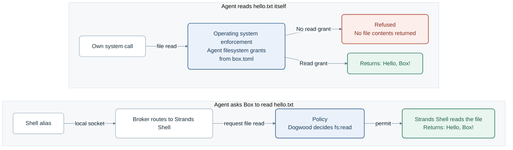

# How Box contains a process

A box includes the agent's sandbox, a sandbox for each tool or local MCP server, and the trusted
process that runs outside them. The operating system enforces each sandbox's restrictions on system
calls. This page explains those restrictions, how Box builds the sandbox grants, and how the agent's
sandbox differs from a tool's or server's sandbox. It also describes the operations that happen
outside operating system enforcement.

On macOS, Seatbelt enforces each sandbox. [macOS enforcement](macos-enforcement.md) explains that
mechanism.

> Platform scope. Unless a section explicitly states Linux behavior, this page describes operating
> system enforcement and guarantees on macOS.

## Two kinds of enforcement

Box restricts the agent in two ways, and they cover different paths to a resource:

- Operating system enforcement bounds the system calls a process makes itself.
- Policy decides each request the agent sends to Box.

| | Operating system enforcement | Policy |
|---|---|---|
| What it covers | A process's own system calls, such as opening a file. | Requests the agent sends to Box: a Strands Shell command, a Monty script, an MCP tool call, and every outbound network request. |
| Who enforces it | The operating system's kernel. | A component in Box's trusted process, which asks the Dogwood policy engine. |
| Where it comes from | `box.toml` and the system paths a process needs to run. | `policy.dw`. |
| When it's decided | Once, before the process starts. | On every request. |

The agent's sandbox has aliases named `zsh`, `bash`, `sh`, `python3`, and `python`, plus one for
each program used to start a declared MCP server. An alias forwards a request over a local socket to
the broker in Box's trusted process. The broker sends it to Strands Shell, the shell interpreter;
Monty, the Python interpreter; or the MCP server. The alias itself authorizes nothing. Outbound
network traffic takes its own route, through the egress gateway.

The agent can therefore reach the same file through two routes. Suppose `hello.txt` in the workspace
contains `Hello, Box!`, and policy permits Strands Shell to read it:


 In the top row, only the agent's grants decide. In the bottom row, only the `fs:read` decision
does.

A policy permit doesn't let the agent read the file with its own system call. A `forbid` doesn't
take away a filesystem grant either, because no policy decision covers that access. Policy stays the
only authorizer, and operating system enforcement stays beneath it. See [the sandbox applies its
grants and evaluates no policy](decisions.md#containment-evaluates-no-policy).

A harness's built-in file tools need direct grants because they make their own system calls. Without
direct grants, an unmodified harness can't edit a file. See [direct reach is declared and
disclosed](decisions.md#direct-filesystem-reach-is-declared-and-disclosed).

## What a box guarantees

A box makes five guarantees:

- Before a process starts, Box reads `box.toml`, adds the system paths the process needs, and writes
  one set of sandbox grants. It runs no program to do this, and the grants never change while the
  box runs. See [fixed and built without running a
  program](decisions.md#containment-is-fixed-and-built-without-running-a-program).
- The launcher, `strands-box-contain-trampoline`, applies the sandbox to itself and then starts the
  configured program. See [one trampoline spawns every contained
  process](decisions.md#one-trampoline-spawns-every-contained-process). If that step fails or Box
  cannot confirm that the sandbox attached, the program doesn't start. There's no weaker fallback
  and no uncontained mode. See [every failed apply refuses the
  workload](decisions.md#every-failed-or-unsupported-apply-refuses-the-workload).
- A configuration starts with no filesystem grants and no network. A field the operator leaves out
  keeps the closed value. See [an omitted field keeps the closed
  default](decisions.md#the-closed-choice-is-the-default).
- Every descendant of a contained process inherits its sandbox restrictions. Replacing the program
  with another one preserves those restrictions. Nothing widens a box after it applies. See
  [children inherit the boundary](decisions.md#children-inherit-the-boundary).
- The sandbox protects the operator's files, credentials, and network from what runs inside. It
  doesn't make the box's own contents confidential, and it doesn't govern code the agent writes and
  gets run somewhere else. See [the sandbox protects the surrounding
  system](decisions.md#box-protects-the-machine-not-the-box).

## Where a box's reach comes from

Box works out a box's reach in four steps:

1. Read the process specification from `box.toml`.
2. Add the runtime minimum, the system paths a process needs to start.
3. Add grants for the process's role as an agent, tool, or local MCP server. [The next
   section](#the-agents-box-and-leaf-boxes) describes these grants.
4. Apply the deny-only checks that refuse paths regardless of the preceding grants.

### The process specification

`[agent]` and each `[tool.<name>]` hold the same four fields, and a stdio `[mcp.<name>]` entry holds
the same four plus `network`. One translator turns each of them into a set of sandbox grants. See
[one process specification and one translator](decisions.md#one-process-spec-and-one-translator).

- `command` names the program and its fixed leading arguments.
- `workspace` names the starting directory. The process can enter it but cannot read it until a
  filesystem list grants that access.
- `env` supplies the process's environment variables. Only `HOME` and `PATH` come from the host OS's
  shell, unless `env` overrides them. Box adds its own names, including the proxy and certificate
  variables. `HOME` is the operator's own home unless `env.HOME` names another directory, and a home
  grants nothing either. See [`HOME` is the operator's own
  home](decisions.md#home-is-the-operators-and-the-workspace-is-entered). [`env`](../user/config.md)
  refuses four kinds of entry. A library caller can check one entry with `check_workload_env(name,
  value)`. It uses the same checks as `box.toml` loading, except that it cannot reject a `HOME` in
  or above `box_dir` without knowing `box_dir`. The error's `kind()` returns an `EnvRefusal`.
  `InvalidName` means the name is invalid. `SetByBox` identifies a name Box supplies. `LoadsCode`
  identifies a dynamic-loader variable whose name starts with `LD_` or `DYLD_`. Box rejects
  both families, so `LD_BIND_NOW` gets `LoadsCode` even though that variable need not load code. `NotAbsolute` identifies a relative `HOME` or `TMPDIR`. Callers can use these kinds to drop
  Box-supplied names and reject names that load code without copying Box's lists. This check does
  not cover a credential's `env://` name, for which Box also refuses `HOME` and `PATH`.

- `filesystem` lists name paths and their access modes. The agent takes eight: `read`, `write`,
  `read_file`, `write_file`, `list`, `metadata`, `exec`, and `deny`. A tool and a local MCP server
  take the same lists without `metadata` and `exec`. A directory entry covers its tree, and a file
  entry is exact. `write` doesn't imply `read`.

### Script interpreter grants on Linux

Box reads a declared script's `#!` line before building its sandbox. It follows the named
interpreter and repeats when that interpreter is itself a script. For `env`, it follows both `env`
and the command that `env` selects.

On Linux, discovery checks each interpreter against the process's original filesystem grants. An
agent needs existing `exec` coverage. A declared tool or local server can use its own `read` or
`read_file` coverage, because those grants permit execution in its sandbox. Existing writable grants
also count where they permit execution and have the required read coverage. Tool and local-server
tables still refuse an `exec` list. A missing grant prevents launch, including when the interpreter
is under a system path.

Each check uses the file identity resolved from the script's path spelling. Explicit denials,
protected paths, and Box state remain outside the accepted grants. Discovery cannot use a grant
added for an earlier interpreter to authorize a later interpreter. A required spelling can expose
the same authorized file inside the sandbox without adding authority over another file.

Box discovers shared-library dependencies from executable-file grants that existed before it
inspected the script. Preserving an interpreter's spelling adds no new source for dependency
discovery. A declared tool's readable interpreter can therefore need separate read grants for
non-system libraries. Interpreter admission alone does not guarantee that the program can start or
finish its work.

On macOS, Box grants a declared command's interpreter chain automatically. See [one exec rule per
grant](decisions.md#the-agent-gets-one-exec-rule-per-grant). On either platform, a workload-selected
program without a declared tool table needs existing `exec` coverage for its interpreter chain. The
[configuration reference](../user/config.md#script-commands-on-linux) shows interpreter grants and
the alternative of running a native interpreter with a readable script argument.

### The runtime minimum

Box adds the system paths a process needs to start. It uses an agent set and a toolchain set. The
agent set contains the null device, time zone data, and system libraries. The toolchain set adds
what a compiler or version control tool reads, such as locale data, linker caches, and the
certificate authority bundle. The agent gets only the agent set, and a tool or a local MCP server
gets both. See [the runtime minimum is two
sets](decisions.md#the-runtime-minimum-is-two-sets-and-the-agent-takes-the-smaller-one). A path the
surrounding OS does not have is left out. Each platform's paths are listed in
[`os-paths.macos.json`](../../crates/containment/src/containment-data/os-paths.macos.json) and
[`os-paths.linux.json`](../../crates/containment/src/containment-data/os-paths.linux.json).

### The floors

Box refuses some grants whatever the configuration says. See [the deny-only
floors](decisions.md#the-deny-only-floors-run-beneath-every-backend). The floors include:

- Box refuses a grant that encloses a credential store such as `~/.aws`, `~/.ssh`, a keychain, or a
  browser profile, and the box does not start. An operator can grant read or write access by naming
  the store itself or a path inside it. Box reports that grant at startup. See [one forbidden-path
  list](decisions.md#one-forbidden-path-list-and-each-row-states-its-rule).
- Box refuses grants over the whole filesystem, every home, or system trees such as `/System` and
  `/etc`. It also refuses grants that reach the password database, `sudo` configuration, or machine
  keychains.
- An `exec` grant cannot name a setuid or setgid program.
- Grants cannot expose the box directory, which holds Box's own state.
- Grants cannot allow writes to the `box.toml` or policy loaded for this run, and their directories
  are cut out of any wider tree a grant names. Without this, a tool the agent runs could rewrite the
  policy for the next run. See [direct reach is declared and
  disclosed](decisions.md#direct-filesystem-reach-is-declared-and-disclosed).
- Box refuses direct writable grants that can overwrite a configured command or replace its path,
  including its symbolic-link route and enclosing directories. The check covers the agent, every
  tool, and every local MCP server.
- Box refuses writable grants that can change its executable, containment launcher, socket-alias
  image, or the macOS package launcher when present. This includes hard-link names, mounted aliases,
  and enclosing directories. The check covers every process's grants. See [installation
  integrity](binaries.md#trampoline---strands-box-contain-trampoline).

The credential store and system tree paths are listed in
[`forbidden-paths.json`](../../crates/containment/src/containment-data/forbidden-paths.json), one
list for every platform. The other floors depend on the run.

A library caller can check a path with `check_read_grant`. It uses the same function that checks a
`read` entry in `box.toml`. It refuses an absent path, a symbolic link, a noncanonical spelling, or
a path rejected by a deny-only check. It reports that a credential-store path needs an explicit
grant. The caller receives the decision without the underlying list, whose rows contain a class and
an `exact` or `overlap` rule.

The refusal's `kind()` returns a `GrantRefusal`: `NotAbsolute`, `Absent`, `Link`, `NotCanonical`,
`Forbidden`, or `Other`. `Forbidden` includes the class of the row that refused the path, such as
`SystemTree` for `/usr`. The credential-store check runs before the rows. A path enclosing a
credential store without naming it therefore returns `Other`, as do `/`, `/Users`, and the
operator's home. A read grant never returns `Forbidden` with `WholeFilesystem` or `CredentialStore`.
Callers can distinguish a `SystemTree` refusal without copying the rows.

### File attributes in a macOS write folder

A macOS write folder permits six operations: content writes, creation, unlinking, extended
attributes, mode changes, and time changes. `utimes` and `futimes` use the time operation.
`utimensat`, which `touch` uses, and `setattrlist` instead check the whole write family, so a write
folder refuses them. Ordinary writes do not need changes to flags, ownership, or access control
lists, and the folder withholds those operations.

The `file-attributes` switch grants the whole write family for the folder. It then denies the four
members the folder withholds: flags, owner, access control list, and Finder information. The set-ID
operation and mounts are outside that family, so the grant does not cover them. `chmod` still cannot
set a set-ID bit. The switch also preserves the folder's unlink and create denials and its refusal
of executable mappings. The protection rules render after the grant, so every protection and refusal
still takes precedence.

However, `setattrlist` changes times, mode, group, owner, and access control lists through the same
family check. No rule distinguishes those changes. The switch therefore lets `touch` work, but also
lets `setattrlist` change a set-user-ID bit, group, or access control list. It can change the owner
as far as the ownership check permits. The separate `chflags`, `chown`, `acl_set_file`, and Finder
information operations remain refused. [File attributes on
macOS](../user/security.md#file-attributes-on-macos) explains the operator's residual risk, and [the
decision](decisions.md#a-write-root-sets-file-attributes-only-when-selected) records the reason for
the switch.

Linux renders nothing for this switch.

### Linux root sandbox launches

A Linux sandbox workload keeps the launcher's underlying file identity after Box removes its
capabilities. If root starts the workload, new files and symbolic links in granted directories can
therefore belong to root in the surrounding OS. A separate privileged program can follow one of
those links outside the workload's grants.

Box refuses sandbox directory write grants when the launcher's real or effective user ID is zero. It
checks the composed grants during validation and again before entering the namespaces. The
restriction applies to agent, tool, and local-server workloads. Existing-file writes, read-only
directories, and private `/tmp` storage remain available. Directory writes require a non-root
launch, including when an outer container presents the launcher as user ID zero. This check uses the
launcher's current user namespace; it does not resolve arbitrary mappings into ancestor namespaces.

Shell and Python filesystem requests run in the trusted process under policy and reach checks. They
do not use sandbox grants, and permitted file creation retains that process's file identity. This
startup restriction does not protect later privileged consumers of those files.

macOS retains root file creation inside granted directories. Seatbelt path denials do not establish
protection against later privileged consumers of those entries. This Linux change does not test or
change that macOS behavior.

### Linux file permission changes

A writable Linux bind shares the underlying file with the surrounding OS. The mount's `nosuid`
option prevents set-user-ID and set-group-ID bits from changing process identity when a file runs;
it does not prevent them from being stored on that file.

The syscall restriction filter rejects either bit in `fchmod`, `fchmodat`, and `fchmodat2`. It also
rejects either bit in `mkdirat` and in the creation mode of `openat` when `O_CREAT` or `O_TMPFILE`
is present. It checks the low 32 bits that the kernel uses. An `openat` call without creation flags
ignores the mode argument, so that unused argument does not cause a refusal. The permit filter
continues to exclude ownership-changing calls, `openat2`, and `mknodat`. Ordinary writes and
permitted compiler output remain available. Executable-bit changes require a requested mode without
either special bit.

These checks govern requested modes. A pre-existing set-group-ID directory can still pass its group
and directory inheritance bit to new subdirectories. The filter does not remove existing bits or
change the surrounding OS's directory inheritance rules. It cannot distinguish keeping an existing
bit from adding one: both requests fail if the requested mode contains either bit. A request that
clears both bits can succeed. GNU `chmod` can preserve a directory's inherited group bit when
changing ordinary permissions, so those commands can fail even when they add no special bit.
`permission_changes_refuse_existing_special_bits_unless_cleared` checks inherited directories,
existing special-bit files, refused requests that preserve the bits, and successful requests that
clear them.

### What a process sees of other processes on macOS

Every macOS sandbox hides other processes. The agent, each tool, and each local MCP server get the
same two rules:

- A process can read all of its own process information.
- A process can read `proc_pidinfo` information about its direct children. Only that one operation
  is allowed. A harness such as Kiro CLI uses it to watch the programs it runs.

A process still can't read the information of its parent, a sibling, or any other process on the
machine. That includes the `strands-box run` process that started the box.

Signals follow the same restriction. A process can signal a child it started, so a harness can stop
a program it no longer needs. It can't signal any other process, including the `strands-box run`
process. A child runs under the same sandbox as its parent, so a signal gives no new reach. The
rules are in [`seatbelt-agent.sb`](../../crates/containment/src/backend/macos/seatbelt-agent.sb).
`CN-I-03` checks that a process in a box can read information about its own child and signal it. It
also checks that the process cannot read its parent's information or signal another process. A
control outside the box confirms that the sandbox causes these refusals.

### How you check a box's reach

Direct access through a filesystem grant produces no policy decision or per-access record. See [a
direct grant replaces the policy
decision](decisions.md#a-direct-grant-replaces-the-policy-decision). So when the run starts, Box
prints every grant for the agent and for each declared tool on stderr, including the system paths it
added. Read that report before you trust a run.

The report leaves out two things, so check them in `box.toml`:

- Check a local MCP server's grants in its `[mcp.<name>.filesystem]` table.
- A program with no tool table has file grants reported under `[agent]`. The report omits its
  sandbox's additional access.

<a id="dependency-read-startup-design"></a>
### Dependency-read startup design

On macOS and Linux, Box discovers dependencies automatically and checks their read grants before
starting the affected workload. If a required Read grant is missing, startup fails with guidance for
adding the missing entries.

The [read-derivation
decision](decisions.md#box-derives-a-read-closure-and-refuses-to-derive-an-exec-closure) keeps
discovery automatic but restricts a branch when the workload can change its executable, a library,
or a resolution path. This includes replacement through writable parents, symbolic links, and hard
links. A hard link is another name for the same file. A write grant on either name can change its
contents. If any directory is writable, Box restricts files with multiple hard links because their
other names can be inside that directory. This conservative check can require Read entries even when
every current link is outside the writable directories. The restriction follows dependencies of
dependencies, even when a later library is not writable. Existing content-read grants or existing
trusted system-library allowances must cover reads on that branch. Write, Exec, metadata, and
directory-listing permissions do not substitute for content Read on macOS.

Linux also checks execution authority for each writable dependency, including the program's native
loader. It refuses automatic executable access unless an explicit Exec grant covers the dependency
or the workload has broad execution permission. This check applies inside system-library directories
too. The hard-link execution check excludes an inode only when ownership, permissions, and an
effective-credential write check exclude workload writes through those aliases. The writable
directory must contain no nested mounts. A shared mount uses the same ownership rules for the source
and any alias. Different mounts qualify only when neither remaps ownership and both use recognized
local filesystems. This check recognizes ext2, ext3, ext4, XFS, Btrfs, tmpfs, and ramfs across mount
boundaries. Other filesystem types and unknown permission or mount information remain restricted.
This can require execution authority even when every current link is outside the writable
directories. A read-only file owned by the workload remains restricted because its owner can change
its permissions. These exceptions affect execution admission only; the conservative dependency-read
checks above remain unchanged. Read access cannot authorize execution of writable bytes. An
immutable dependency of a writable program retains its existing read checks without an additional
Exec requirement.

A read-only dependency mount does not freeze the file's contents through another writable mount. The
retained descriptor fixes the file identity, while the execution check prevents implicit admission
of workload-modifiable libraries. Explicit Exec and Write overlap retains its warning and permitted
behavior.

For a required dependency identified during `box run` startup, missing Read coverage prevents the
affected workload from starting. The command returns an error. The report groups files by their
resolved path and names each requesting executable or library. It tells the operator to append
missing paths to the existing `read_file` list. Existing entries remain necessary. The operator
reviews the suggestion and changes the configuration; Box does not edit it automatically. Explicit
denials and protected-path refusals remain separate errors without suggestions to override them.

For example, a writable program can need two libraries outside its readable project. The startup
error includes the following guidance, with shortened paths for this example:

```text
2 dependencies lack read access; no filesystem grant reaches them.
A writable dependency chain cannot add these reads.

Dependency: "/opt/vendor/libcodec.dylib"
Requested by: {"/demo/project/bin/app"}

Dependency: "/opt/vendor/libstorage.dylib"
Requested by: {"/demo/project/bin/app"}

Keep existing filesystem entries. Append these paths to read_file in the affected process's filesystem table:
  "/opt/vendor/libcodec.dylib",
  "/opt/vendor/libstorage.dylib",
Each added entry permits reading the file's contents. Review it before granting access.
Discovery stopped at unreadable dependencies; more may appear after retry.
No configuration files changed.
```
 For example, update an existing list as follows:

```toml
# Before
[agent.filesystem]
read_file = ["/demo/config/settings.json"]
```

```toml
# After
[agent.filesystem]
read_file = [
  "/demo/config/settings.json",
  "/opt/vendor/libcodec.dylib",
  "/opt/vendor/libstorage.dylib",
]
```
 The example retains an existing settings-file entry and adds two library entries. A library already
covered by an existing Read entry needs no individual entry. The report uses canonical paths and
escaped file names. It suggests individual files, not wider directory grants. If a path cannot be
represented in the configuration, the report says so. The [configuration
reference](../user/config.md) defines the existing Read lists.

Discovery continues through other permitted branches. It does not inspect refused files to complete
the report. The report states when the walk stops at an inaccessible dependency or its diagnostic
limit. Additional dependencies can appear after the operator grants access and retries. Libraries
selected by application code after startup are outside this static discovery guarantee. An absent
weak dependency remains optional. A present weak dependency still needs read coverage on a
restricted branch.

Box continues to derive reads automatically for chains without writable paths or unresolved
hard-link aliases. Automatic discovery does not establish that those files came from a trusted
source. Programs from earlier runs can remain outside this restriction after their files become
read-only. For writable chains, package changes can require new Read entries, while directory Read
entries expose more contents than exact-file entries. Production acceptance still requires
refusal-before-launch tests, permitted build controls, and platform-specific path-replacement tests.

<a id="the-agents-box-and-leaf-boxes"></a>
## The agent's sandbox and the sandboxes for tools and local MCP servers

Box contains three kinds of process:

- The agent runs in the agent's sandbox.
- Each tool runs in its own sandbox.
- Each local MCP server runs in its own sandbox.

All three come from the same specification and translator, so they share everything above. They
differ in how they start and in what the translator adds for each role. The [table at the end of
this section](#side-by-side) compares them.

<a id="the-agents-box"></a>
### The agent's sandbox

The agent's sandbox starts when the run starts. No policy decision admits it, and it runs model
output for the whole run.

It's the narrowest sandbox. The agent can run its own `command` and each program its `exec` list
names, and nothing else. It can't run or load a file it can write as code, unless the operator lists
the same path under both `exec` and `write`, which Box warns about and allows. See [one exec rule
per grant](decisions.md#the-agent-gets-one-exec-rule-per-grant). It can't learn that an ungranted
path under the home exists unless its `metadata` list names it.

Only the agent's sandbox has aliases and a rule allowing connections to its broker socket.

<a id="a-tools-leaf-box"></a>
### A tool's sandbox

A tool is a program on the surrounding OS that Strands Shell starts for the agent, such as `git` or
`cargo`. It starts only when a `shell:spawn` permit admits it. Each admitted launch gets its own
sandbox, which ends when the program does. See [a tool's sandbox reuses the policy engine of the
box's trusted process](decisions.md#a-host-binary-runs-in-a-contained-leaf-box).

Box resolves every configured tool command before the workload starts and keeps an open handle to
its file. Tool selection uses this startup identity, and the launcher checks the identity before
execution. Box refuses a command file with multiple hard links when the user running Box can write
it. Another name could expose the same contents to writes. Box accepts multiple names for a file
that this user cannot write through any name, such as a root-owned system program. The kernel
refuses writes through each name. Before each launch of a program with multiple names, Box requires
the same link count, owner, group, and mode, and checks again that this user cannot write the file.

An identity check detects replacement, but an in-place overwrite keeps the same identity. Direct
writable-grant refusals and the broker's mutation checks protect the program's contents. This
protection covers the program in element 0 of `[tool.<name>] command`. Libraries, plugins, and
scripts named only in arguments still follow their own access checks. The file handle does not
freeze bytes against changes by other processes in the surrounding OS.

That `shell:spawn` decision is the only policy decision a tool raises for itself. After it, the tool
makes its own system calls, which its sandbox restricts. Opening a file produces no `fs:*` decision,
and its children raise no decisions of their own. See [a tool reaches only what its own lists
name](decisions.md#a-tool-reaches-only-the-paths-its-own-lists-name).

A tool's sandbox grants more access than the agent's. A toolchain needs to run helpers that cannot
all be listed before startup, load its build output, and check for optional configuration files
under the home. On macOS, it has the following access:

- It can run any helper program without an exec rule for each one. See [a tool or MCP server runs
  its whole toolchain](decisions.md#a-leaf-runs-its-whole-toolchain-and-loads-what-it-builds).
- It can load files in its own writable grants as code. It cannot do so elsewhere in the home,
  system directories, or box state.
- It can test existence and read metadata across the home, so a probe for `~/.gitconfig` can report
  "not found". Contents stay behind its `read` grants, and the box directory and credential stores
  stay hidden. See [a tool or MCP server discovers existence and
  metadata](decisions.md#a-leaf-discovers-existence-and-metadata-content-stays-gated).
- It receives both the agent and toolchain runtime sets.
- It can read the `net.*` system settings and use a routing socket at startup. A bundled JavaScript
  runtime needs these to list network interfaces. Neither is outbound network access. The account
  lookup the same runtime needs is granted to the agent too. See [startup runtime
  services](decisions.md#a-leaf-reaches-the-host-startup-runtime-services).

That's also why a `[tool.<name>.filesystem]` table holds six lists: `read`, `write`, `read_file`,
`write_file`, `list`, and `deny`. Box refuses `exec` and `metadata` there, because the tool's
sandbox already has both.

A tool's sandbox has no route back to its own box. Box takes the alias directory off its `PATH`,
hides the box directory that holds the aliases, and gives it no connect rule for the broker's
socket. A tool can't ask Box to start another program in a sandbox of its own, or ask Strands Shell
to act for the agent. What comes back is its output and its exit status. Its network traffic goes
through the egress gateway, unless its `[tool.<name>.network]` table sets `contain_egress = false`.
That gives the tool direct network access with the arguments the agent passes, and removes gateway
checks, credential injection, and traffic records for it. See [native egress is an operator-declared
exception to the gateway](decisions.md#native-egress-is-an-operator-declared-leaf-escape).

Another box's broker socket can remain reachable beneath a writable directory. Apply the [placement
and access guidance](../user/config.md#protect-other-boxes) to other boxes.

<a id="local-mcp-servers"></a>
### A local MCP server's sandbox

A local MCP server that talks over standard input and output runs in its own sandbox too, even when
the operator gives it no grants. See [a stdio MCP server runs
contained](decisions.md#a-stdio-mcp-server-runs-contained). A `shell:spawn` decision controls
whether it starts, and each tool call then passes through the broker for a policy decision. Inside
its sandbox, the server's own file operations raise no policy decision. Its
`[mcp.<name>.filesystem]` table takes six lists, as a tool's does, and refuses `metadata` and
`exec`.

The startup report omits a local MCP server's grants. Check its `[mcp.<name>.filesystem]` table
before allowing it to start.

A local MCP server can also bypass the gateway by setting `contain_egress = false` in
`[mcp.<name>.network]`, which gives the server direct network access and removes gateway checks,
credential injection, and traffic records for it. The agent, and every tool or local MCP server that
doesn't set it, keep the gateway.

[MCP](mcp.md) explains how Box starts a server, generates its policy actions, and decides calls.

### A program with no tool table

A program doesn't need a `[tool.<name>]` table to run. If `shell:spawn` permits a program that no
table names, and it lies under one of the agent's `exec` entries, Box runs it in a tool's sandbox,
with the agent's `filesystem` lists, `env`, and `workspace`, plus the additional access granted to a
tool's sandbox. Give a tool its own table when it should reach less than the agent does.

<a id="side-by-side"></a>
### Side by side

| | Agent's sandbox | Tool's sandbox | Local MCP server's sandbox |
|---|---|---|---|
| Starts | When the run starts | On a `shell:spawn` permit, one sandbox per launch | On a `shell:spawn` permit |
| Configured by | `[agent]` | `[tool.<name>]`; see note | `[mcp.<name>]` |
| `filesystem` lists | All eight: `read`, `write`, `read_file`, `write_file`, `list`, `metadata`, `exec`, `deny` | Six: the agent's eight minus `metadata` and `exec` | Six, like a tool |
| Program execution | Its `command` and each `exec` entry | Any helper, on macOS | Any helper, on macOS |
| Run or load writable files as code | Only where `exec` and `write` overlap; Box warns | Its own writable grants, on macOS | Its own writable grants, on macOS |
| Existence and metadata under the home | Only where a list names the path | Across the home on macOS, minus the box directory and credential stores | Same as a tool |
| System paths | The agent set | Both sets | Both sets |
| Route back to Box | Aliases and the broker socket | None | None |
| Network | Through the egress gateway | The gateway, unless `contain_egress = false` | The gateway, unless `contain_egress = false` |
| In the startup report | Yes | Yes | No |

A program with no tool table runs in a tool's sandbox with the agent's specification. Its file
grants appear in the report under `[agent]`, and its extra sandbox reach doesn't.

<a id="why-the-agent-doesnt-inherit-a-leafs-reach"></a>
### Why the agent doesn't inherit a tool's or server's reach

A tool's wider grants do not establish that the same grants are safe for the agent. The two
sandboxes differ in how they start and how they reach Box:

- The operator's `shell:spawn` permits decide which programs can start, and each decision admits one
  launch of one program. The agent's sandbox exists from the start of the run and runs model output
  for all of it.
- A tool's or server's sandbox holds no alias and has no route to its own box's broker. The agent
  holds both, so whatever it can do with its own system calls, it can combine with every request it
  makes through Strands Shell, Monty, and the MCP servers.

We limit each set of grants to what its process needs. A harness reads its own configuration and
talks to a model. It never uses a toolchain's reach. An attacker who controls the agent would. When
a harness does need part of that wider reach to start, moving it to the agent needs its own decision
entry: what the harness needs, what else the grant allows, and which tests pin the rest of the
boundary.

## What's outside operating system enforcement

### Strands Shell and Monty

Strands Shell and Monty run in Box's trusted process, outside every sandbox. We run them there so
one policy engine decides for the whole box. See [the interpreters run in the box's trusted
process](decisions.md#the-interpreters-run-in-the-trusted-process). Each one asks policy before it
touches a file, then applies the reachable paths check. This check also refuses changes to
configured tool programs and the installed trusted binaries, including changes to their enclosing
paths. Reads remain subject to policy. These checks are separate from the agent's own grants.

No additional check protects credential paths from the interpreters. A broad `fs:read` permit lets
Strands Shell read `~/.aws`, even though no grant could give the agent that path. See [credential
paths have no additional protection from the
interpreters](decisions.md#no-credential-floor-sits-beneath-the-interpreters). Keep filesystem
permits to the paths the task needs.

<a id="remote-mcp-servers"></a>
### Remote MCP servers

A remote MCP server runs on another machine, so no box contains it. Naming a server in `box.toml`
doesn't authorize a connection to it. The egress gateway decides the connection and each request,
and policy decides each tool call. See [an MCP tool call passes two
gates](decisions.md#mcp-authorization-is-two-gates). Three protocol methods pass without an MCP
decision: `server/discover`, `ping`, and `subscriptions/listen`. See [the protocol floor is
narrow](decisions.md#four-mcp-methods-are-never-gated). What the server does after an allowed call
is outside Box's reach, so decide whether to trust it with what that call exposes.

## Residual risk

A box limits process access but cannot remove every risk. Allowed writes change real files. Box sets
no resource limits. Tools and local MCP servers have additional access that produces no policy
decisions. [Limits of Box's protection](limitations.md) lists each risk and the decision that
accepts it.

For the request path, read [Policy](policy.md). For the three binaries and where each one runs, read
[Binaries](binaries.md).
