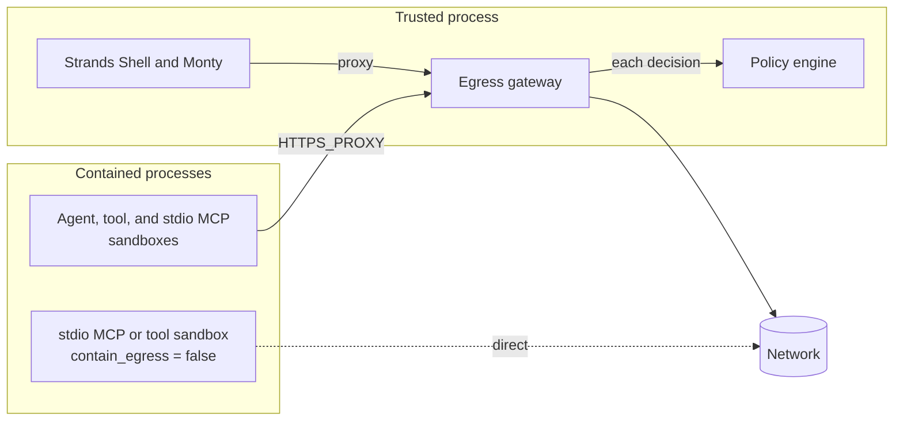
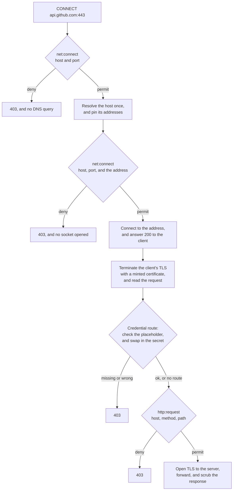
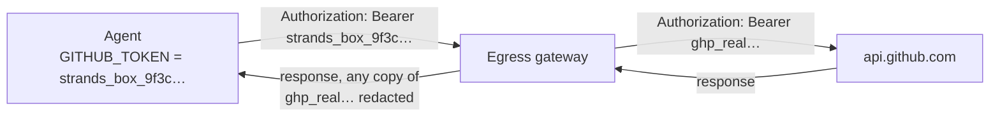

# How Box controls outbound traffic

Each box has one egress gateway in its trusted process, outside every sandbox. The gateway asks
policy to decide outbound requests and forwards those that policy permits. It also adds credentials
bound to the destination, keeping the real secret outside the sandboxes. Contained processes use
this route unless the operator enables the network exception described below.

| The gateway | What it does |
|---|---|
| Requests policy decisions | `net:connect` for each destination before DNS and again for each address it connects to; `http:request` for each request; `mcp:call` for each request to an HTTP MCP server. |
| Adds | The secret an `[egress.<name>]` route binds to the destination. |
| Removes | A copy of that secret from the response, before the process sees it. |

[How Box runs MCP servers](./mcp.md) covers `mcp:call`.

## How traffic reaches the gateway

Box sets the same proxy variables in the environments of the agent, each tool, and each stdio MCP
server:

| Variable | Value |
|---|---|
| `HTTP_PROXY`, `HTTPS_PROXY`, `http_proxy`, `https_proxy` | `http://127.0.0.1:<gateway port>` |
| `NO_PROXY`, `no_proxy` | `127.0.0.1,localhost` |
| `NODE_USE_ENV_PROXY` | `1` |

`NODE_USE_ENV_PROXY` makes Node read the proxy variables. An operator can't set or override any of
these names. `box.toml` rejects them in an `env` table.

Each `box run` creates a new certificate authority in memory and writes only its certificate to
`<box_dir>/trust/cert.pem`. Six variables point each common runtime at that file: `SSL_CERT_FILE`,
`NODE_EXTRA_CA_CERTS`, `CODEX_CA_CERTIFICATE`, `AWS_CA_BUNDLE`, `REQUESTS_CA_BUNDLE`, and
`GIT_SSL_CAINFO`. The private key never leaves the box's trusted process, and a run refuses to start
if the certificate file holds private key material.

The kernel restricts a contained process to two local ports, the gateway and the telemetry
collector, so a client that ignores the proxy variables can't reach the network at all. See [macOS
network restrictions](./macos-enforcement.md#network-connections-and-local-services). A stdio MCP
server or declared tool with `contain_egress = false` connects directly. Its traffic bypasses the
gateway. See [local MCP servers](./containment.md#local-mcp-servers).

Strands Shell's `curl` and Monty's `fetch()` run in the box's trusted process, and both send their
requests through the same gateway, trusting only its certificate authority. Before they do, each
refuses a URL that isn't `http` or `https`, or that names `localhost` or a literal loopback,
private, or link-local address.

## How the gateway decides a request

A client sends either `CONNECT host:port` for HTTPS, or a plain HTTP request with an absolute
`http://` URL. See [plain HTTP takes the same governed
path](decisions.md#plain-http-takes-the-same-governed-path-as-https). Both pass the same decisions.

### `net:connect`, before and after DNS

`net:connect` sees the host and the port, and after DNS, the address.

1. Before DNS, the gateway decides `net:connect` on the host and port. A deny ends the request
   there, so the gateway never looks up a refused host.
2. The gateway resolves the host once and pins the addresses it gets. It connects only to those
   addresses, so a DNS answer that changes later can't redirect the connection. An empty answer or a
   resolver error fails the request.
3. Before it dials each pinned address, in order, the gateway decides `net:connect` again, with the
   address. A deny stops the request. The first permitted address that answers is the one the
   gateway uses, and it decides no later address.

The gateway represents addresses in two fields. `ip4` holds an IPv4 address in dotted-quad form.
`ip6` holds an IPv6 address in compressed lowercase form. Some IPv6 addresses also carry an IPv4
address. Box populates both fields for IPv4-mapped addresses such as `::ffff:169.254.169.254`, 6to4
and Teredo addresses, and addresses under the well-known NAT64 prefix. Policy can then check the
IPv4 endpoint and the IPv6 address used to reach it.

An IPv4 destination populates only `ip4`. Box can extract an IPv4 address from a recognized IPv6
prefix, but it cannot choose one IPv6 representation for an IPv4 address that has many. If Box does
not recognize the IPv6 encoding, `ip4` is absent and an `ip4` rule does not match.

A rule compares either field with `==` or `like`, guarded by `has` for that field. During policy
load, Box checks that address literals in `when` and `unless` conditions use the field's required
form. A refusal gives the expected form or names the other field when the literal belongs to the
other address family. See [a rule that cannot fire is refused at
load](decisions.md#a-rule-that-cannot-fire-is-refused-at-load-and-an-uncertain-one-warns). Box
rejects `context.input.ip` because no action provides that field.

Two cases do not require a whole canonical address. A `like` pattern with a wildcard can match
addresses that cannot be enumerated. A `when temporal` clause checks history, which retains the
spelling recorded with each event. A wildcard pattern must still use characters valid for its field.
Box rejects incorrect letter case and literals from the other family, as it does for hostnames.

IPv4-mapped IPv6 addresses require another check. Their wire representation is exactly `::ffff:`
followed by a dotted quad. Box rejects an `ip6` pattern that puts a dotted quad elsewhere, unless
the pattern starts with a wildcard and its matching addresses cannot be enumerated.

The gateway also canonicalizes the hostname. It converts it to lowercase and removes a trailing dot,
so `API.GitHub.com.` and `api.github.com` reach policy as the same host. Exact comparisons in policy
must use that spelling. Box checks hostname literals in `when` clauses at load and reports the
required form when it refuses one. See [a rule that cannot fire is refused at
load](decisions.md#a-rule-that-cannot-fire-is-refused-at-load-and-an-uncertain-one-warns).
Internationalized domains reach the gateway in punycode form, which rules must also use.

### TLS and `http:request`

Once a pinned address answers, the gateway acknowledges the `CONNECT` and completes the client's TLS
handshake with a certificate for that host, signed by the box's certificate authority. Every
`CONNECT` is intercepted, and the request inside must name the same host as the `CONNECT`.

Policy decides `http:request` for every request. It sees the host, the port, the method, the path,
the body size, and whether the request came inside a `CONNECT`. The gateway puts the path in one
canonical form first. It decodes percent-escapes only for unreserved characters, leaving `%2F`
encoded. It removes `.` and `..` segments and omits the query.

After `http:request` permits the request, the gateway opens TLS to the server. It verifies the
server's certificate against a compiled-in set of public root certificates, then forwards the
request. Each connection carries one request.

A request the gateway refuses gets a 403 with the header `x-strands-box-egress: refused`, and a body
that says why. A `net:connect` refusal of a `CONNECT` arrives before the `200`, so the client never
starts TLS. A policy refusal of a request to an HTTP MCP server gets a JSON-RPC error body.

### Cloud instance metadata

Policy provides the only check on metadata endpoints. The gateway has no built-in block. A policy
needs two `forbid` rules on `net:connect`: one for the metadata hostnames `metadata.google.internal`
and `metadata.azure.internal`, and one for the metadata addresses `169.254.*`, `fd00:ec2::254`, and
the IPv6 link-local range.

## How responses reach the workload

The gateway streams response bodies as they arrive, using bounded buffers. This includes
credentialed responses and HTTP MCP results. Header checks finish before delivery starts, and
credential redaction checks each body chunk before the workload receives it. It retains a
credential-sized tail between chunks, so a small event can wait for more bytes or clean completion.
Matches across chunk boundaries are redacted before delivery.

HTTP MCP `tools/list` keeps bounded capture for each page and the existing schema-staging order
([runtime tool discovery](decisions.md#remote-tool-schemas-are-discovered-at-runtime-in-memory)).
The default 16 MiB cap still applies to requests and these catalog responses.

One absolute upstream deadline covers request transmission and response receipt, with a default of
300 seconds. Chunks do not reset it. A later timeout or framing error closes the unfinished response,
so the workload can receive a processed prefix followed by an error. Box records the request outcome
when the upstream response completes, fails, or is abandoned, and records delivery completion
separately.

## How credentials are added

[How Box keeps credentials out of the box](./credentials.md) covers each source, the request path,
and credential handling for tools and local MCP servers.

An `[egress.<name>]` route binds a secret to a set of destinations. Policy decides whether to
forward each request. The route specifies which credential to add and grants no access itself.

> Every process in a box can use every route. The agent, each tool, and each stdio MCP server get
> every placeholder, and the gateway adds credentials based on the destination. It cannot identify
> which process opened a connection, so it cannot enforce a per-process credential list. A process
> that must not use a credential belongs in a separate box. [The box is the credential
> boundary](./decisions.md#the-box-is-the-credential-boundary) records the decision and its cost.

| Source | `secret.ref` | What the gateway does |
|---|---|---|
| An environment variable | `env://NAME` | Reads `NAME` from the environment of `box run` once, at startup, and swaps it in for a placeholder |
| An AWS profile | `aws://PROFILE` | Signs each request with SigV4, from the profile's static keys |

### The placeholder swap

An `env://` route keeps the real secret in the box's trusted process and gives every contained
process a placeholder instead, which `box.toml` calls a phantom. See [the workload holds a phantom,
and the gateway holds the
secret](decisions.md#the-workload-holds-a-phantom-and-the-gateway-holds-the-secret).

1. At startup, Box reads `NAME` from its own environment, keeps the value, and creates a
   placeholder: `strands_box_`, or the route's `phantom_prefix`, followed by 64 random hex
   characters. Each process gets the placeholder as `NAME`.
2. The process sends the placeholder where it would send the real secret, for example in its
   `Authorization` header.
3. On a request to a bound destination, the gateway looks for the placeholder where the secret goes.
   With `inject = "phantom"`, the default, a request without it, or with a different value, is
   refused with a 403, before policy decides the request. With `inject = "always"`, the gateway adds
   the secret anyway and warns on stderr.
4. The gateway writes the real secret in place of the placeholder. Policy still sees the request as
   the process sent it, and the request goes out only if `http:request` permits it.
5. On the response, the gateway replaces each copy of the real secret in the headers and the body
   with `[REDACTED]`. On a credentialed request, it asks the server for an uncompressed response and
   refuses a compressed one, so that every copy of the secret can be found.

A placeholder sent anywhere else authenticates nothing. The gateway forwards it unchanged to a
destination with no route. The random value reveals no real credential to the receiving server.

The gateway adds a secret only over TLS. It refuses a plain HTTP request to a bound destination
before it adds any credential. See [credentials require TLS](decisions.md#a-secret-rides-only-tls).

`secret.placement` selects a header, HTTP basic auth, or a query parameter for the secret. See
[placement keys](../user/egress.md#placement), [the operator selects the credential
placement](decisions.md#the-operator-selects-the-credential-placement). The gateway looks for the
placeholder in the same place.

### Signed routes

An `aws://` route signs each request. The gateway removes any signing headers the process sent, such
as `Authorization` and `X-Amz-Date`, and signs the request with SigV4. It reads the service and the
region from the host, for example `bedrock` and `us-west-2` from
`bedrock-runtime.us-west-2.amazonaws.com`, and refuses a host it can't read them from. The process
gets placeholder `AWS_ACCESS_KEY_ID` and `AWS_SECRET_ACCESS_KEY` values, so an AWS SDK builds its
request, and the gateway replaces the signature.

## Example: a GitHub API request

Suppose `box.toml` has a route for `api.github.com` with `secret.ref = "env://GITHUB_TOKEN"`, and
`policy.dw` permits `net:connect` and `http:request` for that host. The agent runs `curl -H
"Authorization: Bearer $GITHUB_TOKEN" https://api.github.com/user`.

1. `curl` reads `HTTPS_PROXY` and sends `CONNECT api.github.com:443` to the gateway.
2. `net:connect` permits `api.github.com:443`, before any DNS query.
3. The gateway resolves the host once, `net:connect` permits the first address, and the gateway
   connects to it.
4. `curl` accepts the gateway's certificate for `api.github.com`, because `SSL_CERT_FILE` points at
   the box's certificate authority.
5. The request carries the placeholder in `Authorization`, so the gateway swaps in the real token.
6. `http:request` permits `GET /user` on `api.github.com`.
7. The gateway opens TLS to GitHub, verifies its certificate, and forwards the request.
8. The gateway scrubs any copy of the token from GitHub's reply, and `curl` gets the rest.

If `net:connect` refuses the host at step 2, `curl` gets the 403 in reply to its `CONNECT`.

## See also

- [The `[egress.<name>]` table](../user/egress.md): every route key, and what the box refuses at
  load.
- [How Box keeps credentials out of the box](./credentials.md): the vault, the placeholder swap,
  signed routes, and credentials for a tool or a local MCP server.
- [How Box runs MCP servers](./mcp.md): the `mcp:call` decision for an HTTP MCP server.
- [How Box contains a process](./containment.md): the two kinds of enforcement, and native egress.
- [Policy](./policy.md): how the engine decides each request.
