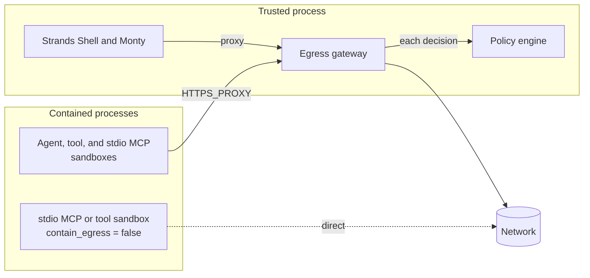
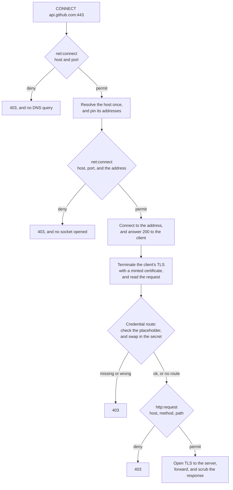
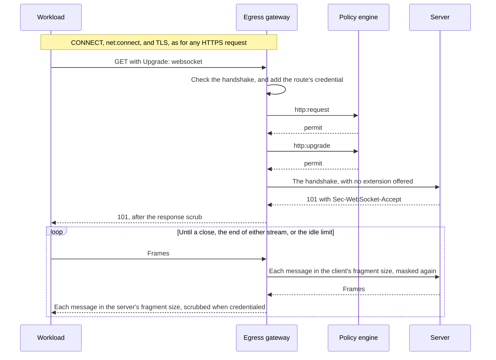
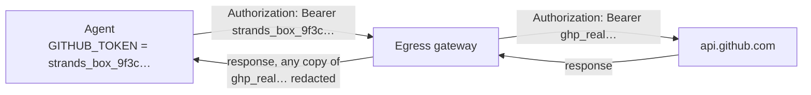

# How Box controls outbound traffic

Every box runs one egress gateway, in the box's trusted process and outside every box. Each network
request a contained process makes goes to the gateway, policy decides it there, and the gateway
forwards it. The gateway also adds the credentials the operator binds to a destination, so the real
secret never enters a box.

| The gateway | What it does |
|---|---|
| Decides | `net:connect` for each destination, before DNS and again for each address it dials. `http:request` for each request. `http:upgrade` for each WebSocket handshake. `mcp:call` for each request to an http MCP server. |
| Adds | The secret an `[egress.<name>]` route binds to the destination. |
| Removes | A copy of that secret from the response, before the process sees it. |

[How Box runs MCP servers](./mcp.md) covers `mcp:call`, and [how a WebSocket passes through the
gateway](#how-a-websocket-passes-through-the-gateway) covers `http:upgrade`.

## How traffic reaches the gateway

**Box points every process at the gateway.** The environment Box composes for the agent, each
tool, and each stdio MCP server sets the same proxy variables:

| Variable | Value |
|---|---|
| `HTTP_PROXY`, `HTTPS_PROXY`, `http_proxy`, `https_proxy` | `http://127.0.0.1:<gateway port>` |
| `NO_PROXY`, `no_proxy` | `127.0.0.1,localhost` |
| `NODE_USE_ENV_PROXY` | `1` |

`NODE_USE_ENV_PROXY` makes Node read the proxy variables. An operator can't set or override any of
these names: `box.toml` refuses each one in an `env` table.

**Box makes every process trust the gateway.** Each `box run` mints a new certificate authority,
in memory, and writes only its certificate to `<box_dir>/trust/cert.pem`. Six variables point each
common runtime at that file: `SSL_CERT_FILE`, `NODE_EXTRA_CA_CERTS`, `CODEX_CA_CERTIFICATE`,
`AWS_CA_BUNDLE`, `REQUESTS_CA_BUNDLE`, and `GIT_SSL_CAINFO`. The private key never leaves the
box's trusted process, and a run refuses to start if the certificate file holds private key material.

**The kernel holds every process to it.** A contained process can connect only to two local ports,
the gateway and the telemetry collector, so a client that ignores the proxy variables can't reach
the network at all ([macOS network restrictions](./macos-enforcement.md#network-connections-and-local-services)).
A stdio MCP server or a declared tool with `contain_egress = false` is the exception: it connects
directly, and the gateway never sees its traffic ([local MCP servers](./containment.md#local-mcp-servers)).

**Box's own interpreters use it too.** A `curl` in Strands Shell and a `fetch()` in Monty run in the
box's trusted process, and both send their requests through the same gateway, trusting only its
certificate authority. Before they do, each refuses a URL that isn't `http` or `https`, or that
names `localhost` or a literal loopback, private, or link-local address.

## How the gateway decides a request

A client sends either `CONNECT host:port` for HTTPS, or a plain HTTP request with an absolute
`http://` URL ([plain HTTP takes the same governed
path](decisions.md#plain-http-takes-the-same-governed-path-as-https)). Both pass the same
decisions.

### `net:connect`, before and after DNS

`net:connect` sees the host and the port, and after DNS, the address.

1. **Before DNS,** the gateway decides `net:connect` on the host and port. A deny ends the request
   there, so the gateway never looks up a refused host.
2. **The gateway resolves the host once** and pins the addresses it gets. It connects only to those
   addresses, so a DNS answer that changes later can't redirect the connection. An empty answer or
   a resolver error fails the request.
3. **Before it dials each pinned address,** in order, the gateway decides `net:connect` again, with
   the address. A deny stops the request. The first permitted address that answers is the one the
   gateway uses, and it decides no later address.

**An address is one spelling.** The gateway gives policy the address as a string, in one canonical
form: an IPv6 spelling of an IPv4 address, such as `::ffff:169.254.169.254`, becomes the IPv4
address, and other IPv6 addresses are compressed and lowercase. A rule matches it with `==` or
`like`.

**The host is one spelling too.** The gateway lowercases it and removes a trailing dot, so a request
for `API.GitHub.com.` and a request for `api.github.com` reach policy as the same host. A rule
carries that spelling as well, because a comparison is exact. A host literal that a `when` clause
compares is held to that spelling at load, and the refusal names the form to write ([a rule that
cannot fire is refused at
load](decisions.md#a-rule-that-cannot-fire-is-refused-at-load-and-an-uncertain-one-warns)). An
internationalized domain reaches the gateway in its punycode form, so a rule names that form.

### TLS and `http:request`

**The gateway reads every HTTPS request.** Once a pinned address answers, the gateway acknowledges
the `CONNECT` and answers the client's TLS with a certificate for that host, signed by the box's own
certificate authority. Every `CONNECT` is intercepted, and the request inside must name the same
host as the `CONNECT`.

**`http:request` is decided for each request.** It sees the host, the port, the method, the path,
the body size, and whether the request came inside a `CONNECT`. The gateway puts the path in one
canonical form first: it decodes only the percent-escapes for unreserved characters, so `%2F` stays
encoded, removes `.` and `..` segments, and leaves out the query.

**The gateway opens TLS to the server last.** Only after `http:request` permits does it connect TLS
to the server, verify the server's certificate against a compiled-in set of public root
certificates, and forward the request. Each connection carries one request. When that request is a
WebSocket handshake and the server accepts it, the connection then carries the WebSocket until it
closes ([how a WebSocket passes through the
gateway](#how-a-websocket-passes-through-the-gateway)).

**A refusal is marked.** A request the gateway refuses gets a 403 with the header
`x-strands-box-egress: refused`, and a body that says why. A `net:connect` refusal of a `CONNECT`
arrives before the `200`, so the client never starts TLS. A policy refusal of a request to an http
MCP server gets a JSON-RPC error body.

### Cloud instance metadata

**Policy is the only check on metadata endpoints.** The gateway has no built-in block. A policy
needs two `forbid` rules on `net:connect`: one for the metadata hostnames
`metadata.google.internal` and `metadata.azure.internal`, and one for the metadata addresses
`169.254.*`, `fd00:ec2::254`, and the IPv6 link-local range.

## How a WebSocket passes through the gateway

A WebSocket starts as one HTTP `GET` that asks the server to switch protocols, and the gateway
decides that request like any other. Once the server agrees with `101 Switching Protocols`, the
same connection carries WebSocket frames, and the gateway stays in the middle: it reads each frame
the workload or the server sends, and writes its own. This happens only on the TLS path, inside a
`CONNECT`.

### The handshake

**The gateway recognizes a handshake before it removes the hop-by-hop fields.** A request is a
WebSocket handshake when it's an HTTP/1.1 `GET` with no body, `Upgrade: websocket`, a `Connection`
field that names `upgrade`, `Sec-WebSocket-Version: 13`, and a `Sec-WebSocket-Key` that decodes to
16 bytes. A request that asks for `websocket` and fails one of those checks gets a 400. Any other
`Upgrade` token, such as `h2c`, is removed as before, and the request goes on as plain HTTP/1.1.

**Two refusals come before policy.** The gateway refuses a handshake to the host of a configured
http MCP server, because its frames would cross with no `mcp:call` decision. It also refuses a
handshake on the plain-HTTP path, because the gateway relays a WebSocket only between two TLS
connections. Each refusal is a 403, and no request reaches the server.

**Policy decides the handshake twice.** `http:request` sees it as a `GET` with no body. When
`http:request` permits, the gateway raises `http:upgrade` on the same host, port, and path, with
`protocol` set to `websocket`. A deny at either gate wins. `http:upgrade` is default-deny, so a
policy written before WebSocket support admits no WebSocket ([a WebSocket upgrade passes a second
gate](decisions.md#a-websocket-upgrade-passes-a-second-gate)).

**The route acts on the handshake as on any request.** Before a route or policy reads the head, the
gateway removes `Sec-WebSocket-Extensions`, so the client can't negotiate compression or any other
extension ([the gateway reads every WebSocket frame and negotiates no
extension](decisions.md#the-gateway-reads-every-websocket-frame-and-negotiates-no-extension)). A
signed route signs the head as it stands, `Sec-WebSocket-Key` and the other WebSocket fields
included. The gateway adds `Upgrade: websocket` and `Connection: Upgrade` back only when it writes
the request out, after the route has run, so a signature never covers a hop-by-hop field.

**The gateway accepts a `101` only when it answers the handshake it forwarded.**
`Sec-WebSocket-Accept` must be the value RFC 6455 derives from the key, the response must name no
extension, and a subprotocol must be one the client offered. Any other `101` gets a 502. A `101` to
a request that wasn't a handshake is refused, as it always was. Any other status, such as `401`, is
an ordinary response. An accepted `101` goes through the same response scrub and release as every
response, and the `http:request` history records it as the reply, with status `101`.

### The relay

**The gateway reads every frame.** After the `101`, it keeps both TLS connections and decodes the
frames in each direction. It checks each one against RFC 6455: a client frame is masked and a server
frame isn't, the reserved bits are clear, the opcode is one the RFC defines, a control frame is
unfragmented and at most 125 bytes, and a continuation belongs to an open message. A frame that
fails a check closes the connection, with 1002 to the side that sent it, or 1007 for text that
isn't UTF-8. The other side gets 1001 when the workload sent the frame, and 1014 when the server
did, so a client library such as Python `websockets` reports the lost server message as an error
rather than a clean close.

**Each message is reassembled, then sent on in its sender's fragment size.** The gateway holds a
message until its last fragment arrives, up to the response body limit, 16 MiB by default. A larger
message closes the connection, with 1009 to its sender. It then writes the message in fragments the
size of the largest fragment the sender used, but at least 1 KiB, or in one frame when the sender
sent one, so a server that limits its frame size, such as AgentCore Runtime at 64 KB, gets fragments
the client sized for it. Control frames pass at once, even between the fragments of a message.
Toward the server, the gateway masks each frame with a fresh random key, and toward the workload it
sends frames unmasked ([a WebSocket message is reassembled, re-framed, re-masked, and
scrubbed](decisions.md#a-websocket-message-is-reassembled-re-framed-re-masked-and-scrubbed)).

**Server messages are scrubbed when the handshake carried a credential.** Each server message
passes through the same response scrub as an HTTP body, so a copy of an `env://` secret arrives at
the workload as `[REDACTED]`. A ping or pong that carries the secret loses its payload, and a close
frame keeps only its code. The scrub reads one message at a time, so a secret that the server
splits across two messages reaches the workload in two parts. The route doesn't act on client
messages, so a placeholder inside one reaches the server as the placeholder.

**The connection ends when it goes idle.** After the `101`, the upstream deadline that bounds an
HTTP exchange becomes an idle limit, 300 seconds by default. When no bytes move in either direction
for that long, both sides get close 1001. There's no total limit, so a WebSocket that keeps
traffic moving, pings included, stays open ([a WebSocket ends on idle and has no lifetime
limit](decisions.md#a-websocket-ends-on-idle-and-has-no-lifetime-limit)).

**One WebSocket holds one connection slot.** The relay runs on the connection's own thread and
keeps the connection's slot until it closes, so each open WebSocket counts against the gateway's
256 concurrent connections. When the queue for one side holds more than 256 KiB, the gateway stops
reading the other side until the queue drains, so a queue holds at most 256 KiB plus one whole
message.

**Policy decides no message.** The `http:upgrade` permit admits the whole connection, and no
message reaches the policy engine or its history. A rule that reads history, such as a budget or a
rule that closes egress after a secret read, therefore stops new requests and WebSockets and leaves
an open WebSocket running ([policy decides the WebSocket handshake and no
message](decisions.md#policy-decides-the-websocket-handshake-and-no-message)). A close the gateway
makes, for a protocol fault, an oversized message, or a refused server message, reaches the decision
log as a deny with its reason. A clean close, the session length, and the byte counts do not.

## How credentials are added

[How Box keeps credentials out of the box](./credentials.md) covers each source, the request path,
and tools and local MCP servers in full. This section is the summary.

An `[egress.<name>]` route binds a secret to a set of destinations. It grants nothing: policy still
decides whether each request to those destinations goes out. The route decides only what rides on
a request that does.

> **Every process in a box can use every route.** The agent, each tool, and each stdio MCP server
> get every placeholder, and the gateway adds a route's credential by destination alone. The gateway can't tell which process opened a connection, so a per-process allowlist would
> bound nothing. A process that must not use a credential belongs in a separate box.
> [The box is the credential boundary](./decisions.md#the-box-is-the-credential-boundary) records the
> decision and its cost.

| Source | `secret.ref` | What the gateway does |
|---|---|---|
| An environment variable | `env://NAME` | Reads `NAME` from the environment of `box run` once, at startup, and swaps it in for a placeholder |
| An AWS profile | `aws://PROFILE` | Signs each request with SigV4, from the profile's static keys |

### The placeholder swap

An `env://` route keeps the real secret in the box's trusted process and gives every contained process a
placeholder instead, which `box.toml` calls a phantom ([the workload holds a phantom, and the
gateway holds the secret](decisions.md#the-workload-holds-a-phantom-and-the-gateway-holds-the-secret)).

1. **At startup,** Box reads `NAME` from its own environment, keeps the value, and mints a
   placeholder: `strands_box_`, or the route's `phantom_prefix`, followed by 64 random hex
   characters. Each process gets the placeholder as `NAME`.
2. **The process sends the placeholder** where it would send the real secret, for example in its
   `Authorization` header.
3. **On a request to a bound destination,** the gateway looks for the placeholder where the secret
   goes. With `inject = "phantom"`, the default, a request without it, or with a different value,
   is refused with a 403, before policy decides the request. With `inject = "always"`, the gateway
   adds the secret anyway and warns on stderr.
4. **The gateway writes the real secret** in place of the placeholder. Policy still sees the
   request as the process sent it, and the request goes out only if `http:request` permits it.
5. **On the response,** the gateway replaces each copy of the real secret in the headers and the
   body with `[REDACTED]`. On a credentialed request, it asks the server for an uncompressed
   response and refuses a compressed one, so that every copy of the secret can be found.

**A placeholder sent anywhere else authenticates nothing.** The gateway forwards it unchanged to a
destination with no route. It's random, so the server that receives it learns nothing.

**The gateway adds a secret only over TLS.** It refuses a plain HTTP request to a bound destination
before it adds any credential ([a secret rides only TLS](decisions.md#a-secret-rides-only-tls)).

**`secret.placement` selects where the secret goes:** a header, HTTP basic auth, or a query
parameter ([placement keys](../user/egress.md#placement), [the operator selects the credential
placement](decisions.md#the-operator-selects-the-credential-placement)). The gateway looks for the
placeholder in the same place.

### Signed routes

An `aws://` route signs each request rather than swapping a placeholder. The gateway
removes any signing headers the process sent, such as `Authorization` and `X-Amz-Date`, and signs
the request with SigV4. It reads the service and the region from the host, for example `bedrock`
and `us-west-2` from `bedrock-runtime.us-west-2.amazonaws.com`, and refuses a host it can't read
them from. The process gets placeholder `AWS_ACCESS_KEY_ID` and `AWS_SECRET_ACCESS_KEY` values, so
an AWS SDK builds its request, and the gateway replaces the signature.

## Example: a GitHub API request

Suppose `box.toml` has a route for `api.github.com` with `secret.ref = "env://GITHUB_TOKEN"`, and
`policy.dw` permits `net:connect` and `http:request` for that host. The agent runs `curl -H
"Authorization: Bearer $GITHUB_TOKEN" https://api.github.com/user`.

1. **Routing.** `curl` reads `HTTPS_PROXY` and sends `CONNECT api.github.com:443` to the gateway.
2. **Host.** `net:connect` permits `api.github.com:443`, before any DNS query.
3. **Address.** The gateway resolves the host once, `net:connect` permits the first address, and
   the gateway connects to it.
4. **Client TLS.** `curl` accepts the gateway's certificate for `api.github.com`, because
   `SSL_CERT_FILE` points at the box's certificate authority.
5. **Placeholder.** The request carries the placeholder in `Authorization`, so the gateway swaps in
   the real token.
6. **Request.** `http:request` permits `GET /user` on `api.github.com`.
7. **Server TLS.** The gateway opens TLS to GitHub, verifies its certificate, and forwards the
   request.
8. **Response.** The gateway scrubs any copy of the token from GitHub's reply, and `curl` gets the
   rest.

If `net:connect` refuses the host at step 2, `curl` gets the 403 in reply to its `CONNECT`.

## See also

- [The `[egress.<name>]` table](../user/egress.md): every route key, and what the box refuses at
  load.
- [How Box keeps credentials out of the box](./credentials.md): the vault, the placeholder swap,
  signed routes, and credentials for a tool or a local MCP server.
- [How Box runs MCP servers](./mcp.md): the `mcp:call` decision for an http MCP server.
- [WebSocket](../user/egress.md#websocket): the policy a WebSocket needs, its limits, and its
  errors.
- [How Box contains a process](./containment.md): the two kinds of enforcement, and native
  egress.
- [Policy](./policy.md): how the engine decides each request.
