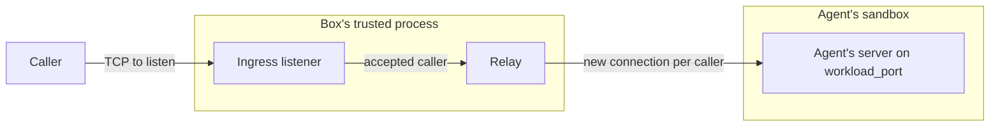
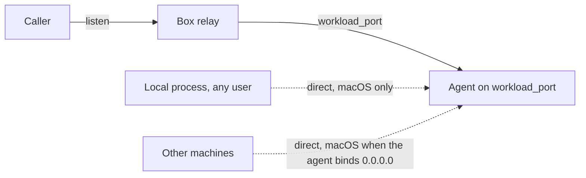

# How Box accepts inbound connections

Ingress lets callers reach a server that the agent runs, such as an HTTP, MCP, or A2A server. Box
listens for callers in its trusted process, outside every sandbox, and relays each caller's TCP
connection to the agent's port. Ingress is optional and experimental: a box has none unless
`[experimental-features]` sets `ingress = true` and `[agent]` declares `[[agent.ingress]]` entries.

Ingress is a relay, not an access control. Box does not authenticate a caller, and no policy
decision covers one. The host that runs the box decides who can reach `listen`. On macOS, callers
can also reach the agent's port without the relay.

| Ingress | What it does |
|---|---|
| Accepts | A TCP connection on each `listen` address. |
| Relays | The caller's bytes to the agent's `workload_port`, and the agent's bytes back, until both sides close. |
| Does not | Authenticate or authorize a caller, end TLS, read or change the bytes, log a caller's identity, or pass on a caller's address. |
| Changes | Nothing about what the agent can reach. The agent stays in its sandbox, and policy still decides everything it does. |

## What the host must provide

Box and the host share the work. Box carries bytes to the agent. The host decides who may send them.

| Box does | The host must do |
|---|---|
| Binds each `listen` address before the agent starts, and refuses a setting it cannot honour. | Make `listen` reachable only by callers it trusts: an authenticating front such as AgentCore Runtime, a reverse proxy that checks identity, a firewall, or a loopback address on a host where it trusts every local user. |
| Relays each caller to the agent's port, up to a limit that Box sets from its open-file limit. A further caller waits until one closes. | Rate-limit and authorize callers, if the agent needs it. |
| Keeps the agent in its sandbox while it serves callers. | Expect Box to admit every caller that reaches `listen`. Box does not refuse one. |
| On macOS, lets the agent listen only on its `workload_port`s. | On macOS, accept that local processes can reach the agent directly, or not run an agent server there. See [Who can reach the agent](#who-can-reach-the-agent). |

A `listen` of `0.0.0.0` accepts a caller from any address that can reach the host on that port.
Use it only when something in front of the host authenticates callers.

A `listen` of `127.0.0.1` keeps out other machines, but it admits every local process of every
user, a page in a local browser within the browser's rules, and on Linux a tool or local MCP server
with `network.contain_egress = false`. So a loopback `listen` is an access control only on a host
with one trusted user.

The agent's server sees each caller's connection come from `127.0.0.1`. Box sends no PROXY header
and no forwarded address. So the server must not trust a caller because of its address. The bytes
pass unchanged, so an HTTP server can check the `Host` and `Origin` headers. That check is the
defence against DNS rebinding when `listen` is a loopback address.

## How a caller reaches the agent

For each caller, Box accepts the connection on `listen`, opens a new connection to the agent's
`workload_port` on `127.0.0.1`, and copies bytes both ways. Any protocol over TCP works, and the
agent's code does not change. How Box opens the second connection depends on the operating system.

### Linux

The agent runs in its own network namespace, which holds only a loopback. Nothing outside the
sandbox can connect to the agent's port, not even Box's trusted process. For each caller, Box asks
the sandbox's PID 1, which is Box's own code and not the agent's, for a TCP socket. PID 1 creates
the socket in the sandbox's network and passes it back unconnected. The trusted process connects it
to `127.0.0.1:workload_port`, with a timeout, and joins it with the caller's connection. The relay
is the only way in.

### macOS

macOS has no network namespaces, so the agent shares the Mac's network. Box adds a Seatbelt rule
that lets the agent listen on each `workload_port` and on no other port. The relay connects to
`127.0.0.1:workload_port` on the Mac's loopback. Seatbelt limits which port the agent listens on,
not who connects to it, so the relay is the supported way in but not the only one.

## Who can reach the agent

| Who | Linux | macOS, agent listens on `127.0.0.1` | macOS, agent listens on `0.0.0.0` |
|---|---|---|---|
| A caller that reaches `listen` | Yes, through the relay | Yes, through the relay | Yes, through the relay |
| A local process, any user | Not directly | **Yes, directly** | **Yes, directly** |
| Another machine on the network | Not directly | No | **Yes, directly** |
| A web page in a local browser | Not directly | Yes, within the browser's rules | Yes |
| A tool or local MCP server with `network.contain_egress = false` | Not directly | Yes | Yes |

The table shows reach that does not pass through the relay. Each row also reaches the agent through
the relay when it can reach `listen`. With a loopback `listen`, every row except another machine
can do so, on Linux too.

On macOS:

- Bind the agent's server to `127.0.0.1`, so other machines cannot reach it.
  `BedrockAgentCoreApp` does this by default outside a container.
- Any local process can call the agent without the relay. A Mac is a development machine, and the
  design accepts this; see [decision D3 in the ingress relay design](../../team/designs/0003-ingress-relay.md#d3).
- Box checks at start that nothing accepts on `127.0.0.1` at a `workload_port`, and refuses the run
  when something does. A process that binds the port after that check, before the agent does,
  receives the relay's callers.

## On AgentCore Runtime

AgentCore Runtime authenticates each `InvokeAgentRuntime` request with IAM or the runtime's
inbound authorizer before it reaches the runtime, and callers reach the runtime's ports only
through the platform. Box runs on Linux there, so the relay is the only way into the agent, and a
`listen` of `0.0.0.0` at the runtime protocol's port is the expected setting: 8080 for HTTP, 8000
for MCP, or 9000 for A2A. Each other server that the agent runs needs its own entry, on a port that
the runtime routes callers to.

On any other host, the host carries that duty: put an authenticating front before `listen`. Keep
`listen` on a loopback address only when the host has one trusted user.

## See also

- [`[[agent.ingress]]`](../user/config.md#agentingress): the settings and the startup checks.
- [Security model and shared responsibility](./security.md): what Box, the operator, and the
  platform own.
- [Limits of Box's protection](./limitations.md): residual risk.
- [Platform differences](./platform-differences.md): other Linux and macOS differences.
- [The ingress relay design](../../team/designs/0003-ingress-relay.md): planned extensions.
