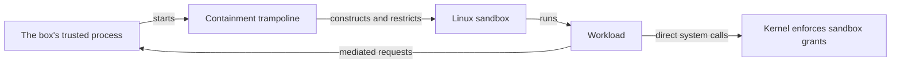

# Operating system enforcement on Linux

Box uses Linux [namespaces](#terms) to give each workload a restricted filesystem and process view.
A system call filter limits the operations that the workload can request from the kernel.

The [platform comparison](platform-differences.md) states configuration differences and startup results.
The published [getting-started guide](../user/getting-started.md) retains its macOS release scope.
This page covers ARM64, the 64-bit Arm architecture.

## Where enforcement runs

The box's trusted process starts each workload through the containment trampoline.
The trampoline is a small program that applies the sandbox before it starts the workload.
It creates [namespaces](#terms), constructs the filesystem view, removes setup authority, and installs [seccomp](#terms) filters.
An unsuccessful setup stops startup.
Box does not start the workload with a partly constructed sandbox.

The user namespace maps the surrounding OS identity to the workload identity.
The mount namespace holds the restricted filesystem view.
The process namespace gives the workload its own process identifiers and a fresh `/proc`.
Separate namespaces also isolate system identity and interprocess communication.
The [network exception](#network-access) changes only the network namespace choice.

Strands Shell, Monty, and the policy engine run in the box's trusted process, outside these sandboxes.
Policy decides requests that reach those components.
The workload's own file operations use its filesystem grants and produce no individual policy decision.
See [the two enforcement paths](containment.md#two-kinds-of-enforcement).

The [Linux boundary uses namespaces rather than Landlock](decisions.md#the-linux-boundary-is-namespaces-not-landlock), a mechanism for additional process access restrictions.
Direct Linux file operations use filesystem grants rather than individual policy decisions.
Linux refuses `[experimental-features] native-filesystem-policy = true` during configuration validation.
See the [platform comparison](platform-differences.md#behavior-and-configuration) for the macOS build requirement and mediated alternatives.

## How the filesystem view changes access

The view starts with an isolated root and adds the files that the workload needs.
A bind mount exposes an existing file or directory at a path inside that view.
An ungranted surrounding-OS path can therefore appear absent.
It does not have to return the same error as a macOS refusal.

`read` exposes a file or directory tree without write access.
`read_file` selects one existing file.
Directory grants include their descendants.
The `workspace` field selects the initial directory but grants no access to its contents.

`write` and `write_file` expose readable, writable mounts on Linux.
Linux does not enforce write-only content access through these mounts.
Box refuses a Linux write grant unless an explicit `read` or `read_file` grant covers its entire scope.
This check applies to the agent, tools, and local Model Context Protocol (MCP) servers before they start.
Execute grants do not satisfy the read requirement.

Startup output identifies each content grant's access mode.
Matching `read` and `write` grants display `read-write`, including exact-file grants.
A read tree with a writable child displays `read-only except read-write at overlapping write grants`.

The comparison explains [overlap and exact-file scope](platform-differences.md#access-modes-and-overlap).

`deny` subtracts access from broader grants.
Linux configuration refuses a deny path that does not exist.
For an existing denied file, Linux can substitute an empty file.
A read can then succeed with empty output while writes fail.

Linux refuses `list`, because the mount view cannot expose directory names without file contents.
An agent's metadata-only directory grant contributes no mount and causes no startup error.
Other grants can still expose that directory.

## Programs and shared libraries

The agent can execute its command and paths under its `exec` grants.
A shared library contains code that another program loads.
A read grant does not make programs executable, except in the loader directories listed below.
Linux mounts those directories readable and executable so their shared libraries can load.
This also permits execution of programs in those directories.

On ARM64, the recognized paths are `/lib64`, `/usr/lib64`, `/lib/aarch64-linux-gnu`, `/usr/lib/aarch64-linux-gnu`, `/lib`, and `/usr/lib`.
Box compares their resolved directory identities with the granted directory.

ELF means Executable and Linkable Format, the Linux binary format.
For an exact ELF binary grant, Box discovers its executable-format interpreter and declared library dependencies.
It also follows the dependencies of discovered system libraries.
System libraries are libraries within the recognized loader directories listed above.

This discovery does not inspect script interpreter lines.
Box handles the declared command's script interpreter chain separately.
An additional script reached through an execution grant can need explicit interpreter and library access.
A directory `exec` grant does not enumerate every program's dependencies.
Libraries loaded later can need additional grants.

A tool or local MCP server runs in its own sandbox.
On Linux, its readable and writable file or directory grants also permit execution.
This lets a tool run helpers and load code that it builds.
Automatic temporary mounts, refused paths, and protected files retain their separate restrictions.
The agent does not receive this broader execution behavior.
See [the tool execution decision](decisions.md#a-leaf-runs-its-whole-toolchain-and-loads-what-it-builds).

## System calls and executable memory

Seccomp checks system call numbers and selected arguments.
It does not resolve pathnames or replace filesystem grants.
The filters refuse operations outside their permit set.

The filter rejects simultaneous writable and executable memory mappings.
The `mprotect` and `pkey_mprotect` system calls change memory access permissions.
The filter refuses `mprotect` requests whose permissions include executable access, including requests that retain that access.
It refuses every `pkey_mprotect` request.
A runtime that compiles code during execution can fail under these restrictions.
Tool execution from writable files does not remove these memory restrictions.

## Terminal controls

The filter refuses `TIOCSTI`, `TIOCLINUX`, and `TIOCSETD` requests through `ioctl`.
These requests can inject terminal input, paste console selections, or replace the terminal's line discipline.
The line discipline controls how the kernel processes terminal input.
The filter compares the low 32 bits of each request, as the kernel does.
Nonzero upper bits do not bypass the restriction.

Ordinary input, output, terminal settings, window-size queries, and resizing remain permitted.
This restriction does not isolate every terminal operation or restore arbitrary terminal settings after workload exit.

## Network access

With gateway networking enabled, the Linux sandbox has a private network namespace without external routes.
Box creates a loopback endpoint inside that namespace.
A relay carries its connections to the egress gateway in the trusted process.
The relay transfers bytes.
The gateway applies policy.
See [egress enforcement](egress.md).

For a tool, `[tool.<name>.network] contain_egress = false` selects the surrounding OS network namespace.
A local MCP server has the corresponding [MCP setting](../user/mcp.md).
Traffic then bypasses the gateway and its policy checks.
Filesystem and process restrictions still apply.
The agent refuses a network table.

This exception does not enable every socket family.
The Linux filter permits UNIX and IPv4 sockets and refuses all other families, including IPv6.

## Startup failures and qualification

The user-namespace probe checks whether the current identity can create a user namespace.
Later mount, process, network, and filter operations can still fail.
A successful probe does not qualify a deployment.

An absent program or loader can produce a missing-file error.
A non-executable mount or refused operation can produce an access error.
Diagnose the operation, path, grants, and workload output together.
The error alone does not identify the responsible restriction.

Each deployment needs its own image, kernel, identity, setup privileges, workload grants, and execution evidence.
A local Linux result does not establish a cloud platform's allowed setup operations.
Minimum versions, minimum privileges, package installation, and testing the assembled Box build remain outside this explanation.

## Terms

| Term | Definition | Notes |
|---|---|---|
| Namespace | A kernel mechanism that gives processes a separate view of selected resources. | Box uses several namespace types. |
| Bind mount | An existing file or directory exposed at another mount point. | Its access flags affect direct file operations. |
| Seccomp | A Linux mechanism that filters system calls. | Box uses static filters before workload execution. |
| Shared library | Code that a program loads from a separate file. | The loader needs readable, executable access. |
| `/proc` | A filesystem that exposes process and kernel information. | Box mounts it within the process namespace. |
| `mprotect` and `pkey_mprotect` | System calls that change memory access permissions. | Box refuses executable access through `mprotect` and every `pkey_mprotect` request. |
