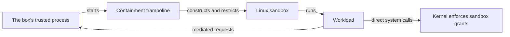

# Operating system enforcement on Linux

Box uses Linux [namespaces](#terms) to give each workload a restricted filesystem and process view.
A system call filter limits the operations that the workload can request from the kernel.

The [platform comparison](platform-differences.md) states configuration differences and startup results.
For installation, see [getting started](../user/getting-started.md#step-1-download-box).
This page covers ARM64, the 64-bit Arm architecture.

## Where enforcement runs

The box's trusted process starts each workload through the containment trampoline.
The trampoline is a small program that applies the sandbox before it starts the workload.
It creates [namespaces](#terms) and the filesystem view. It then removes the privileges used for
setup and installs [seccomp](#terms) filters.
An unsuccessful setup stops startup.
Box does not start the workload with a partly constructed sandbox.

The user namespace maps the surrounding OS identity to the workload identity.
The mount namespace holds the restricted filesystem view.
The process namespace gives the workload its own process identifiers and a fresh `/proc`.
Separate namespaces also isolate system identity and interprocess communication.
The [network exception](#network-access) changes only the network namespace choice.

Inside the process namespace, process ID 1 is the namespace reaper, which collects child exit statuses.
Before creating the workload, it sets `PR_SET_DUMPABLE=0` to restrict workload access to its memory through `/proc/1/mem`.
If that operation fails, it reports setup failure and terminates the namespace before the workload starts.

This guard restricts memory access independently of whether `/proc` permits writes.
A read-only `/proc` does not itself prevent reads of the reaper's memory.
Box installs its seccomp filters in the workload after creating it. The reaper does not receive those filters.

The workload's `/proc` is read-only to prevent writes through process-memory files to executable pages.
Process inspection remains available.
The filters permit creation of nested user namespaces, but read-only `/proc` prevents writes to their user and group identity maps.

Strands Shell, Monty, and the policy engine run in the box's trusted process, outside these sandboxes.
Policy decides requests that reach those components.
The workload's own file operations use its filesystem grants and produce no individual policy decision.
See [the two enforcement paths](containment.md#two-kinds-of-enforcement).

The [Linux boundary uses namespaces rather than Landlock](decisions.md#the-linux-boundary-is-namespaces-not-landlock), a mechanism for additional process access restrictions.
Direct Linux file operations use filesystem grants rather than individual policy decisions.
Linux refuses `[experimental-features] native-filesystem-policy = true` during configuration validation.
See the [platform comparison](platform-differences.md#behavior-and-configuration) for the macOS build requirement and mediated alternatives.

## Capabilities inside nested namespaces

A Linux [capability](#terms) is a privilege for an operation such as namespace administration.
Box clears every capability set before the workload starts.
This removes the privileges used for startup. Linux can still grant capabilities in a nested user namespace.

The filters permit `unshare`, `clone`, and `clone3` to create user namespaces, and `setns` to enter eligible child namespaces.
The process can then hold capabilities within that namespace and the namespaces it owns.
Those capabilities do not grant privileges in a parent user namespace.

Box's seccomp filters remain active after namespace creation or entry, and child processes inherit them.
The filters still refuse `mount` and `fsopen`, which mount a filesystem or begin filesystem setup.
Other permitted operations can use the restored capabilities, such as creation of a nested mount namespace.
These namespaces share the surrounding OS kernel, so [kernel security remains a dependency](security.md#the-operator-and-platform-own-the-environment).

## How the filesystem view changes access

The view starts with an isolated root and adds the files that the workload needs.
A bind mount exposes an existing file or directory at a path inside that view.
An ungranted surrounding-OS path can therefore appear absent.
It does not have to return the same error as a macOS refusal.

Box retains open references to each validated source and its mount target during setup.
It creates missing mount targets only in the isolated staging filesystem.
If a nested target disappears from an exposed surrounding-OS tree, setup refuses instead of recreating that target.
This rule also prevents directory creation outside the filesystem grants when an ancestor changes during setup.

Enclosing mounts precede their descendants, and canonical source mounts precede aliases that depend on them.
Box resolves permitted symbolic links within the staging root and verifies where each new mount attaches.
Alias mounts retain the canonical grant's permissions when they reach that same mounted object.
Write-protected files remain protected through permitted aliases.
A protection alias must resolve to its producing writable grant's verified mount location plus the protected file's relative path.
Box refuses a redirect to another location, including a replaced descendant link.
Box applies bind permissions through the retained mount reference, then verifies the flags and that same mount's placement.
If the final checks cannot confirm the same mount at its verified location, startup refuses.
Box still enumerates submounts through mount-table pathnames. These checks do not protect against
every concurrent change to a descendant.

`read` exposes a file or directory tree without write access.
`read_file` selects one existing file.
Directory grants include their descendants.
The `workspace` field selects the initial directory but grants no access to its contents.

`write` and `write_file` expose readable, writable mounts on Linux.
Linux does not enforce write-only content access through these mounts.
Box refuses a Linux write grant unless an explicit `read` or `read_file` grant covers its entire scope.
This check applies to the agent, tools, and local MCP servers before they start.
MCP means Model Context Protocol.
Execute grants do not satisfy the read requirement.

Startup output identifies each content grant's access mode.
Matching `read` and `write` grants display `read-write`, including exact-file grants.
A read tree with a writable child displays `read-only except read-write at overlapping write grants`.

The comparison explains [overlap and exact-file scope](platform-differences.md#access-modes-and-overlap).

`deny` subtracts access from broader grants.
Linux configuration refuses a deny path that does not exist.
For an existing denied file, Linux can substitute an empty file.
A read can then succeed with empty output while writes fail.

For denied files and directories beneath writable grants, Box protects the intermediate ancestor directories.
It binds those directories onto themselves, then covers those mounts with the original writable grant.
Within the workload's mount namespace, Linux keeps the hidden mounts attached to those directory entries and refuses to rename them.
The visible grant stays continuous, so unrelated file and directory renames across those ancestors remain available.
Box installs nested grants and denial masks after this covering bind. They retain their precedence
and source identity checks.
Existing boundaries between separate grants or filesystems still apply.

Linux refuses `list`, because the mount view cannot expose directory names without file contents.
An agent's metadata-only directory grant contributes no mount and causes no startup error.
Other grants can still expose that directory.

## Programs and shared libraries

The agent can execute its command and paths under its `exec` grants.
A shared library contains code that another program loads.
A read grant does not make programs executable, except in the loader directories listed below.
Linux mounts those directories readable and executable so their shared libraries can load.
This also permits execution of programs in those directories.

On ARM64, the recognized paths are `/lib64`, `/usr/lib64`, `/lib/aarch64-linux-gnu`, `/usr/lib/aarch64-linux-gnu`, `/lib`, and `/usr/lib`.
Box compares their resolved directory identities with the granted directory.
After combining overlapping grants, Box refuses a writable, executable mount without an explicit execution grant covering its source.
This includes a loader-directory read combined with a write on the same directory or an ancestor.
An execution grant for one file does not authorize execution across its containing directory.
Read-only library directories keep their automatic execution access.

ELF means Executable and Linkable Format, the Linux binary format.
For an exact ELF binary grant, Box discovers its executable-format interpreter and declared library dependencies.
It also follows the dependencies of discovered system libraries.
System libraries are libraries within the recognized loader directories listed above.

Before an agent starts, Box checks whether each discovered loader or shared library is writable through the workload's grants.
A writable dependency needs an explicit `exec` grant, even when a read-only program loads it.
Otherwise, Box refuses startup.
This check includes writable symbolic-link paths and hard-link aliases.
Hard-linked libraries can retain automatic execution access when ownership, permissions, and mount checks establish that the workload cannot modify them.
See [writable library grants](../user/config.md#linux-writable-libraries) for the configuration requirements and limits.

This discovery does not inspect script interpreter lines.
For a declared script command, Box checks each interpreter against that process's original filesystem grants.
An agent needs `exec` coverage; a tool or local MCP server can reuse its readable grants.
An earlier interpreter cannot authorize a later interpreter, and system paths have no exemption.
See [script commands on Linux](../user/config.md#script-commands-on-linux) for the required grants.

An additional script reached through an execution grant can need explicit interpreter and library access.
A directory `exec` grant does not enumerate every program's dependencies.
Libraries loaded later can need additional grants.

A tool or local MCP server runs in its own sandbox.
On Linux, its readable and writable file or directory grants also permit execution.
This lets a tool run helpers and load code that it builds.
Automatic temporary mounts, refused paths, and protected files retain their separate restrictions.
The agent does not receive this broader execution behavior.
See [the tool execution decision](decisions.md#a-leaf-runs-its-whole-toolchain-and-loads-what-it-builds).

## System calls and executable memory

Seccomp checks system call numbers and selected arguments.
It does not resolve pathnames or replace filesystem grants.
The filters refuse operations outside their permit set.

The filter rejects simultaneous writable and executable memory mappings.
The `mprotect` and `pkey_mprotect` system calls change memory access permissions.
The filter refuses `mprotect` requests whose permissions include executable access, including requests that retain that access.
It refuses every `pkey_mprotect` request.
A runtime that compiles code during execution can fail under these restrictions.
Tool execution from writable files does not remove these memory restrictions.

## Terminal controls

The filter refuses `TIOCSTI`, `TIOCLINUX`, and `TIOCSETD` requests through `ioctl`.
These requests can inject terminal input, paste console selections, or replace the terminal's line discipline.
The line discipline controls how the kernel processes terminal input.
The filter compares the low 32 bits of each request, as the kernel does.
Nonzero upper bits do not bypass the restriction.
Console request numbers follow the Linux user API headers
[`kd.h`](https://github.com/torvalds/linux/blob/adc218676eef25575469234709c2d87185ca223a/include/uapi/linux/kd.h)
and [`vt.h`](https://github.com/torvalds/linux/blob/adc218676eef25575469234709c2d87185ca223a/include/uapi/linux/vt.h).
The filter defines missing constants privately, without unreleased library definitions.

Ordinary input, output, terminal settings, window-size queries, and resizing remain permitted.
The filter also refuses virtual-console keyboard modes, display modes, switching, deallocation, and console-wide resizing.
It refuses keyboard lock flags, indicator lights, accent-table changes, fonts, color palettes, and screen and Unicode map changes.
Programs that manage these console features receive a permission error.
Read-only console queries remain permitted when they have a separate request number.
`KDFONTOP` combines font queries and changes behind a pointer, so the filter refuses both.
Ordinary terminal resizing through `TIOCSWINSZ` remains permitted.
Kernel capability checks still restrict keymap and function-key replacement.
This restriction does not isolate every terminal operation or restore arbitrary terminal settings after workload exit.

## Network access

On Linux, `contain_egress` selects the network mode for a tool or local MCP server.
A tool sets it under `[tool.<name>.network]`.
A local MCP server has the corresponding [MCP setting](../user/mcp.md).
The agent uses gateway networking and refuses a network table.

`contain_egress = true` is the default.
The sandbox has a private network namespace without external routes.
Box creates a loopback endpoint inside that namespace.
A relay carries its connections to the local egress gateway in the box's trusted process.
The gateway supports outbound HTTP and HTTPS requests.
The gateway applies policy, as described in [egress enforcement](egress.md).

The sandbox cannot connect directly to the surrounding OS's loopback listeners, such as
`localhost`, or [abstract Unix sockets](#terms).
A client can reach a surrounding-OS HTTP service through the gateway when it explicitly sends the request there and policy permits.
Box sets `NO_PROXY=127.0.0.1,localhost`, so clients that honor it attempt direct connections to those destinations inside the private namespace.
Strands Shell `curl` and Monty `fetch()` refuse URLs naming `localhost` or a literal loopback, private, link-local, `0.0.0.0/8`, or cloud metadata address, or an IPv6 address that carries one of these.
See [how traffic reaches the gateway](egress.md#how-traffic-reaches-the-gateway).

`contain_egress = false` selects the surrounding OS network namespace.
Direct connections can reach IPv4 destinations, including loopback listeners, and abstract Unix sockets.
Direct connections bypass the gateway's policy checks, credential injection, and traffic records.
Box still sets proxy environment variables, so clients that use them can continue through the gateway.

In both modes, the Linux filter permits Unix and IPv4 sockets and refuses other socket families, including IPv6.
[Pathname Unix sockets](#terms) remain subject to filesystem visibility and operating system permissions.
A directory grant can expose sockets inside that directory.

The process retains the invoking operator's identity in the surrounding OS.
A reachable service that trusts that identity may treat the process as the operator.
The process keeps its filesystem and process restrictions.
Those restrictions do not constrain a surrounding-OS service that acts on the process's behalf.

## Startup failures and qualification

The user-namespace probe checks whether the current identity can create a user namespace.
Later mount, process, network, and filter operations can still fail.
A successful probe does not qualify a deployment.

An absent program or loader can produce a missing-file error.
A non-executable mount or refused operation can produce an access error.
Diagnose the operation, path, grants, and workload output together.
The error alone does not identify the responsible restriction.

Qualify each deployment with its intended image, kernel, identity, setup privileges, and workload
grants. Keep the execution results as evidence.
A local Linux result does not establish a cloud platform's allowed setup operations.
Minimum versions, minimum privileges, package installation, and testing the assembled Box build remain outside this explanation.

## Terms

| Term | Definition | Notes |
|---|---|---|
| Namespace | A kernel mechanism that gives processes a separate view of selected resources. | Box uses several namespace types. |
| Abstract Unix socket | A local communication endpoint with a name instead of a filesystem path. | Its visibility follows the network namespace. |
| Pathname Unix socket | A local communication endpoint addressed through a filesystem path. | A directory grant can expose its path. |
| Capability | A Linux privilege for a specific operation. | User namespaces scope these privileges. |
| `unshare`, `clone`, `clone3`, and `setns` | System calls that create or enter namespaces. | `clone` and `clone3` also create processes. |
| `mount` and `fsopen` | System calls that mount a filesystem or begin filesystem setup. | Box refuses both after nested namespace creation or entry. |
| Bind mount | An existing file or directory exposed at another mount point. | Its access flags affect direct file operations. |
| Seccomp | A Linux mechanism that filters system calls. | Box uses static filters before workload execution. |
| Shared library | Code that a program loads from a separate file. | The loader needs readable, executable access. |
| `/proc` | A filesystem that exposes process and kernel information. | Box mounts it within the process namespace. |
| `mprotect` and `pkey_mprotect` | System calls that change memory access permissions. | Box refuses executable access through `mprotect` and every `pkey_mprotect` request. |
