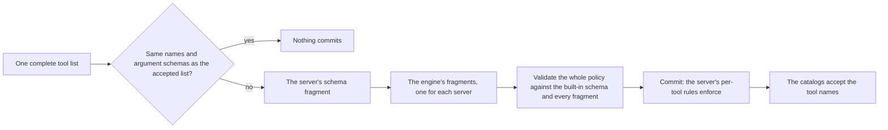
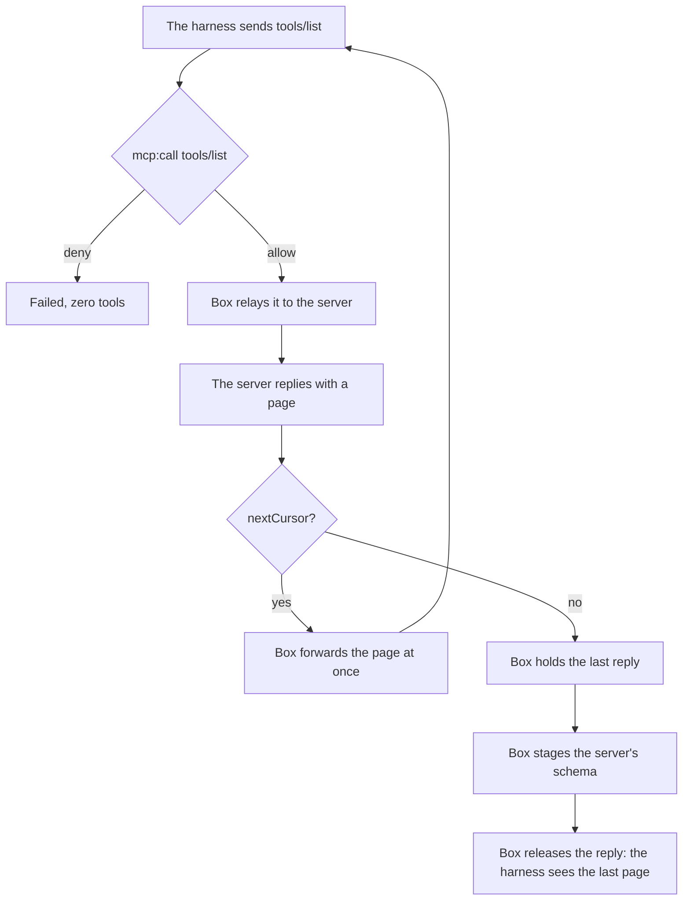
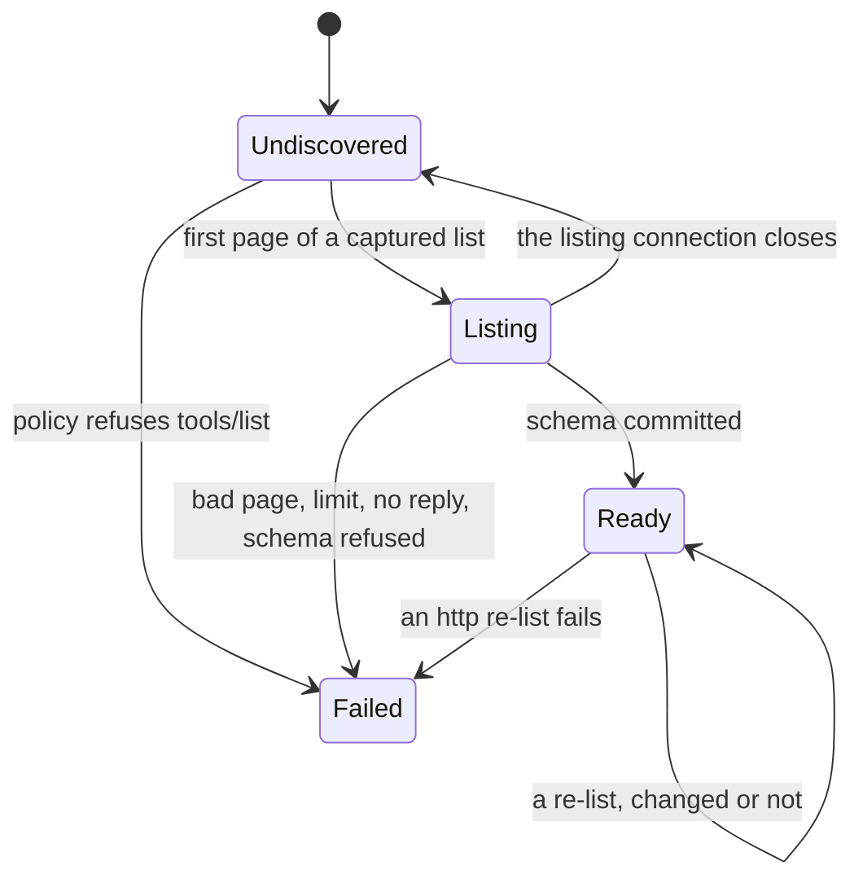

# How Box discovers MCP tools

MCP means Model Context Protocol. MCP discovery lets Box apply policy to individual tools and
their arguments. For example, an
operator can permit GitHub searches but refuse searches that request more than five results.
Dogwood checks each rule against a schema before loading it. The schema declares the actions and
their input types. A rule cannot load if it names an undeclared action or compares an argument as
a number when the schema declares another type. The decision to use
[Dogwood](decisions.md#the-engine-is-dogwood) explains the policy language choice.

The schema has two parts, and policy loads in two steps to match:

| | The built-in schema | The generated schema |
|---|---|---|
| What it declares | Box's own actions: `net:connect`, `http:request`, `shell:spawn`, `fs:*`, and `mcp:call` with the server, method, tool, prompt, and URI | One action for each tool on each server, such as `github::Action::"search_repositories"`, with a typed field for each argument |
| Where it comes from | Box ships it | Box builds it from each server's answer to `tools/list` |
| When it's available | When the box starts | When that server's tool list arrives |
| Rules it enables | A server permit, a method or tool-name `forbid` on `mcp:call`, and every egress, shell, and file rule | A rule that names a tool's own action, such as `github::Action::"get_me"`, or tests its arguments, such as `context.input.perPage > 5` |

When the box starts, the policy engine commits every rule that validates against the built-in
schema, so the agent, the shell, the egress gateway, and every server's `mcp:call` permit work at
once. A rule that names a tool's own action waits until that server's part of the generated schema
is staged. The engine can then load and enforce a rule like this:

```cedar
forbid (principal, action == github::Action::"search_repositories", resource)
when { context.input has perPage && context.input.perPage > 5 };
```

Discovery builds the generated schema. It works the same way for stdio servers that Box starts
and http servers that Box reaches through the egress gateway. Box
reads the replies to the harness's own `tools/list`, and sends no list of its own. It holds the
reply to the last page until that server's schema commits, so a tool is not callable until the engine enforces its rules. See [Box discovers an MCP tool schema from the live server's own
list](decisions.md#mcp-tool-schemas-are-discovered-from-the-live-server).

This page explains discovery for both server types, including completion, repeated lists, and
failures. For policy levels and tool-call decisions, read [How Box runs MCP servers](./mcp.md).

## How a tool list becomes enforced rules

Staging is the step that turns one server's complete tool list into enforced rules. Box generates
the server's schema fragment with one policy action per tool and typed arguments. The policy engine
commits that fragment. See [per-tool actions and their arguments](./mcp.md#per-tool-actions-and-their-arguments).



The policy engine keeps one fragment for each server. For each commit, it combines the fragments, validates the whole policy against them, and commits
the result. The last commit therefore includes every server's schema. Commits run one at a time.
Each server commits when its list is complete:

| Commit | When | What it adds | Engine readiness |
|---|---|---|---|
| 1 | The box starts | Every rule that validates against the built-in schema. Per-tool rules wait. | `Discovering` while a per-tool rule waits, otherwise `Ready` |
| One for each server | That server's list completes | That server's fragment, and the per-tool rules that now validate | `Ready` once every per-tool rule validates |

A server with no per-tool rule still commits, so its tools join the schema. A server that fails, is
refused, or never connects adds no commit.

While the engine is `Discovering`, the committed rules decide each request. See [discovery serves the
schema-independent subset](decisions.md#discovery-serves-the-schema-independent-subset). Box refuses a tool call as pending while its per-tool rule waits. It also refuses calls that an
inert per-tool rule would decide on a server whose rule has not loaded. These refusals apply to
individual tools. The loaded rules still decide calls to tools that have no waiting rule.

## How a server is discovered

Both server types follow the steps below. Each step table includes the server's discovery state,
defined in [the parts and their states](#the-parts-and-their-states).




Box builds the server's tool list from replies that start without a cursor and follow that list's
`nextCursor` chain. See [pages, limits, and failures](#pages-limits-and-failures).

The two kinds of server differ in how they hold the last reply. A stdio connection carries many
frames, so the broker keeps the reply in the connection's queue, stages on a background thread, and
keeps relaying other frames while it waits. An http request has its own thread, so the gateway
stages on that thread before it writes the response.

### A stdio server

| Step | What happens | Server state |
|---|---|---|
| 1 | The harness runs the server's full command through its alias. `shell:spawn` decides the declared program, and Box starts the server in its own sandbox. | `Undiscovered` |
| 2 | The harness sends `initialize`. Box forwards it without a decision, and the broker checks the protocol version in the reply. | `Undiscovered` |
| 3 | The harness sends `tools/list`, and `mcp:call` decides it. A refused list never reaches the server. | `Failed` if refused |
| 4 | The broker relays the request. Box captures a list that names no cursor, and gives it 30 seconds for each reply. | `Undiscovered` |
| 5 | Box merges and forwards a page with a `nextCursor` immediately. | `Listing` |
| 6 | The last page completes the list. The broker holds its reply and starts staging. | `Listing` |
| 7 | The engine commits the schema and enforces the server's per-tool rules. | `Ready` |
| 8 | The broker sends the held reply, and the harness sees the last page. | `Ready` |
| 9 | Once every stdio server is `Ready` or `Failed`, and every held reply is written, the broker reports that stdio discovery is complete. | |

A failure at steps 5 to 7 sends the harness an MCP error that names the failed step, in place of the
reply. A stdio server that fails there takes no new connections, and its other connections close.

### An http server

| Step | What happens | Server state |
|---|---|---|
| 1 | The harness connects through the egress gateway. `net:connect` decides the host before DNS and each address after it. | `Undiscovered` |
| 2 | Policy decides each request as `http:request` and its MCP frame as `mcp:call`. It also decides `initialize` for an http server. | `Undiscovered` |
| 3 | `mcp:call` decides `tools/list`. A refusal is a 403. | `Failed` if refused |
| 4 | The gateway forwards the request and reads the whole response. | `Undiscovered` |
| 5 | Before it writes the response, the gateway hands the page to the tool catalogs, with the request's `Mcp-Session-Id` and cursor. | `Listing` |
| 6 | On the last page the catalogs stage the schema, on the request's thread. Once every http server is `Ready` or `Failed`, the gateway reports that http discovery is complete. | `Ready` |
| 7 | The gateway writes the response, and the harness sees the last page. | `Ready` |

The gateway reports completion before writing the last response. Unlike the broker, it does not
wait until the harness has the tools. On failure, it withdraws the server's accepted tools and
writes the failure to stderr, but still sends the response to the harness. An http server that fails stays
reachable, and each call to its tools is refused.

## The parts and their states

Five components handle discovery. All of them run in the box's trusted process.

| Part | What it does | State it holds |
|---|---|---|
| The tool catalogs | One set per box, shared by both kinds of server. They collect a server's pages, stage its schema, and check each `tools/call` against the accepted tool names. | Each server's discovery state and accepted tools, and each unfinished list |
| The MCP broker | Relays each stdio connection, holds the last page's reply, and reports when every stdio server is done. | Each connection's pending lists and held replies; whether the stdio side is done |
| The egress gateway and its policy hook | Relays each http request, hands each `tools/list` reply to the catalogs, and reports when every http server is done. | None of its own |
| The policy engine | Validates the policy against the combined schema, and commits it. | Its readiness, either `Discovering` or `Ready` |
| The discovery coordinator | Waits for both kinds of server to report, then finishes discovery once. See [the box coordinates discovery completion](decisions.md#the-box-coordinates-discovery-completion). | The sides still to report |

### A server's discovery state

Each declared server is in one of four states.



- `Undiscovered` means no list has arrived.
- `Listing` means a list is arriving, and Box has not accepted a catalog.
- `Ready` means Box has accepted a catalog and its tools are callable.
- `Failed` means discovery failed. The reason identifies the failed step.

`Ready` and `Failed` both count as complete for startup.

Box uses these states to track discovery. [When startup is
complete](./mcp.md#when-startup-is-complete) describes the operator-visible outcomes. A `Ready`
server has the Ready outcome. A `Failed` server has the No tools or Degraded outcome when policy
refused `tools/list`, and Failed for other causes. See [recovery after a denied tool list](decisions.md#a-server-whose-discovery-a-policy-denies-degrades-alone).

## How discovery finishes

The broker reports once to the coordinator for stdio servers. The gateway reports once for http
servers. The gateway reports only when `box.toml` declares an http server. When the last side
reports, the coordinator finishes discovery once. A per-tool rule that still hasn't validated
is inert: the servers it waits for are degraded, stderr names them, and the engine becomes `Ready`
for the rest of the run.

For each inert rule, Box holds back the tools it can identify as subject to that rule. It recognizes
a tool named in the head or a condition that pins both a server and a tool. The warning instead
names the servers the rule still needs. If a rule applies to tools it never names, Box holds back
no calls for that rule. [mcp.md](mcp.md#when-startup-is-complete) explains this limit.

Every tool mentioned in the head, a condition, or a history reference must be declared. Box names
the server for each undeclared tool. A server whose `tools/list` policy refused declares no tools.
An accepted catalog can still omit a tool because the rule misspells its name or the server removed it.

If every referenced tool is declared, the rule failed for another reason, such as a different
argument name or type. Box then names every server mentioned in the rule. This can include a server
that answers correctly. [Box reports these pending rules without refusing the whole
policy](decisions.md#a-server-whose-discovery-a-policy-denies-degrades-alone). A history-only
reference to a tool still does not decide calls to it, so that tool is not held back.

A rule held back this way isn't always held back for the rest of the run. A list that arrives after
discovery finishes still stages its schema, and if it completes the whole policy those rules load
and enforce from that moment. Two things decide whether a server gets there: whether a later list
reaches Box, and whether its schema is the last thing the policy needs.

A later list goes through the same decision, staging, and [limits](#pages-limits-and-failures) as
the first, so an earlier refusal doesn't have to repeat. A rule that reads history can refuse one
`tools/list` and permit the next, and a server can follow a schema the policy refused with one it
accepts. On an http server no state guard stands in the way, so any later `tools/list` that policy
permits delivers a list, on any session. On a stdio server, a list that fails while the server has
no accepted catalog stops it: the connection whose list failed closes, the failure wakes every other
connection open to that server and `admit_open` then stops each one, and a new `Open` is refused. A
`tools/list` that policy refused doesn't stop a stdio server, so a later one that policy permits
still stages. Letting a stdio server recover from a failed list would be a change to the broker.

The schema also has to be the last thing the policy needs. After discovery finishes, a late list is
validated with the whole policy, so it stages only when every other schema the policy needs is
already there and matches its rules. With two schemas missing, a list from either server leaves the
other's per-tool rules unvalidated: the policy doesn't validate, the list is refused, and the schema
it carried is dropped with it. The other server's later list then fails the same way, because the
first schema is gone, so neither recovers. A schema that staged but doesn't match its rule blocks a
late list the same way. So what blocks recovery is whatever else the policy still needs, not how
many servers have tools held. A rule that decides a tool on each of two servers holds both tools
while one schema is missing, and the late list that supplies that schema completes the policy and
recovers both.

A declared server that never connects stays `Undiscovered`, so its side never reports and discovery
never finishes. The engine still becomes `Ready` if every per-tool rule validates, and stays
`Discovering` only while a rule waits for a server that hasn't staged. Either way, every other
server's rules are already committed, so no request waits on the missing server.

## When a server lists again

A harness can list a server again when it reconnects, opens a second window, or receives
`notifications/tools/list_changed`. On a stdio server each connection is its own server process, and
its list reaches that process.

Box compares the new list's fingerprint with the accepted one. The fingerprint is each tool's name
and `inputSchema`, sorted by name, and the list's `$defs`. A description, a title, or tool order
doesn't change it.

| The new list | stdio server | http server |
|---|---|---|
| The same fingerprint | Nothing commits, and the reply goes out at once | Nothing commits |
| A different fingerprint | It commits, and replaces the accepted tools | It commits, and replaces the accepted tools |
| It fails | The accepted tools stay | The accepted tools are withdrawn |

While a changed list commits, only tools named in both lists pass the catalog check. A server can
change its tools 16 times in one run. After that, its accepted tools stay, and stderr names it.

## Pages, limits, and failures

Box captures a list only along its own cursor chain. The first request has no cursor. Each later
request must name the preceding page's `nextCursor` on the same connection. On an http
server, `Mcp-Session-Id` is the connection. A list that starts with a cursor, or a cursor that
doesn't continue the chain, still reaches the harness, but Box doesn't capture it. So the harness
can't shape what Box captures, and the pages always come from the server.

| Limit | Value | When a list goes over it |
|---|---|---|
| Pages in one list | 256 | The list fails |
| Bytes in one list | 8 MiB | The list fails |
| Discovery data in one run | 32 MiB, checked best-effort | The list that goes over it fails |
| Unfinished lists for one server | 4 | A new list replaces the oldest unfinished one |
| Catalog changes for one server | 16 in one run | The accepted tools stay |
| Time for a stdio server to answer a captured list | 30 seconds | The server fails |

A failure stays with its server:

| Failure | That server | The other servers |
|---|---|---|
| `shell:spawn` refuses a stdio server | It never starts | Unaffected |
| Policy refuses `tools/list` | `Failed` with zero tools, and each call to its tools is refused | Unaffected |
| A bad page, a limit, or no reply in time | `Failed` | Unaffected |
| The schema can't be generated, or policy refuses it | `Failed` | Unaffected |
| A re-list fails after `Ready` | stdio: keeps its tools. http: `Failed`, tools withdrawn | Unaffected |
| The policy history can't be written | stdio: the box stops. http: stderr warns, and the box keeps running | stdio: the box stops |

A rule that decides a tool on two servers is the exception: while it waits for one server's schema,
it holds its tool on the other server too.

A harness that stops paging before the last page leaves the server unstaged, and each call to its
tools is refused.

## Example: Claude Code with five servers

The box runs Claude Code with two stdio servers and three http servers. The `docs` server is
declared, but nothing is running at its address. This is the MCP part of `box.toml`. The `[agent]`
table and the model's egress route are as in [getting started](../user/getting-started.md), and the
stdio servers' filesystem grants are omitted. See [the `[mcp.<name>]` table](../user/mcp.md) for those grants:

```toml
[mcp.fetch]
type    = "stdio"
command = ["mcp-server-fetch"]

[mcp.git]
type    = "stdio"
command = ["mcp-server-git"]

[mcp.github]
type         = "http"
destinations = ["api.githubcopilot.com"]
secret.ref   = "env://GITHUB_MCP_TOKEN"

[mcp.deepwiki]
type         = "http"
destinations = ["mcp.deepwiki.com"]

[mcp.docs]
type         = "http"
destinations = ["mcp.docs.example.com"]
```

The example uses these MCP rules in `policy.dw`:

```cedar
@id("mcp_starts")
permit (principal, action == Box::Action::"shell:spawn", resource)
when { ["mcp-server-fetch", "mcp-server-git"].contains(context.input.program) };

@id("mcp_hosts")
permit (principal, action == Box::Action::"net:connect", resource)
when { ["api.githubcopilot.com", "mcp.deepwiki.com", "mcp.docs.example.com"].contains(context.input.host) };

@id("mcp_requests")
permit (principal, action == Box::Action::"http:request", resource)
when { ["api.githubcopilot.com", "mcp.deepwiki.com", "mcp.docs.example.com"].contains(context.input.host) };

@id("mcp_servers")
permit (principal, action == Box::Action::"mcp:call", resource)
when { ["fetch", "git", "github", "deepwiki", "docs"].contains(context.input.server) };

@id("hide_deepwiki_tools")
forbid (principal, action == Box::Action::"mcp:call", resource)
when { context.input.server == "deepwiki" && context.input.method == "tools/list" };

@id("small_github_searches")
forbid (principal, action == github::Action::"search_repositories", resource)
when { context.input has perPage && context.input.perPage > 5 };

@id("short_fetches")
forbid (principal, action == fetch::Action::"fetch", resource)
when { context.input has max_length && context.input.max_length > 100000 };
```

The first five rules validate against the built-in schema, so they load when the box starts. The
last two name a tool's own action, so each one waits for its server's part of the generated schema.
`git` has no per-tool rule, and its schema still stages, so a rule for it could be added later.

When Claude Code starts and lists each server, discovery proceeds as follows:

| Moment | Engine | fetch | git | github | deepwiki | docs | Waiting to report |
|---|---|---|---|---|---|---|---|
| The box starts, commit 1 | `Discovering` | `Undiscovered` | `Undiscovered` | `Undiscovered` | `Undiscovered` | `Undiscovered` | stdio, http |
| `hide_deepwiki_tools` refuses deepwiki's `tools/list` | | | | | `Failed` | | |
| Each list's last page arrives, and each reply is held | | `Listing` | `Listing` | `Listing` | | | |
| GitHub commits, and the engine enforces `small_github_searches` | | | | `Ready` | | | |
| Fetch commits, the engine enforces `short_fetches`, and Box sends fetch's reply | `Ready` | `Ready` | | | | | |
| git commits, and its reply goes out | | | `Ready` | | | | http |
| `docs` never answers | | | | | | `Undiscovered` | http |

The commits run one after another, so the later servers wait behind the first. The engine becomes
`Ready` when fetch commits, because both per-tool rules then validate. The broker reports stdio completion when it sends git's reply. Discovery itself never finishes, because `docs` keeps the http side from
reporting, but no request waits on it.

When Claude Code reconnects `fetch`, a new server process answers a new `tools/list`. Its
fingerprint matches, so nothing commits, and the tools become callable immediately.

## See also

- [How Box runs MCP servers](./mcp.md): the policy levels, how a server starts, and how Box decides
  a tool call.
- [Policy](./policy.md): how the engine decides each request, and what refuses to load.
- [Write policy for an MCP server](../user/mcp-policy.md): the permits and per-tool rules an operator
  writes.
- [Decisions](./decisions.md): why discovery is passive, and why the box coordinates it.
