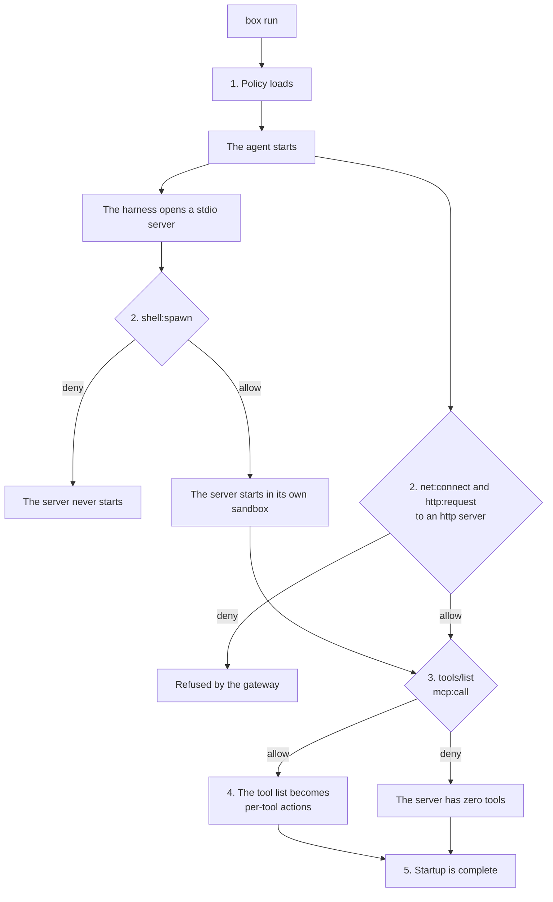
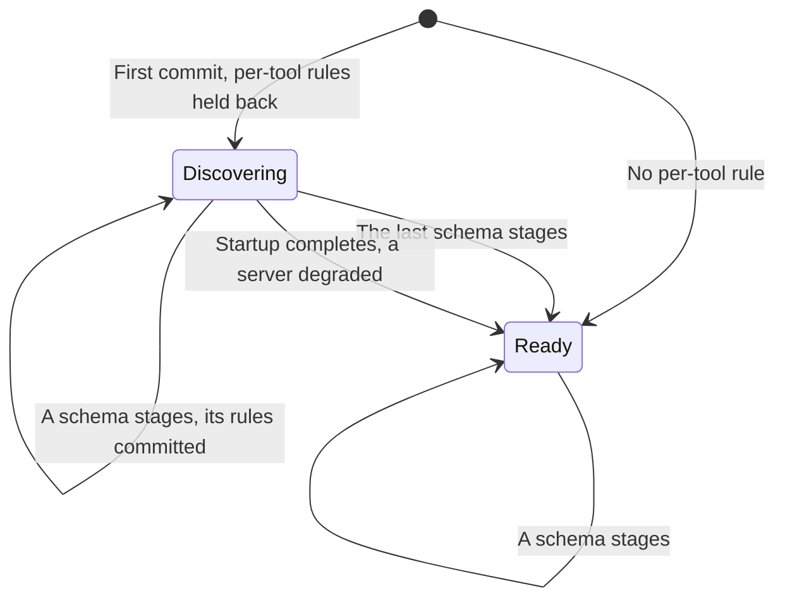
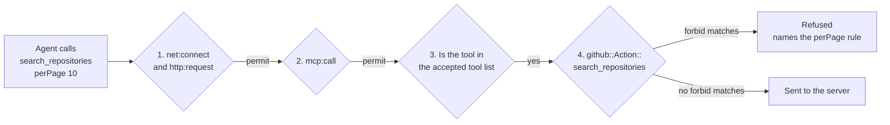

# How Box runs MCP servers

Box supports two types of MCP server. MCP means Model Context Protocol. A **stdio server** is a
program Box starts on the operator's
machine, and an **http server** runs somewhere else. Either way, the agent reaches the server only
through Box, and policy decides each request it makes.

This page explains how `box run` starts servers, learns their tools, and decides tool calls.
It also explains which parts of a request policy can restrict.

| | stdio server | http server |
|---|---|---|
| Declared as | `[mcp.<name>]` with `type = "stdio"` | `[mcp.<name>]` with `type = "http"` |
| Runs in | Its own sandbox, which Box starts | Somewhere else. Box checks its requests, not the server. |
| Reached through | The alias for the server's program, then the MCP broker, then the server's stdin | The egress gateway |
| Starting or connecting | `shell:spawn` | `net:connect` and `http:request` |
| Each MCP request | `mcp:call` | `mcp:call` |

Box starts each stdio server in a sandbox of its own, separate from the agent's. See [local MCP servers](./containment.md#local-mcp-servers). The MCP broker is the part of Box that
receives the agent's requests over a local socket, and the egress gateway checks and forwards every
outbound network request.

A server needs both transport access and MCP authorization. A server needs `shell:spawn`, or `net:connect` and
`http:request`, plus `mcp:call`. Together they allow every tool on the server. See [an MCP tool call
takes two decisions](decisions.md#mcp-authorization-is-two-gates). Every other MCP rule narrows
that.

The server's name comes from `box.toml`. A rule reads the `[mcp.<name>]` table's name, never a
value from the request. See [every MCP server is one configuration
table](decisions.md#an-mcp-server-is-one-configuration-table).

## Policy levels

Two actions decide MCP requests, and a rule can narrow either one.

| Level | Action | What the rule reads | Example rule |
|---|---|---|---|
| Server | `Box::Action::"mcp:call"` | `context.input.server` | `forbid (principal, action == Box::Action::"mcp:call", resource) when { context.input.server == "deepwiki" };` |
| Method | `Box::Action::"mcp:call"` | `context.input.method` | `forbid (principal, action == Box::Action::"mcp:call", resource) when { context.input.server == "deepwiki" && context.input.method == "tools/list" };` |
| Tool, prompt, or resource | `Box::Action::"mcp:call"` | `context.input.tool`, `.prompt`, or `.uri` | `forbid (principal, action == Box::Action::"mcp:call", resource) when { context.input has tool && context.input.tool == "get_me" };` |
| Tool | `github::Action::"get_me"`, one per tool | The action itself | `forbid (principal, action == github::Action::"get_me", resource);` |
| Tool arguments | `github::Action::"search_repositories"`, one per tool | `context.input.<argument>` | `forbid (principal, action == github::Action::"search_repositories", resource) when { context.input has perPage && context.input.perPage > 5 };` |
| History | Either action, in a `when temporal` clause | Earlier `::request` or `::response` events | `forbid (principal, action == Box::Action::"mcp:call", resource) when { context.input.server == "github" && context.input.method == "tools/call" } when temporal { … };` |

`mcp:call` is built in. Policy decides it on every MCP request, so one rule can combine the server,
the method, and the item. `tool`, `prompt`, and `uri` are present only on the method that carries
them, so a rule tests them with `has` first.

Box normalizes each `file`, `http`, or `https` resource URI before policy checks it. It sends the
same normalized URI to the server, so the server receives the resource name that policy checked.
Normalization applies these changes:

- Lowercase the scheme and host, and remove a trailing dot from the host.
- Decode percent-escapes of unreserved characters. Uppercase the hex digits of remaining escapes
  in the path.
- Resolve `.`, `..`, and empty path segments, and remove a default port.
- Convert `file:/x` and `file://localhost/x` to `file:///x`.
- Remove a fragment, which never reaches the server, and remove an empty query.

Box leaves URIs with other schemes exactly as the workload wrote them. Write each `uri` literal
in the normalized form. Rules compare text exactly, so another spelling never matches.

A URI must include the delimiters its scheme requires. Otherwise, a URL parser can supply them
and open a resource that Box never checked. RFC 8089 defines `local-path = path-absolute`, so a
`file:` URI needs an absolute path. Box refuses `file:etc/passwd`, which a parser reads as
`file:///etc/passwd`. RFC 9110 requires an authority with a host for `http` and `https`. Box therefore
refuses `http:/etc/passwd` and `https:///notes/page`. A parser can treat the first path segment as
the host, making `etc` the host in the first example. Box completes `file:/x` because RFC 8089 treats
an absent authority as local.

Box also validates the authority against RFC 3986 §3.2, which defines `[userinfo@]host[:port]`.
The host must be an IP literal, IPv4 address, or registered name. Box normalizes text by lowercasing,
decoding unreserved escapes, and removing a default port. URL parsers also apply internationalized
domain name processing, or IDNA, and their own character restrictions. These operations can change
which host a spelling names. For example, a parser resolves `https://no<zero-width space>tes/page`
to host `notes`. It opens `file://localhost<soft hyphen>/home/op/.env` as `file:///home/op/.env`.
Box refuses these requests.

The authority check refuses raw non-ASCII or ignorable characters, forbidden host characters such
as `"`, `|`, `<`, `>`, `^`, a backquote, or a brace, and `%` without a valid escape. It also refuses
unbracketed IPv6 literals, a second `@`, and a port containing characters other than digits.
Box refuses paths that violate RFC 3986 §3.3.

Host escapes need a separate check. The grammar permits them, so §3.2 catches
`file://localhost<soft hyphen>/home/op/.env` but not `file://localhost%C2%AD/home/op/.env`.
A parser decodes the latter host before resolving it and opens the same file. Box first decodes
escapes for unreserved characters, which normalizes `file://%6C%6Fcalhost/x` and
`https://%6Eotes/page`. Every remaining host escape represents a reserved character or a non-ASCII
byte, so Box refuses it. Write a non-ASCII host in its `xn--` form.

Grammar validation does not perform IDNA normalization. Apart from the normalization above, Box
keeps accepted host spellings, even when multiple spellings identify one host. Measurements with
Node, Python `urlsplit`, and the Rust `url` crate show these limits:

| What stays unfolded | One origin, two strings |
|---|---|
| A non-ASCII host written as its `xn--` form against the same name written in Unicode | Box refuses the Unicode spelling, so a rule must name the `xn--` form. |
| An IPv4 literal in any form but dotted-quad | `https://127.1/page` and `https://2130706433/page` each reach `127.0.0.1`. |
| An IPv6 literal under `http`/`https` that compresses its zeros or maps an IPv4 address | `https://[::0001]/page` reaches `[::1]`; `https://[::FFFF:127.0.0.1]/page` reaches `[::ffff:7f00:1]`. Box does normalize a loopback literal under `file:` because it parses the local authority. |

Box does not normalize port spellings. A URL parser treats `:0443` as `443` and removes it as the
`https` default. It also removes a bare `:` and empty userinfo, though Box now refuses userinfo for
HTTP. Box retains the port spelling it receives. Thus `https://notes:0443/page`,
`https://notes:08080/page`, and `https://notes:/page` reach the same origins as shorter spellings
but present different strings to policy. A rule naming a shorter spelling does not match.
All three parsers accept these forms. Query escapes also retain their hex case, so `?a=%2e` and
`?a=%2E` remain distinct.

A `file:` URI can retain userinfo or an empty port. Node and the Rust `url` crate reject such URIs,
but a server using Python's more permissive `urlsplit` can still open the file.

None of the three resolvers implements remote `file:` access. Node's `fileURLToPath` and the Rust
`url` crate's `to_file_path` accept an empty host or `localhost`. They refuse every other host,
including `[::1]`. Python's `url2pathname` ignores the host and reads the path. It therefore opens
`file://notes/home/op/.env`, `file://[::2]/home/op/.env`, and `file://127.1/home/op/.env` as
`/home/op/.env`. Box keeps non-local authorities. With a server using `urlsplit`, any such host can
bypass a `forbid` that names `file:///home/op/.env`.

A `forbid` can cover these host spellings with `uri like "file://*/home/op/.env"`. The pattern does
not need to cover encoded slashes because Box refuses them. This is a suffix match. The `*` also
matches `/`, so the pattern refuses `file:///srv/backup/home/op/.env` and any other path ending
with the same characters. For a `forbid`, this broadens the refusal.

Do not use that pattern shape in a `permit`. The pattern `uri like "file://*/srv/public/readme"`
also permits `file:///home/op/srv/public/readme`. A `like` pattern cannot express any authority with
exactly one path because `*` can match beyond the first `/`. A `permit` must therefore name the
expected authority, usually the normalized empty authority in `file:///srv/public/readme`.
Another host spelling then lacks a permit.

Normalizing a loopback authority such as `[::0001]` to an empty authority makes a rule on that path
match more spellings. This narrows access under a refusal rule. It does not establish which host a
resolver opens.

Box refuses userinfo in an `http` or `https` URI. RFC 9110 §4.2.4 deprecates it and prohibits
senders from generating it. Recipients should treat userinfo from an untrusted source as an error
because it obscures the authority. The workload is such a source. In measurements, all three
parsers read `https://user@notes/page` as host `notes` and path `/page`, but a policy pattern written
for the host did not match the userinfo before it. Parsers also dropped empty userinfo that Box
retained. Box still retains userinfo in a `file:` URI because RFC 9110 does not govern that scheme.

While these port spellings remain distinct, no `uri` pattern identifies exactly one HTTP origin.
The pattern `uri like "https://notes/*"` misses variants with ports before the `/`. The pattern
`uri like "https://notes*"` matches all port spellings, but also `notes.example.com` and
`notes-staging`. Userinfo needs no pattern because Box refuses it. Use the longest host prefix
possible and check every other host it can match. Use `context.input.server` or
`context.input.method` when the restriction must not depend on host spelling.
`admission.rs::a_uri_like_pattern_cannot_name_one_origin_and_only_that_origin` checks both pattern limits.

For `http` and `https`, the origin server receives the query. Box keeps it as written because it
helps identify the request and can contain credentials. A `file:` URI has no query under RFC 8089,
which defines `file-URI = file-scheme ":" file-hier-part`. A resolver opens the hier-part and ignores
text after `?`. Box therefore refuses a `file:` URI with a query. This prevents
`file:///home/op/.env?x` from accessing the same file as `file:///home/op/.env` under a different
policy string.

Box refuses encoded slashes in `file:` paths. Neither POSIX nor Windows filenames contain `/`, so
a segment containing `%2F` cannot identify a filename with that character. Python's `url2pathname`
and the Rust `url` crate decode it as a separator. They open `file:///home/op%2F.env` as
`/home/op/.env` and resolve `file:///tmp/%2e%2e%2Fetc/passwd` through `/tmp/../etc/passwd`.
Node refuses the URI. Box also refuses it to prevent disagreement with a resolver. In `http` and
`https`, Box keeps an encoded slash because the origin receives it and can accept it within a segment.
Box permits an encoded backslash. All three resolvers decode `%5C` to a literal `\`, which POSIX
filenames can contain, so both sides identify the same file.

Box refuses spaces, control characters, and backslashes anywhere in URIs using these three schemes.
RFC 3986 allows none of them, and parsers can interpret them differently from Box. Without this
check, Box would treat a tab inside `file` as part of a custom scheme and leave the URI unchanged,
while a server could read it as `file:`. A server could drop a trailing space that Box retained in
a query. A server could also treat a backslash as a path separator and open
`file://localhost\home\op\.env` as `/home/op/.env`. Refusing these characters prevents those
resource mismatches.

Box generates a per-tool action for each tool a server lists. Policy decides it only for a
`tools/call`, after `mcp:call` allows the call. A rule on it can refuse the whole tool, or only the
calls whose arguments match a condition.

A history rule adds a `when temporal` clause to a rule at any level, for example to cap how
often the agent calls a server. See [what a history rule sees](./policy.md#what-a-history-rule-sees).

Each level narrows access with a `forbid`. A server's `mcp:call` permit already allows every method
and every tool. A `permit` on a per-tool action changes no verdict, though the decision log then
names it as the deciding rule.

Rules on `mcp:call` work as soon as the box starts. Rules on generated actions must wait.
`github::Action::"search_repositories"` and its typed `perPage` exist only once Box has learned the
server's tools, and that happens while the server starts.

## How a server starts

Box builds per-tool actions from each server's `tools/list` during startup. Step 4 below generates
those actions. The agent starts immediately, and each server becomes callable when its own startup
finishes.



1. Policy loads in one commit, or in stages when it has a per-tool rule. See [staged policy
   commits](#staged-policy-commits).
2. The server starts, or the agent connects to it. See [starting the
   server](#starting-the-server).
3. The harness lists the tools through an `mcp:call` request. See [starting the
   server](#starting-the-server).
4. Box generates per-tool actions from the tool list. See [per-tool actions and their
   arguments](#per-tool-actions-and-their-arguments).
5. Startup completes when every server has reported. See [when startup is
   complete](#when-startup-is-complete).

### Starting the server

A stdio server starts on demand. It starts when the agent's harness runs the server's full
command through the alias in the box's `bin/`, not when `box run` starts. The alias is named for
the program, so servers that share a program, such as `npx`, share one alias. The alias sends its name and arguments to the broker. The broker selects the server whose
`command` in `box.toml` matches those words in order. Arguments must either all match the authored
form or all match the form the server receives after `${OTEL_EXPORTER_OTLP_*}` tokens expand.
A harness with a fixed configuration relies on the written form, because an endpoint token expands to
a port that changes on each run. If no `command` matches, the broker refuses the launch and starts
no server. The launch cannot reach a server it did not name. The refusal names the servers on that program and never their commands,
because the agent cannot read `box.toml`. The broker also records the refusal as a `shell:spawn`
denial with the rule `enforcement:mcp-command`, so an operator finds a mistyped command in the run's
records. By default, the arguments only select among the servers the operator declared.

With `argument_wildcards = true` on a stdio MCP entry, a configured argument equal
to `*` skips that position's comparison. The executable, argument count, and other arguments must still match. Each entry defaults to literal argument matching. Exact commands, including literal
stars on entries without the opt-in, take priority. Otherwise, exactly one wildcard command
must match. Box refuses overlapping wildcard entries before the workload starts, after checking both the authored and expanded forms. The launcher expands the configured arguments,
then replaces only the star positions with received values. Received text is not expanded again.
Policy checks the effective command and arguments before Box starts the server in its sandbox.
Any workload process can call the MCP alias. Each operator-declared `*` therefore gives that
caller control of one argument to a server with its own configured permissions. A permit that
checks only the program does not restrict that value. If the argument selects a package or a
destination, the caller selects the code or destination used under the server's permissions.

The broker then decides `shell:spawn` on the configured program and effective arguments, before the
process exists. If it's allowed, the server starts in its own sandbox.

An http server is already running. The gateway decides `net:connect` before DNS, again for
each resolved address, and `http:request` for each request. Each MCP request to the server is one
of those HTTP requests.

The harness lists the tools. `tools/list` is an `mcp:call` request, so a server's `mcp:call`
permit also lets the agent list its tools, and a rule can refuse it to hide a server's tools. A few
protocol methods needed by a connection pass without a decision. See [the protocol floor is
narrow](decisions.md#four-mcp-methods-are-never-gated).

### Per-tool actions and their arguments

Each tool a server lists becomes its own action, such as `github::Action::"search_repositories"`.
Take the rule from the tool arguments row:

```cedar
forbid (principal, action == github::Action::"search_repositories", resource)
when { context.input has perPage && context.input.perPage > 5 };
```

To load, this rule needs an action named `github::Action::"search_repositories"` and a typed
`perPage` under that action's `context.input`. Neither is built in. Both come from the server.

The server describes its tools. Each tool in a `tools/list` reply carries its name and an
`inputSchema`, the JSON Schema of its arguments. Box reads the replies to the harness's own
`tools/list`, through the broker for a stdio server and through the gateway for an http server, and
sends no request of its own. It follows the harness's pages from the first, and holds the reply to
the last page until the schema stages. See [Box discovers an MCP tool schema from the live server's own
list](decisions.md#mcp-tool-schemas-are-discovered-from-the-live-server).

Box generates a schema for every server, whether or not a rule names its tools:

```text
tools/list reply                                  generated schema (abridged)
-------------------------------------------       ---------------------------------------------
{ "name": "search_repositories",                  action "search_repositories" appliesTo {
  "inputSchema": {                                  context: { input: {
    "properties": {                                   query: String,
      "query":   { "type": "string" },                perPage?: Long
      "perPage": { "type": "integer" } },           } }
    "required": ["query"] } }                     };
```

The server name becomes a namespace, with each character other than a letter, a digit, or `_`
changed to `_`, so `my-server` becomes `my_server`. Each tool becomes one action, spelled as the
server spells it. Box simplifies argument types so a rule compares plain values. A JSON `integer` becomes `Long`,
and an optional argument becomes an optional field. The rule therefore tests `has perPage` first.

During staging, Box adds the schema to the policy engine and validates the policy against it.
The engine then loads and enforces the rule above. A later list that changes the
tools replaces them, and a list that does not change them commits nothing. Box writes no schema file, so each run learns the tools again. To read a server's action names and argument types before
writing a rule, run `strands-box policy generate-schema`, which does the same generation offline.

For the pages, the limits, and what happens when a server lists again, see [how Box discovers MCP
tools](./mcp-discovery.md).

### Staged policy commits

A rule on a per-tool action can't load until its server's schema stages. A policy with no such rule
loads in one commit, and the engine is `Ready` at once. A policy with per-tool rules commits in stages.
[While discovery is pending, Box enforces the schema-independent
subset](decisions.md#discovery-serves-the-schema-independent-subset):

1. At load, the first commit holds every rule that validates against the built-in schema. This includes each
   `net:*`, `http:*`, `shell:*`, `fs:*`, and `mcp:call` rule. The per-tool rules are held back, and
   the engine is `Discovering`.
2. Each server whose schema stages adds one commit with its per-tool rules. The engine enforces
   them from that moment.
3. The last commit makes the engine `Ready` when the whole policy validates. If startup
   completes first, a per-tool rule still held back is inert. The servers it waits for are degraded,
   and the engine is `Ready`.

[How Box discovers MCP tools](./mcp-discovery.md) follows one server from its first `tools/list` to
its commit.



While `Discovering`, the committed rules decide every request, so the agent, the model,
the shell, and every server's `tools/list` work from the start. A tool call can't reach a server
before its tool list is accepted, and that server's per-tool rules commit at the same moment, so Box cannot permit a call before enforcing its rule.

### When startup is complete

The broker and gateway report on their servers. [Box coordinates
discovery completion](decisions.md#the-box-coordinates-discovery-completion):

- The broker reports once every stdio server has an accepted, refused, or failed tool list.
- The gateway reports in the same way for http servers, only when `box.toml` declares one.
- The last report completes startup once, regardless of which part sends it.

Each server is then in one of four states:

| State | Its tools | Its per-tool rules |
|---|---|---|
| Ready | Its tool list was accepted, and its tools are callable. | Enforced from the moment its schema staged. |
| No tools | Policy refused its `tools/list`, so it has zero tools. | It has none. |
| Degraded | Policy refused its `tools/list`, so it has zero tools, and a call to a tool that one of those rules decides is refused. | A rule decides one of its tools, and it hasn't loaded. stderr names the server ([recovery after a denied tool list](decisions.md#a-server-whose-discovery-a-policy-denies-degrades-alone)). |
| Failed | Box couldn't read or stage its tool list. | Not loaded at startup, and a call to a tool that one of those rules decides is refused. stderr names the step that failed. |

The engine is then `Ready` for the rest of the run. It has loaded every rule that can load at startup.

A rule that didn't load leaves its tools refused, and that isn't always for the rest of the run. A
tool list can still arrive after startup, stage its schema, and complete the whole policy. Those
rules then load and enforce from that moment, and Box stops refusing their tools. Two things decide
whether that happens:

- **A later list has to get through.** It goes through the same decision and the same limits as the
  first, so a refusal doesn't have to repeat: a rule that reads history can refuse one `tools/list`
  and permit the next, and a server can replace a schema the policy refused with one it accepts. A
  Degraded server gets through this way whether it's stdio or http. A Failed server gets through
  only over http, because on stdio the failure stops the server: the connection whose list failed
  closes, Box stops every other connection open to that server, and it refuses a new one.
- **Its schema has to be the last thing the policy needs.** A late list is validated with the whole
  policy, so while another schema is missing or doesn't match its rules, the list is refused and its
  schema is dropped. How many servers have tools held doesn't decide it, and [how discovery
  finishes](./mcp-discovery.md#how-discovery-finishes) shows one late list recovering two servers.

The startup warning on stderr was true when it was printed, and nothing prints to say it no longer
is. Read it as a record of startup, not as the state of the run.

A degraded server has refusals for specific tools. Box holds back the tools that an inert rule
would decide. The rules that loaded still decide calls to other tools on that server, usually
through the server's `mcp:call` permit. A history reference to a tool does not decide calls to that
tool, so the reference alone does not hold it back.

For each inert rule, Box identifies two sets. It holds back the tools the rule would decide and
reports the servers the rule still needs. A rule can therefore hold back a tool on one server
while naming another server in its warning.

Every tool a rule mentions must be declared, whether the reference appears in its head, a condition,
or history. Box reports the server for each undeclared tool. If policy refused a server's
`tools/list`, that server declares no tools. An accepted catalog can also omit a tool because the
rule misspells its name or the server removed it.

A rule can remain pending even when every referenced tool is declared. For example, the server
can name an argument differently or give it another type. Box then reports every server the rule
mentions. This can include a server that is answering correctly. We accept the less precise warning
because the alternative would leave an inert rule without a warning. Box holds back a rule only
when it names at least one tool, so every inert rule has a server to report.

A rule can identify the tool it decides in its condition as well as its head. A rule headed by
`mcp:call` can pin `context.input.server` and `context.input.tool` to one quoted name each. Box
recognizes these pins and holds back that tool, just as it would for a tool named in the head.

A pin counts only when the rule cannot match without it. Box examines the tests joined by `&&`
in a `when` condition because all must hold. It accepts a test that compares exactly
`context.input.server` or `context.input.tool` with a quoted name. Other tests in the conjunction
do not invalidate these pins. For example, adding `&&
context.input.method != "tools/list"` or a choice between two methods keeps them valid.

Box does not accept pins nested under `||`, negation, or `if`, or compared with another comparison.
Such a condition could exclude the pinned pair, so holding that pair would refuse the wrong call.
An `unless` condition provides no pin because it identifies what stops the rule from matching.

A head that already names a tool also provides no condition pins. That head defines which tool
the rule decides. Reading another tool from the condition could hold back calls the rule can
never decide.

If a rule's head names no tool and its condition does not pin both a server and a tool, Box holds
back no calls for it. The warning still names the server the rule needs, so the operator can see
that the rule is inert.

This limit has different causes. A condition on `context.input.method` or an argument value can
apply to tools it never names. A rule with no narrowing condition can do the same. These rules
provide no fixed tool set to hold back. Other conditions do identify a set that Box does not yet
extract. A server-only pin covers every call to that server, and
`["a", "b"].contains(context.input.tool)` identifies a fixed set of pairs. Supporting these forms
would require holding calls at a level broader than a `(server, tool)` pair or expanding a named
set. Both would extend the current mechanism.

## How Box decides a tool call

Each `tools/call` to a server whose tool list was accepted passes four checks, and stops at the
first that refuses it. This can start for one server while others are still starting.

### Example: limit a GitHub search

Suppose `box.toml` declares `[mcp.github]` as an http server, and `policy.dw` holds the server's
`net:connect`, `http:request`, and `mcp:call` permits, plus the `perPage` rule from [per-tool
actions and their arguments](#per-tool-actions-and-their-arguments).



1. **Connect.** The gateway checks `net:connect` and `http:request` for `api.githubcopilot.com`.
   Both permit.
2. **Server.** `mcp:call` checks the server, the method, and the tool. The server's permit allows
   it.
3. **Tool list.** The gateway checks that `search_repositories` is in GitHub's accepted tool list,
   by its exact name. It is.
4. **Arguments.** `github::Action::"search_repositories"` checks the typed arguments. `perPage` is
   10, so the `forbid` matches.
5. **Result.** The gateway refuses the call with an HTTP 403 whose body is an MCP error naming the
   rule's `@id`, and the decision log records that rule as the decider.

If `perPage` is 5, no `forbid` matches. The `mcp:call` permit allows the call to reach the server. The decision log names the server's permit.

For a stdio server, the broker runs the same checks without the first, checks the tool list before
`mcp:call`, and refuses with an MCP error. A stdio server's own requests, such as `roots/list`, reach
the harness, and the harness's reply is decided as `mcp:call` on the method of the request it answers. See [the client's reply to a server's own request is
decided](decisions.md#a-client-reply-to-a-server-request-is-decided). For each refusal message and its cause, see
[troubleshooting](../user/mcp-policy.md#troubleshooting).

## See also

- [How Box discovers MCP tools](./mcp-discovery.md): the states a server moves through, and how its
  tool list becomes enforced rules.
- [Local MCP servers](./containment.md#local-mcp-servers): what a stdio server's sandbox
  can reach, and what `contain_egress` changes.
- [Policy](./policy.md): how the engine decides each request, and what refuses to load.
- [The `[mcp.<name>]` table](../user/mcp.md) and [write policy for an MCP
  server](../user/mcp-policy.md): configuring a server and writing its rules.
