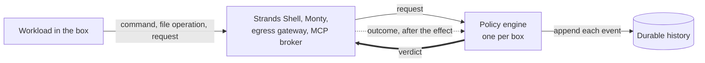

# Policy

Policy decides each operation that the box's trusted process performs for the workload. This page
explains where those decisions happen, how the engine records history, and which policies it refuses
to load. It is for security evaluators and contributors. To write a policy and run a box, start with
[getting started](../user/getting-started.md).

## What the Dogwood policy engine provides

Dogwood decides requests from their details and recorded history. Box's built-in components submit
those requests from outside the agent's sandbox.

A policy can check file paths, command arguments, and Model Context Protocol tool arguments. This
lets the operator permit a tool while refusing particular requests to it.

[Dogwood extends Cedar](decisions.md#the-engine-is-dogwood), a declarative policy language, with
temporal rules that use recorded events within a time window. Strands Shell, Box's shell
interpreter, and Monty, Box's Python interpreter, share one engine with the egress gateway and MCP
broker. The gateway checks outbound requests, and the broker checks and routes MCP requests. Their
[shared history](#one-engine-and-its-the-only-authorizer) lets a rule connect a file operation with
a later network request.

For example, a policy can refuse web requests for five minutes after Monty reads a designated file.
The same request can pass before the read and fail afterward. Box enforces the rule when the request
occurs.

Only events submitted by Box's built-in components enter this history. A file read through the
agent's own system calls does not. The operating system decides whether that read is allowed from
the agent's filesystem grants, which specify paths and access modes.

## Where policy sits

A box has two enforcement tiers. The sandbox grants come from `box.toml`, and Box fixes them before
the first process starts. They bound the system calls the workload makes itself. Policy comes from
`policy.dw`, written in Dogwood, a superset of Cedar that adds history rules. See [the policy
language is Dogwood](decisions.md#the-engine-is-dogwood). It decides each request the workload makes
through the box's trusted process: a command or file operation in Strands Shell, the box's shell; an
`os` call in Monty, the box's Python; an outbound connection or HTTP request through the egress
gateway; and a message to an MCP server.

Each tier covers its own route. When a list in `[agent.filesystem]` grants a path, the workload
reaches it directly, and policy never sees that access. See [a direct grant replaces the policy
decision](decisions.md#a-direct-grant-replaces-the-policy-decision). The same goes for what a tool
or a local MCP server does on its own, inside its own sandbox. See [a tool reaches only the paths
its own lists name](decisions.md#a-tool-reaches-only-the-paths-its-own-lists-name), [a stdio MCP
server runs contained](decisions.md#a-stdio-mcp-server-runs-contained). In the other direction, a
`permit` never changes what the workload's own system calls reach.

Strands Shell and Monty can access anything under the operator's home when policy permits it. An
`fs:read` permit without a path condition therefore exposes `~/.ssh` and `~/.aws` through either
interpreter. This is the product's widest exposure. The reachable paths check described below does
not protect those paths. See [credential paths have no additional protection from the
interpreters](decisions.md#no-credential-floor-sits-beneath-the-interpreters).

## One engine, and it's the only authorizer

Each box runs exactly one policy engine, inside its own trusted process, and every caller asks that
engine. See [a box has exactly one policy engine](decisions.md#one-policy-engine-per-box). One
engine means one history, so a rule can make a network decision depend on something the workload
read through Strands Shell. With two engines, that rule would load in both and match in neither.
Every decision runs in-process, behind one lock, with no network call. See [every decision is local
and in-process](decisions.md#every-decision-is-local-and-in-process). The engine itself is the
published Dogwood engine, pinned to an exact version, and everything Box adds around it sits behind
one facade. See [the policy crate exposes one
facade](decisions.md#the-policy-crate-exposes-one-facade).

Policy is the only authorizer. The engine has no compiled-in rules, so an empty or absent policy
denies everything. A `forbid` overrides a `permit`, and the engine denies a request when no `permit`
matches it. Adding a `permit` can only widen access. A restriction, including a cap or rate limit,
must therefore use a `forbid`. See [composition is
deny-overrides](decisions.md#deny-overrides-composition-with-no-compiled-rule-tier).

Every other check on a mediated path can only refuse access. It can reject an operation that policy
permits but cannot permit an operation that policy denies. See [the policy is the only decision
authority](decisions.md#the-authored-policy-is-the-only-decision-authority).

- The reachable paths check runs in the Shell and Monty after the engine. It refuses the box
  directory, the `box.toml` and policy this run loaded, and anything outside the operator's home and
  the workspace. It also refuses writes, deletion, replacement, and enclosing-path changes for
  configured tool programs and the [installed trusted
  binaries](binaries.md#trampoline---strands-box-contain-trampoline). Reads of these files remain
  subject to policy. Policy decides first, so a counting rule still sees the attempt, and the
  refusal is recorded beside policy's verdict.

Cloud metadata protection comes from the operator's policy. The gateway asks policy about the
destination before name resolution and about each resolved address before it connects. It has no
built-in metadata block. See [cloud metadata protection is
policy](decisions.md#the-ssrf-and-metadata-floor-is-compiled-beneath-policy). The [egress
guide](egress.md#cloud-instance-metadata) describes the required rules.

## How a request is decided

Each caller asks about its own boundary, and the action name says which boundary that is.

 Both interpreters use the same `fs:*` actions. See [one principal, one resource, and the action
scopes the rule](decisions.md#one-principal-one-resource-and-the-action-scopes-the-rule):

| Caller | Actions |
|---|---|
| Strands Shell | `shell:exec` or `shell:spawn` per command line, and `fs:read`, `fs:write`, `fs:delete`, or `fs:move` per file operation |
| Monty | `fs:read`, `fs:write`, `fs:delete`, or `fs:move` per `os` call |
| Egress gateway | `net:connect`, `http:request`, and `mcp:call` with its per-tool action for a remote MCP server |
| MCP broker | `mcp:call` with its per-tool action for a local MCP server |

The Shell asks once per command line, after it has resolved the program, and then once per file
operation the command makes, on the resolved path. See [the Shell asks policy at two
levels](decisions.md#the-shell-checks-policy-at-two-levels).

Each decision changes history. The engine appends the request before evaluating the rules and writes
the append to disk before returning the verdict. After the operation runs, the caller records how it
ended. Only these trusted callers write history, and the workload never does. See [only trusted
enforcement points submit history](decisions.md#only-trusted-enforcement-points-submit-history).

## What a history rule sees

A history rule, which Dogwood calls a temporal rule, is an ordinary `permit` or `forbid` with a
`when temporal { … }` clause. See [a temporal rule uses the same closed
context](decisions.md#temporal-rules-ride-the-closed-context). For each action, the history holds
three kinds of event:

- `::request` for every durably submitted attempt, whether it was allowed or denied.
- `::response` for an operation that happened, or may have happened.
- `::error` for an operation that definitely didn't happen.

For an MCP command with [argument wildcards](../user/mcp.md#argument-wildcards) enabled, the
`shell:spawn` request records the effective launch command and arguments, including the received
values in the `*` positions.

A metadata read has occurred once the workload receives its answer. A Shell `test -e`, `test -L`, or
`test -r` on a missing file in an existing folder therefore records a `::response`. The same applies
to Python's `os.stat()` and `Path.exists()`.

A path that cannot be resolved can also produce a `::response`, even though the reachable paths
check refuses it. Examples include paths below a missing folder or a folder the surrounding OS will
not let Box search. Box records a `::response` only if the path is within the reachable paths, has
no `.` or `..` component, crosses no symbolic link in a folder Box can inspect, and is outside Box's
own state.

Other checks that Box refuses produce a `::error`. They cannot satisfy a precondition that requires
a `::response`. This includes reachable paths refusals outside the cases above and changes between
the decision and the check. Strands Shell detects any namespace change; Python detects a symbolic
link substituted into the path. A cap on attempts uses `::request` because it includes denied
attempts.

Each recorded request carries a nonempty `requestId`, and its existing response or error carries the same value.
Box allocates the identifier from the next durable log offset while holding the engine lock.
Offsets distinguish identical concurrent attempts and continue across reopening and pruning.
The public interface returns an opaque request token with the verdict and requires that token when recording an outcome.
A token belongs to the opened engine. Reload preserves it; a separately opened engine refuses it.

One gateway exchange can contain separate HTTP and MCP requests, each with its own identifier.
A filesystem rename also has separate checks for its source, source contents, destination removal, and destination mutation.
Each recorded outcome uses its own check's token. A check that records no outcome remains request-only.
Existing events without identifiers remain unchanged; their other facts and recovered monitor state remain available.
Those events cannot satisfy a predicate that requires `requestId`, because the missing association cannot be reconstructed.

Each caller fills in the outcome from what it saw. A filesystem response carries `output.result` as
`completed`, `descriptor_issued`, or `indeterminate`, so a rule that counts certain completions can
leave the other two out. A shell response carries the command's exit status as `output.status`, and
a command that a signal killed records 128 plus the signal number, so a rule can require a passing
test before it permits a commit. A connect that definitely failed is a `::error`, and one that may
have opened a socket is a `::response`, so a rule can count failed connects, and a cap on connects
still counts the uncertain ones.

For an HTTP request, the gateway records accepted request bytes and any received status when the
upstream response completes, fails, or reaches its deadline. HTTP MCP calls record their outcome at
the same point. If the workload disconnects or the gateway refuses delivery, the gateway discards
the remaining body under the same deadline before recording the outcome.
Partial or uncertain outcomes still count as `::response`, which does not prove tool success.
Response delivery adds no second policy event.

Because a denied attempt is still a `::request`, asking and being refused satisfies a precondition
keyed on `::request`. Key a precondition on `::response` instead. See [temporal rules are enforced
against recorded history](decisions.md#temporal-rules-are-enforced-against-recorded-history).
Counting differs the same way. Each request is appended under the one lock before the next is
decided, so a `::request` count includes every earlier attempt, and a budget keyed on `::request`
admits exactly N attempts, even when they arrive together. A `::response` count only sees operations
that have finished, so several requests in flight at once can each pass before any of them finishes.

A `when temporal` clause names one action, with no group, no `or`, and no wildcard, so a budget over
several actions needs one clause per action. See [a temporal rule names one
action](decisions.md#a-temporal-rule-names-one-action). Every window is capped at 24 hours, which is
Dogwood's default, and a longer window refuses to load.

## Durable history

Each box keeps one history file, `<box_dir>/private/dogwood.redb`, and a restart reuses it. See
[history is durable per box](decisions.md#history-is-durable-per-box-and-has-no-rewind). That's what
stops a restart from resetting a budget. The history follows these rules:

- Opening the engine recovers the history in full, or the run fails. The box never falls back to an
  empty history. A damaged file refuses the next run and is left as it was found. The run also
  refuses when the box's record says it has run before but the history is missing or empty, and when
  a history exists but the record says the box has never run.
- After a policy edit, unchanged history rules keep their state. New or changed rules start with
  empty state.
- The engine timestamps each event from the system clock. Callers cannot supply timestamps. If the
  clock steps backwards, timestamps keep moving forward, so rolling the clock back doesn't free a
  budget. The cost is that a restriction can outlast its window a little.
- If an append fails, the engine denies that request and every subsequent request. When recording an
  outcome fails, the caller warns on stderr and nothing retries it.
- The engine checkpoints as events accumulate and removes events outside the longest window. This
  bounds the file size by the window rather than the box's lifetime.

History is not an audit record and has no tamper evidence. It cannot be rewound or shared by boxes.
The operation and its recorded outcome do not commit together. If the process stops between them,
the history omits that outcome and a `::response` count is too low.

## What refuses to load

An invalid policy stops the box. A `forbid` that never matches can appear to protect a resource
while allowing access. The loader therefore validates every name against the closed action
vocabulary. See [the action vocabulary is closed and strict-validated at
load](decisions.md#the-action-vocabulary-is-closed-and-strict-validated-at-load). It also refuses
every rule it can prove will never match. See [a rule that can't fire is refused at
load](decisions.md#a-rule-that-cannot-fire-is-refused-at-load-and-an-uncertain-one-warns). It also
refuses a rule that reads `context.input` under actions of more than one family, or under no action,
because a field means what the action makes it mean. See [a rule that reads the input names one
action family](decisions.md#a-rule-that-reads-the-input-names-one-action-family).

The `run` verb validates the policy before it writes any box state. A box with no local MCP server
validates against the complete action schema, and that check accepts and refuses exactly what the
later load does, so a policy that passes it loads at the next run.

A box with a local MCP server can finish the check only after the server reports its tools. Up
front, `run` checks syntax, macro expansion, provider use, and the action family of each rule that
reads `context.input`. The per-tool actions don't exist until a server reports its tools, so `run`
stages each server's schema as it arrives and validates the whole policy once more when every server
has reported. Until then a tool call for that server is denied without reaching the engine. See
[discovery serves the schema-independent
subset](decisions.md#discovery-serves-the-schema-independent-subset). A rule that names only tool
grammar `Tool::<name>` actions doesn't wait for a server: the grammar's actions are in the schema
from the start, so the rule loads at once or the box refuses it. If policy refuses a server's tool
listing, only that server loses its per-tool rules. The box starts without those rules. See [recovery after a denied tool list](decisions.md#a-server-whose-discovery-a-policy-denies-degrades-alone).

A library caller checks a policy without a run through `check_policy`. It reads `box.toml` and the
policy file it names with the reader that `run` uses, and it applies the same validation: the
complete check when the box declares no local MCP server, and otherwise the classification that
staging applies before any server reports. In the second case each per-tool rule is listed as
unchecked, because only a running box can learn the server's tools, and every other rule is
validated. The check starts no process, resolves no secret, writes no box state, and doesn't use the
one run that a process allows. Each finding names its rules by their position in the authored file
and their `@id`, the line and column when the engine reports a span, and the validator's hint, such
as ``did you mean `path`?``.

A policy that validates can still fail to run, because opening the history has its own refusals;
[durable history](#durable-history) lists them. Before a workload starts, Box also refuses
configured tool programs with multiple hard links when the user running Box can write them.
It also refuses configured tool programs that overlap with direct writable grants.
[Configured command integrity](../user/config.md#configured-command-integrity) describes those
constraints. When two MCP entries enable [argument wildcards](../user/mcp.md#argument-wildcards),
Box also refuses wildcard commands that can select different servers for the same request. Box also
refuses installed trusted programs with unaccounted hard-link names or overlap with any process's
writable grants. [Installation integrity](../user/config.md#installation-integrity) describes these
refusals.

The inert-rule check sorts each rule into one of three classes:

- Box refuses rules it can prove are inert. These include undeclared actions or fields,
  `context.input.ip` under a network action, and path or host literals that cannot match any
  reported path or destination host. It also refuses address literals that cannot match a pinned
  destination or belong to the other address family, and `ip6` patterns with a dotted quad outside
  the `::ffff:` form. Two rules cannot share an `@id`. A cap written as a `permit` beside an
  unconditional `permit` for the same action is also refused, because it cannot narrow that permit.
  Box also refuses a temporal predicate that names an action group, such as
  `Tool::git::Action::"*"`, because history records individual member actions and never the group.
  A rule waiting for an MCP server's schema goes through the same checks when Box stages the schema.
  If the rule is provably inert, Box refuses the schema. Holding the rule for a later schema cannot
  make it match.

  The `ip` refusal is a check of Box's own, ahead of strict validation, and prevents a rule from
  loading without effect. `net:connect` carries `ip4` and `ip6` and no `ip`, so `context.input has
  ip` is statically false; the validator then never typechecks the comparison behind that guard, and
  the rule would load and enforce nothing. The refusal names both replacements.
- Box warns when a rule may be inert, such as a `program` literal written as a path, or a cap beside
  a conditional `permit`.
- The validator accepts two forms it cannot prove inert: a comparison between different enum types
  and a `has`-guarded read of `context.output` outside a `when temporal` clause.

A refusal names the rule and says what to write instead.

When a tool grammar binds a program, each spawn of it enters history as its grammar action and not as
`shell:spawn`. When a program the Shell started ends, the grammar action's `::response` carries the
exit status as `output.status`, the same as a `shell:spawn` response, so a rule can refuse a
`git push` until a `cargo test` has passed. The response records only that the agent ran a command
the grammar reads as `cargo test`, in a working directory and with arguments the agent chose, and
that it exited 0. A test in a scratch crate satisfies such a rule, so a rule that must mean "this
project's tests passed" pins `input.cwd` to the project. A spawn that the binding refuses before any rule decides
it, such as a bound name whose file was replaced, enters history as a `shell:spawn` request, so a
rule that counts attempts still sees it. A bound file called by a name that no grammar binds is
decided as `shell:spawn`.

## Residual risk

In addition to the credential exposure described in [where policy sits](#where-policy-sits), policy
has these limits:

- Decisions serialize. Every decision waits for one disk sync and for the one lock, so requests in a
  burst wait for earlier decisions.
- A temporal macro can lose its history. In Dogwood 1.0.0, a rule that calls a temporal macro such
  as `count_within` loses its accumulated state when the text before the call changes, even by a
  comment. A rule written inline keeps its state. Nothing Box ships calls a macro.
- A verdict is allow or deny. No rule can pause a request for human approval. See [there is no
  approval verdict](decisions.md#there-is-no-approval-verdict).
- A refusal reveals policy details. It names the component, the reason, and the rule, so a workload
  can learn the shape of the policy from what fails. See [a refusal names the component, the reason,
  and the rule](decisions.md#a-denial-names-the-rule-that-refused-it).
