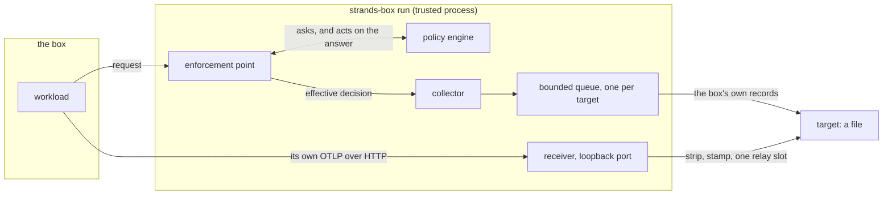

# Telemetry

Telemetry records what a box decided. It is on by default, even when the operator supplies no
telemetry configuration. Each decision record names the request and whether Box allowed or refused
it.

Box also accepts the workload's OpenTelemetry data so the operator can read both kinds of record in
one place. The workload is untrusted. This page explains how Box separates its own records from that
data and protects them from forgery and suppression.

## The parts

- The collector holds the queues and targets and receives each record Box produces.
- The receiver accepts workload telemetry on a loopback port and removes claims the workload is not
  allowed to make.
- A target is a file where Box appends one record per line.

All three run in the box's [trusted process](terminology.md), `strands-box run`, outside the
sandboxes. The operator does not install a separate collector. Two boxes share no buffer, so a
compromised box cannot reach another box's audit trail through it. See [one collector per
box](decisions.md#one-collector-per-box-in-the-trusted-process).

### Collector

Every policy decision reaches the collector. [Policy decides each request the workload makes through
the trusted process](policy.md#where-policy-sits). The enforcement point that requested the decision
then sends the effective answer to the collector.

The collector records the effective answer after all checks, as described in [the effective decision
is the canonical record](decisions.md#the-effective-decision-is-the-canonical-record). Checks
beneath policy can refuse an operation that policy permits. For example, the reachable paths check
refuses access to the box directory even when a broad read permit matches. Recording only the
engine's verdict would describe a permitted operation that did not happen. These checks run on Box's
own request path. Operating system enforcement separately limits the workload's own system calls.

A box writes two kinds of record. Each has a scope that readers can select:

- `strands-box.policy` contains one record for each effective decision.
- `strands-box.control` contains records of changes to the box's authority.

A decision names the action, resource, verdict, cause, and every policy that determined it. Standard
OpenTelemetry keys describe the request, including the server address and port, request method, file
path, or resolved command. See [the policy attribute names are this product's
own](decisions.md#the-policy-attribute-names-are-this-products-own). Box omits the full URL and full
command line because both can contain credentials.

A shell record includes literal arguments and redacts expanded arguments unless they are plain
flags. The shell receives arguments after expansion, so recording `echo $(cat secret.txt)` without
this check would expose the file's contents. See [a shell record names only a literal
argument](decisions.md#a-shell-record-names-only-a-literal-argument).

A decision also carries the caller's trace context, which connects it to the agent's work. The
workload supplies that context. Box bounds and validates it but never treats it as evidence of
authority. See [correlation context is a
hint](decisions.md#correlation-context-is-a-hint-and-never-authority).

Six control-plane records describe policy installation or refusal, tool vocabulary installation,
completed discovery, and box startup or shutdown. They show which authority was in force at a given
moment, so they share a file with the decisions.

Each Box record is both a span and a log record, with one shared trace identifier and span
identifier. See [every box record is
both](decisions.md#every-box-record-is-both-a-span-and-a-log-record). The log record provides audit
evidence. The span places the decision on a timeline beside the workload's work. Its start and end
are equal because it marks the instant of submission.

OpenTelemetry lets a caller mark a trace as not sampled to reduce performance data volume. Box
ignores that mark for its own decisions and always writes them. The workload supplies the trace
context, so honoring the mark would let it suppress records of its own refusals.

### Receiver

The collector asks the kernel for a free loopback port. Box supplies that address through the
standard OpenTelemetry exporter variables, so an unmodified agent SDK can export without code
changes or credentials. See [the collector listens on a second loopback
port](decisions.md#the-collector-listens-on-a-second-loopback-port). The receiver accepts spans, log
records, and metrics on three routes and returns `404` on all others. It relays the workload's data
and produces none on its behalf. A harness that exports no metrics contributes no metrics.

Box reserves the `strands.box.` attribute namespace. See [`strands.box.` is reserved, and the
collector strips it at every level](decisions.md#the-strands-box-namespace-is-reserved). Before
routing a payload, the receiver removes attributes with that prefix at every level. It renames
scopes that claim Box's namespace and marks each resource as agent data.

An OpenTelemetry resource is a group of attributes that identifies a producer. It contains the
scopes and records within a payload. Box marks its own resources as Box data, and readers use that
mark to distinguish the sources. Removing reserved attributes only at resource level would leave a
forged verdict on a nested record. Box therefore removes them at every level. Removal and marking
are one operation, so no route can perform only half of the work.

### Target

A target is a file. Each line contains one complete OpenTelemetry request in the JSON form of OTLP,
the OpenTelemetry wire protocol. A viewer can read the file without conversion. See [OpenTelemetry
owns the schema](decisions.md#opentelemetry-owns-the-schema-and-the-box-owns-its-queues). Records
stay on the computer that produced them. This is a product requirement, and every shipped example
uses local files.

Without telemetry configuration, Box writes `private/telemetry/records.jsonl` in its box directory.
See [every box records by default](decisions.md#every-box-records-by-default). The workload cannot
read, truncate, or delete that file. A check beneath policy rejects every path that resolves into
the box directory, regardless of a permit.

A declared target replaces the default and does not inherit its protection. Box refuses a
destination inside the box directory but outside its private tree. It also refuses paths containing
`..`. It does not compare the destination with the workload's grants. If the operator puts the file
in a directory the workload can write, the workload can truncate it.

A target can select Box denials, Box permits, or the value that selects relayed workload spans. See
[a target names a set](decisions.md#a-target-names-a-set-of-signals). The span selector also
includes control-plane records. Omitting it loses Box's record of authority changes. Relayed
workload log records and metrics arrive regardless of this selection.

## What the workload cannot do

The workload cannot forge a Box record. Every route removes reserved attributes and marks the source
before a target receives the payload. See [`strands.box.` is
reserved](decisions.md#the-strands-box-namespace-is-reserved).

The workload cannot suppress Box records by filling their queues with its own telemetry. Box uses
one bounded queue per target for its records. A relayed payload never enters that queue. The
receiver sends it directly to the target, with only one relay active at a time. This slot is a
concurrency token, not a policy permit. A payload that finds it occupied is dropped. See [the two
kinds of record share no queue](decisions.md#the-agents-lane-and-the-boxs-lane-share-no-queue). With
a shared queue, the workload could fill it until subsequent decisions were dropped.

The receiver bounds the memory needed to process a payload. It takes the relay slot before decoding.
If the slot is occupied, it discards the payload without decoding it. The bytes have already
arrived, subject to the request-size cap, but the expensive processing has not begun.

Two size limits bound an accepted payload. The first caps request bytes before decoding. The second
caps the number of resources after decoding, when that count becomes known. Box checks the resource
limit before adding source attributes. Without it, millions of empty resources could turn a few
megabytes of input into hundreds of megabytes of memory. The receiver runs in the same process as
the policy engine, resolved secrets, and gateway signing key, so memory exhaustion would affect all
of them.

The workload cannot tell which data a target kept from the response. Every answer has the same
two-byte JSON body. A dropped payload still gets `200`.

## Limits

- Delivery is best effort. A failed target write loses the record without a retry, a report of the
  loss, or a disk copy for later delivery. See [a record can be
  lost](decisions.md#delivery-is-best-effort). The shutdown drain runs on every exit path, even when
  startup fails before the workload starts, so Box still records that it stopped. Relayed payloads
  do not join that drain and can be lost in flight. A decision cannot be lost through that shutdown
  race.
- Every process running as the operator can reach the loopback port. The listener cannot identify
  which process connected. Such a process cannot forge a Box record, but it can inject noise
  attributed to the agent.
- Record files have no tamper evidence. Box neither signs records nor chains them together. A
  process that can write the file can alter it afterward without leaving a trace.
- Only the default destination is outside the workload's reach. Interpreter requests for the box
  directory are refused before policy is consulted. The sandbox also refuses direct system calls
  because it never grants that directory, and Box rejects a `filesystem` grant that names it. A
  declared destination has neither guarantee. Put it outside every path granted to the workload, or
  the workload may be able to truncate it.
- The record file grows without bound. Box does not rotate or truncate it.
- A slow target delays workload telemetry. The relay slot stays occupied during a write and its disk
  flush. Box does not bound the number of connections to the port. The slot limits concurrency, not
  rate. A client that waits for each response never encounters an occupied slot, regardless of
  volume. Dropping a payload requires two payloads in flight together.
- Two boxes must not share a file. A long line can require multiple writes, and concurrent writers
  can interleave them. Give each box its own file.

## How it fits together

| Part | Takes | Gives |
|---|---|---|
| Collector | Each effective decision and control-plane operation | One span and one log record per decision, queued per target |
| Receiver | Workload OTLP over HTTP on a loopback port | The payload with reserved attributes removed and its source marked, relayed inline |
| Target | Collector records and receiver payloads | One file line per request in the JSON form of OTLP |

## See also

- [Telemetry reference](../user/telemetry.md) describes `box.toml` keys, record keys, and how to
  read a records file.
- [Policy](policy.md) explains the engine whose decisions telemetry records.
- [Decisions](decisions.md) records the reasons for the design. This page links the decisions that
  support its claims; the `Telemetry` section contains the rest.
- [Terminology](terminology.md) defines trusted process, workload, box directory, and related terms.
