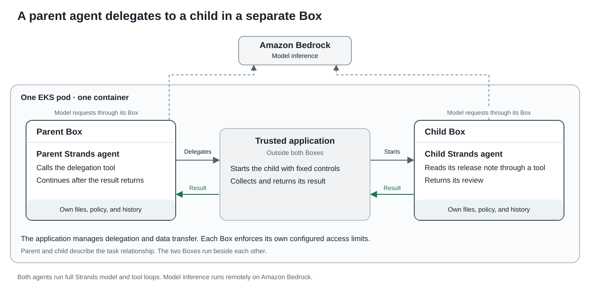

# Delegate work to an agent in a separate Box

A parent agent asks a subagent to review a release note. Trusted application code starts the subagent in a separate Box.
The subagent reads its input and returns a result. The parent uses that result to answer the original request.
Both agents use the Strands SDK and call Amazon Bedrock from inside their own Box.

## How the agents work together



Each Box has its own filesystem grants, Dogwood policy, and history.
The parent can call the application's delegation endpoint. The child can read its release note.
Both policies permit requests to the selected Bedrock model. Box inserts the real model credential into approved requests.

The application fixes the child command, configuration, and input paths. It passes the child's result back through the parent's tool call.
The Boxes run beside each other. The parent/child relationship belongs to the application; this example provides no permission inheritance.

## Run on EKS

Complete the [EKS guide prerequisites](../../../../docs/user/tutorials/eks.md#before-you-start).
Use Linux ARM64 workers, access to the selected Bedrock model, and an existing EKS Pod Identity Agent addon.
Run these commands from `examples/cloud-deployments/eks`.

```sh
export AWS_REGION='us-west-2'
export MODEL='global.anthropic.claude-sonnet-4-5-20250929-v1:0'
export CLUSTER_NAME='YOUR_CLUSTER'
export KUBE_CONTEXT='YOUR_KUBERNETES_CONTEXT'
export NAMESPACE='box-delegation'
export SERVICE_ACCOUNT='box-delegation'
export IDENTITY_STACK='BoxDelegationIdentity'
export IMAGE='YOUR_REGISTRY/box-example:strands'

docker build --platform linux/arm64 --target strands -t "$IMAGE" .
docker push "$IMAGE"
kubectl --context "$KUBE_CONTEXT" create namespace "$NAMESPACE"
kubectl --context "$KUBE_CONTEXT" -n "$NAMESPACE" create serviceaccount "$SERVICE_ACCOUNT"
aws cloudformation deploy --region "$AWS_REGION" --stack-name "$IDENTITY_STACK" \
  --template-file strands/pod-identity.json --capabilities CAPABILITY_IAM \
  --parameter-overrides ClusterName="$CLUSTER_NAME" Namespace="$NAMESPACE" \
    ServiceAccount="$SERVICE_ACCOUNT"
export EXPECTED_ROLE_ARN="$(aws cloudformation describe-stacks --region "$AWS_REGION" \
  --stack-name "$IDENTITY_STACK" --query 'Stacks[0].Outputs[?OutputKey==`RoleArn`].OutputValue' \
  --output text)"
python3 run.py --mode strands --fixture baseline --image "$IMAGE" \
  --namespace "$NAMESPACE" --context "$KUBE_CONTEXT" --service-account "$SERVICE_ACCOUNT" \
  --region "$AWS_REGION" --model "$MODEL" --expected-role-arn "$EXPECTED_ROLE_ARN" --render
```

Inspect the rendered Job, then repeat the last command without `--render` to submit it.
Record the pushed image digest and use that digest for repeat runs.
The application checks its Pod Identity role before generating a temporary Bedrock token.
The agents receive a placeholder credential through their Box configuration.

## Read the result

The runner saves the Job logs and receipt beneath `evidence/JOB_NAME/`.
A successful result contains `passed: true`, the checks, and the complete delegation receipt.
The receipt connects the child's result to the parent's tool response and subsequent model response.

Repeat the run with `--fixture alternate` to change only the child's release window.
The parent's initial prompt stays the same. Its answer must follow the child's changed result.

| Operation | Expected result |
| --- | --- |
| Child reads its release note | Succeeds. |
| Parent reads the child's input directly | The ungranted path is absent on Linux. |
| Child reads the parent's private input | The ungranted path is absent on Linux. |
| Parent delegates through its tool | The application starts the fixed child agent. |
| Parent receives the result | The parent continues with another model response. |

The filesystem checks use native file operations. An absent path is not a Dogwood policy denial.
The SDK tools run inside their respective agent's sandbox. Their Python function calls are not MCP tool-policy decisions.

## Configuration and limits

The image pins Box to `e24d903412cf3f34766f0b77c941ddd1a048991d` and Strands SDK to `1.62.0`.
The complete Python dependency lock is [requirements.txt](requirements.txt).
The runtime uses Python 3.13 on Debian Bookworm and runs as user 1000.
Both fixtures passed all nine checks on EKS 1.35 with ARM64 Amazon Linux 2023 workers and kernel `6.12.111-136.204.amzn2023.aarch64`.
Each agent received two model responses. The parent's final answer followed the changed release window.
This package targets Linux ARM64 on EKS. Other processor architectures and deployment services require separate validation.

The Job uses pod user namespaces, `procMount: Unmasked`, and `seccompProfile: Unconfined`.
It drops Linux capabilities, disables privilege escalation, and makes the container root filesystem read-only.
These settings need cluster admission support. They are not a production security assessment or proven minimum privileges.

The example limits each agent to four model calls. Failed tools, malformed results, or timeouts fail the example.
Model responses can vary. The verifier checks the required handoff and release window; it does not assess summary quality.
This example keeps policy histories separate and uses application code to manage delegation.

## Clean up

Delete each Job using the name in its receipt, then remove the resources created above:

```sh
kubectl --context "$KUBE_CONTEXT" -n "$NAMESPACE" delete job JOB_NAME_FROM_RECEIPT
aws cloudformation delete-stack --region "$AWS_REGION" --stack-name "$IDENTITY_STACK"
aws cloudformation wait stack-delete-complete --region "$AWS_REGION" --stack-name "$IDENTITY_STACK"
kubectl --context "$KUBE_CONTEXT" -n "$NAMESPACE" delete serviceaccount "$SERVICE_ACCOUNT"
kubectl --context "$KUBE_CONTEXT" delete namespace "$NAMESPACE"
```

Delete the example image through your registry's image-management tools.
Keep shared cluster resources and the existing Pod Identity addon.

## Check the example code

Use Python 3.11 or newer. Run the offline tests from `examples/cloud-deployments/eks`:

```sh
python3 -m unittest discover -s strands/tests -v
python3 -m unittest test_run.py -v
```

The offline tests require no model access. A live run is required to check the actual agent and Box behavior.
