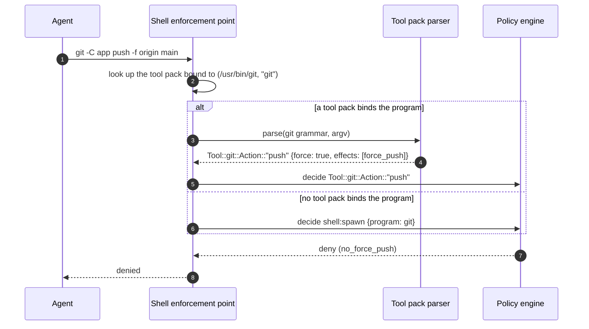

# Feature - Tool Packs

## 1. Background

John Tristan proposed this in [box-staging#60](https://github.com/strands-agents/box-staging/pull/60), but we decided not to merge it before launch as it was a big change to do last minute. This document is my attempt at formalizing the prototype and simplifying it. 

> Note. The feature is now named Tool Packs

## 2. What are tool packs? 

A tool pack allows users to extend the vocabulary of actions that they have available to write policies against. The Box canonical schema, also referred to as "The Action Vocabulary", is not enough to express semantic policy for third-party tools. For example, a rule such as "Allow my agent to git push but only if the cargo tests are passing" is very hard to accomplish today. A force push command can be written as `-f`, `-uf`, `--force-with-lease`, `+main`, or `git -C repo push -f`, and a full test run can be written as `cargo test`, `cargo t` or `cargo +stable test` . A policy author must either list every spelling or allow only one of them. That's not good enough. 

## 3. What does a tool pack look like? 

A tool pack is a TOML file that contains a vocabulary of actions and effects for a given tool, as well as a grammar for how the Box can recognize those actions depending on the enforcement point that it sees them. Take the following example of a tool pack for `git`. 

```toml
pack = "git"
program = "git"

format  = 1     # pack file language version, owned by Box
version = 1     # this pack's version

[effects]
force_push      = "Replaces commits on a remote branch"

[shell.push]
usage = "git [-C <directory>] push [options] [<remote> [<refspec>...]]"
options.force            = { flag = ["-f", "--force"], adds = ["force_push"] }
options.force_with_lease = { flag = ["--force-with-lease"], value = "optional", adds = ["force_push"] }
options.dry_run          = { flag = ["-n", "--dry-run"], removes = ["force_push"] }
operands.refspec         = { like = "+*", adds = ["force_push"] }
```

With this tool pack, a policy to forbid force pushes would look like so: 

```dw
@id("no_force_push")
@description("Force pushes are not allowed.")
forbid (principal, action == Tool::git::Action::"push", resource)
when { context.input.effects.contains(Tool::git::Effect::"force_push") };
```

You may notice that we are introducing a new concept to the schema: `Effect`. The reason is because effects add richer semantic meaning. This is helpful when the same effect can be accomplished via multiple actions. Take `Cargo` as an example, imagine we declare the `update_lockfile` effect. You would expect that only `cargo update` would update the `Cargo.lock`, but `cargo build` or `cargo test` can do that too. So, instead of writing policies for every single action, users can write policies using the effect. 

## 4. Do tool packs contain policies too? 

No. A tool pack only describes a tool: its actions, its effects, and the grammar to recognize them. Shipping default policies is tricky because what may be "a safe rule" for some, it may be insecure for others. 

Canned policies are a separate feature, and that's what we reserve the name Policy Packs for: end-to-end policies per use case (not per tool), for example "safe coding agent", written against one or more tool packs. Policy packs are out of scope for this document.

## 5. How do users install a tool pack? 

A new top-level configuration key, `tool_packs`, is added to the `box.toml` interface: 

```toml
tool_packs = ["packs/git.pack.toml"]

[tool.git]
command = ["git"]
```

The tool pack's `program` key names the program its shell grammar covers. At startup, Box binds the pack to the resolved path of every `[tool]` that runs that program, and at runtime it matches each command by that exact path. The `[tool]` table is the one users already write so the agent can run git. Box refuses to start if a pack's `program` matches no `[tool]`, because its rules would never apply. It also refuses two packs that name the same program.

## 6. Who writes tool packs? 

Anyone. Users can write them. In a perfect world, the tool's maintainers (e.g. git, cargo, stripe, kubectl, etc) would vend their official tool pack for Strands Box. But more realistically, this would come from the community itself. I can imagine us owning a GitHub repo with a compilation of community-sourced tool packs for popular tools. 

## 7. How does Box use a tool pack? 

### 7.1 At startup

At startup, Box loads each tool pack and generates a Cedar schema for all its actions. For example, the pack shown above for `git` would automatically generate the action `Tool::git::Action::"push"`. This would work similar to how Box auto generates the MCP schemas. Except that the source of truth for tool packs is their toml file. Box merges that schema with the canonical schema and any generated MCP schemas and installs them into the Dogwood Local Engine. 

### 7.2 At runtime

Once the pack is loaded, Box will use it to parse the tool requests at the corresponding enforcement point based on the grammar defined in the pack's toml. For this, Box needs a parser which acts as the "engine" that turns requests into tool pack actions for the Policy engine to decide. 



At a high level, the parser is nothing but a function that given a grammar, a request, it outputs an Action: 

```rust
impl ShellGrammar {
    fn parse(&self, argv: &[String], cwd: &Path) -> Parsed;
}

impl HttpGrammar {
    fn parse(&self, req: &HttpRequest) -> Parsed;
}

enum Parsed {
  Action { action: ActionId, fields: Record, effects: EffectSet },
  Unmodeled,
}
```

## 8. Versioning 

A tool pack describes how a tool's commands should be read, and that can change over time. Let's say the author fixes a bug, renames an effect, or drops a flag that the tool no longer supports. Some of those changes are harmless. Others quietly change what an existing policy means. For example, if a new version of the git pack stops treating `-f` as `force_push`, a rule written for the old version stops firing silently. Versioning exists to make that kind of change explicit.

A tool pack declares two versions:

```toml
format  = 1   # version of the tool pack file format, owned by Box
version = 1   # major version of this pack's content, owned by the pack author
```

**format** is how Box evolves the TOML language itself. If we ever add or change keys in a way old Box versions can't read, we bump it. 

**version** is the pack's major version, and it shows up in the namespace of its Dogwood types: `Tool::git::v2::Action::"push"`. Version 1 is the exception: it has no suffix, so it stays `Tool::git::Action::"push"`. Most packs will never reach v2, and I didn't want every rule to carry a version that rarely changes. I took this idea from Go's major version suffix rule, where import paths stay unversioned until v2. 

The nice part is that we don't need any new machinery to enforce this. A policy written for `v1` names `Tool::git::Action::"push"`. If you install `v2` of the pack, that action no longer exists, so Box refuses to start, just as it does for any rule that names an unknown action. You have to review your rules and move them to `Tool::git::v2::` on purpose. Nothing about versions goes in box.toml: the policy itself says which version it was written for.

## 9. Key decisions

### D1. Tool packs contain grammars, never code. 

Keeping a tool pack as simple as a TOML file means we don't need to put external code inside the TCB and it keeps packs easy to write and review. **Rejected alternative**: Parsers as Python code that runs in Monty.

### D2. A tool pack replaces the shell:spawn action 

If a tool pack is provided for a program like `git`, Box emits only the tool pack action, such as Tool::git::Action::"push", or "unmodeled", instead of emitting a `shell:spawn` as today. A tool pack action is a normal action: it needs a permit, absent policy is default-deny, and a forbid wins. For example, to allow all actions in the `git` tool, you would write a policy like so:

```dw
permit (principal, action in Tool::git::Action::"*", resource);
```

**Rejected alternative:** Two gates: `shell:spawn` first, then the tool pack action. In that model the second gate can only narrow, so a permit there means nothing, and unmodeled commands are allowed by default. When reviewed with the team, everyone found this confusing.

### D3. Tool pack actions do not spell the enforcement point. 

The whole point of semantic policy is so that users can express policy with a high-level vocabulary without worrying about how or where Box enforces the policy. For example, denying a git force push means writing a rule that says `forbid Tool::git::Action::"push" when context.input.effects.contains(Tool::git::Effect::"force_push")`. It doesn't say whether the push is happening via a Shell command or an HTTP request. 

### D4. Requests that can't be parsed will raise the "unmodeled" action

If a request cannot be parsed using the tool pack's grammar, Box raises an action `Tool::git::Action::"unmodeled"` and user policies decide what to do with it. If no policy is written for it, the action is denied. 

### D5. Tool pack actions live under the `Tool::` namespace.

A tool pack's actions and effects live under `Tool::<name>`: the git tool pack generates `Tool::git::Action::"push"` and `Tool::git::Effect::"force_push"`. Tool pack namespaces can never collide with MCP servers, whose actions use the server's label (`git::Action::"push"` for `[mcp.git]`). A policy written for a tool pack that isn't installed names an unknown action, so the box refuses to start instead of the rule silently applying to an MCP server with the same name. Box reserves `Tool` as it reserves `Box`, so no MCP server can be labelled `Tool`.

**Rejected alternative:** a bare namespace (`git::Action::"push"`), matching MCP. It's shorter, but if the tool pack is missing, a rule can silently attach to an MCP server with the same name.

### D6. Tool packs are versioned, but the version is only displayed after v2

A tool pack's version is part of its namespace, for example `Tool::git::v2::Action::"push"`. Version 1 is the exception: it has no suffix, so it stays `Tool::git::Action::"push"`. Most packs will never reach version 2, so most rules never carry a version, and a breaking change still forces every rule to name the new one. This idea was taken from the Go language, where a module's import path stays unversioned until there is a v2. It reduces visual noise. 

## 10. Limitations

### L1. The shell grammar sees only the command line

It does not see environment variables, config files, child processes or a renamed binary. 
