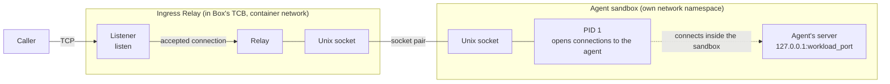
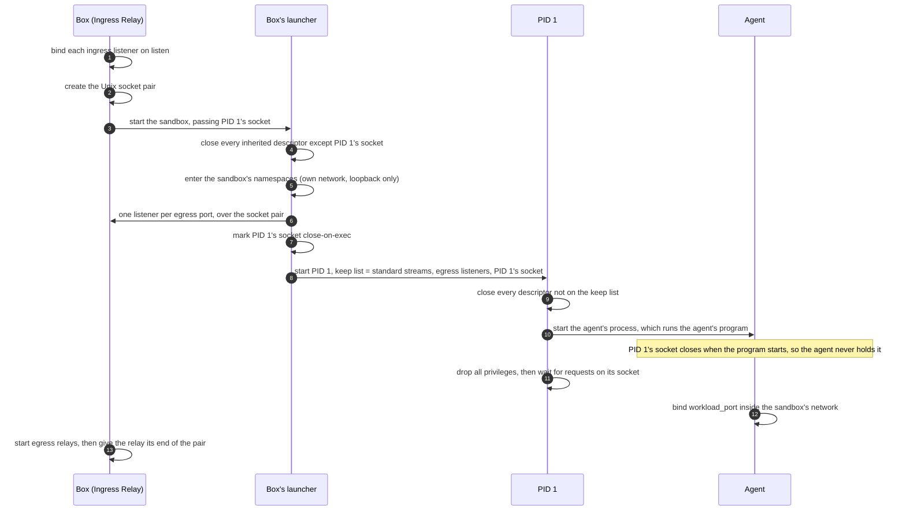
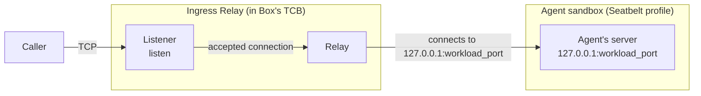
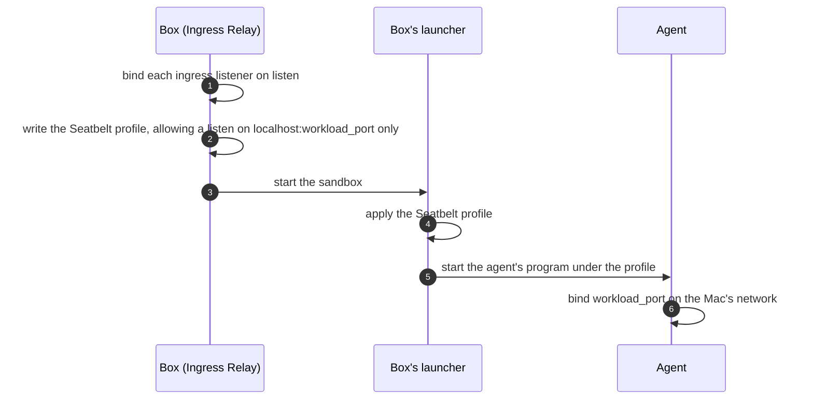
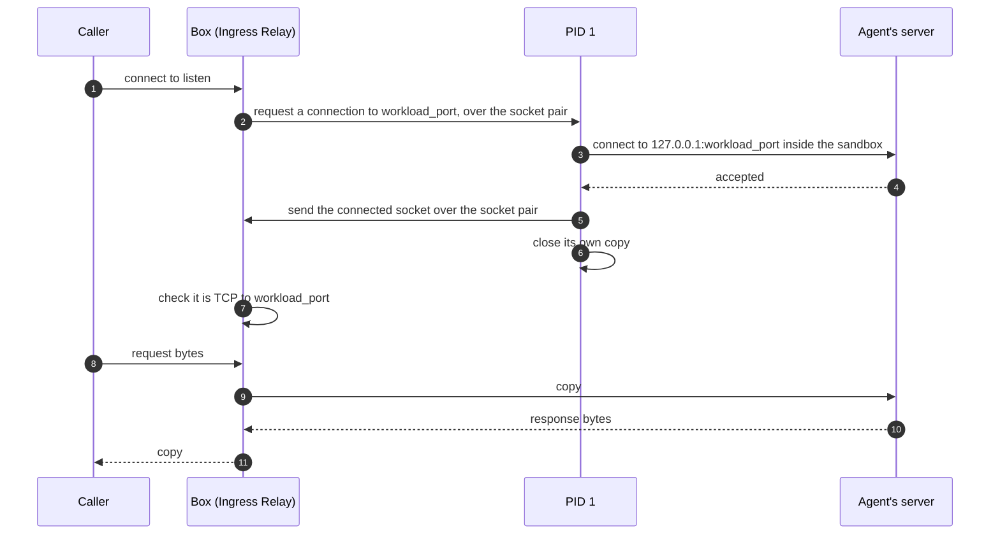
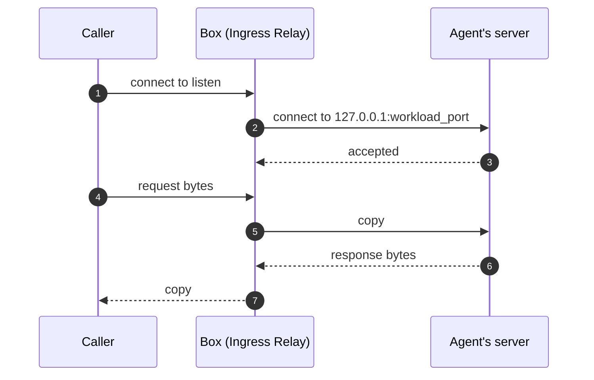
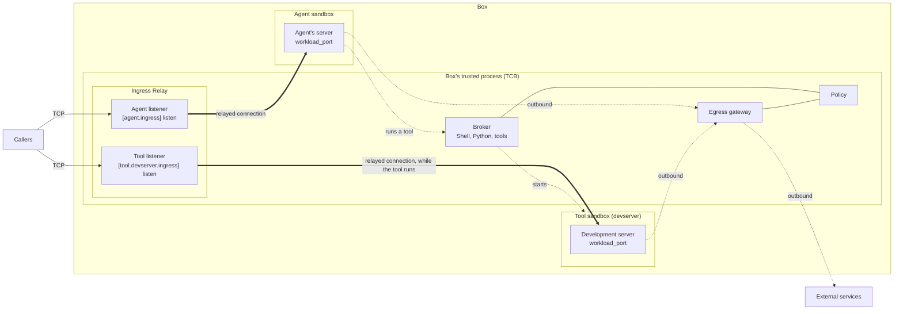

# Feature - Ingress Relay

## Background

Different kinds of agents can run inside a box. Interactive agents such as Claude Code and Codex talk to the user over standard input and output. Agents built with frameworks such as the Strands Agents SDK or LangGraph are usually served by an HTTP server, and callers reach them on a TCP port.

When such an agent runs inside a box, nothing outside the sandbox can reach that port today: the sandbox only allows outbound connections, through Box's egress gateway. The same is true for a server the agent starts in a tool's sandbox, such as a development server. Box needs an ingress path for both. This document describes that path on Linux and macOS.

## What does Ingress Relay do?

The job of Ingress Relay is to set up listeners in Box's trusted process (the TCB) that accept connections from callers and relay them to their agent or tool sandboxes. Each listener maps to exactly one server process, either the agent's server or a server the agent started in a tool's sandbox. For each caller, Box opens a TCP connection to that process's port and copies bytes both ways, so any protocol over TCP works. The process's code does not change, and it gains no new reach. How Box opens that connection differs between Linux and macOS, because Linux gives each sandbox its own network, while macOS sandboxes share the Mac's. Later sections discuss each in detail. [Appendix A](#appendix-a) shows where Ingress Relay sits in Box.


## How do operators configure it in box.toml?

Ingress Relay is configured per process. Any `[agent]` or `[tool.<name>]` table can have an `ingress` table, and each one gets its own listener.

For the agent:

```toml
[agent]
command = ["python", "agent.py"]

[agent.ingress]
listen        = "0.0.0.0:8080"   # where Box listens for callers
workload_port = 8081             # where the agent's server listens, inside its sandbox
```

The agent's code does not change. It listens on its port as it would outside a box:

```python
app = BedrockAgentCoreApp()
app.run(port=8081)
```

| Setting | Meaning |
|---|---|
| `listen` | The address and port Box listens on for callers. |
| `workload_port` | The port the process's server listens on, inside its sandbox. |

Both settings are required.

A tool can have its own listener the same way. Here, a development server the agent may start:

```toml
[tool.devserver]
command = ["python3", "-m", "http.server"]

[tool.devserver.ingress]
listen        = "0.0.0.0:8090"
workload_port = 9000
```

The agent starts the server by running the tool's command, as it would run any tool. The tool's listener answers only while the server runs: Box refuses callers before it starts and after it exits. A tool that declares `ingress` keeps running after the agent's call returns, as a contained stdio MCP server does, until it exits or the box stops. Only one instance of it runs at a time: Box refuses a second start while one runs.

A few rules apply:
- On AgentCore Runtime, the agent's `listen` must be `0.0.0.0:8080`, the port Runtime connects to.
- On macOS, `listen` and `workload_port` must be different ports, and no two processes may use the same port, because all sandboxes share the Mac's network. On Linux, each sandbox has its own network, so they may be the same.
- Box refuses at start a setting it cannot honour, such as a port already in use, an address that is not an IP address and port, port 0, or the same port used twice.
- Box refuses `ingress` on a tool with `network.contain_egress = false`, because that tool shares the host's network, and callers could reach its port without Box.


## How is the Ingress Relay setup during Startup ?

On Linux, Box starts each process (the agent, or a tool) in its own network namespace, so its port exists only inside the sandbox. On macOS, which has no network namespaces, Box runs each process under a Seatbelt profile that limits what it may do on the Mac's shared network.

At startup, Box binds a listener on each `listen` address before it starts any process. It then builds the sandbox for the agent and starts it; the agent's server listens on its `workload_port` inside that sandbox. A tool's listener is bound at startup too, but the tool's sandbox starts later, when the agent runs the tool. The next two sections describe what the relay needs on each platform.


### Linux

The agent's port exists only inside its sandbox's network namespace, so something inside the sandbox has to open each connection to it. That is **PID 1**: the first process Box starts inside the sandbox, which launches the agent and stays alive for as long as the sandbox runs. PID 1 is Box's own code, not the agent's.

The Ingress Relay reaches PID 1 through a **Unix socket pair**: two connected sockets that belong to no file and no network, so they keep working across the namespace boundary. Box keeps one end for the relay and passes the other into the sandbox, where only PID 1 holds it. Box already creates this pair for egress: at startup, it receives over the pair the listeners through which the agent reaches Box's egress gateway. Ingress keeps the same pair open after startup.



At startup on Linux:

1. Box binds each ingress listener on its `listen` address.
2. Box creates the Unix socket pair, keeps one end for the relay, and starts the sandbox with the other.
3. Box's launcher creates the sandbox's namespaces.
4. PID 1 starts the agent and keeps its socket. The agent's copy closes when the agent's program starts, so only PID 1 holds it. PID 1 then waits for connection requests.
5. The agent's server binds its `workload_port` inside the sandbox's network, and the relay is ready for callers.

The full sequence:




### macOS

macOS has no network namespaces, so the agent's port is on the Mac's own network, and the relay can connect to it directly. What Box controls instead is whether the agent may listen at all. Box runs each process under a **Seatbelt** profile: macOS's kernel sandbox, which checks every file, process, and network call the process makes against rules Box writes for it. By default, the profile lets the process make outbound connections only to Box's own ports, such as the egress gateway, and does not let it listen on any port.

For a process that declares ingress, Box adds one rule: the process may listen on `localhost:<workload_port>`, and on no other port. No socket pair and no PID 1 are needed: Box's launcher applies the profile and then starts the agent's program directly.



At startup on macOS:

1. Box binds each ingress listener on its `listen` address.
2. Box writes the agent's Seatbelt profile, with one rule that allows a listen on `localhost:<workload_port>`.
3. Box's launcher applies the profile and starts the agent's program.
4. The agent's server binds its `workload_port` on the Mac's network, and the relay is ready for callers.

Seatbelt can limit the port the process listens on, but not the address. Whether the agent's server listens on `127.0.0.1` or on every address of the Mac is the agent's own choice; "Who can reach the process?" covers what that means.

The full sequence:




## What happens when a caller connects?

The relay accepts each caller on its listener and opens a new TCP connection to the process's `workload_port`, one per caller. It then copies bytes between the two connections, in both directions, until either side closes. Many callers are served at the same time, each on its own pair of connections. Only how Box opens the connection to the process differs by platform.

A tool's listener works the same way, but only while the tool runs. Before the agent starts the tool, and after the tool exits, Box refuses the tool's callers.

### Linux

1. The relay accepts the caller's connection on its listener.
2. Over its end of the socket pair, the relay asks PID 1 for a connection to `workload_port`.
3. PID 1 creates a TCP socket inside the sandbox's network and connects it to `127.0.0.1:workload_port`, where the agent's server listens.
4. PID 1 sends that connected socket back to the relay over the socket pair, and closes its own copy. A Unix socket can carry a socket from one process to another: the receiver gets its own handle to the same connection.
5. The relay checks that it received a TCP connection to `workload_port`, and then copies bytes between the caller and the agent.

PID 1 takes part only in opening the connection. It answers one request at a time, and each takes a fraction of a millisecond. After that, the bytes go between the relay and the agent directly. If nothing listens on `workload_port` yet, PID 1 says so, and the caller sees a closed connection.

The full sequence:



### macOS

1. The relay accepts the caller's connection on its listener.
2. The relay opens a TCP connection to `127.0.0.1:workload_port`, as any local client would.
3. The relay copies bytes between the caller and the agent.

No PID 1 and no socket pair are involved, because the agent's server is on the Mac's own network.

The full sequence:



### Who can reach the process?

On Linux, the relay is the only way into the process's port:

| Who | Can reach the agent's port? | Why |
|---|---|---|
| Other machines (LAN, internet) | No | The port exists only in the sandbox's network. |
| Processes in the container or on the host | No | Their `127.0.0.1` is a different loopback. |
| Other sandboxes (tools, MCP servers) | No | Each has its own network namespace. |
| Box's relay | Yes, through PID 1 | PID 1 is inside the sandbox's network. |

This holds for every process that declares `ingress`, because each one has its own network namespace on Linux: Box refuses `ingress` on a tool that shares the host's network (`network.contain_egress = false`).

On macOS, the relay is the supported way in, but not the only one. Seatbelt limits the port the agent listens on, not who connects to it:

| Who | Agent listens on `127.0.0.1` | Agent listens on `0.0.0.0` |
|---|---|---|
| Other machines on the LAN | No | **Yes** |
| Local processes, any user | **Yes** | **Yes** |
| A web page in a local browser | Yes, within the browser's own rules | Yes |
| Other sandboxes (tools, MCP servers) | No: their profiles only allow connections to Box's ports | No |
| Box's relay | Yes | Yes |

`BedrockAgentCoreApp` listens on `127.0.0.1` by default outside a container, so a default agent on a Mac is not reachable from the LAN. An agent that listens on `0.0.0.0` is.

#### Why keep the relay on macOS, if local processes can reach the agent directly?

The direct port changes who can reach the agent, not what the agent can reach: the agent stays inside its Seatbelt profile either way. Box accepts that trade-off on macOS, because a Mac is mostly a development machine, and keeps the relay as the supported path, the same as on Linux. [D3](#d3) gives the reasons.


## How many connections can it handle?

Box does not limit the number of connections. The relay costs little per connection, and in our tests the agent's own server ran out of capacity long before the relay did.

**How we tested it.** We ran a box with Linux Option 1 in one Docker container (12 vCPU, 7.6 GB), in front of an echo agent built with `BedrockAgentCoreApp`. The agent made no model calls, so the test measured Box and not the model. A load client in the same container connected to Box's listener, and the agent counted the connections it saw.

| Test | Result |
|---|---|
| WebSockets held open at once, 30 s, then one echo each | 28,230 of 30,000 |
| New connections per second, each a short HTTP request | up to 2,000 per second with no failures; at 5,000 per second the agent fell behind |
| Requests per second on reused connections | about 6,100, the same as with no Box in front |
| 20 callers that send 1 MB messages and never read, beside 100 normal callers | normal callers still echo in 5 ms (median); Box's memory stays flat |

**Recommendation.** No connection limit in Box. The agent's server is the bottleneck, so a limit in the relay would only refuse callers that the agent could not serve anyway.

## What happens when something fails?

A failure can happen at startup, while a caller connects, or when a process stops. The table lists each case and what Box does.

| What happens | What Box does |
|---|---|
| A `listen` port is already in use at startup | Box refuses to start, and names the port. |
| Nothing listens on `workload_port` yet, or any more | The caller sees a closed connection. Box keeps listening, so a later caller succeeds once the process listens. |
| The agent exits | The box stops, as it does today when the agent exits. |
| A tool exits | The tool's listener refuses callers until the agent runs the tool again. The box keeps running. |
| The process accepts no connections (for example, it is stuck) | On Linux, PID 1 gives up on that connection after a short timeout, so other callers are not held up behind it. The caller sees a closed connection. |

Box logs every refused connection, so a failure is never silent.

## What happens when the box stops?

When the box is asked to stop, for example when AgentCore Runtime ends a session:

1. Box stops accepting new callers on every listener.
2. Box lets open connections finish, for a bounded time.
3. Box closes the connections that are still open, stops each tool's sandbox, and stops the agent.

When the agent exits on its own, the box stops the same way: its listeners close, and so do the connections they relayed.


## Key decisions

### D1. Box relays connections; it does not open a network path into the sandbox.

The sandbox keeps the network it has today: outbound only, through Box's egress gateway. Box's trusted process accepts each caller and copies bytes to the process's port, so the process gains no new reach, and any protocol over TCP works. Box makes no policy decision when it accepts a caller: the operator's `listen` setting is the authorization. **Rejected alternative:** a network path into the sandbox, such as a veth pair or user-mode networking (pasta). It works, but it gives the sandbox a second network interface and a route to it, which is more than one declared port needs.

### D2. On Linux, PID 1 opens the connection to the agent.

The agent's port exists only in the sandbox's network namespace, so something inside has to connect to it. PID 1 is Box's own code, is already inside, and is already linked to Box by the socket pair that egress uses. It connects to `127.0.0.1:workload_port`, hands the connection to the relay, and steps out of the data path. The agent's code does not change. **Rejected alternative:** a Unix socket file that the agent's server listens on instead of a port. It needs a shim that redirects the server's listen call to the file, and that shim does not work for every runtime.

<a name="d3"></a>

### D3. On macOS, Box keeps the relay, even though local processes can reach the agent directly.

macOS has no network namespaces, so the agent listens on the Mac's own network, and Seatbelt can limit only which port it listens on. Any local process can connect to that port, and the LAN can too if the agent listens on `0.0.0.0`. We accept that on macOS, because a Mac is mostly a development machine, and the risk is about who can reach the agent, not what the agent can reach. Box still puts the relay in front, so callers use the same `listen` address and get the same behaviour as on Linux, and one `box.toml` works on both. **Rejected alternative:** no relay on macOS, with callers using `workload_port` directly. It is simpler, but the address and the behaviour then differ by platform, and Box sees none of the traffic.

### D4. Only the operator opens a listener.

Every listener comes from `box.toml` and is bound when the box starts. The agent cannot open a new one: it decides only when a declared tool runs, and that tool's listener answers only while the tool runs. What the outside world can reach is therefore fixed before any untrusted code starts.

### D5. Each process declares its own ingress, and both settings are required.

Ingress lives inside the process it serves, as `[agent.ingress]` or `[tool.<name>.ingress]`, so a listener cannot point at a process that does not exist. `listen` and `workload_port` are required on both platforms, so the operator always states what is exposed and where.

### D6. Box sets no connection limit and does not poll the process's health.

In our tests, the agent's own server ran out of capacity long before the relay did, so a limit in Box protects nothing the agent does not already limit. Box finds a failure when it tries to connect to `workload_port`, and handles it then. **Rejected alternative:** a fixed connection limit, and periodic checks of `workload_port`.


### D7. The agent cannot restart a running tool server.

An agent that runs a tool server often needs to restart it after it changes the code, which means Box must stop the running instance in its sandbox and start a fresh one. P0 does not support this: a tool server serves callers until it exits or the box stops, and Box refuses a second start. Restart on the same listener is planned for P1.

## Interface changes

`ingress` is a new field in `[agent]` and in each `[tool.<name>]`, so it adds to the fields that each process table holds. At startup, Box reports each listener on stderr, as `listen → process:workload_port`, in the same way that it reports each filesystem grant. Ingress adds no policy action.

## Appendix

<a name="appendix-a"></a>

### A. Where Ingress Relay sits in Box



Bold arrows are the ingress paths. Dotted arrows are paths Box already has: the agent runs a tool through the broker, and each sandbox reaches external services through the egress gateway.
