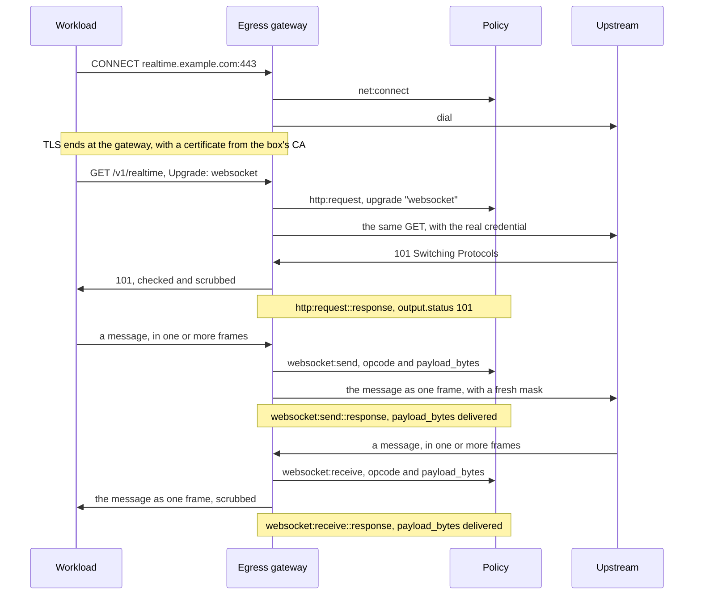
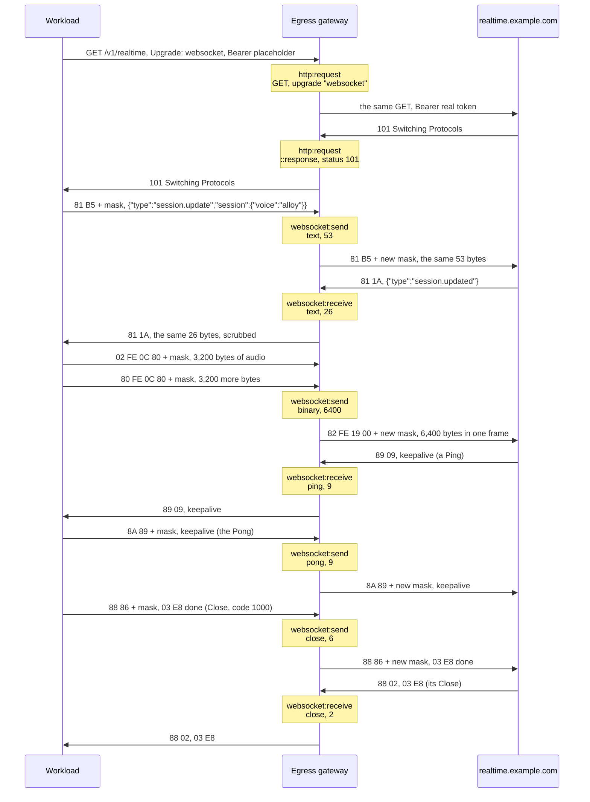

# Feature - WebSocket through the egress gateway

## Overview

This design lets a WebSocket pass through the egress gateway, and keeps every message in both directions under policy. Main refuses a WebSocket today, because it strips `Upgrade` and refuses a `101`. The design uses three actions:
- **`http:request`** decides the handshake, as it decides any HTTPS request today. It gains one input field, `upgrade`, which is `"websocket"` on a handshake and `""` on every other request.
- **`websocket:send`** is new. It decides each message that the workload sends after the `101`, before any byte of the message leaves.
- **`websocket:receive`** is new. It decides each message that the server sends after the `101`, before any byte of the message reaches the workload.

Both message actions take the same input: the handshake's `host`, `port`, and `path`, plus the message's `opcode` (`text`, `binary`, `ping`, `pong`, or `close`) and `payload_bytes`. They follow `http:request`, and a message is to them what a body is to an HTTP request. The gateway reads the whole message, up to main's 16 MiB body cap, then asks policy, then sends the message on as one frame. `payload_bytes` is the offer on `::request` and the delivery on `::response`, as `body_bytes` is on `http:request`. Ping, Pong, and Close are messages too, because the side that sends one chooses its bytes.

So an operator can permit HTTP requests and no WebSocket data, because a `GET` permit admits a handshake head and no message. A size rule refuses a large message before it moves on. A guard, such as "nothing leaves after the SSH key is read", stops the next message, and a budget sums `payload_bytes` on the records of one direction. Existing rules on `http:request` keep their meaning and their events. Each message waits about 4 ms for its decision, so a box decides about 133 to 149 messages a second, in both directions together. A `sum` over a long lookback lowers that rate (section 5).

Response streaming, HTTP/2, and headers in policy are out of scope, and each gets its own design.

## 1. Background

Realtime model APIs and browser automation keep a WebSocket open. Main (the main branch at `0dee080`) strips `Upgrade` and `Connection`, sends the handshake as a plain `GET`, and refuses a `101`. #173 asks for WebSocket support.

#230 was a prototype that relayed WebSockets and asked `http:request` again while one was open. Its review asked for a design first. We keep its relay and its measurements. We change two things:
- A `GET` permit admitted a WebSocket that uploads, with no warning. Here, a message needs its own permit.
- Each decision wrote an `http:request::response` event, so a rate limit counted the decisions of an open WebSocket and could close it. Here, `http:request` writes the same events as on main, and messages write `websocket:send` and `websocket:receive` events.

We also add a decision for each server message, `websocket:receive`.

## 2. How does a WebSocket pass through the gateway?

A WebSocket handshake is a `GET` with `Upgrade: websocket`, and the server answers `101 Switching Protocols`. After that, both sides send messages for as long as they like. A message is one frame, or a first frame and continuation frames up to one with the FIN bit. The handshake takes the same path as any HTTPS request, and only the messages after the `101` are new:



Policy writes `::request` at each decision. A refusal at any step closes the WebSocket, and the message never reaches the other side (section 3.3).

The handshake follows these rules:
- The gateway accepts `wss://` only, because it reads messages only inside the TLS tunnel that it ends. A plain HTTP handshake gets 403 and a Deny record, the gateway's own record of a refusal, kept outside the history.
- The handshake must be a valid RFC 6455 `GET` on HTTP/1.1, or it gets 400. A handshake to a configured remote MCP (Model Context Protocol) server gets 403, because its messages would skip the `mcp:call` decision.
- The gateway swaps the placeholder token for the real credential on the handshake, never in a message. On a signing host, one whose requests the gateway signs with SigV4, it signs the handshake as a `GET` with no body.
- The gateway removes `Sec-WebSocket-Extensions` and refuses a `101` that names one, because `permessage-deflate` would hide a message from policy and the scrub. The scrub masks each copy of a credential in what the server sends back.
- hyper's client takes any `101` as an upgrade, so the gateway checks `Upgrade`, `Connection`, and `Sec-WebSocket-Accept`, and answers 502 if one is wrong.

After the `101`, the relay reads each message whole in each direction, as main reads a whole request body and a whole response body. It checks each frame against RFC 6455. The checks cover reserved bits, opcodes, masking by the workload only, unfragmented control frames of at most 125 bytes, and frame order. Text and the reason in a Close must be valid UTF-8. The relay sends each message on as one frame, and masks a workload message again with a fresh key, so the workload can't choose the bytes on the upstream wire. When a placeholder credential applies to the host, the relay scrubs the `101` head and each server message after its decision.

We write the frame codec ourselves on hyper's upgrade, as #230 did. It's about 75 lines of #230's 593-line relay, and the hooks for policy and the scrub are most of the rest. tungstenite and tokio-tungstenite (0.30) answer every Ping and Close themselves, so a Ping or a Close from either side never reaches a decision. fastwebsockets (0.8) doesn't check which side masks.

## 3. How does policy decide a WebSocket?

### 3.1 The handshake

The handshake is one `http:request`, decided and recorded as on main: `http:request::request` at the decision, and `http:request::response` at the `101`, with `output.status` 101. The one new input field is `upgrade`. It's `"websocket"` on a handshake and `""` on every other request. It matches the HTTP field name, as `method` does, so a rule reads like the request: `context.input.upgrade == "websocket"`.

A permit that doesn't read `upgrade` admits a handshake to its host. That lets the head leave, as any `GET` does, and no message can follow without a `websocket:send` or a `websocket:receive` permit. An operator who wants no handshake at all adds `context.input.upgrade == ""` to the permit.

### 3.2 Messages

Each message that the workload sends is one `websocket:send`, and each message that the server sends is one `websocket:receive`. The gateway asks when the last frame of the message has arrived. The two actions follow `http:request`. The input names the endpoint and the payload, and `payload_bytes` is the offer on `::request` and the delivery on `::response`, as `body_bytes` is. A message gets no reply, so neither action has an `output`, as `net:connect` has none.

```text
entity WebSocketOpcode enum ["text", "binary", "ping", "pong", "close"];

type WebSocketMessageInput = {
  host: String,           // from the handshake
  port: Long,
  path: String,
  opcode: WebSocketOpcode,
  payload_bytes: Long     // the payload length, after the mask comes off
};

action "websocket:send" appliesTo {
  principal: Agent,
  resource: Resource,
  context: { input: WebSocketMessageInput }
};

action "websocket:receive" appliesTo {
  principal: Agent,
  resource: Resource,
  context: { input: WebSocketMessageInput }
};
```

`opcode` names the first frame's opcode, as RFC 6455 does, and a rule spells it `Box::WebSocketOpcode::"text"`:

| `opcode` | Frame opcode | Payload |
|---|---|---|
| `text` | `0x1` | 0 to 16 MiB of UTF-8 |
| `binary` | `0x2` | 0 to 16 MiB |
| `ping` | `0x9` | 0 to 125 bytes |
| `pong` | `0xA` | 0 to 125 bytes, usually a copy of the Ping that it answers |
| `close` | `0x8` | 0 bytes, or a 2-byte code and a UTF-8 reason, up to 125 bytes |

A continuation frame (`0x0`) is part of the message that it continues, so it has no value of its own. A control frame (Ping, Pong, or Close) is a message of its own, because its sender chooses its payload. A control frame between two frames of a text or binary message gets its own decision and moves on first.

The events follow the rules of every other action (`docs/user/policy/actions.md`), and the two actions differ only in where the message goes:
- `::request` at each decision, permitted or denied.
- `::response` when the gateway has sent the message on, upstream for `websocket:send` and to the workload for `websocket:receive`. If the other side drops while the gateway sends it, the record counts the bytes that the other side took.
- `::error` when no byte of the message reached the other side.

The end of a WebSocket writes no event. The `::response` of each Close records how the WebSocket ended.

### 3.3 Refusals and limits

A refused message never reaches the other side. The relay closes both sides and writes one Deny record. After a refusal by policy, in either direction, the workload gets 1008 and the server gets 1001, so the server learns nothing about the policy. After a protocol fault, the side that broke the rule gets the close code from the table. The other side gets 1001 after a workload fault or 1014 after a server fault.

| Cause | Signal |
|---|---|
| `http:request` refuses the handshake | 403, as on main |
| A plain HTTP handshake, or a handshake to a remote MCP host | 403 |
| A handshake that isn't valid RFC 6455 | 400 |
| A `101` with a wrong `Upgrade`, `Connection`, or `Sec-WebSocket-Accept`, or with an extension | 502 |
| `websocket:send` or `websocket:receive` refuses a message | 1008 to the workload, 1001 to the server |
| A frame that breaks RFC 6455 | 1002 to the side that sent it |
| Text or a Close reason that isn't valid UTF-8 | 1007 to the side that sent it |
| A message over 16 MiB | 1009 to the side that sent it, and no event |
| One side drops | 1001 to the workload or 1014 to the server, and `::error` or `::response` for a message that was on its way to that side |
| Nothing moves on either leg for 300 s | 1001 to both sides |

The 16 MiB cap is main's `max_body_bytes`. A WebSocket holds at most one message in each direction. An HTTP exchange on main holds a request body and a response body, so the memory bound is the same. The 300 s is main's `upstream_read_deadline`. On main it's a total for each exchange, which would cut every WebSocket at 300 s. After the `101`, it limits idle time on both legs. A WebSocket holds one of main's 256 connections (`max_connections`) while it's open. Neither number becomes a config key.

## 4. What changes in a policy?

Existing rules on `http:request` keep their meaning, and their events don't change. Take a sample policy that loads today, lets an agent read from GitHub, and has a guard:

```text
@id("github_read")
permit (principal, action == Box::Action::"http:request", resource)
when { context.input.host == "api.github.com" && context.input.method == "GET" };
@id("none_after_key")
@description("Nothing leaves after the SSH key is read.")
forbid (principal, action in [Box::Action::"http:request", Box::Action::"websocket:send"], resource)
when temporal {
  formerly within 24h (
    Box::Action::"fs:read"::response{ input.path: "~/.ssh/id_ed25519",
                                      input.operation: Box::FsReadOperation::"read_content" }
  )
};
@id("realtime")
permit (principal, action == Box::Action::"http:request", resource)
when { context.input.host == "realtime.example.com" && context.input.path == "/v1/realtime" &&
       context.input.upgrade == "websocket" };
@id("realtime_messages")
permit (principal, action in [Box::Action::"websocket:send", Box::Action::"websocket:receive"], resource)
when { context.input.host == "realtime.example.com" && context.input.path == "/v1/realtime" &&
       context.input.payload_bytes <= 1048576 };
@id("websocket_budget")
@description("At most 10 MiB sent over WebSockets in 10 minutes.")
forbid (principal, action == Box::Action::"websocket:send", resource)
when temporal {
  exists (total: Long). (
    (sum b for (b: Long), (t: Timepoint). where (
      formerly within 10m (
        Box::Action::"websocket:send"::response{ input.payload_bytes: b } && tp(t)
      )
    )) == total && total >= 10485760
  )
};
```

These rules differ from today:
- `github_read` needs no edit. It admits a handshake head to `api.github.com`, but no rule permits a message there, so the first message in either direction closes the WebSocket with 1008.
- `none_after_key` names `websocket:send` next to `http:request`, so it also stops the next message out of an open WebSocket. It doesn't name `websocket:receive`, so the server can still send to the workload. It reads no `context.input`, so it loads across the two action families.
- `realtime` and `realtime_messages` are new, and a WebSocket to `realtime.example.com` needs both. `realtime_messages` reads `context.input` across `websocket:send` and `websocket:receive`, which loads because the two are one action family. It refuses a message over 1 MiB in either direction before it moves on, because the gateway knows the length when it asks.
- `websocket_budget` is new, and sums the delivered bytes, as main's HTTP budget sums `body_bytes` on `http:request::response`. A budget on received bytes is the same rule on `websocket:receive`, and a budget on text only adds `input.opcode: Box::WebSocketOpcode::"text"` to the pattern. One `sum` reads the events of one action, so a budget on HTTP bodies stays a separate rule on `http:request`, with its own limit.

Here's a WebSocket to `wss://realtime.example.com/v1/realtime` under these rules. Each arrow shows a frame's header bytes in hex, then its payload. `mask` is the 4-byte key that the workload chooses, and server frames have no mask. Each note is one decision, with the action, the `opcode`, and `payload_bytes`:



Each decision writes `::request` at the note and `::response` after the arrow out, so the session writes 16 events. Each `websocket:*` event also carries `host` "realtime.example.com", `port` 443, and `path` "/v1/realtime". The gateway swaps the placeholder for the real token on the handshake only, so the messages carry no credential. If the workload reads `~/.ssh/id_ed25519` after the first text message, `none_after_key` refuses the binary message, it never leaves, and both sides close.

## 5. What does it cost?

Each message costs one decision and one record, in either direction. A probe on a patched copy of main at `93a3761`, in a release build on macOS, measured the engine with a sample policy that has a byte budget, a rate limit, and a guard on `http:request`:

| Measurement | Result, p50 unless stated |
|---|---|
| Up to about 3,400 events in the history | Decision 4.0 to 4.2 ms, record 2.7 to 3.3 ms |
| About 16,500 events | Decision 21.4 ms (p99 69.5 ms), record 3.4 ms |
| Permits only, about 16,500 events | Decision 4.0 ms |
| #230, new WebSockets that each send one message | 54.1 per second, against 72.9 with no decisions |

So a message waits about 4 ms after its last frame arrives, and costs about 6.7 to 7.5 ms of engine time at a small history. One mutex guards each engine call, so the whole box decides about 133 to 149 messages a second, in both directions together. We haven't measured a WebSocket that sends a message for each decision.

A large message also waits while the gateway reads all of it, as a large HTTP body does on main. The memory bound is one message in each direction for each WebSocket, 16 MiB each, the same as an HTTP exchange on main.

The growth of the history is the cost I'm least sure of. Dogwood keeps the events that match each `count` or `sum`, but no running total. So each decision of an action that the rule names adds up its matches in the lookback again, at about 1.2 µs for each one. A decision of another action skips the rule.

Take a realtime audio stream that sends 50 messages a second each way, which is a guess for audio in 20 ms frames:
- With no `count` or `sum`, it uses about 100 of the box's 133 to 149 decisions a second.
- Under `websocket_budget`, the 10-minute lookback holds 30,000 `websocket:send::response` events. That adds about 36 ms to each `websocket:send` decision. The box then decides only about 29 messages a second each way, so the stream falls behind.
- With a 1-minute lookback, a `websocket:send` decision costs about 3.6 ms more, and the stream uses about 89% of the box.

Every `http:request` waits on the same lock, so HTTP slows with the stream. The cost comes from the `sum`, not from one decision for each message, because the stream fits with no `sum`.

## 6. How do we deliver it?

The work lands in two PRs after this doc, and each one fails closed, which means it refuses what it doesn't yet decide.
1. This doc.
2. The policy PR adds `upgrade` to `http:request`, and adds `websocket:send` and `websocket:receive` with `Box::WebSocketOpcode` and their input. The gateway still strips `Upgrade`, so `upgrade` is always `""` and nothing raises a `websocket:*` action yet.
3. The relay PR adds the handshake, the relay with its frame rules and scrub, the 16 MiB cap, the idle clock, and a decision for each message in each direction. It adds end-to-end tests through a real box, with an echo server and a SigV4 handshake to a signing host, as #197 ran them. It also runs one stream of 50 messages a second each way for 10 minutes, under `websocket_budget` with a 10-minute and a 1-minute lookback. The bar is that the relay keeps the stream's rate, and the estimate above says that only the 1-minute lookback passes.

If we accept this design, we approve these changes to frozen surfaces, the interfaces that change only with an approved design:
- The egress gateway's `pub use` set (the relay PR). `EffectAttempt::HttpRequest` gains `upgrade`, and `EffectAttempt` gains `WebSocketSend` and `WebSocketReceive`.
- The policy crate's `pub use` set (the policy PR). `Request::Http` gains `upgrade`, and `Request` and `Outcome` each gain a `WebSocket` variant that serves both actions.
- The policy action vocabulary (the policy PR): `upgrade` on `http:request`, the actions `websocket:send` and `websocket:receive`, and the enum `Box::WebSocketOpcode`.

Box rules are written in Dogwood, the upstream policy language and engine, and Dogwood fixes the event schema of a store. So a box created before the policy PR refuses to start until its operator creates it again.

## 7. Key decisions

### D1. `http:request` decides the handshake, and there's no `websocket:connect`

The handshake is an HTTP `GET`, and `http:request` with `upgrade` decides it. A third action would add a rule and decide nothing new. A rule that should refuse every handshake reads `context.input.upgrade`.

### D2. Each message is one decision before it moves on

A message is what one side chooses to send, so each one is one decision. A guard then stops the next message, and a budget is exact to one message. We rejected two options:
- One decision for each WebSocket. A guard or a budget couldn't stop a WebSocket that's already open, and only the idle clock would end it.
- One decision for each frame. The gateway sends each message as one frame anyway, so a frame boundary carries no new fact, and a sender could multiply the decisions.

### D3. The gateway reads the whole message before it decides

HTTP decides a request with its `body_bytes`, so a message action decides a message with its `payload_bytes`, and a rule reads the same fact on both. At the first frame, the gateway doesn't know the length of a message with more than one frame. So a size rule couldn't refuse a large message before it moves on. The cost is the wait to read the message, and memory up to the 16 MiB cap, both as for an HTTP body on main.

### D4. Control frames are messages

Ping, Pong, and Close each carry up to 125 bytes that their sender chooses, so each one gets a decision. The `opcode` field lets a rule treat them apart.

### D5. Server messages get their own action, `websocket:receive`

What enters the box matters too, so an operator can cap or budget the bytes that a server sends, and a rule can see a received message in the history. We didn't add a direction field to `websocket:send`, because a budget on sent bytes would then need a direction filter. A rule that forgot the filter would count both ways. Both actions share one input, and they're one action family, so one rule can read `context.input` across both. HTTP replies still get no decision, and response bytes for HTTP are left to the response streaming design.

### D6. Packs compose rules across actions now, and effects can later

A guard over every action that sends bytes out names each action today, as `none_after_key` names `http:request` and `websocket:send`. A policy pack can ship that set of rules for a use case. Tool grammars (0001) add effects, which more than one action can share. A box effect, such as `Box::Effect::"network_outbound"` on `http:request` and `websocket:send`, would let one rule cover each such action, later ones included. We leave it to its own design, because two things must change first. A rule that reads `context.input` and names no action, or actions of two families, refuses to load today (`crates/policy/src/spelling.rs`). And every action in a rule's scope must declare the `effects` field.

## 8. Limitations

1. The scrub reads one message at a time, so it misses a secret split across two messages or encoded again, for example in base64. A mask in a binary stream breaks the stream and shows the secret's length.
2. There's no WebSocket over HTTP/2 (RFC 8441), no WebSocket compression, and no HTTP/3.
3. A message moves on only after the gateway has read all of it. So when one side streams one large message, its first byte reaches the other side late.
4. A budget compares the bytes already delivered with its limit, so the message that crosses the limit passes in full, as an HTTP body does on main.
5. Each message waits for a decision. The box decides about 133 to 149 messages a second in both directions together, at a small history and with no `count` or `sum`. A 10-minute `sum`, as in `websocket_budget`, lowers that to about 29 a second each way, below one realtime audio stream (section 5).
6. A byte budget over HTTP bodies and WebSocket messages is two rules, so a workload can send up to the sum of their limits.
7. A `formerly` guard acts once its record is written. The Strands Shell and the Python broker write the `fs:read` record before the read returns. The experimental native filesystem policy on macOS writes it after the kernel admits the open, so a message right after the read can leave first, as a request can on main.
