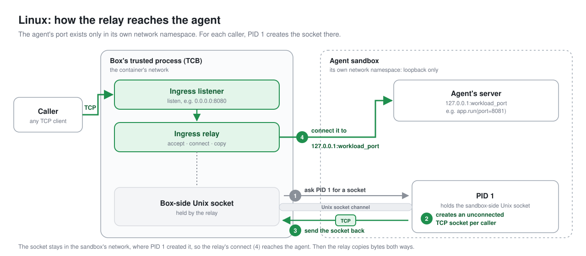
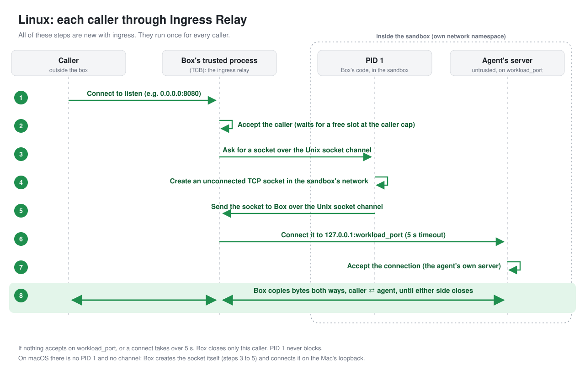
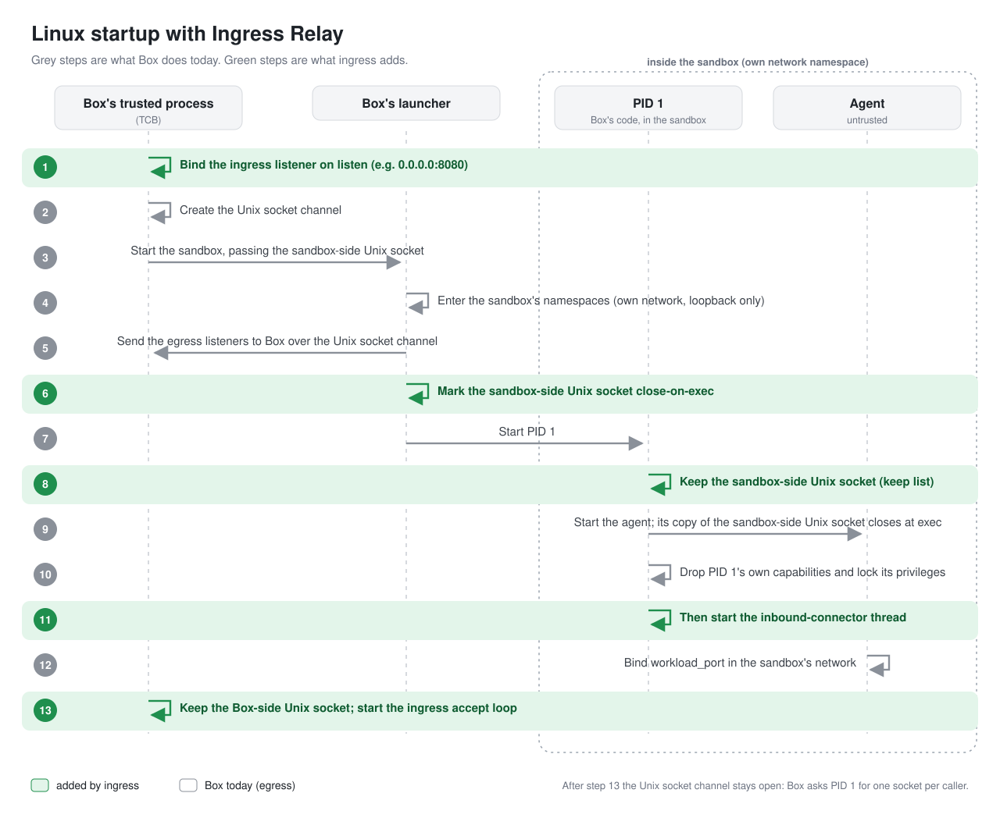
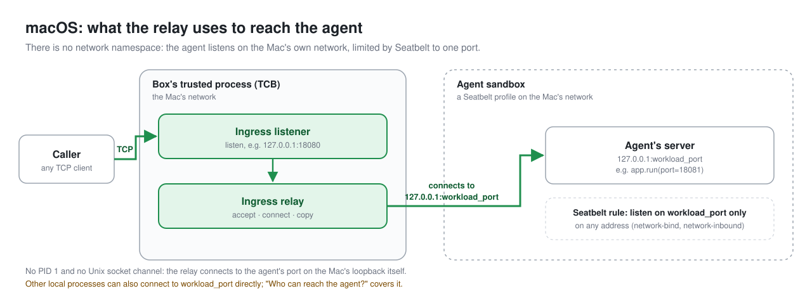
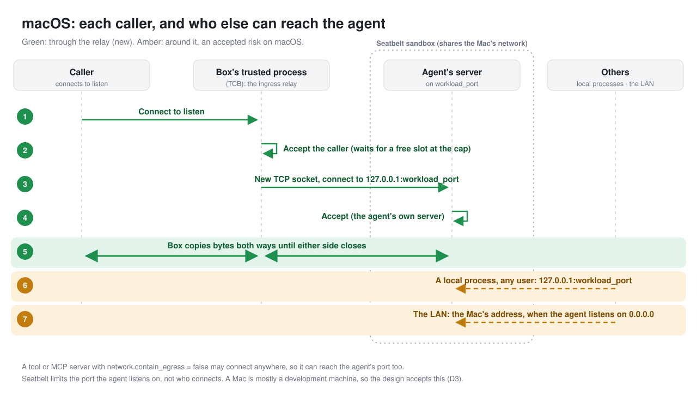
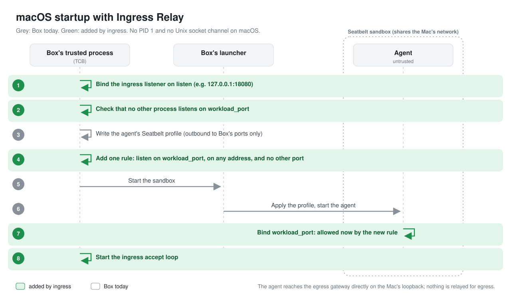
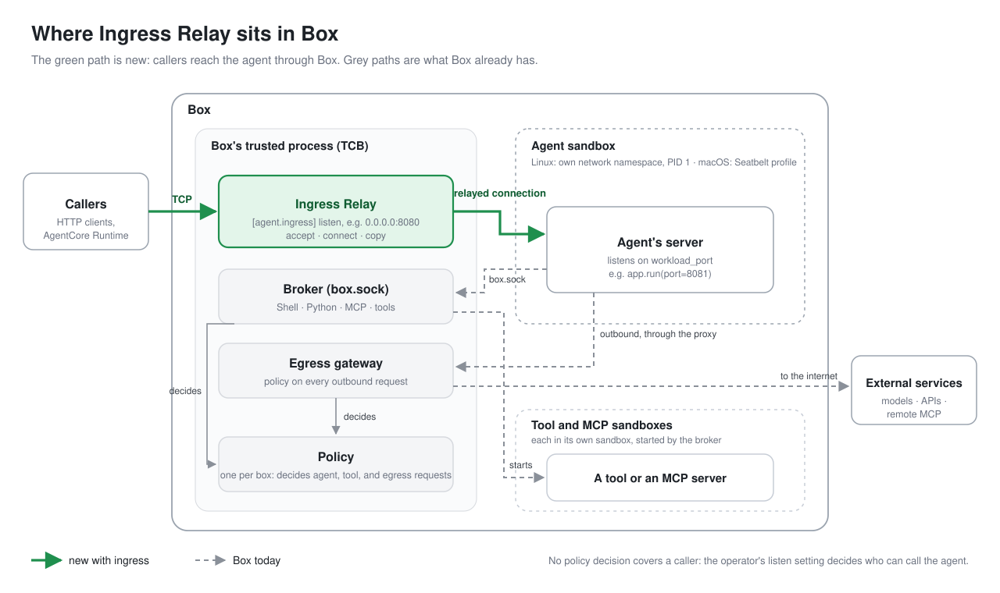

# Feature - Ingress Relay

## Background

Different kinds of agents can run inside a box. Interactive agents such as Claude Code and Codex talk to the user over standard input and output. Agents built with frameworks such as the Strands Agents SDK or LangGraph are usually served by an HTTP server, and callers reach them on a TCP port.

When such an agent runs inside a box, nothing outside the sandbox can reach that port today: the sandbox only allows outbound connections, through Box's egress gateway. Box needs an ingress path to that port. This document describes that path on Linux and macOS.

**Scope.** This design covers the agent's own server, `[agent.ingress]`. Ingress to a server that the agent starts in a tool's sandbox, such as a development server, is a fast follow-on with its own design (see [Future work](#future-work)).

## What does Ingress Relay do?

The job of Ingress Relay is to set up a listener in Box's trusted process (the TCB) that accepts connections from callers and relays them to the agent's sandbox. For each caller, Box opens a TCP connection to the agent's port and copies bytes both ways, so any protocol over TCP works. The agent's code does not change, and it gains no new reach. How Box opens that connection differs between Linux and macOS, because Linux gives each sandbox its own network, while macOS sandboxes share the Mac's. Later sections discuss each in detail. [Appendix A](#appendix-a) shows where Ingress Relay sits in Box.


## How do operators configure it in box.toml?

Ingress Relay is configured as an `ingress` list under `[agent]`:

```toml
[agent]
command = ["python", "agent.py"]

[[agent.ingress]]
listen        = "0.0.0.0:8080"   # where Box listens for callers
workload_port = 8081             # where the agent's server listens, inside its sandbox
```

Each `[[agent.ingress]]` entry maps one `listen` address to one `workload_port`. To serve another port, for example MCP or A2A next to HTTP, add another entry. An agent may declare up to five. [D4](#d4) explains why.

The agent's code does not change. It listens on its port as it would outside a box:

```python
app = BedrockAgentCoreApp()
app.run(port=8081)
```

| Setting | Meaning |
|---|---|
| `listen` | The address and port Box listens on for callers. |
| `workload_port` | The port the agent's server listens on, inside its sandbox. |

Both settings are required in each entry.

Some examples for configuring these settings:
- On AgentCore Runtime, the entry for `InvokeAgentRuntime` listens on `0.0.0.0` at the runtime protocol's port (8080 for HTTP, 8000 for MCP, 9000 for A2A, unless `protocolConfiguration.port` sets another). Entries for other servers listen on the ports in the runtime's `allowedPorts`.
- On macOS, the agent's sandbox shares the Mac's network, so no `listen` port may equal any entry's `workload_port`. On Linux, the sandbox has its own network, so they may be the same.
- Box refuses at start a setting it cannot honour, such as a port already in use, two entries with the same `listen` port, more than five entries, an address that is not an IP address and port, or port 0.


## How does Ingress Relay reach the agent?

For every caller, Box does the same three things: it accepts the caller on `listen`, opens a new connection to the agent's `workload_port`, and copies bytes both ways until either side closes. What differs between Linux and macOS is how Box opens that connection, because a Linux sandbox has its own network and a macOS sandbox shares the network of the Mac.

### Linux

#### What Box already has

On Linux, the agent runs in its own network namespace, which holds only a loopback. Its port is not reachable from outside, not even from Box.

Two pieces already exist that we leverage for this work:

- **PID 1** is the first process inside the sandbox. It is Box's own code, not the agent's. It starts the agent, cleans up processes the agent leaves behind, and passes signals on to it.
- **The Unix socket channel** is a pair of connected Unix sockets that Box creates before it starts the sandbox. Box keeps one socket and passes the other into the sandbox. Today it is used once: the sandbox sends Box the listeners the agent uses to reach the egress gateway, and then the channel closes.

A socket stays in the network it was created in, even after it is passed to another process. That is what makes it possible for listener sockets and TCP sockets to cross network namespaces and operate.

#### What happens when a caller connects



1. Box accepts the caller on `listen`.
2. Box asks PID 1 for a socket, over the Unix socket channel.
3. PID 1 creates a TCP socket inside the sandbox's network, and sends it back without connecting it.
4. Box connects that socket to `127.0.0.1:workload_port`. Because the socket was created inside the sandbox, the connection reaches the agent's server.
5. Box copies bytes between the caller and the agent.

PID 1 only creates sockets, which never blocks, so a slow agent cannot hold it up. Box makes each connection itself, with a timeout for each caller.



#### What we add at startup

For the above flow to work, the Unix socket channel must stay open, PID 1 must be listening on it, and the agent must not hold it. Today, startup goes like this:

1. Box creates the Unix socket channel and starts the sandbox.
2. The sandbox sends the egress listeners to Box over the channel.
3. PID 1 closes its socket, Box drops its own, and the agent starts.

Ingress changes the following:

- Box binds each `listen` address before it starts anything, so a port in use stops the box straight away.
- PID 1 adds the sandbox-side Unix socket to its keep list, so it keeps the socket instead of closing it as it does today. Box also sets close-on-exec on it again, so the copy the agent inherits from PID 1 closes before any agent code runs.
- After PID 1 starts the agent and drops its capabilities, as it does today, it starts a small thread that waits for socket requests.
- Box keeps its own socket, and starts accepting callers.



### macOS

#### What Box already has

macOS has no network namespaces. The agent runs under a Seatbelt profile, macOS's sandbox, which today lets it connect only to Box's own ports and does not let it listen at all. There is no PID 1 and no Unix socket channel.

#### What happens when a caller connects



1. Box accepts the caller on `listen`.
2. Box connects to `127.0.0.1:workload_port`, where the agent listens.
3. Box copies bytes between the caller and the agent.



#### What we add at startup

- Box binds each `listen` address, and checks that no other process already listens on any `workload_port`.
- Box adds a rule to the agent's Seatbelt profile for each entry: the agent may listen on that `workload_port`, on any address, and on no other port.
- Box starts accepting callers.



Seatbelt limits the port the agent listens on, not who connects to it. "Who can reach the agent?" covers what that means.

### Who can reach the agent?

On Linux, nothing outside the sandbox can reach the agent's port: callers reach it only through the Ingress Relay.

On macOS, the relay is the supported way in, but not the only one. Seatbelt limits the port the agent listens on, not who connects to it:

| Who | Agent listens on `127.0.0.1` | Agent listens on `0.0.0.0` |
|---|---|---|
| Other machines on the LAN | No | **Yes** |
| Local processes, any user | **Yes** | **Yes** |
| A web page in a local browser | Yes, within the browser's own rules | Yes |
| Other sandboxes (tools, MCP servers) | No, unless one has `network.contain_egress = false`: that profile allows connections to any address | Same as with `127.0.0.1` |
| Box's relay | Yes | Yes |

`BedrockAgentCoreApp` listens on `127.0.0.1` by default outside a container, so a default agent on a Mac is not reachable from the LAN. An agent that listens on `0.0.0.0` is.

The relay connects to whatever listens on `127.0.0.1:workload_port`. Box checks at startup that no other process listens there, but a process that binds the port after that check, before the agent does, receives the relay's callers.

#### Why keep the relay on macOS, if local processes can reach the agent directly?

The direct port changes who can reach the agent, not what the agent can reach: the agent stays inside its Seatbelt profile either way. Box accepts that trade-off on macOS, because a Mac is mostly a development machine, and keeps the relay as the supported path, the same as on Linux. [D3](#d3) gives the reasons.


## How many connections can it handle?

For operating the box at high concurrency, the following are the limitations ingress may encounter: 

1. Number of open file descriptors.
2. Local Port Range.
3. Memory.

Each open caller costs Box two file descriptors and about 18 KB of memory, and both are released when the caller closes. At startup Box raises its open-file limit as far as the system allows; that limit depends on where Box runs. Each connection to the agent also uses one local port, and about 28,000 exist on Linux and 16,000 on macOS, so the agent's own server usually runs out of capacity long before Box reaches any of these limits. On AgentCore Runtime the open-file limit stays at 1,024, which holds a few hundred callers; that is enough, because each session runs in its own microVM and serves few callers. Box also keeps a share of its file descriptors free for the egress gateway, the broker, and policy, so a further caller waits rather than starving them.

## What happens when something fails?

A failure can happen at startup, while a caller connects, or when the agent stops. The table lists each case and what Box does.

| What happens | What Box does |
|---|---|
| A `listen` port is already in use at startup | Box refuses to start, and names the port. |
| On macOS, another process already listens on `workload_port` at startup | Box refuses to start, and names the port. |
| Nothing listens on `workload_port` yet, or any more | The caller sees a closed connection. Box keeps listening, so a later caller succeeds once the agent listens. |
| The agent exits | The box stops, as it does today when the agent exits. |
| The agent accepts no connections (for example, it is stuck) | The relay gives up on that caller's connection after a timeout, and closes it. Other callers are not held up behind it. |
| Box runs out of descriptors | The relay stops accepting for a second and tries again; callers wait in the queue. |

Box logs every refused connection, so a failure is never silent.

## What happens when the box stops?

When the box is asked to stop, for example when AgentCore Runtime ends a session:

1. Box stops accepting new callers on its listeners.
2. Box lets open connections finish, for a bounded time.
3. Box closes the connections that are still open, and stops the agent.

When the agent exits on its own, the box stops the same way: its listeners close, and so do the connections they relayed.


## Key decisions

### D1. Ingress is part of the agent's table, not a top level construct

`[agent.ingress]` is the method to add an ingress relay to the agent. Decision made here was to not let this be a top level construct like `[ingress]`. This enables future work where we can support multiple listeners where listeners can have ingress paths into both agents and tool sandboxes. The idea is to have a one-to-one mapping between a listener and its sandbox.

### D2. On Linux, Box relays each caller instead of opening a network path into the sandbox.

Box uses a relay for connecting the two network namespaces i.e., TCB and sandbox. A network connection is only established per call: a TCP socket is created in the sandbox and connected to the agent's `workload_port`, and the relay joins it with the caller's connection on the ingress listener. 

**Rejected Alternatives** 
1. Connecting both networks using veth pairs with port forwarding and firewall rules.
2. Leveraging solutions like pasta for connecting network namespaces.

Both either need admin privileges or only work on Linux, and both open a network path into the sandbox. With the relay, every caller goes through Box's trusted process, so we can add things like a `net:ingress` policy or data provenance later.

<a name="d3"></a>

### D3. On macOS, Box keeps the relay in front, and accepts that local processes can reach the agent directly.

On macOS, callers reach the agent through the relay, and local processes can also connect to its port directly: macOS has no network namespaces, and Seatbelt can only limit which port the agent listens on. Box keeps the relay so callers use the same address and get the same behaviour as on Linux.

**Rejected Alternatives**
1. A Unix socket file that the agent listens on, through a shim that redirects its TCP bind.
2. No relay on macOS, with callers connecting to `workload_port` directly.

A Mac is a development machine, not where agents are deployed, so local processes reaching the agent is an acceptable risk there. The shim does not load into Apple's own or hardened-runtime binaries, such as the system `python3`, so it is not worth the extra isolation.

<a name="d4"></a>

### D4. An agent can declare several ingress listeners, each relayed to its own port

`[[agent.ingress]]` is a list. Each entry maps one `listen` address to one `workload_port` in the agent's sandbox, and an agent may declare up to five.

An agent can serve several protocols to its callers, such as HTTP, MCP, and A2A. Some agents serve them all from one app on one port, with a path for each. Others run each protocol's SDK as its own server, on its own port:

```python
# Sketch: one agent, three servers, three ports.
threading.Thread(target=lambda: mcp.run(transport="http", host="0.0.0.0", port=8000), daemon=True).start()
threading.Thread(target=a2a.serve, daemon=True).start()   # A2A on 9000
app.run(port=8080)                                         # HTTP on 8080
```

Each server gets its own entry:

```toml
[[agent.ingress]]
listen        = "0.0.0.0:8080"
workload_port = 8080

[[agent.ingress]]
listen        = "0.0.0.0:8000"
workload_port = 8000
```

Every listener uses the same Unix socket channel, and PID 1 does not change: Box binds each listener at startup and runs one relay for each. Box's startup checks apply across entries: every `listen` port must be unique. On macOS, where the agent shares the Mac's network, no `listen` port may equal any entry's `workload_port`, so the example above works only on Linux, where the agent has its own network.

**Rejected Alternatives**
1. A single `[agent.ingress]`, with agents combining every protocol into one app on one port.
2. One listener that routes callers to different ports by path or host name.

On AgentCore Runtime, each runtime declares one protocol, and `InvokeAgentRuntime` serves only that one. Callers reach an agent's other servers through session endpoints, which connect to each server's port, so a single listener would leave those servers unreachable inside the agent's sandbox. Routing by path or host belongs in the agent's own app, or in Runtime's session endpoints, not in a TCP relay. The cap of five covers the common layouts, such as HTTP, MCP, and A2A with a port or two to spare, and can be raised later.

## Interface changes

`ingress` is a new list in `[agent]`, so it adds to the fields that the agent table holds. At startup, Box reports each listener on stderr, as `listen → process:workload_port`, in the same way that it reports each filesystem grant.

Ingress is a grant that no policy decision covers, like the filesystem lists. Policy is no longer the only thing that authorizes: `[[agent.ingress]]` authorizes callers. Ingress adds no policy action, and policy still decides everything the agent does.

It also replaces the recorded decision that `Network::Localhost.listen` is an unimplemented field. Both containment backends now lower it: on Linux through PID 1, and on macOS through the Seatbelt port rule.

<a name="future-work"></a>

## Future work

- **Tool ingress** (`[tool.<name>.ingress]`) is a fast follow-on. It reuses the same relay; its own design will settle how a tool server keeps running and restarts, and how many instances can run.
- **A policy on who may call the agent**, such as a `net:ingress` action. In P0 a caller has no identity for policy to decide on, and on AgentCore Runtime every caller arrives from the platform.

## Appendix

<a name="appendix-a"></a>

### A. Where Ingress Relay sits in Box


