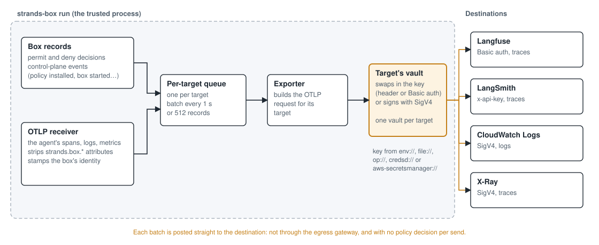

# Sending Box telemetry to third-party destinations

## 1. Background

Box records every decision it makes: each `permit` and `deny`, each control-plane event such as a
policy install or a box starting and stopping, and the agent's own spans, logs and metrics, which
it relays through its OTLP receiver. Today those records can go to two places: a file, or an OTLP
endpoint that takes a single bearer token.

That is not enough for the people running Box. They want the records in the tools they already
use, and the three that keep coming up are Langfuse, LangSmith and CloudWatch. All three accept
OTLP, but none of them works with a plain OTLP target:

- CloudWatch Logs and X-Ray want every request signed with SigV4, and CloudWatch Logs also wants
  the log group and log stream in two headers.
- Langfuse wants its key pair as HTTP Basic auth, a specific path, and an ingestion-version
  header.
- LangSmith wants its key in an `x-api-key` header, and the project in another header.

Each of them also needs a key, and that key has to live somewhere the agent can never read.

This document describes how Box sends its telemetry to these destinations: what the operator
writes in `box.toml`, how a batch leaves the box, and where the key comes from.

## 2. What does the operator write?

Each destination is a `[telemetry.<name>]` table with a `kind` for the vendor:

```toml
[telemetry.langfuse]
kind = "langfuse"
destination = "https://us.cloud.langfuse.com"
secret.ref = "aws-secretsmanager://box/telemetry#LANGFUSE_AUTH"

[telemetry.langsmith]
kind = "langsmith"
project = "my-project"
secret.ref = "env://LANGSMITH_API_KEY"

[telemetry.cloudwatch_logs]
kind = "cloudwatch_logs"
region = "us-west-2"
log_group = "my-group"
log_stream = "my-stream"
secret.ref = "aws://my-profile"

[telemetry.cloudwatch_traces]
kind = "cloudwatch_traces"
region = "us-west-2"
secret.ref = "aws://my-profile"
```

The operator writes only what is theirs: where their account lives, which project or log group to
write to, and where the key is kept. Box fills in the rest from the kind:

| Kind | What Box sets |
|---|---|
| `langfuse` | the `/api/public/otel` path, `x-langfuse-ingestion-version: 4`, traces only, the key as Basic auth |
| `langsmith` | the `/otel` path, `Langsmith-Project`, traces only, the key in `x-api-key` |
| `cloudwatch_logs` | `https://logs.<region>.amazonaws.com`, `x-aws-log-group` and `x-aws-log-stream`, logs only, SigV4 |
| `cloudwatch_traces` | `https://xray.<region>.amazonaws.com`, traces only, SigV4 |

`destination` is optional for Langfuse and LangSmith, and defaults to each vendor's cloud. For a
vendor Box doesn't know, `kind = "otlp"` still works, and it now takes `headers`, `accepts` (the
payloads the endpoint takes) and a placement for the key. `include` narrows which signals reach a
target exactly as it does today; the new kinds don't change it.

## 3. How does a batch reach the destination?



Every record goes onto a queue for each target it belongs to, and the queue sends a batch every
second or every 512 records. The target's exporter turns the batch into an OTLP request, and then
asks the target's vault to attach the credential. The vault either swaps a placeholder for the
real key, as a header or as Basic auth, or signs the request with SigV4. The exporter then posts
it straight to the destination.

The agent's own telemetry takes the same path. It arrives at Box's OTLP receiver, Box strips any
attribute in the `strands.box.` namespace so the agent can't forge a decision, stamps the box's
identity on it, and relays it to every target that accepts that payload. When a shell command or a
model call carries the agent's trace context, the decisions Box makes for it appear as children of
the agent's span, so a whole run reads as one trace.

If a send fails, Box counts it and moves on. With `STRANDS_BOX_TELEMETRY_DEBUG` set, it also prints
the failure with its full cause, so a timeout reads differently from a refused key.

## 4. Where does the key come from?

The vault already reads keys from four places: the environment (`env://`), a file (`file://`),
1Password (`op://`) and credsd (`credsd://`). `aws://` names an AWS profile for the SigV4
destinations. This design adds one more source:

```toml
secret.ref = "aws-secretsmanager://box/telemetry#LANGFUSE_AUTH"
```

The part before `#` names a secret, by name or by ARN, and the part after it names one field of a
JSON secret, so one secret can hold every vendor's key. Without a field, Box reads the whole
secret string. The region comes from the ARN, or from `AWS_REGION` when the secret is named
without one. Box reads the secret once, when the vault opens, and signs the call with whatever AWS
identity the standard credential chain finds, and it says which one at startup:

```
strands-box credentials [strands-box-telemetry-langfuse]: aws-secretsmanager://[REDACTED] read
from Secrets Manager, signed by the AWS credential chain's Profile provider
```

## 5. Key decisions

### D1. Telemetry leaves directly, not through the egress gateway.

Sending telemetry is something Box does for itself, not something the agent asks for, so it is
not a policy decision. If every send went through the egress gateway, a default-deny policy would
quietly drop the box's own record of what it refused, unless the operator remembered to permit
it. 0002 takes the same position for credential fetches: policy authorizes the agent's actions,
not Box's.

The cost is that the agent's relayed spans also leave without a decision. The operator chose the
destination, but the content comes from the agent. Section 7 comes back to this.

**Rejected alternative:** route each export through the egress gateway, with a `net:connect` and
`http:request` decision for every send.

### D2. Each target gets its own vault.

The egress gateway already has a vault for the agent's traffic. Telemetry keys go in separate
vaults, one per target, so no request the agent makes can ever be given a telemetry key: the two
never meet. The cost is a few extra vault opens at startup.

**Rejected alternative:** register telemetry keys as extra routes in the egress gateway's vault.
It is one vault fewer, but a key would then sit beside the agent's own routes, separated only by
the destination match.

### D3. Vendors are kinds, not header recipes.

The first version of this feature made the operator write each vendor's headers, path and
placement by hand. The Langfuse ingestion header and the CloudWatch log headers were the first
things to go wrong, and nothing told the operator until the vendor quietly ignored the data. A
kind removes that whole class of mistake.

A vendor kind refuses any field it sets itself (`headers`, `accepts`, and the key's `header`,
`prefix` and `placement`), so an operator can't half-override a vendor's settings by accident, and
it names any field it is missing. When Box reads `box.toml`, it expands each kind into the plain
`otlp` target it stands for and stores that, so the export path doesn't know kinds exist.

**Rejected alternative:** keep `kind = "otlp"` and add a `vendor` key beside it. It says the same
thing twice, and it still leaves the operator able to write headers that contradict the vendor.

### D4. The vault reads keys from Secrets Manager.

Exporting a key into the shell before every run works on a laptop, but it leaves the key in a
process environment, and every operator ends up writing the same setup step. Secrets Manager keeps
the key in one place, and Box needs only an AWS identity and `secretsmanager:GetSecretValue` on
that one secret.

**Rejected alternative:** credsd. Box's credsd client signs AWS requests today, and nothing else.
Using it for vendor keys would need a new route type and a new kind of credential on both sides.

### D5. Box uses the AWS SDK for Rust, with its default features off.

The SDK brings the whole credential chain: environment variables, profiles, web identity,
containers and instance metadata. A client of our own would have to reimplement each of those, and
keep up with them.

The defaults are the problem. They add a second crypto provider to the TLS library that the rest
of Box shares, and once two providers are compiled in, the egress gateway's TLS setup panics at
startup because rustls can no longer pick one. With the defaults off and TLS pinned to `ring`, the
SDK reuses the exact TLS and HTTP stack Box already has. A test fails the build if the second
provider ever comes back.

The cost is real: about 34 crates and 9 MB of binary in the trusted process, which also holds the
CA key and every resolved secret. This is the decision I expect the most questions on.

**Rejected alternative:** the SigV4 signer the credentials crate already has, plus the HTTP client
Box already links. It adds no crates, but it can only read environment variables and static
profiles.

### D6. Box says which identity signed.

The SDK doesn't expose which provider in its chain supplied the credentials. Box runs the same
chain itself, in the same order (environment, profile, web identity, container, instance
metadata), so it knows the answer and prints it. An operator can see straight away whether their
own profile or some ambient identity was used.

A vault that requires a named AWS profile refuses this source outright, rather than signing with
an identity nobody declared.

### D7. The key is fetched once per run.

One background worker serves every fetch in the process, so every vault shares one connection pool
and one credential chain. The worker exists because the vault opens inside the box's async
runtime, where a blocking call isn't allowed. Fetching once is enough because a `strands-box run`
is short-lived; a rotated key takes effect on the next run.

## 6. Limitations

### L1. Two ways to the same AWS identity.

`aws://`, which signs the CloudWatch and Bedrock requests, still reads only static keys, while
`aws-secretsmanager://` uses the full credential chain. In one box the two can sign as different
identities. They should share one path, and that is follow-up work.

### L2. Box can't wipe the SDK's memory.

Box wipes the key from its own memory once it is done with it, but not the SDK's internal request
and response buffers. When Box reads one field of a JSON secret, the secret's other fields also sit
in memory until they are dropped.

### L3. Delivery is best effort.

Each send has four seconds and no retry. A slow vendor can be counted as a failure even though it
stored the batch.

### L4. Not every span joins the agent's trace.

The box's startup and shutdown spans form a trace of their own. A decision appears under the
agent's trace only when the request behind it carried the agent's trace context.

## 7. Open questions

1. Is the AWS SDK acceptable inside the trusted process, or should the Secrets Manager call live
   somewhere outside it?
2. Should vendor kinds live in Box itself, or as presets in the CLI that expand to `otlp` before
   Box ever sees them?
3. Is a source for AWS alone the right first step, or should it be the first of several behind a
   common secrets interface?
4. The agent's spans reach the operator's vendors without a policy decision. Is the operator's
   choice of destination enough of a gate, or should Box let policy see relayed telemetry too?
