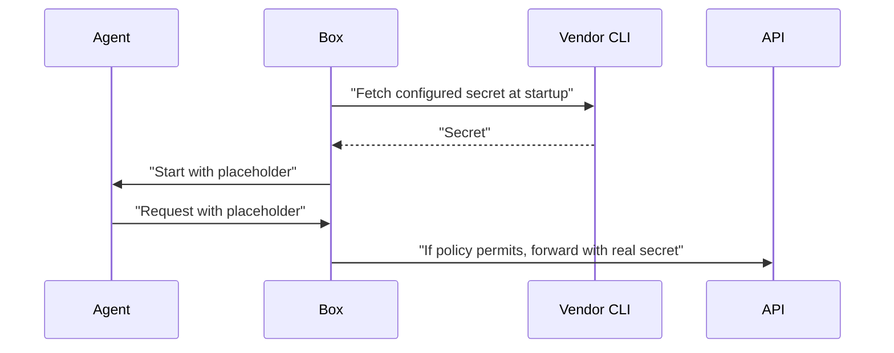

# Secret providers

## Background

One of Box’s core promises is that the agent never sees a secret. This matters most for developers running agents on their laptops, where they hold sensitive credentials. The way it works is that Box gives the agent placeholder values, and swaps them for the real secrets at the egress gateway in two ways:

1. **By re-signing.** For AWS, the agent’s SDK signs each request with the placeholder keys. The gateway discards the signature and signs the request again with the real credentials using AWS SigV4. The real credentials are sourced from either a profile with static access keys (`aws://`) or from the credentials daemon (`credsd://`).

2. **By placeholder swap.** For API keys and tokens, the gateway finds the placeholder key in the outgoing request headers or query params and replaces it with the real secret. Box sources the real secret from an environment variable (`env://`) supplied by the user before starting the Box.

This proposal focuses on the placeholder swap. Customers who already have a vault where they store secrets, such as 1Password, will be able to specify a secret location, for example, `op://MyVault/GitHub/token`, and Box retrieves it at startup using the 1Password CLI and holds it in memory for the run.

## Proposed solution

I propose one command contract for reading secrets through a vendor's CLI, starting with 1Password. The operator specifies the secret, the vendor handles authentication, and Box fetches it at startup. Additional providers will come through packs.



A pack in Box CLI is a reusable set of TOML configuration: `box/claude` describes how to run Claude Code, and `box/anthropic` configures its connection to the Anthropic API. The operator's profile selects packs and supplies their own settings. Box CLI merges these into the `box.toml` that Box Core reads.

We extend the existing pack format with a `secret-source` table, rather than introduce a new pack type. The proposed `box/1password` pack uses that table to declare how to read secrets with `op` (the 1Password CLI) and which local paths to protect. The operator adds the pack and names the secret in their profile:

```toml
packs = ["box/claude", "box/anthropic", "box/1password"]

[egress.anthropic.secret]
ref = "op://Private/Anthropic/credential"
env = "ANTHROPIC_API_KEY"
```

At startup, Box launches the CLI as a separate host process, once per distinct reference, before starting the workload. It passes arguments directly and composes the environment from `HOME`, a fixed `PATH`, and explicitly named host variables. Any failed fetch stops startup.

Box keeps the fetched secrets in the trusted run process’s memory until the run ends. It does not write them to disk or pass them to the agent. The agent, tools, and MCP servers receive placeholders. On a request that policy permits, the gateway substitutes the real secret using the existing destination and placement rules. Box does not refresh secrets during a run. That's an intentional limitation to keep this feature simple.

### Protecting access to the vault

The agent must not be able to bypass Box and fetch secrets directly from the vault, or change how Box retrieves them. The provider remains trusted software chosen by the operator.

The pack tells Box what to protect. For `box/1password`, this declaration covers:

- `command`: the `op` executable.
- `reads`: the CLI's configuration paths.
- `deny`: other access paths, such as directories containing the desktop app's authentication sockets.
- `pass-env`: host variables the provider needs, such as `OP_SERVICE_ACCOUNT_TOKEN`.

Box keeps the declared files and sockets outside the agent's, tools', and MCP servers' reach. It refuses write grants that could let them replace the executable or its configuration. Variables named in `pass-env` can reach the provider, but Box refuses those names in workload environments. These protections must also cover the hosted Shell and Python paths.

Box does not discover these paths automatically, so protection depends on the pack declaring every access path. On Linux, only paths present at configuration time are protected. Before shipping the pack, we must verify the real 1Password authentication paths on Linux and macOS.

### Interface changes

Existing configurations keep their behavior.

#### box.toml

We add `[secret-source.<scheme>]` with `protocol`, `command`, `args`, `pass-env`, `reads`, and `deny`. Protocol `box.secret-source.v1` substitutes one `{ref}` argument and reads the secret from stdout. The `reads` and `deny` fields identify paths to protect from workloads.

The command gets no stdin, has a timeout and output limits, and a non-zero exit stops startup. We strip one trailing `\n` or `\r\n` before validating the secret. Error diagnostics are bounded and redacted.

#### Egress and remote MCP secrets

We add `secret.env` to name the placeholder variable. It is required for declared providers. On an `env://NAME` route, it is optional and must equal `NAME`.

This revises the [current `op://` refusal](../../docs/design/decisions.md#an-undeliverable-credential-is-refused-at-load) and its `an_undeliverable_credential_scheme_is_refused` test: a provider route becomes valid only when its provider is declared.

#### Stored record and credentials API

The stored record gains provider declarations and the checked executable identity, which requires a record version change. Each run checks the executable afresh and records its identity, so a CLI update between runs does not require recreating the box. A replacement after that check stops the fetch.

The credentials API adds `SecretSourceCommand`, the reference-argument constant, and a backend constructor for declared providers. That backend uses a declared provider in place of the built-in source for the same scheme; it never registers both. Existing callers of `Backend::local()` keep the built-in `op://` source.

#### Box CLI

Box CLI accepts provider declarations in profiles and shared packs, refuses them in tool packs, and shows them in `box profile show`. We ship `box/1password` as the first secret provider pack. The profile supplies `secret.env`; existing model packs keep their defaults, so profiles that override `env://` references still work.

#### Telemetry

Box records each fetch outcome with the provider, program, and redacted reference. Secret values stay out of records and errors.
