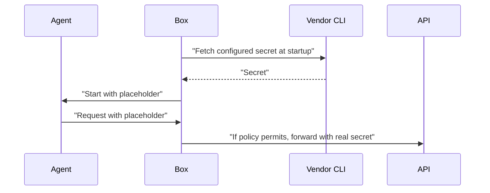

# Secret providers

## Background

One of Box’s core promises is that the agent never sees a secret. This matters most for developers running agents on their laptops, where they hold sensitive credentials. The way it works is that Box gives the agent placeholder values, and swaps them for the real secrets at the egress gateway in two ways:

1. **By re-signing.** For AWS, the agent’s SDK signs each request with the placeholder keys. The gateway discards the signature and signs the request again with the real credentials using AWS SigV4. The real credentials are sourced from either a profile with static access keys (`aws://`) or from the credentials daemon (`credsd://`).

2. **By placeholder swap.** For API keys and tokens, the gateway finds the placeholder key in the outgoing request headers or query params and replaces it with the real secret. Box sources the real secret from an environment variable (`env://`) supplied by the user before starting the Box.

This proposal focuses on the placeholder swap. Customers who already have a vault where they store secrets, such as 1Password, will be able to specify a secret location, for example, `op://MyVault/GitHub/token`, and Box retrieves it at startup using the 1Password CLI and holds it in memory for the run.

## Proposed solution

I propose one command contract for reading secrets through a vendor's CLI, starting with 1Password. The operator specifies the secret, the vendor handles authentication, and Box fetches it at startup. Additional providers will come through plugins.



A pack in Box CLI is a reusable set of TOML configuration: `box/claude` describes how to run Claude Code, and `box/anthropic` configures its connection to the Anthropic API. The operator's profile selects packs and supplies their own settings. Box CLI merges these into the `box.toml` that Box Core reads.

A secret provider does something that no pack does. A pack only adds config to `box.toml`, and every program it names runs inside a sandbox. A provider changes what Box itself can do. Box's trusted process runs a host program such as `op` (the 1Password CLI) outside every sandbox, with the user's rights and vault login. That is a different trust level, so it should look different in the profile. We add a plugin for it, which the profile lists in `plugins`, rather than extend the pack format.

The proposed `box/1password` plugin holds a `secret-source` table. The table declares how to read secrets with `op` and which local paths to protect. The operator lists the plugin and names the secret in their profile:

```toml
packs   = ["box/claude", "box/anthropic"]
plugins = ["box/1password"]

[egress.anthropic.secret]
ref = "op://Private/Anthropic/credential"
env = "ANTHROPIC_API_KEY"
```

The plugin is one TOML file:

```toml
[plugin]
name    = "box/1password"
version = 1
kind    = "secret-source"

[inputs.onepassword.path]
type    = "program"
program = "op"

[secret-source.op]
protocol = "box.secret-source.v1"
command  = ["${{ inputs.onepassword.path }}", "read", "op://{ref}"]
pass-env = ["OP_SERVICE_ACCOUNT_TOKEN"]
reads    = ["~/.config/op"]
# deny lists the desktop app's socket directories, after we verify them.
```

The plugin finds `op` on the operator's `PATH` through a `program` input, as an agent pack finds its agent. A profile can set another path in `[options]`. Box CLI writes the absolute path into `box.toml`.

The `[plugin]` header keys mean what they mean in a `[pack]` header: `version` is the file's own revision, and `kind` names the plugin type. `kind` leaves room for other plugin types later. This version accepts only `secret-source`.

A plugin has its own rules:

- Only the profile lists a plugin, in `plugins`. No pack can pull one in through `extends`.
- Only a plugin, or the profile itself, can declare `[secret-source.<scheme>]`. Packs refuse it.
- `box profile show` prints each plugin, and Box prints each declared source at startup. Both name the program that runs.

For operators the test is simple: if it makes Box run a program on their machine, outside the box, it is a plugin.

A second provider is one more plugin file. For example, this plugin reads AWS Secrets Manager through the `aws` CLI:

```toml
[plugin]
name    = "box/aws-secrets-manager"
version = 1
kind    = "secret-source"

[inputs.aws.path]
type    = "program"
program = "aws"

[secret-source.aws-secretsmanager]
protocol = "box.secret-source.v1"
command  = ["${{ inputs.aws.path }}", "secretsmanager", "get-secret-value",
            "--secret-id", "{ref}", "--query", "SecretString", "--output", "text"]
pass-env = ["AWS_PROFILE"]
reads    = ["~/.aws"]
```

The command prints the whole secret string. One secret in AWS Secrets Manager often holds a JSON object with several keys, so a reference can name one field with `#FIELD`. A profile then sends one key of that secret to a telemetry target:

```toml
plugins = ["box/aws-secrets-manager"]

[telemetry.langsmith]
kind = "otlp"
destination = "https://api.smith.langchain.com/otel"
secret.ref = "aws-secretsmanager://box/telemetry#LANGSMITH_API_KEY"
secret.header = "x-api-key"
```

So AWS Secrets Manager needs no source of its own in Box Core.

At startup, Box launches the CLI as a separate host process, once per distinct secret, before starting the workload. It passes arguments directly and composes the environment from `HOME`, a fixed `PATH`, and explicitly named host variables. Any failed fetch stops startup.

Box keeps the fetched secrets in the trusted run process’s memory until the run ends. It does not write them to disk or pass them to the agent. The agent, tools, and MCP servers receive placeholders. On a request that policy permits, the gateway substitutes the real secret using the existing destination and placement rules. Box does not refresh secrets during a run. That's an intentional limitation to keep this feature simple.

### Protecting access to the vault

The agent must not be able to bypass Box and fetch secrets directly from the vault, or change how Box retrieves them. The provider remains trusted software chosen by the operator.

The plugin tells Box what to protect. For `box/1password`, this declaration covers:

- `command`: the `op` executable, which is its first entry.
- `reads`: the CLI's configuration paths.
- `deny`: other access paths, such as directories containing the desktop app's authentication sockets.
- `pass-env`: host variables the provider needs, such as `OP_SERVICE_ACCOUNT_TOKEN`.

Box keeps the declared files and sockets outside the agent's, tools', and MCP servers' reach. It refuses write grants that could let them replace the executable or its configuration. Variables named in `pass-env` can reach the provider, but Box refuses those names in workload environments. These protections must also cover the hosted Shell and Python paths.

Box does not discover these paths automatically, so protection depends on the plugin declaring every access path. On Linux, only paths present at configuration time are protected. Before shipping the plugin, we must verify the real 1Password authentication paths on Linux and macOS.

### Interface changes

Existing configurations keep their behavior.

#### box.toml

We add `[secret-source.<scheme>]` with `protocol`, `command`, `pass-env`, `reads`, and `deny`. `command` is one array: the program first, then its arguments. `[agent]`, `[tool.<name>]`, and `[mcp.<name>]` already write it this way. The program is an absolute path, and Box refuses a bare name. The `reads` and `deny` fields identify paths to protect from workloads.

A declaration names `op`, or a scheme that Box does not reserve. The reserved schemes are `env`, `file`, `aws`, `credsd`, `secret`, `cmd`, `oauth2`, and `aws-signed`, and the credentials crate owns this list. Box refuses a declaration for a reserved scheme. So a plugin cannot take over a built-in source.

Protocol `box.secret-source.v1` replaces `{ref}` in the arguments with the text after `scheme://` in the reference, and reads the secret from stdout. `aws ... --secret-id` takes the bare name, so that plugin writes `{ref}` alone. `op read` takes the whole reference, so the 1Password plugin writes `op://{ref}`.

A reference can end with `#FIELD`. Box removes `#FIELD` before it fills `{ref}`. It then reads stdout as a JSON object and takes that one string field. Without `#FIELD`, Box refuses a secret that is a JSON object, so that one destination never gets every key in it.

Two references that differ only in `#FIELD` name one secret, so Box runs the program once for both. Each place that uses the secret shares that fetch: an egress route, a remote MCP server, or a telemetry target.

`protocol` names the version of this contract. In this version, Box fetches each secret once. A later version can return an expiry with the secret, so that Box can fetch it again during a run.

At startup, Box prints one line for each declared source, with the program it runs.

The command gets no stdin, has a timeout and output limits, and a non-zero exit stops startup. We strip one trailing `\n` or `\r\n` before validating the secret. Error diagnostics are bounded and redacted.

#### Egress, remote MCP, and telemetry secrets

We add `secret.env` to name the placeholder variable. It is required for declared providers. On an `env://NAME` route, it is optional and must equal `NAME`.

One placeholder variable holds one secret. When Box loads the configuration, it refuses two entries that name one variable with different references, and it names both entries. An `env://NAME` entry counts under `NAME`. For a declared provider, the operator does not need to set that variable.

A telemetry target's `secret.ref` also accepts a declared scheme. Box attaches that secret itself, in its trusted process. So the target holds no placeholder, and it takes no `secret.env`. The `a_secret_reference_is_normalized_and_a_literal_is_refused` test gains a case for a declared scheme.

This revises the [current `op://` refusal](../../docs/design/decisions.md#an-undeliverable-credential-is-refused-at-load) and its `an_undeliverable_credential_scheme_is_refused` test: a provider route becomes valid only when its provider is declared.

#### Stored record and credentials API

The stored record gains provider declarations and the checked executable identity, which requires a record version change. Each run checks the executable afresh and records its identity, so a CLI update between runs does not require recreating the box. A replacement after that check stops the fetch.

The credentials API adds `SecretSourceCommand`, the `{ref}` token constant, and a backend constructor for declared providers. That backend uses a declared `op` provider in place of the built-in `op://` source; it never registers both. Box's `policy generate-schema` uses the same provider declarations and checks for remote MCP authentication. A telemetry target's secret resolves through the same declarations and checks. `Backend::local()` keeps its built-in `op://` source for callers without provider declarations.

#### Box CLI

Box CLI adds plugins: the `plugins` list in a profile, and the `[plugin]` header with `name`, `version`, and `kind`. Only `plugins` accepts a plugin. One scheme has one declaration: Box CLI refuses a profile in which two plugins, or a plugin and the profile, declare the same scheme. Box CLI accepts provider declarations in profiles and plugins, refuses them in every pack, and shows each plugin and its program in `box profile show`. We ship `box/1password` as the first plugin. The profile supplies `secret.env`; existing model packs keep their defaults, so profiles that override `env://` references still work.

#### Telemetry

Box records each fetch outcome with the provider, program, and redacted reference. Secret values stay out of records and errors.
