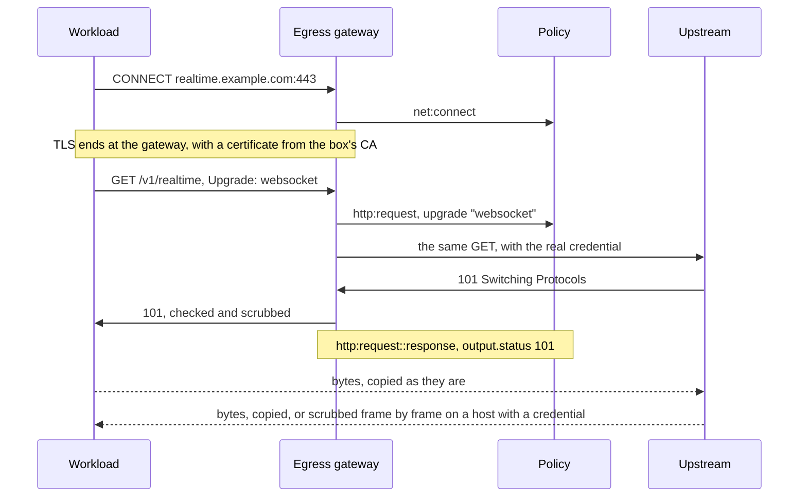

# Feature - WebSocket through the egress gateway

## Overview

Agents that use a realtime model API, drive a browser, or run as the tool runner of a managed agent keep a WebSocket open. Box refuses every WebSocket today. On the main branch ("main"), the egress gateway strips the `Upgrade` header and refuses a `101` reply, so a WebSocket never opens. For example, the tool runner of a Bedrock managed agent opens one WebSocket to Bedrock when its session starts. Every tool call of the session arrives over that WebSocket, so the agent cannot run in a box.

This design lets a WebSocket through the gateway, and **policy decides the WebSocket once, at its handshake**. The handshake is an HTTP `GET`, so `http:request` decides it, as it decides any HTTPS request today. `http:request` gets one new input field, `upgrade`, which is `"websocket"` on a handshake and `""` on every other request. After the `101`, the gateway copies bytes in both directions and asks policy nothing more. On a host with a placeholder credential, the gateway also scrubs each server frame, as it scrubs an HTTP response on main.

The design gives up control of single messages, and in return the code that Box must trust stays small. A permit on a handshake admits the whole WebSocket, so a guard or a budget cannot stop a WebSocket that is already open. The design adds no action, no decision for each message, and no frame rules for workload messages. A rule for each message can come later, in its own design, when a customer asks for one.

HTTP/2 and headers in policy are out of scope, and each gets its own design. HTTP response streaming is on main (#345).

## 1. Background

#173 asks for WebSocket support. On main, the gateway strips `Upgrade` and `Connection`, sends the handshake as a plain `GET`, and refuses a `101`.

#230 was a prototype that relayed WebSockets and asked `http:request` again while one was open. Its review asked for a design first. An earlier version of this design then decided each message with two new actions, `websocket:send` and `websocket:receive`. Its review chose the handshake alone for the first version, because 1/ no customer has asked for a rule on single messages, 2/ Box has no policy hook on what reaches an agent from outside, and 3/ each message cost 6.7 to 7.5 ms of engine time for its decision and its record. At that cost a box decides 133 to 149 messages a second, and one realtime audio stream in 20 ms frames uses 100 of them. A 10-minute byte budget cut that stream to 29 messages a second each way.

## 2. How does a WebSocket pass through the gateway?

A WebSocket starts with a handshake. The workload sends a `GET` with `Upgrade: websocket`, and the server answers `101 Switching Protocols`. After that, both sides send messages until one side closes. The handshake takes the same path as any HTTPS request, and only the relay after the `101` is new:



The handshake follows these rules:
- The gateway accepts `wss://` only, because it can scrub only inside the TLS tunnel that it ends. A plain HTTP request with `Upgrade: websocket` gets 403 and a Deny record. A Deny record is the gateway's own record of a refusal, and the gateway keeps it outside the history. This refusal comes after the token check and before `net:connect`, so no upstream connection opens. It also covers a host in `upgrade_http`, because the workload's own connection to the gateway is still plain HTTP. A malformed plain handshake gets the same refusal, and the record keeps the path without its query.
- The handshake must be a valid `GET` on HTTP/1.1 under RFC 6455, the WebSocket standard, or it gets 400. A handshake to a configured remote MCP (Model Context Protocol) server gets 403, because its messages would skip the `mcp:call` decision.
- A `[[egress.<name>.backends]]` re-route applies to a handshake as to any request. The gateway dials the backend when the workload connects. The handshake carries the backend's host, path prefix, and `auth`, and the relay runs on the connection to the backend. Policy and the audit records still judge the original destination.
- The gateway swaps the placeholder token for the real credential on the handshake, never after it. On a signing host, where the gateway signs requests with SigV4, it signs the handshake as a `GET` with no body.
- The gateway removes `Sec-WebSocket-Extensions` and refuses a `101` that names an extension, because `permessage-deflate` would hide a credential from the scrub.
- hyper's client accepts any `101` as an upgrade. The gateway therefore checks `Upgrade`, `Connection`, and `Sec-WebSocket-Accept` itself, and answers 502 if one is wrong. The handshake still records `http:request::response` with status 101, because the server did answer 101. The gateway then writes a Deny record and answers the workload with 502.
- On main, hyper's server runs with keep-alive off, and that also closes a `101`. The gateway turns keep-alive on and sets `Connection: close` on every other response itself, as hyper did with keep-alive off. An HTTP exchange still uses one connection, and its bytes do not change.

After the `101`, the relay works in one of two ways. On a host with no credential, it copies the bytes in both directions without change. On a host with a credential, it copies the workload's bytes without change and reads each frame that the server sends. It reads the whole frame, up to main's 16 MiB body cap, scrubs the payload, and sends the frame on with its new length. Each copy of the credential becomes `[REDACTED]`, as in an HTTP response. The scrub keeps a partial match from one frame of a message to the next, as the HTTP scrub keeps one from one chunk to the next. If the scrub changes a Ping or a Pong, the relay sends it with no payload. If the scrub changes a Close, the relay keeps only its 2-byte code.

The relay checks the RFC 6455 rules only on the frames that it scrubs, because it must parse those frames. It does not check or change workload frames, and the server checks them on arrival.

## 3. How does policy decide a WebSocket?

### 3.1 The handshake

The handshake is one `http:request`, decided and recorded as on main. Policy writes `http:request::request` at the decision, and `http:request::response` at the `101` with `output.status` 101. The gateway writes that `::response` event before the relay starts, so a rule that waits for it does not wait for the WebSocket to close.

The one new input field is `upgrade`. It is `"websocket"` on a handshake and `""` on every other request. It matches the HTTP field name, as `method` does, so a rule reads like the request: `context.input.upgrade == "websocket"`.

A permit that does not read `upgrade` admits a handshake to its host, and so admits the whole WebSocket. An operator who wants HTTP to a host and no WebSocket adds `context.input.upgrade == ""` to the permit, or writes one `forbid` on `upgrade == "websocket"`.

### 3.2 After the handshake

Policy decides nothing after the `101`, and the relay writes no event to the history. A guard or a budget reads only `http:request` events, so it can refuse the next handshake but cannot close a WebSocket that is open. The end of a WebSocket writes no event either.

### 3.3 Refusals and limits

A refusal at the handshake leaves no WebSocket open. After the `101`, a side that closes its connection ends the copy toward the other side, and the WebSocket ends when both directions have ended. The relay ends both connections at once when the scrub cannot go on, or when nothing moves for 300 s. It writes a Deny record only when the scrub cannot go on. A drop or the idle timer writes none, as an HTTP exchange that ends writes none on main.

| Cause | Signal |
|---|---|
| `http:request` refuses the handshake | 403, as on main |
| A plain HTTP handshake, or a handshake to a remote MCP host | 403 |
| A handshake that is not valid RFC 6455 | 400 |
| A `101` with a wrong `Upgrade`, `Connection`, or `Sec-WebSocket-Accept`, or with an extension | 502 |
| On a host with a credential, a server frame over 16 MiB or a frame that breaks RFC 6455 | Both connections end, and a Deny record names the cause |
| One side closes its connection | The relay closes its write to the other side |
| Nothing moves on either connection for 300 s | Both connections end |

The relay does not track the workload's frames, so it cannot put a Close frame between them. When the relay ends a WebSocket itself, each side sees an abnormal closure (1006).

The 300 s limit is main's `upstream_read_deadline`. On main it limits the whole exchange, which would cut every WebSocket at 300 s. After the `101`, the gateway uses it as an idle limit on both connections. A WebSocket holds one of main's 256 connections (`max_connections`) while it is open. Neither number becomes a config key.

## 4. What changes in a policy?

The sample policy below is a policy after this change. It lets an agent read from GitHub, has a guard, and admits one realtime WebSocket:

```text
@id("github_read")
permit (principal, action == Box::Action::"http:request", resource)
when { context.input.host == "api.github.com" && context.input.method == "GET" &&
       context.input.upgrade == "" };
@id("none_after_key")
@description("Nothing leaves after the SSH key is read.")
forbid (principal, action == Box::Action::"http:request", resource)
when temporal {
  formerly within 24h (
    Box::Action::"fs:read"::response{ input.path: "~/.ssh/id_ed25519",
                                      input.operation: Box::FsReadOperation::"read_content" }
  )
};
@id("realtime")
permit (principal, action == Box::Action::"http:request", resource)
when { context.input.host == "realtime.example.com" && context.input.path == "/v1/realtime" &&
       context.input.upgrade == "websocket" };
```

These rules differ from today:
- `github_read` adds `context.input.upgrade == ""`, so it admits HTTP requests to `api.github.com` and no WebSocket. Without that line, it would also admit a WebSocket to `api.github.com`.
- `none_after_key` needs no edit. It refuses each handshake after the read. A WebSocket that opened before the read stays open.
- `realtime` is new, and it admits a WebSocket to `realtime.example.com/v1/realtime` and nothing else there.

## 5. What does it cost?

A WebSocket costs one decision and two events, at its handshake, as any HTTPS request does. After the `101`, no message waits for policy.

On a host with no credential, the relay holds no message. On a host with a credential, it holds one server frame at a time, up to 16 MiB, and the scrub copies it once. That is up to 32 MiB for each WebSocket, and about 8 GiB at main's 256 connections. Main's bound is about 4 GiB of request bodies, because responses stream. The team has not measured the relay's throughput.

## 6. How do we deliver it?

The work lands in one PR, #476, after this doc. #476 fails closed, which means that it refuses whatever it does not decide. It adds `upgrade` to `http:request`, the handshake rules, the relay, the scrub, the 16 MiB cap, and the idle timer.

#476 tests the relay through a real gateway, with a TLS workload and a TLS echo server, in `crates/egress-gateway/tests/websocket_e2e.rs`.

If we accept this design, we approve these changes to frozen surfaces, which are the interfaces that change only with an approved design:
- The egress gateway's `EffectAttempt::HttpRequest` gains `upgrade`.
- The policy crate's `Request::Http` and `Outcome::Http` gain `upgrade`.
- The policy action vocabulary gains `upgrade` on `http:request`.

Box rules are written in Dogwood, the upstream policy language and engine, and Dogwood fixes the event schema of a store. A box created before #476 therefore refuses to start until its operator creates it again.

## 7. Key decisions

### D1. `http:request` decides the handshake, and there is no `websocket:connect`

The handshake is an HTTP `GET`, so `http:request` with `upgrade` decides it, and an operator learns one field instead of one action. A `websocket:connect` action would fail closed, because no permit that exists today names it. We chose the field, and the cost is that a permit that does not read `upgrade` admits a WebSocket to its host. Section 4 shows the one line that keeps such a permit to HTTP.

### D2. Policy decides the connection, not each message

A decision for each message lets a guard stop the next message and a budget count message bytes. The review chose the handshake alone, for the reasons in section 1. A rule on messages needs its own design, and information flow control is the case that will ask for it. In that work, data that enters the agent's context gets a tag. Policy then refuses tagged data that tries to leave through any channel, a WebSocket included.

### D3. The relay parses frames only to scrub them

The relay must parse a server frame on a host with a credential, because the scrub changes the frame's length. Everywhere else it copies bytes, so the code that Box must trust gets no frame handling for workload messages. The server and the workload still check RFC 6455 on what they receive.

### D4. Effects can later cover every action that sends bytes out

Tool grammars (0001) add effects, which more than one action can share. A box effect, such as `Box::Effect::"network_outbound"`, would let one rule cover each action that sends bytes out, later ones included. A future message action would then need no edit to existing guards. That work needs its own design, because the policy loader must first accept such a rule (`crates/policy/src/spelling.rs`).

## 8. Limitations

1. A permit on a handshake admits the whole WebSocket. A guard or a budget cannot close a WebSocket that is open, and a budget on HTTP bodies does not count WebSocket bytes.
2. A permit on `http:request` that does not read `upgrade` admits a WebSocket to its host. That holds for every such permit written before this change.
3. The scrub reads one message at a time, so it misses a secret split across two messages or encoded again, for example in base64. A redaction in a binary stream breaks the stream, and the new frame length shows the length of the secret.
4. On a host with a credential, each server frame waits until the gateway reads all of it. A frame over 16 MiB ends the WebSocket.
5. There is no WebSocket over HTTP/2 (RFC 8441), no WebSocket compression, and no HTTP/3.
6. When the relay ends a WebSocket itself, it sends no Close frame, so each side sees an abnormal closure (1006).
7. A Deny record after the `101` carries the handshake's `GET` and path, so Box telemetry labels it `http:request`. Its reason names the WebSocket fault.
