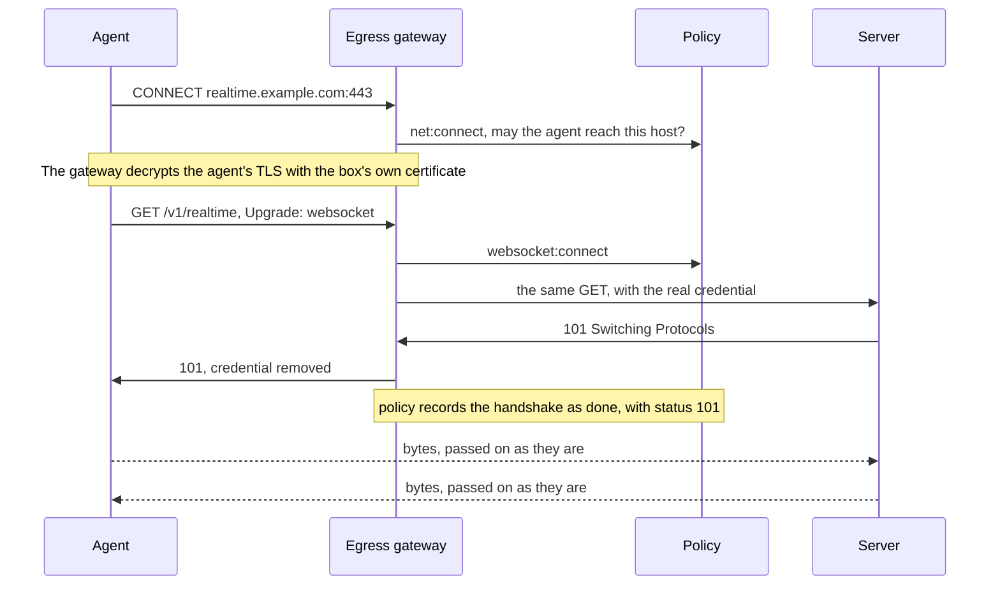

# Feature - WebSocket through the egress gateway

## Overview

Some agents keep a WebSocket open, which is one long connection that carries messages both ways. Agents that use a realtime model API, drive a browser, or run tools for a managed agent all do this. For example, the tool runner of a Bedrock managed agent opens one WebSocket to Bedrock when its session starts. Every tool call of the session arrives over it. Box refuses every WebSocket today, because the egress gateway removes the `Upgrade` header and refuses the server's `101` reply. That agent cannot run in a box.

This design lets a WebSocket through the gateway, and **policy decides each WebSocket once, when it opens**. A WebSocket opens with one HTTP `GET`, called the handshake. Policy decides the handshake with a new action, `websocket:connect`, which reads the host, port, method, and path, as `http:request` does. A permit on `http:request` does not cover it, so a policy written before this change lets no WebSocket through. After the server says yes, the gateway passes bytes both ways and asks policy nothing more.

The design gives up control of single messages. A rule cannot close a WebSocket that is open, and the gateway does not remove a credential from a message. In return, no message waits for policy, and the gateway stays small because it does not read messages. A rule for single messages can come later, in its own design.

Merging this doc approves the interface changes in section 6. The new action changes the format of stored policy events, so a box created before #476 must be created again. HTTP/2 and headers in policy are out of scope, and each gets its own design. HTTP response streaming is on main (#345).

## 1. Background

#173 asks for WebSocket support. #230 was a prototype that passed WebSockets through and asked `http:request` again while one was open. Its review asked for a design first.

The first version of this design decided each message, with two actions, `websocket:send` and `websocket:receive`. Its review chose the handshake alone. No customer has asked for a rule on single messages, and Box has no policy check today on what reaches an agent from outside. Each message also cost 6.7 to 7.5 ms of policy time, so a box decided 133 to 149 messages a second. One realtime audio stream in 20 ms pieces needs 100 a second, 50 each way. A rule that capped bytes over 10 minutes made each decision slower, and the box then decided only 29 messages a second each way.

The second version decided the handshake with `http:request` and a new `upgrade` field, and it removed the credential from each server message. Its review chose a separate action, because a permit that adds `upgrade == ""` to keep WebSockets out does not read plainly. The review also removed the credential check on messages, for the reasons in D3.

## 2. How does a WebSocket pass through the gateway?

The handshake takes the same path as any HTTPS request. Only the last two arrows are new:



The gateway checks each handshake with these rules:
- It accepts `wss://` only, because it can read a handshake only inside a TLS connection that it decrypts. A plain `ws://` handshake gets 403 before policy is asked, and no connection to the server opens. The gateway reaches a host in `upgrade_http` over TLS when the agent asks for plain HTTP. A plain handshake to that host also gets 403, because the agent's own connection is plain. The gateway writes the refusal to its own audit log, with the path and no query string.
- A handshake must be an HTTP/1.1 `GET` with `Connection: upgrade`, `Sec-WebSocket-Version: 13`, and no body, or it gets 400.
- A handshake to a configured remote MCP (Model Context Protocol) server gets 403, because its messages would skip the `mcp:call` check.
- A `[[egress.<name>.backends]]` entry works for a handshake as for any request. The handshake carries that server's host, path prefix, and `auth`, and policy and the audit log still name the host that the agent asked for.
- For some hosts, Box holds a credential, and the agent holds only a stand-in token. The gateway puts in the real credential on the handshake only. On a SigV4 host, it signs the handshake as a `GET` with no body. It removes the credential from the `101` headers, as from any HTTP reply on main.

hyper, the HTTP library in the gateway, closes the connection after each response on main, and that would also close a WebSocket. The gateway now keeps the connection open after a `101` only. Other HTTP responses reach the agent with the same bytes as on main.

After the `101`, the gateway passes bytes both ways without change, on every host. It does not read WebSocket messages, so the agent and the server check the WebSocket standard on what they receive.

## 3. How does policy decide a WebSocket?

### 3.1 The handshake

Policy decides the handshake as one `websocket:connect`. A rule reads `host`, `port`, `method`, `path`, and `intercepted`, as on `http:request`. There is no `body_bytes`, because a handshake has no body.

A permit on `http:request` does not cover `websocket:connect`. A policy lets a WebSocket through only with a permit that names `websocket:connect`, or with a permit that covers every action. A `forbid` on `http:request` does not cover `websocket:connect` either, so a rule that must stop all traffic to the outside names both actions. The policy loader checks the `context.input` of a rule against one family of actions, and `http:` and `websocket:` are two families. A guard that reads `context.input` is therefore one rule for each action.

### 3.2 What policy records

Policy records events for a handshake as for any `http:request`, with one `requestId`. It records the request at each decision, permitted or refused. It records the response when the server replies, with the reply's status, and a `101` is recorded before any message moves. A rule that reads the response can act at once, with no wait for the WebSocket to close. Box stores events in its own format. These are the two events of an opened WebSocket from a test run of #476, with their fields written as JSON:

```json
{ "action": "Box::Action::\"websocket:connect\"", "kind": "request",
  "principal": "Box::Agent::\"self\"", "requestId": "6",
  "input": { "host": "realtime.example.com", "port": 443, "method": "GET",
             "path": "/v1/realtime", "intercepted": true } }

{ "action": "Box::Action::\"websocket:connect\"", "kind": "response",
  "principal": "Box::Agent::\"self\"", "requestId": "6",
  "input": { "host": "realtime.example.com", "port": 443, "method": "GET",
             "path": "/v1/realtime", "intercepted": true },
  "output": { "status": 101 } }
```

An `http:request` event has the same shape, with one more field, `body_bytes`, in `input`. A response with no `output` means that the handshake left the box and got no reply.

Policy records nothing after the response. A message, a byte count, and the end of a WebSocket write no event. A rule that blocks traffic after an event, or that caps bytes over time, can refuse the next handshake if it names `websocket:connect`.

### 3.3 How a WebSocket ends

When one side closes its connection, the gateway closes its side toward the other end. When no byte moves on either connection for 300 seconds, the gateway ends both. Neither case writes a record, as on main when an HTTP exchange ends. The gateway does not track messages, so it sends no Close message, and each side sees the connection drop with no reason (close code 1006).

The 300 seconds is main's `upstream_read_deadline`. On main it limits the whole exchange, and that would cut every WebSocket at 300 seconds. After the `101`, the gateway uses it as an idle limit instead. A WebSocket uses one of main's 256 connections (`max_connections`) while it is open. Neither number becomes a new setting.

## 4. What changes in a policy?

The sample policy below lets an agent read from GitHub and lets one realtime WebSocket through. It refuses each new request after the agent reads an SSH key:

```text
@id("github_read")
permit (principal, action == Box::Action::"http:request", resource)
when { context.input.host == "api.github.com" && context.input.method == "GET" };
@id("none_after_key")
@description("No HTTP request or new WebSocket after the SSH key is read.")
forbid (principal, action in [Box::Action::"http:request", Box::Action::"websocket:connect"], resource)
when temporal {
  formerly within 24h (
    Box::Action::"fs:read"::response{ input.path: "~/.ssh/id_ed25519",
                                      input.operation: Box::FsReadOperation::"read_content" }
  )
};
@id("realtime")
permit (principal, action == Box::Action::"websocket:connect", resource)
when { context.input.host == "realtime.example.com" && context.input.path == "/v1/realtime" };
```

These rules differ from today:
- `github_read` is the same as on main. It lets HTTP requests through to `api.github.com`, and no WebSocket.
- `none_after_key` names both actions, so it refuses each HTTP request and each new WebSocket after the read. It reads no `context.input`, so one rule can name both. It cannot close a WebSocket that opened before the read, so "nothing leaves after the read" holds only in a policy that permits no `websocket:connect`.
- `realtime` is new. It lets a WebSocket through to `realtime.example.com/v1/realtime`.

An existing policy needs no change to keep every WebSocket out, unless one of its permits covers every action. A box made from the `@box/open` starter after #476 lets a WebSocket through to any host. Before an operator adds a permit on `websocket:connect`, each `forbid` that must also stop a WebSocket must name `websocket:connect`.

## 5. What does it cost?

A WebSocket costs one policy decision and two records, at its handshake, as any HTTPS request does. After the `101`, no message waits for policy.

The gateway holds no message. It copies bytes through one 16 KiB buffer in each direction, so a WebSocket holds 32 KiB, and 256 WebSockets hold 8 MiB. The team has not measured how fast the gateway passes WebSocket bytes.

## 6. How do we deliver it?

The work lands in one PR, #476, after this doc. #476 refuses any case that it does not handle. It adds `websocket:connect`, the handshake rules, the byte copy, and the idle limit. It also adds a permit on `websocket:connect` to the `@box/open` starter policy, which lets the agent reach any host. #476 tests the WebSocket path through a real gateway, with a TLS agent and a TLS echo server, in `crates/egress-gateway/tests/websocket_e2e.rs`.

Some interfaces change only with an approved design. If we accept this design, we approve these changes to them:
- The egress gateway's `EffectAttempt::HttpRequest` gains `websocket`, which is true on a handshake.
- The policy crate's `Request::Http` and `Outcome::Http` gain `websocket`. It selects `websocket:connect` in place of `http:request`, as `operation` selects one of the `fs:*` actions.
- The policy action vocabulary gains `websocket:connect`.

Box stores policy events in a fixed format, which Dogwood, the policy engine, sets when a box is created. The new action changes that format, so a box created before #476 does not start until its operator creates it again.

## 7. Key decisions

### D1. `websocket:connect` decides the handshake

The handshake is an HTTP `GET`, so `http:request` with an `upgrade` field could decide it. Then every permit on `http:request` written before this change lets a WebSocket through to its host. A permit that keeps to HTTP must add `context.input.upgrade == ""`, and that line does not say plainly that it keeps WebSockets out.

We chose a separate action. A policy written before this change stays closed to WebSockets, unless one of its permits covers every action. The name also fits WebSocket over HTTP/2 (RFC 8441), which opens with an extended `CONNECT` and no `Upgrade` header. A later `websocket:send` and `websocket:receive` can use the same prefix.

The cost is that a `forbid` on `http:request` does not stop a handshake, so a rule that must stop all traffic names both actions. Tool grammars (0001) add effects, which are labels that more than one action can share. A box effect such as `Box::Effect::"network_outbound"` would let one rule cover both actions, and each later action that sends bytes out. That work needs its own design, because the policy loader refuses such a rule today (`crates/policy/src/spelling.rs`).

### D2. Policy decides the connection, not each message

A decision on each message would let a rule stop the next message after an event, and let a byte cap count message bytes. The review chose the handshake alone, for the reasons in section 1. A rule on messages needs its own design, and information flow control is the work that will need it. In that work, data that enters the agent's context gets a tag. Policy then refuses tagged data that tries to leave through any channel, a WebSocket included.

### D3. The gateway does not read WebSocket messages

The gateway removes a credential from a reply because a server can refuse a key and send it back in the error. A server refuses a WebSocket's key in the handshake reply, and the gateway removes the key from that reply as from any HTTP reply. We assume that a server that has accepted the key does not send it back. A server that copies request headers or its own settings into a message breaks that assumption.

To check messages for a credential, the gateway must read each server message, hold up to 16 MiB of it, and rewrite its length. That was most of the new gateway code in the earlier version, and up to 32 MiB of memory for each WebSocket. We chose to pass bytes as they are, on every host. The cost is limitation 3.

## 8. Limitations

1. A permit on a handshake lets the whole WebSocket through. A rule cannot close a WebSocket that is open, and a byte cap on HTTP bodies does not count WebSocket bytes.
2. A `forbid` on `http:request` does not stop a handshake. A rule that must stop all traffic to the outside names `websocket:connect` too, in a rule of its own when it reads `context.input`.
3. After the `101`, the gateway does not remove a credential. If a server sends the real key inside a message, the agent sees it.
4. There is no WebSocket over HTTP/2 (RFC 8441), and no HTTP/3.
5. When the gateway ends a WebSocket itself, each side sees the connection drop with no reason (close code 1006).
6. Box telemetry shows a handshake that the gateway refuses before it asks policy, such as a plain `ws://` handshake, as an `http:request`. A handshake that policy decides shows as `websocket:connect`.
