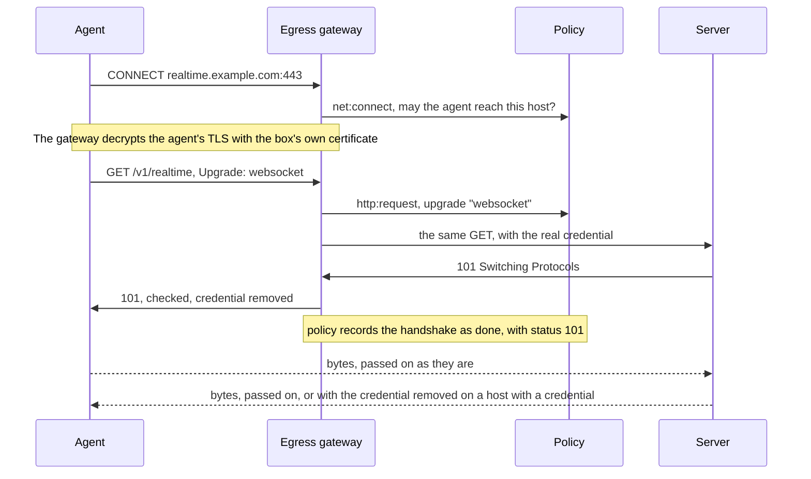

# Feature - WebSocket through the egress gateway

## Overview

Some agents keep a WebSocket open, which is one long connection that carries messages both ways. Agents that use a realtime model API, drive a browser, or run tools for a managed agent all do this. Box refuses every WebSocket today. On the main branch ("main"), the egress gateway removes the `Upgrade` header and refuses the server's `101` reply, so a WebSocket never opens.

For example, the tool runner of a Bedrock managed agent opens one WebSocket to Bedrock when its session starts. Every tool call of the session arrives over that WebSocket. That agent cannot run in a box today.

This design lets a WebSocket through the gateway, and **policy decides each WebSocket once, when it opens**. A WebSocket opens with one HTTP `GET`, called the handshake. Policy decides the handshake with `http:request`, as it decides any HTTPS request today. `http:request` gets one new input field, `upgrade`, which is `"websocket"` on a handshake and `""` on every other request. After the server says yes, the gateway passes bytes both ways and asks policy nothing more.

For some hosts, Box holds a credential, such as an API key. The agent holds only a stand-in token, and the gateway puts in the real key on the way out. A server can send the key back, for example in an error message. The gateway therefore removes it from what the server sends, as for an HTTP response on main.

The design gives up control of single messages. In return, no message waits for policy, and the security-critical code in Box stays small. A permit on a handshake lets the whole WebSocket through. A rule that blocks traffic after an event, or that caps bytes over time, therefore cannot stop a WebSocket that is already open. A rule for single messages can come later, in its own design, when a customer asks for one.

HTTP/2 and headers in policy are out of scope, and each gets its own design. HTTP response streaming is on main (#345).

## 1. Background

#173 asks for WebSocket support. On main, the gateway removes `Upgrade` and `Connection`, sends the handshake as a plain `GET`, and refuses a `101`.

#230 was a prototype that passed WebSockets through and asked `http:request` again while one was open. Its review asked for a design first. The earlier version of this design then decided each message, with two new actions, `websocket:send` and `websocket:receive`.

The review of that version chose the handshake alone for the first version. No customer has asked for a rule on single messages. Box also has no policy check on what reaches an agent from outside, so a rule on server messages would be the first one. Each message also cost 6.7 to 7.5 ms of policy time to decide and record. At that cost a box decides 133 to 149 messages a second. One realtime audio stream in 20 ms pieces uses 100 of them, 50 each way. A rule that capped bytes over 10 minutes made each decision slower, and the box kept up with only 29 messages a second each way.

## 2. How does a WebSocket pass through the gateway?

A WebSocket starts with the handshake. The agent sends a `GET` with `Upgrade: websocket`, and the server says yes with `101 Switching Protocols`. After that, both sides send messages until one side closes. Each message travels as one or more pieces, called frames.

The figure shows the handshake on the same path as any HTTPS request. Only the last two arrows are new:



The handshake follows these rules:
- The gateway accepts `wss://` only, because it can read the traffic only inside the TLS connection that it decrypts. A plain `ws://` handshake gets 403, and the gateway writes a refusal record to its own audit log, apart from the policy's event log. The refusal comes after the gateway's own access check and before it asks policy, so no connection to the server opens. A plain handshake that is not valid gets the same 403. The same holds for a host in `upgrade_http`, because the agent's own connection is still plain. The gateway reaches such a host over TLS even when the agent asks for plain HTTP. The refusal record keeps the path without its query string.
- The handshake must be a valid `GET` on HTTP/1.1 under the WebSocket standard (RFC 6455), or it gets 400. A handshake to a configured remote MCP (Model Context Protocol) server gets 403, because its messages would skip the `mcp:call` check.
- A `[[egress.<name>.backends]]` entry sends traffic for a host to another server, and it works for a handshake as for any request. The gateway connects to that server when the agent connects, and the WebSocket runs on that connection. The handshake carries that server's host, path prefix, and `auth`. Policy and the audit log still name the host that the agent asked for.
- The gateway puts in the real credential on the handshake only, never later. On a host where the gateway signs requests with SigV4, it signs the handshake as a `GET` with no body.
- The gateway removes `Sec-WebSocket-Extensions` and refuses a `101` that names an extension. Compression (`permessage-deflate`) would hide a credential from the gateway.
- The HTTP library in the gateway (hyper) accepts any `101`. The gateway therefore checks `Upgrade`, `Connection`, and `Sec-WebSocket-Accept` itself. If one is wrong, the agent gets 502 and the gateway writes a refusal record. Policy still records the handshake with status 101, because the server did send 101.
- On main, hyper closes the connection after each response, and that would also close a WebSocket. The gateway now keeps the connection open after a `101`, and it still closes the connection after every other response. HTTP responses reach the agent with the same bytes as on main.

After the `101`, the gateway works in one of two ways. On a host with no credential, it passes bytes both ways without change. On a host with a credential, it passes the agent's bytes without change and reads each frame from the server. It reads the whole frame, up to main's 16 MiB body limit. It replaces each copy of the credential with `[REDACTED]`, as in an HTTP response, and sends the frame on with its new length.

A credential can arrive split across two frames of one message. The gateway carries the partial match from one frame to the next, as it does across the pieces of an HTTP response. The WebSocket standard also has three small control frames, Ping, Pong, and Close. If the gateway must change a Ping or a Pong, it sends it empty. If it must change a Close, it keeps only the 2-byte close code.

The gateway checks the WebSocket standard only on the server frames that it reads, because it must parse them. It does not read or change the agent's frames, and the server checks them.

## 3. How does policy decide a WebSocket?

### 3.1 The handshake

Policy decides and records the handshake as one `http:request`, as on main. It records the request when it decides, and the response when the `101` arrives, with status 101. The gateway records the response before it passes any message on. A rule that reads that record can act at once, and it does not wait for the WebSocket to close.

The one new input field is `upgrade`. It is `"websocket"` on a handshake and `""` on every other request. It has the name of the HTTP header, as `method` has the name of the HTTP method, so a rule reads like the request: `context.input.upgrade == "websocket"`.

A permit that does not read `upgrade` lets a handshake through to its host, and so lets the whole WebSocket through. An operator who wants HTTP to a host and no WebSocket adds `context.input.upgrade == ""` to the permit. An operator can also refuse every WebSocket with one `forbid` on `upgrade == "websocket"`.

### 3.2 After the handshake

Policy decides nothing after the `101`, and the gateway records nothing more in the policy's event log. A rule that blocks traffic after an event, or that caps bytes over time, sees only `http:request` events. It can refuse the next handshake, but it cannot close a WebSocket that is open. The end of a WebSocket records nothing either.

### 3.3 Refusals and limits

A refused handshake leaves no WebSocket open. After the `101`, when one side closes its connection, the gateway stops the copy toward the other side. The WebSocket ends when both directions have ended.

The gateway ends both connections at once when no byte moves for 300 seconds. On a host with a credential, it also ends them when it cannot read a server frame. It writes a refusal record only in that case. A drop or the idle limit writes no record, as on main when an HTTP exchange ends.

| Cause | What the agent sees |
|---|---|
| `http:request` refuses the handshake | 403, as on main |
| A plain `ws://` handshake, or a handshake to a remote MCP host | 403 |
| A handshake that breaks the WebSocket standard | 400 |
| A `101` with a wrong `Upgrade`, `Connection`, or `Sec-WebSocket-Accept`, or with an extension | 502 |
| On a host with a credential, a server frame over 16 MiB, or one that breaks the standard | Both connections end, with a refusal record |
| One side closes its connection | The gateway closes its side toward the other end |
| No byte moves on either connection for 300 seconds | Both connections end |

The gateway does not track the agent's frames, so it cannot put a Close frame between them. When the gateway ends a WebSocket itself, each side sees the connection drop with no reason (close code 1006).

The 300-second limit is main's `upstream_read_deadline`. On main it limits the whole exchange, and that would cut every WebSocket at 300 seconds. After the `101`, the gateway uses it as an idle limit instead. A WebSocket uses one of main's 256 connections (`max_connections`) while it is open. Neither number becomes a new setting.

## 4. What changes in a policy?

The sample policy below lets an agent read from GitHub, blocks traffic after the agent reads an SSH key, and lets one realtime WebSocket through:

```text
@id("github_read")
permit (principal, action == Box::Action::"http:request", resource)
when { context.input.host == "api.github.com" && context.input.method == "GET" &&
       context.input.upgrade == "" };
@id("none_after_key")
@description("No HTTP request or new WebSocket after the SSH key is read.")
forbid (principal, action == Box::Action::"http:request", resource)
when temporal {
  formerly within 24h (
    Box::Action::"fs:read"::response{ input.path: "~/.ssh/id_ed25519",
                                      input.operation: Box::FsReadOperation::"read_content" }
  )
};
@id("realtime")
permit (principal, action == Box::Action::"http:request", resource)
when { context.input.host == "realtime.example.com" && context.input.path == "/v1/realtime" &&
       context.input.upgrade == "websocket" };
```

These rules differ from today:
- `github_read` adds `context.input.upgrade == ""`, so it lets HTTP requests through to `api.github.com` and no WebSocket. Without that line, it would also let a WebSocket through to `api.github.com`.
- `none_after_key` refuses each HTTP request and each new WebSocket after the read. It cannot close a WebSocket that opened before the read. "Nothing leaves after the read" therefore holds only in a policy that lets no WebSocket through.
- `realtime` is new. It lets a WebSocket through to `realtime.example.com/v1/realtime`, and no plain HTTP request to that path.

For an existing policy, one `forbid` on `upgrade == "websocket"` keeps every WebSocket out. A `forbid` always wins over a `permit`, so to let one WebSocket through later, the operator adds an `unless` for its host to that `forbid`.

## 5. What does it cost?

A WebSocket costs one policy decision and two records, at its handshake, as any HTTPS request does. After the `101`, no message waits for policy.

On a host with no credential, the gateway holds no message. On a host with a credential, it holds one server frame of up to 16 MiB, plus one copy while it removes the credential. That is up to 32 MiB for each WebSocket, and about 8 GiB at main's 256 connections. On main the limit is about 4 GiB, which is 256 request bodies of 16 MiB, because responses stream. The team has not measured how fast the gateway passes WebSocket bytes.

## 6. How do we deliver it?

The work lands in one PR, #476, after this doc. #476 refuses any case that it does not handle. It adds `upgrade` to `http:request`, the handshake rules, the byte copy, the credential removal, the 16 MiB limit, and the idle limit.

#476 tests the WebSocket path through a real gateway, with a TLS agent and a TLS echo server, in `crates/egress-gateway/tests/websocket_e2e.rs`.

Some interfaces change only with an approved design. If we accept this design, we approve these changes to them:
- The egress gateway's `EffectAttempt::HttpRequest` gains `upgrade`.
- The policy crate's `Request::Http` and `Outcome::Http` gain `upgrade`.
- The policy action vocabulary gains `upgrade` on `http:request`.

Box stores policy events in a fixed format, which Dogwood, the policy engine, sets when a box is created. The new field changes that format. A box created before #476 therefore does not start until its operator creates it again.

## 7. Key decisions

### D1. `http:request` decides the handshake, and there is no `websocket:connect`

The handshake is an HTTP `GET`, so `http:request` with `upgrade` decides it, and an operator learns one field instead of one action. A new `websocket:connect` action would keep every existing policy closed to WebSockets, because no permit today names it. We chose the field. The cost is that a permit that does not read `upgrade` lets a WebSocket through to its host. Section 4 shows the one line that keeps such a permit to HTTP.

### D2. Policy decides the connection, not each message

A decision on each message would let a rule stop the next message after an event, and let a byte cap count message bytes. The review chose the handshake alone, for the reasons in section 1. A rule on messages needs its own design, and information flow control is the work that will need it. In that work, data that enters the agent's context gets a tag. Policy then refuses tagged data that tries to leave through any channel, a WebSocket included.

### D3. The gateway reads frames only to remove a credential

The gateway must read a server frame on a host with a credential, because `[REDACTED]` changes the frame's length. Everywhere else it passes bytes as they are, so the security-critical code in Box does not read the agent's frames. The server and the agent still check the WebSocket standard on what they receive.

### D4. Effects can later cover every action that sends bytes out

Tool grammars (0001) add effects, which are labels that more than one action can share. A box effect, such as `Box::Effect::"network_outbound"`, would let one rule cover each action that sends bytes out, later ones included. A future message action would then need no change to existing rules. That work needs its own design, because the policy loader refuses such a rule today (`crates/policy/src/spelling.rs`).

## 8. Limitations

1. A permit on a handshake lets the whole WebSocket through. A rule cannot close a WebSocket that is open, and a byte cap on HTTP bodies does not count WebSocket bytes.
2. A permit on `http:request` that does not read `upgrade` lets a WebSocket through to its host. That holds for every such permit written before this change.
3. The gateway removes a credential within one message at a time. It misses a credential split across two messages, or encoded again, for example in base64. A removal in a binary stream breaks the stream, and the new frame length shows the credential's length.
4. On a host with a credential, each server frame waits until the gateway has read all of it. A frame over 16 MiB ends the WebSocket.
5. There is no WebSocket over HTTP/2 (RFC 8441), no WebSocket compression, and no HTTP/3.
6. When the gateway ends a WebSocket itself, it sends no Close frame, so each side sees the connection drop with no reason (close code 1006).
7. A refusal record after the `101` names the handshake's `GET` and path, so Box telemetry shows it as `http:request`. Its reason names the WebSocket problem.
