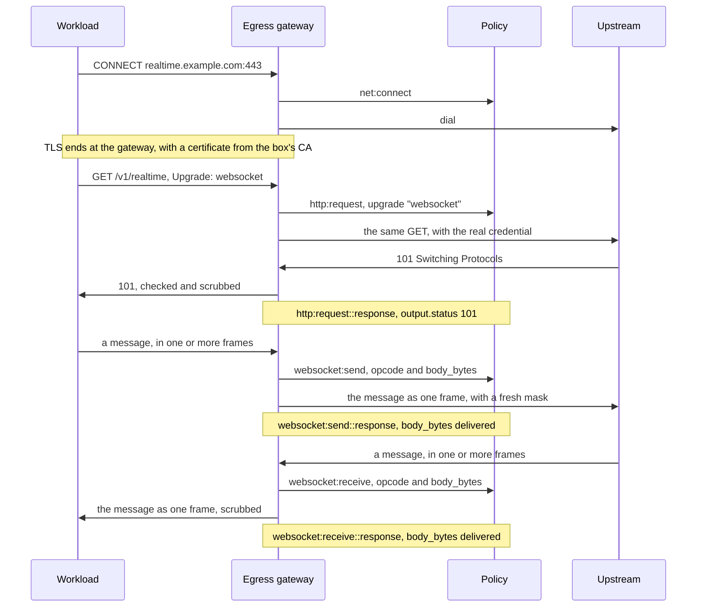
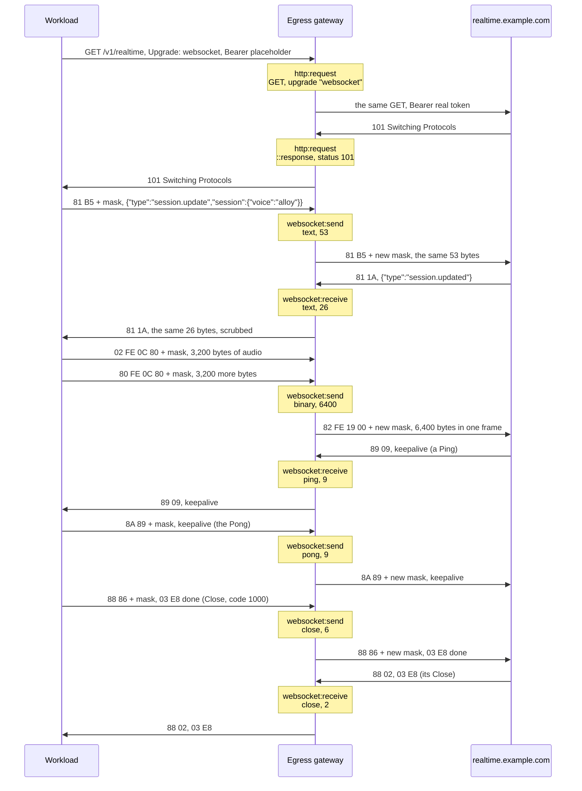

# Feature - WebSocket through the egress gateway

## Overview

Agents that use a realtime model API or drive a browser keep a WebSocket open, and Box refuses every WebSocket today. On the main branch ("main"), the egress gateway strips the `Upgrade` header and refuses a `101` reply, so a WebSocket never opens. This design lets a WebSocket through the gateway and keeps every message in both directions under policy.

Policy decides a WebSocket with three actions:
- `http:request` decides the handshake, as it decides any HTTPS request today. It gets one new input field, `upgrade`, which is `"websocket"` on a handshake and `""` on every other request.
- `websocket:send` is new. It decides each message that the workload sends after the `101`, before any byte of the message leaves.
- `websocket:receive` is new. It decides each message that the server sends after the `101`, before any byte of the message reaches the workload.

The two new actions follow `http:request`. A message is to them what a body is to an HTTP request, so the size field keeps its HTTP name, `body_bytes`. Both actions see the handshake's `host`, `port`, and `path`, the message type in `opcode` (`text`, `binary`, `ping`, `pong`, or `close`), and the message size in `body_bytes`. Ping, Pong, and Close count as messages, because the side that sends one chooses its bytes. The gateway asks policy before any byte of a message moves on, then sends the message on as one frame.

The gateway reads each workload message whole, up to main's 16 MiB body cap, and decides after its last byte, as main does for a request body. A server's binary message in one frame states its length in the frame header. On a host with no credential, which is a host where no placeholder credential applies, the gateway decides at that header and streams the payload, as #345 streams an HTTP response. The gateway reads every other server message whole, up to 16 MiB (section 3.3).

An operator can now permit HTTP requests and no WebSocket data, because a `GET` permit admits a handshake head and no message. A size rule refuses a large message before it moves on. A guard such as "nothing leaves after the SSH key is read" stops the next message, and a budget sums `body_bytes` on the `::response` events of one direction. Existing rules on `http:request` keep their meaning, and their events do not change.

Each message waits about 4 ms for its decision, so the whole box decides about 133 to 149 messages a second, in both directions together. A `sum` over a long time window lowers that rate, and section 5 shows by how much.

HTTP/2 and headers in policy are out of scope, and each gets its own design. HTTP response streaming is on main (#345), and section 3.3 says how this design follows it.

## 1. Background

#173 asks for WebSocket support. On main, the gateway strips `Upgrade` and `Connection`, sends the handshake as a plain `GET`, and refuses a `101`.

#230 was a prototype that relayed WebSockets and asked `http:request` again while one was open. Its review asked for a design first. This design keeps the relay and the measurements of #230, and it changes two things:
- In #230, a `GET` permit admitted a WebSocket that uploads, with no warning. Here, each message needs its own permit.
- In #230, each decision wrote an `http:request::response` event, so a rate limit counted the decisions of an open WebSocket and could close it. Here, `http:request` writes the same events as on main, and messages write `websocket:send` and `websocket:receive` events.

This design also adds a decision for each server message, `websocket:receive`.

## 2. How does a WebSocket pass through the gateway?

A WebSocket starts with a handshake. The workload sends a `GET` with `Upgrade: websocket`, and the server answers `101 Switching Protocols`. After that, both sides send messages for as long as they like. A message is one frame, or a first frame and continuation frames up to a frame with the FIN bit. The handshake takes the same path as any HTTPS request, and only the messages after the `101` are new:



Policy writes a `::request` event at each decision. A refusal at any step closes the WebSocket, and the refused message never reaches the other side (section 3.3).

The handshake follows these rules:
- The gateway accepts `wss://` only, because it can read messages only inside the TLS tunnel that it ends. A plain HTTP request with `Upgrade: websocket` gets 403 and a Deny record. A Deny record is the gateway's own record of a refusal, and the gateway keeps it outside the history. This refusal comes after the token check and before `net:connect`, so no upstream connection opens. It also covers a host in `upgrade_http` and a malformed plain handshake, and the record keeps the path without its query.
- The handshake must be a valid RFC 6455 `GET` on HTTP/1.1, or it gets 400. A handshake to a configured remote MCP (Model Context Protocol) server gets 403, because its messages would skip the `mcp:call` decision.
- A `[[egress.<name>.backends]]` re-route applies to a handshake as to any request. The gateway dials the backend when the workload connects. The handshake carries the backend's host, path prefix, and `auth`, and the relay runs on the connection to the backend. Policy and the audit records still judge the original destination. #476 tests a re-route with a box-owned token. It does not test a backend whose `auth` is `aws://`, where the gateway signs the handshake as any `GET` with no body.
- The gateway swaps the placeholder token for the real credential on the handshake, never in a message. On a signing host, which is a host whose requests the gateway signs with SigV4, the gateway signs the handshake as a `GET` with no body.
- The gateway removes `Sec-WebSocket-Extensions` and refuses a `101` that names an extension, because `permessage-deflate` would hide a message from policy and from the scrub. The scrub redacts each copy of a credential in what the server sends back.
- hyper's client accepts any `101` as an upgrade. The gateway therefore checks `Upgrade`, `Connection`, and `Sec-WebSocket-Accept` itself, and answers 502 if one is wrong. The handshake still records `http:request::response` with status 101, and then the gateway writes a Deny record.
- On main, hyper's server runs with keep-alive off, and that also closes a `101`. The gateway turns keep-alive on and sets `Connection: close` on every other response. An HTTP exchange still uses one connection, and its bytes do not change.

After the `101`, the relay reads each message in each direction. Section 3.3 says which messages it streams and which it holds whole. The relay checks each frame against RFC 6455. The checks cover reserved bits, opcodes, masking by the workload only, unfragmented control frames of at most 125 bytes, and frame order. Text, and the reason in a Close, must be valid UTF-8.

The relay sends each message on as one frame. It masks a workload message again with a fresh key, so the workload cannot choose the bytes on the upstream wire. When a placeholder credential applies to the host, the relay scrubs the `101` head and each server message after its decision. If the scrub changes a Ping or a Pong, the relay sends it with no payload. If the scrub changes a Close, the relay keeps only its 2-byte code. The decision reads `body_bytes` before the scrub, and the `::response` event counts the bytes after it.

We write the frame codec ourselves on hyper's upgrade, as #230 did. The codec is about 75 lines of the 593-line relay in #230, and the hooks for policy and the scrub are most of the rest. tungstenite and tokio-tungstenite (0.30) answer every Ping and Close themselves, so a Ping or a Close from either side would never reach a decision. fastwebsockets (0.8) does not check which side masks.

## 3. How does policy decide a WebSocket?

### 3.1 The handshake

The handshake is one `http:request`, decided and recorded as on main. Policy writes `http:request::request` at the decision, and `http:request::response` at the `101` with `output.status` 101. The gateway writes that `::response` event before the relay reads any message, so a rule that waits for it does not wait for the WebSocket to close.

The one new input field is `upgrade`. It is `"websocket"` on a handshake and `""` on every other request. It matches the HTTP field name, as `method` does, so a rule reads like the request: `context.input.upgrade == "websocket"`.

A permit that does not read `upgrade` admits a handshake to its host. The handshake head leaves, as any `GET` does, and no message can follow without a `websocket:send` or a `websocket:receive` permit. An operator who wants no handshake at all adds `context.input.upgrade == ""` to the permit.

### 3.2 Messages

Each message that the workload sends is one `websocket:send`, and each message that the server sends is one `websocket:receive`. For a server's binary message in one frame on a host with no credential, the gateway asks at the frame header. For any other message, it asks after the last frame arrives (section 3.3).

The input names the endpoint and the payload. `body_bytes` has the same name and meaning as on `http:request`. On `::request` it is the size that the sender offers, and on `::response` it is the size delivered. For a message, it is the payload length of RFC 6455, after the mask comes off. A message gets no reply, so neither action has an `output`, as `net:connect` has none.

```text
entity WebSocketOpcode enum ["text", "binary", "ping", "pong", "close"];

type WebSocketMessageInput = {
  host: String,           // from the handshake
  port: Long,
  path: String,
  opcode: WebSocketOpcode,
  body_bytes: Long        // the payload length, after the mask comes off
};

action "websocket:send" appliesTo {
  principal: Agent,
  resource: Resource,
  context: { input: WebSocketMessageInput }
};

action "websocket:receive" appliesTo {
  principal: Agent,
  resource: Resource,
  context: { input: WebSocketMessageInput }
};
```

`opcode` names the opcode of the first frame, as RFC 6455 does, and a rule spells it `Box::WebSocketOpcode::"text"`:

| `opcode` | Frame opcode | Payload |
|---|---|---|
| `text` | `0x1` | 0 to 16 MiB of UTF-8 |
| `binary` | `0x2` | 0 to 16 MiB from the workload. From the server, any length in one frame on a host with no credential, else 0 to 16 MiB |
| `ping` | `0x9` | 0 to 125 bytes |
| `pong` | `0xA` | 0 to 125 bytes, usually a copy of the Ping that it answers |
| `close` | `0x8` | 0 bytes, or a 2-byte code and a UTF-8 reason, up to 125 bytes |

A continuation frame (`0x0`) is part of the message that it continues, so it has no value of its own. A control frame (Ping, Pong, or Close) is a message of its own, because its sender chooses its payload. If a control frame arrives between two frames of a text or binary message, it gets its own decision and moves on first.

The events follow the rules of every other action (`docs/user/policy/actions.md`), and the two actions differ only in where the message goes:
- `::request` at each decision, permitted or denied.
- `::response` after the gateway has sent the message on, upstream for `websocket:send` and to the workload for `websocket:receive`. If the other side drops during the send, the event counts the bytes that the other side took.
- `::error` when no byte of the message reached the other side.

The end of a WebSocket writes no event. The `::response` event of each Close records how the WebSocket ended.

### 3.3 Refusals and limits

A refused message never reaches the other side. The relay closes both sides. It writes one Deny record for a refusal by policy, a protocol fault, a gateway fault, or an outcome that it cannot record. A drop or the idle timer writes no Deny record, as an HTTP exchange that ends writes none on main.

After a refusal by policy in either direction, the workload gets close code 1008 and the server gets 1001, so the server learns nothing about the policy. After a protocol fault, the side that broke the rule gets the close code from the table below. The other side gets 1001 after a workload fault, or 1014 after a server fault.

| Cause | Signal |
|---|---|
| `http:request` refuses the handshake | 403, as on main |
| A plain HTTP handshake, or a handshake to a remote MCP host | 403 |
| A handshake that is not valid RFC 6455 | 400 |
| A `101` with a wrong `Upgrade`, `Connection`, or `Sec-WebSocket-Accept`, or with an extension | 502 |
| `websocket:send` or `websocket:receive` refuses a message | 1008 to the workload, 1001 to the server |
| A frame that breaks RFC 6455 | 1002 to the side that sent it, and no event |
| Text or a Close reason that is not valid UTF-8 | 1007 to the side that sent it, and no event |
| A held message over 16 MiB, which is any workload message or a server message that the relay holds (list below) | 1009 to the side that sent it, and no event |
| One side drops | 1014 to the workload when the server drops, or 1001 to the server when the workload drops, and `::error` or `::response` for a message that was on its way to the side that dropped |
| The gateway cannot decide a message for a reason other than policy, cannot make a mask key, or cannot record an outcome | 1011 to the workload, 1001 to the server |
| Nothing moves on either connection for 300 s | 1001 to both sides |
| Any of the above while the gateway is partway through a frame to one side | No Close to that side, because a Close cannot go in the middle of a frame. The gateway ends that connection, that side sees an abnormal closure (1006), and the message records `::response` or `::error` with the bytes that side took |

The 16 MiB cap is main's `max_body_bytes`. On main, the gateway holds a request body whole and decides after its last byte, and since #345 it streams a response. The relay follows the same split. What it streams has no cap, and what it holds whole is capped at 16 MiB.
- The relay holds every workload message whole and decides after its last byte, as main holds a request body. A decision at the frame header would come before the payload exists. The workload could then read a key after the decision and write it into the payload, and a guard such as `none_after_key` could not stop it.
- A budget on sent bytes can let one message pass its limit. It overshoots by at most 16 MiB on each open WebSocket, as an HTTP budget can.
- A server's binary message in one frame states its length in its header. On a host with no credential, the relay decides at the header and streams the payload with no cap, as an HTTP response has none.
- The relay holds every other server message whole. A text message must pass the UTF-8 check before it moves on. A message in more than one frame states its whole length only at its last frame. A message on a host with a credential changes length when the scrub redacts a secret.

A WebSocket therefore holds at most one held message in each direction, 16 MiB each. On a host with a credential, the scrub also needs a second copy of the server message while it runs. The worst case is then about 48 MiB for each WebSocket (section 5). An HTTP exchange on main holds at most a 16 MiB request body.

The 300 s limit is main's `upstream_read_deadline`. On main it limits the whole exchange, which would cut every WebSocket at 300 s. After the `101`, the gateway uses it as an idle limit on both connections. A WebSocket holds one of main's 256 connections (`max_connections`) while it is open. Neither number becomes a config key.

Box telemetry labels a message decision with its `websocket:*` action and the resource `host:port/path`.

## 4. What changes in a policy?

The sample policy below is a policy after this change. It lets an agent read from GitHub, has a guard, and admits one realtime WebSocket:

```text
@id("github_read")
permit (principal, action == Box::Action::"http:request", resource)
when { context.input.host == "api.github.com" && context.input.method == "GET" };
@id("none_after_key")
@description("Nothing leaves after the SSH key is read.")
forbid (principal, action in [Box::Action::"http:request", Box::Action::"websocket:send"], resource)
when temporal {
  formerly within 24h (
    Box::Action::"fs:read"::response{ input.path: "~/.ssh/id_ed25519",
                                      input.operation: Box::FsReadOperation::"read_content" }
  )
};
@id("realtime")
permit (principal, action == Box::Action::"http:request", resource)
when { context.input.host == "realtime.example.com" && context.input.path == "/v1/realtime" &&
       context.input.upgrade == "websocket" };
@id("realtime_messages")
permit (principal, action in [Box::Action::"websocket:send", Box::Action::"websocket:receive"], resource)
when { context.input.host == "realtime.example.com" && context.input.path == "/v1/realtime" &&
       context.input.body_bytes <= 1048576 };
@id("websocket_budget")
@description("At most 10 MiB sent over WebSockets in 10 minutes.")
forbid (principal, action == Box::Action::"websocket:send", resource)
when temporal {
  exists (total: Long). (
    (sum b for (b: Long), (t: Timepoint). where (
      formerly within 10m (
        Box::Action::"websocket:send"::response{ input.body_bytes: b } && tp(t)
      )
    )) == total && total >= 10485760
  )
};
```

These rules differ from today:
- `github_read` loads today and needs no edit. It admits a handshake head to `api.github.com`, but no rule permits a message there. The first message in either direction therefore closes that WebSocket with 1008.
- `none_after_key` now names `websocket:send` next to `http:request`, so it also stops the next message out of an open WebSocket. It does not name `websocket:receive`, so the server can still send to the workload. It reads no `context.input`, so it loads across two action families. An action family is the set of actions that share a prefix, such as `http:` or `websocket:`.
- `realtime` and `realtime_messages` are new, and a WebSocket to `realtime.example.com` needs both. `realtime_messages` reads `context.input` across `websocket:send` and `websocket:receive`, and it loads because the two are one action family. It refuses a message over 1 MiB in either direction before the message moves on, because the gateway knows the size when it asks.
- `websocket_budget` is new. It sums the delivered `body_bytes`, as an HTTP budget on main sums `body_bytes` on `http:request::response`. A budget on received bytes is the same rule on `websocket:receive`, and a budget on text only adds `input.opcode: Box::WebSocketOpcode::"text"` to the pattern. One `sum` reads the events of one action, so a budget on HTTP bodies stays a separate rule on `http:request`, with its own limit.

The diagram below shows a WebSocket to `wss://realtime.example.com/v1/realtime` under these rules. Each arrow shows the header bytes of a frame in hex, then its payload. `mask` is the 4-byte key that the workload chooses, and server frames have no mask. Each note is one decision, with the action, the `opcode`, and `body_bytes`:



Each decision writes `::request` at its note and `::response` after the arrow out, so the session writes 16 events. Each `websocket:*` event also carries `host` "realtime.example.com", `port` 443, and `path` "/v1/realtime". The gateway swaps the placeholder for the real token on the handshake only, so the messages carry no credential. If the workload reads `~/.ssh/id_ed25519` after the first text message, `none_after_key` refuses the binary message. That message never leaves, and both sides close.

## 5. What does it cost?

Each message costs one decision and one event, in either direction. A probe on a patched copy of main at `93a3761`, in a release build on macOS, measured the engine. Its sample policy had a byte budget, a rate limit, and a guard on `http:request`:

| Measurement | Result, p50 unless stated |
|---|---|
| Up to about 3,400 events in the history | Decision 4.0 to 4.2 ms, record 2.7 to 3.3 ms |
| About 16,500 events | Decision 21.4 ms (p99 69.5 ms), record 3.4 ms |
| Permits only, about 16,500 events | Decision 4.0 ms |
| #230, new WebSockets that each send one message | 54.1 per second, against 72.9 with no decisions |

A message therefore waits about 4 ms after its last frame arrives. With a small history, it costs about 6.7 to 7.5 ms of engine time, which is the decision plus the record. One mutex guards each engine call. The whole box therefore decides about 133 to 149 messages a second in both directions together, which is 1,000 ms divided by 7.5 or 6.7 ms. We have not measured a WebSocket that sends a message for each decision.

A held message also waits while the gateway reads all of it, as a large HTTP request body does on main. A streamed server binary message does not wait. Each WebSocket holds at most one held message in each direction, 16 MiB each. On a host with a credential, it also holds a scrub copy of up to about 16 MiB. That is about 48 MiB for each WebSocket, and about 12 GiB at main's 256 connections. Main's bound is about 4 GiB of request bodies, because responses stream.

The cost that we are least sure of is the growth of the history. Dogwood keeps the events that match each `count` or `sum`, but it keeps no running total. Each decision of an action that the rule names therefore adds up the matches in the lookback again, at about 1.2 µs for each match. The lookback is the `within` window of the rule. A decision of another action skips the rule.

Take a realtime audio stream that sends 50 messages a second each way. That rate is a guess for audio in 20 ms frames.
- With no `count` or `sum`, the stream uses about 100 of the box's 133 to 149 decisions a second.
- Under `websocket_budget`, the 10-minute lookback holds 30,000 `websocket:send::response` events (50 a second for 600 s). At 1.2 µs each, that adds about 36 ms to each `websocket:send` decision. The box then decides only about 29 messages a second each way, so the stream falls behind. At N messages a second each way, a `websocket:send` decision costs 0.72 × N ms more, for 600 × N events at 1.2 µs each. The engine is full when N × (7 + 0.72 × N) + N × 7 = 1,000 ms, which gives N ≈ 29.
- With a 1-minute lookback, the 3,000 events add about 3.6 ms to a `websocket:send` decision, and the stream uses about 89% of the box.

Every `http:request` waits on the same lock, so HTTP slows down with the stream. The `sum` causes this slowdown, because the stream fits when there is no `sum`.

## 6. How do we deliver it?

The work lands in one PR, #476, after this doc. #476 fails closed, which means that it refuses whatever it does not decide. It adds the policy part and the relay together. The policy part adds `upgrade` to `http:request`, and it adds `websocket:send` and `websocket:receive` with `Box::WebSocketOpcode` and their input. The relay adds the handshake, the frame rules, the scrub, the 16 MiB cap, the idle timer, and a decision for each message in each direction.

#476 tests the relay through a real gateway, with a TLS workload and a TLS echo server, in `crates/egress-gateway/tests/websocket_e2e.rs`. On an earlier head of #476, a real box ran an echo server and a SigV4 handshake to a signing host. One run is still to do: a stream of 50 messages a second each way for 10 minutes, under `websocket_budget` with a 10-minute and a 1-minute lookback. The run passes if the relay keeps the stream's rate, and the estimate in section 5 says that only the 1-minute lookback passes.

If we accept this design, we approve these changes to frozen surfaces, which are the interfaces that change only with an approved design:
- The egress gateway's `pub use` set gains `WebSocketOpcode`. `EffectAttempt::HttpRequest` gains `upgrade`, and `EffectAttempt` gains `WebSocketSend` and `WebSocketReceive`.
- The policy crate's `pub use` set gains `WebSocketDirection` and `WebSocketOpcode`. `Request::Http` and `Outcome::Http` gain `upgrade`, and `Request` and `Outcome` each gain one `WebSocket` variant that serves both actions. `WebSocketDirection` is a field of that variant, and it selects the action, `websocket:send` or `websocket:receive`. It is not a policy input, so a rule reads the direction from the action, never from `context.input`, as D5 requires. The gateway needs no such type, because `EffectAttempt` has a separate variant for each direction.
- The policy action vocabulary gains `upgrade` on `http:request`, the actions `websocket:send` and `websocket:receive`, and the enum `Box::WebSocketOpcode`.

Box rules are written in Dogwood, the upstream policy language and engine, and Dogwood fixes the event schema of a store. A box created before #476 therefore refuses to start until its operator creates it again.

## 7. Key decisions

### D1. `http:request` decides the handshake, and there is no `websocket:connect`

The handshake is an HTTP `GET`, so `http:request` with `upgrade` decides it. A third action would add a rule and decide nothing new. A rule that refuses every handshake reads `context.input.upgrade`.

### D2. Each message is one decision before it moves on

A message is what one side chooses to send, so each message gets one decision. A guard then stops the next message, and a budget is exact to one message. We rejected two options:
- One decision for each WebSocket. A guard or a budget could not stop a WebSocket that is already open, and only the idle timer would end it.
- One decision for each frame. The gateway sends each message as one frame anyway, so a frame boundary carries no new fact, and a sender could multiply its decisions.

### D3. The gateway decides a message before any byte of it moves on

A message action decides a message with its `body_bytes`, as `http:request` decides a request, so an operator learns one field for the size of what an action carries. The workload chooses its bytes and when it writes them, so the gateway holds each workload message whole. A decision at the frame header would come before the payload exists, and a guard could not stop bytes written after the decision.

A server's binary message in one frame states its length in its header. On a host with no credential, the gateway decides there and streams the payload, as main streams a response. At the first frame of a server message in more than one frame, the gateway does not know the length. Text must also pass the UTF-8 check before it moves on. The gateway therefore holds those messages whole, and a size rule can refuse a large message before it moves on. The cost is the wait to read a held message and up to 16 MiB of memory, the same as for an HTTP request body on main.

### D4. Control frames are messages

Ping, Pong, and Close each carry up to 125 bytes that their sender chooses, so each one gets a decision. The `opcode` field lets a rule treat them apart.

### D5. Server messages get their own action, `websocket:receive`

With its own action, an operator can cap or budget the bytes that a server sends into the box, and a rule can see a received message in the history. We did not add a direction field to `websocket:send`, because a budget on sent bytes would then need a direction filter. A rule that forgot the filter would count both ways. Both actions share one input and are one action family, so one rule can read `context.input` across both. HTTP replies still get no decision. #345 streams them, and no rule reads their bytes.

### D6. Packs compose rules across actions now, and effects can later

Today a guard over every action that sends bytes out names each action, as `none_after_key` names `http:request` and `websocket:send`. A policy pack can ship that set of rules for a use case. Tool grammars (0001) add effects, which more than one action can share. A box effect, such as `Box::Effect::"network_outbound"` on `http:request` and `websocket:send`, would let one rule cover each such action, later ones included.

We leave the box effect to its own design, because two things must change first. A rule that reads `context.input` and names no action, or names actions of two families, refuses to load today (`crates/policy/src/spelling.rs`). Also, every action in the scope of a rule must declare the `effects` field.

## 8. Limitations

1. The scrub reads one message at a time, so it misses a secret that is split across two messages or encoded again, for example in base64. A redaction in a binary stream breaks the stream and shows the length of the secret.
2. There is no WebSocket over HTTP/2 (RFC 8441), no WebSocket compression, and no HTTP/3.
3. A held message moves on only after the gateway has read all of it. The first byte of a large message reaches the other side late. This applies to any large workload message, and to a large server message that is text or in more than one frame.
4. A budget compares the bytes already delivered with its limit. On each open WebSocket, the message that crosses the limit passes in full, as an HTTP body does on main. On the receive side, a server's binary message in one frame on a host with no credential has no cap. That message can be of any length, as an HTTP response on main can.
5. Each message waits for a decision. With a small history and no `count` or `sum`, the box decides about 133 to 149 messages a second in both directions together. A 10-minute `sum`, as in `websocket_budget`, lowers that to about 29 a second each way, which is below one realtime audio stream (section 5).
6. A byte budget over HTTP bodies and WebSocket messages is two rules, so a workload can send up to the sum of their limits.
7. A `formerly` guard acts once its event is written. The Strands Shell and the Python broker write the `fs:read` event before the read returns. The experimental native filesystem policy on macOS writes it after the kernel admits the open. A message right after the read can then leave first, as a request can on main.
8. A Deny record for a protocol fault or a gateway fault carries the handshake's `GET` and path, so Box telemetry labels it `http:request`, not `websocket:send` or `websocket:receive`. Its reason names the WebSocket fault.
