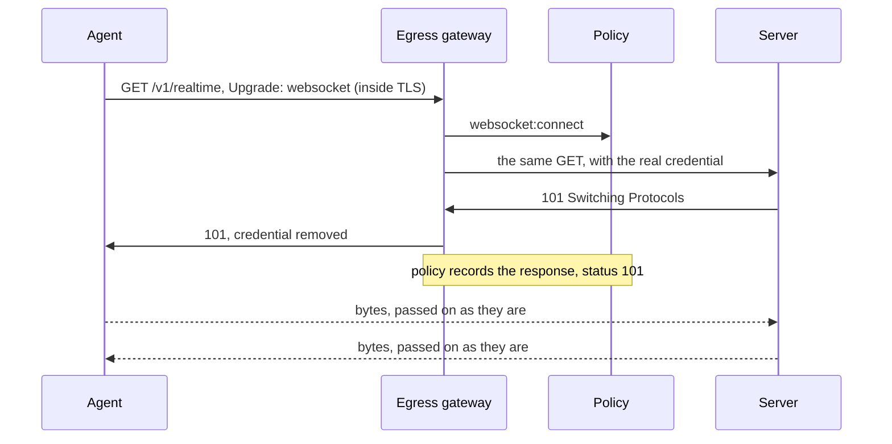

# Feature - WebSocket through the egress gateway

## Overview

Some agents keep a WebSocket open, which is one long connection that carries messages both ways. For example, the tool runner of a Bedrock managed agent opens one WebSocket to Bedrock when its session starts. Every tool call of the session arrives over it. Box refuses every WebSocket today, because the egress gateway removes the `Upgrade` header and refuses the server's `101` reply. That agent cannot run in a box.

This design lets a WebSocket through, and **policy decides each WebSocket once, when it opens**. A WebSocket opens with one HTTP `GET`, called the handshake, and a new action, `websocket:connect`, decides it. After the server replies `101`, the gateway copies bytes both ways and asks policy nothing more.

The design gives up control of single messages. Policy cannot close a WebSocket that is open, and the gateway does not remove a credential from a message. In return, no message waits for policy, and the gateway code stays small because it does not read messages.

Merging this doc approves the interface changes in section 5. The code PR, #476, follows it. A box created before #476 keeps its policy history, because the new action does not change the format of stored events. HTTP/2 and headers in policy are out of scope, and each gets its own design.

## 1. Background

#173 asks for WebSocket support, and two earlier versions of this design were reviewed. The first version decided each message, with `websocket:send` and `websocket:receive`. Each message cost 6.7 to 7.5 ms of policy time, so a box decided 133 to 149 messages a second, and one realtime audio stream needs 100. The second version decided the handshake with an `upgrade` field on `http:request`. Its review chose a separate action. With the field, a permit that must keep WebSockets out adds `upgrade == ""`, and that line does not say what it does.

## 2. How does a WebSocket pass through the gateway?

The handshake takes the same path as any HTTPS request. Only the last two arrows are new:



The gateway checks each handshake with these rules:
- It accepts `wss://` only, because it can read a handshake only inside TLS that it decrypts. A plain `ws://` handshake gets 403 before policy is asked.
- A handshake that is not an HTTP/1.1 `GET` with `Connection: upgrade`, `Sec-WebSocket-Version: 13`, and no body gets 400.
- A handshake to a configured remote MCP (Model Context Protocol) server gets 403, because its messages would skip the `mcp:call` check.
- For a host where Box holds a credential, the gateway puts in the real credential on the handshake only. It removes the credential from the `101` reply headers, as from any HTTP reply.

After the `101`, the gateway copies bytes both ways without change and does not read them. When one side closes, the gateway closes the other side. When no byte moves for 300 seconds, it closes both. A WebSocket Ping is bytes too, so a client that sends Pings keeps a quiet WebSocket open. It sends no WebSocket Close message, so each side sees the connection drop with close code 1006. A WebSocket holds two 16 KiB buffers while it is open.

## 3. What does policy decide and record?

`websocket:connect` reads `host`, `port`, `method`, `path`, and `intercepted`, as `http:request` does. It has no `body_bytes`, because a handshake has no body.

Policy records a request event at each decision, permitted or refused. It records a response event when the server replies, with the reply's status. Policy records the response for a `101` before any message moves. A later rule that reads it does not wait for the WebSocket to close. These are the two events of an opened WebSocket, from a test run of #476, with their fields written as JSON:

```json
{ "action": "Box::Action::\"websocket:connect\"", "kind": "request",
  "principal": "Box::Agent::\"self\"", "requestId": "6",
  "input": { "host": "realtime.example.com", "port": 443, "method": "GET",
             "path": "/v1/realtime", "intercepted": true } }

{ "action": "Box::Action::\"websocket:connect\"", "kind": "response",
  "principal": "Box::Agent::\"self\"", "requestId": "6",
  "input": { "host": "realtime.example.com", "port": 443, "method": "GET",
             "path": "/v1/realtime", "intercepted": true },
  "output": { "status": 101 } }
```

Policy records nothing after the response. A message, a byte count, or the end of a WebSocket writes no event.

## 4. What changes in a policy?

A permit on `http:request` does not cover `websocket:connect`. A policy written before this change therefore lets no WebSocket through, unless one of its permits covers every action. A `forbid` on `http:request` does not cover `websocket:connect` either. A rule that must stop all traffic to the outside names both actions. If it reads `context.input`, it is one rule for each action, because the policy loader checks `context.input` against one family of actions.

The sample policy below lets an agent read from GitHub and lets one realtime WebSocket through. It refuses each new request after the agent reads an SSH key:

```text
@id("github_read")
permit (principal, action == Box::Action::"http:request", resource)
when { context.input.host == "api.github.com" && context.input.method == "GET" };
@id("none_after_key")
@description("No HTTP request or new WebSocket after the SSH key is read.")
forbid (principal, action in [Box::Action::"http:request", Box::Action::"websocket:connect"], resource)
when temporal {
  formerly within 24h (
    Box::Action::"fs:read"::response{ input.path: "~/.ssh/id_ed25519",
                                      input.operation: Box::FsReadOperation::"read_content" }
  )
};
@id("realtime")
permit (principal, action == Box::Action::"websocket:connect", resource)
when { context.input.host == "realtime.example.com" && context.input.path == "/v1/realtime" };
```

`github_read` lets HTTP requests through to `api.github.com`, and no WebSocket. `none_after_key` refuses each HTTP request and each new WebSocket after the key read, but it cannot close a WebSocket that opened before the read. `realtime` lets one WebSocket through. The `@box/open` starter, which lets the agent reach any host, gets a permit on `websocket:connect` in a separate CLI PR after #476. Until then, it refuses every WebSocket.

## 5. Interface changes

Some interfaces change only with an approved design. This design changes these:
- The egress gateway's `EffectAttempt::HttpRequest` gains `websocket`, which is true on a handshake.
- The policy crate's `Request::Http` and `Outcome::Http` gain `websocket`, which selects `websocket:connect` in place of `http:request`.
- The policy action vocabulary gains `websocket:connect`.

#476 builds the whole design. It tests the WebSocket path through a real gateway, with a TLS agent and a TLS echo server.

## 6. Key decisions

### D1. A separate action, not an `upgrade` field

With an `upgrade` field on `http:request`, every permit on `http:request` written before this change lets a WebSocket through to its host. With a separate action, those policies stay closed to WebSockets. The name also fits WebSocket over HTTP/2 (RFC 8441), which has no `Upgrade` header. The cost is that a `forbid` on `http:request` does not stop a handshake.

### D2. Policy decides the connection, not each message

No customer has asked for a rule on single messages. A decision on each message is also too slow for a realtime audio stream (section 1). A rule on messages needs its own design.

### D3. The gateway does not read messages

A server that refuses a key can repeat the key in its error reply. The gateway removes it from the handshake reply, as from any HTTP reply. We assume that a server that accepted the key does not send it back in a message. To check messages, the gateway must read each one, hold up to 16 MiB of it, and rewrite its length. That was most of the gateway code in the earlier version.

## 7. Limitations

1. Policy cannot close a WebSocket that is open, and a WebSocket has no time limit while bytes move. A byte cap on HTTP bodies does not count WebSocket bytes.
2. A `forbid` on `http:request` does not stop a handshake.
3. If a server sends the real key inside a message, the agent sees it.
4. There is no WebSocket over HTTP/2 or HTTP/3.
5. Box telemetry shows a handshake that the gateway refuses before it asks policy, such as a plain `ws://` handshake, as an `http:request`.
