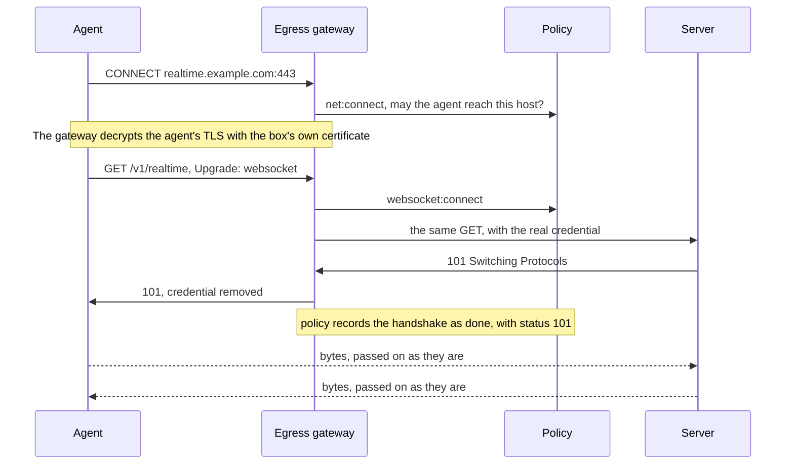

# Feature - WebSocket through the egress gateway

## Overview

Some agents keep a WebSocket open, which is one long connection that carries messages both ways. Agents that use a realtime model API, drive a browser, or run tools for a managed agent all do this. Box refuses every WebSocket today. On the main branch ("main"), the egress gateway removes the `Upgrade` header and refuses the server's `101` reply, so a WebSocket never opens.

For example, the tool runner of a Bedrock managed agent opens one WebSocket to Bedrock when its session starts. Every tool call of the session arrives over that WebSocket. That agent cannot run in a box today.

This design lets a WebSocket through the gateway, and **policy decides each WebSocket once, when it opens**. A WebSocket opens with one HTTP `GET`, called the handshake. Policy decides the handshake with a new action, `websocket:connect`. Its input is the `http:request` input without the body size. A permit that names `http:request` does not cover it. A policy written before this change therefore lets no WebSocket through, unless one of its permits covers every action. After the server says yes, the gateway passes bytes both ways and asks policy nothing more.

For some hosts, Box holds a credential, such as an API key. The agent holds only a stand-in token, and the gateway puts in the real key on the handshake only. It removes the key from the handshake reply, as for any HTTP response on main. After the `101`, the gateway passes bytes without change on every host.

The design gives up control of single messages, and it does not remove a credential from a message. In return, no message waits for policy, and the gateway does not read WebSocket messages, so the security-critical code in Box stays small. A permit on a handshake lets the whole WebSocket through. A rule that blocks traffic after an event, or that caps bytes over time, therefore cannot stop a WebSocket that is already open. A rule for single messages can come later, in its own design, when a customer asks for one.

Merging this doc approves the interface changes in section 6. HTTP/2 and headers in policy are out of scope, and each gets its own design. HTTP response streaming is on main (#345).

## 1. Background

#173 asks for WebSocket support. On main, the gateway removes `Upgrade` and `Connection`, sends the handshake as a plain `GET`, and refuses a `101`.

#230 was a prototype that passed WebSockets through and asked `http:request` again while one was open. Its review asked for a design first. The earlier version of this design then decided each message, with two new actions, `websocket:send` and `websocket:receive`.

The review of that version chose the handshake alone for the first version. No customer has asked for a rule on single messages. Box also has no policy check on what reaches an agent from outside, so a rule on server messages would be the first one. Each message also cost 6.7 to 7.5 ms of policy time to decide and record. At that cost a box decides 133 to 149 messages a second. One realtime audio stream in 20 ms pieces uses 100 of them, 50 each way. A rule that capped bytes over 10 minutes made each decision slower, and the box kept up with only 29 messages a second each way.

The next version decided the handshake with `http:request` and a new `upgrade` field, and it removed the credential from each server message. Its review chose a separate action for the handshake, because a rule that keeps a permit to HTTP with `upgrade == ""` does not read plainly. The review also removed the credential check on messages, for the reasons in D3.

## 2. How does a WebSocket pass through the gateway?

A WebSocket starts with the handshake. The agent sends a `GET` with `Upgrade: websocket`, and the server says yes with `101 Switching Protocols`. After that, both sides send messages until one side closes.

The figure shows the handshake on the same path as any HTTPS request. Only the last two arrows are new:



The handshake follows these rules:
- The gateway accepts `wss://` only, because it can read the traffic only inside the TLS connection that it decrypts. A plain `ws://` handshake arrives as plain HTTP, with no `CONNECT`. It gets 403, and the gateway writes a refusal record to its own audit log, apart from the policy's event log. The refusal comes after the gateway's own access check and before it asks policy, so no connection to the server opens. A plain handshake that is not valid gets the same 403. The gateway reaches a host in `upgrade_http` over TLS even when the agent asks for plain HTTP. A plain handshake to such a host gets the same 403, because the agent's own connection is still plain. The refusal record keeps the path without its query string.
- The handshake must be a `GET` on HTTP/1.1 with `Connection: upgrade`, `Sec-WebSocket-Version: 13`, and no body, or it gets 400. A handshake to a configured remote MCP (Model Context Protocol) server gets 403, because its messages would skip the `mcp:call` check.
- A `[[egress.<name>.backends]]` entry sends traffic for a host to another server, and it works for a handshake as for any request. The gateway connects to that server when the agent connects, and the WebSocket runs on that connection. The handshake carries that server's host, path prefix, and `auth`. Policy and the audit log still name the host that the agent asked for.
- The gateway puts in the real credential on the handshake only, never later. On a host where the gateway signs requests with SigV4, it signs the handshake as a `GET` with no body.
- The gateway sends the server's `101` on to the agent, with the credential removed from its headers, and the agent's WebSocket client checks it.
- On main, hyper, the HTTP library in the gateway, closes the connection after each response, and that would also close a WebSocket. The gateway now keeps the connection open after a `101`, and it still closes the connection after every other response. HTTP responses reach the agent with the same bytes as on main.

After the `101`, the gateway passes bytes both ways without change, on every host. It does not read WebSocket messages, so the agent and the server check the WebSocket standard on what they receive.

## 3. How does policy decide a WebSocket?

### 3.1 The handshake

Policy decides and records the handshake as one `websocket:connect`. It records the request when it decides, and the response when the `101` arrives, with status 101. The gateway records the response before it passes any message on. A rule that reads that record can act at once, and it does not wait for the WebSocket to close.

The input of `websocket:connect` is the `http:request` input without `body_bytes`, because a handshake has no body. A rule reads `host`, `port`, `method`, `path`, and `intercepted`, as on `http:request`, and the reply's `status` on `output`.

A permit on `http:request` does not cover `websocket:connect`. A policy therefore lets a WebSocket through only with a permit that names `websocket:connect`, or with a permit that covers every action. A `forbid` on `http:request` does not cover `websocket:connect` either. A rule that must stop all traffic to the outside names both actions. A rule that reads `context.input` can name only actions whose names start the same way, such as `fs:read` and `fs:write`. A guard that reads `context.input` is therefore one rule for each action. The sample `none_after_key` in section 4 reads no `context.input`, so it names both actions in one rule.

### 3.2 After the handshake

Policy decides nothing after the `101`, and the gateway records nothing more in the policy's event log. A rule that blocks traffic after an event, or that caps bytes over time, can refuse the next handshake if it names `websocket:connect`. It cannot close a WebSocket that is open. The end of a WebSocket records nothing either.

### 3.3 Refusals and limits

A refused handshake leaves no WebSocket open. After the `101`, when one side closes its connection, the gateway stops the copy toward the other side. The WebSocket ends when both directions have ended.

The gateway ends both connections at once when no byte moves for 300 seconds. A drop or the idle limit writes no record, as on main when an HTTP exchange ends.

| Cause | What the agent sees |
|---|---|
| `websocket:connect` refuses the handshake | 403, as on main |
| A plain `ws://` handshake, or a handshake to a remote MCP host | 403 |
| A handshake that breaks the WebSocket standard | 400 |
| One side closes its connection | The gateway closes its side toward the other end |
| No byte moves on either connection for 300 seconds | Both connections end |

The gateway does not track the agent's messages, so it cannot put a Close message between them. When the gateway ends a WebSocket itself, each side sees the connection drop with no reason (close code 1006).

The 300-second limit is main's `upstream_read_deadline`. On main it limits the whole exchange, and that would cut every WebSocket at 300 seconds. After the `101`, the gateway uses it as an idle limit instead. A WebSocket uses one of main's 256 connections (`max_connections`) while it is open. Neither number becomes a new setting.

## 4. What changes in a policy?

The sample policy below lets an agent read from GitHub, refuses each new request after the agent reads an SSH key, and lets one realtime WebSocket through:

```text
@id("github_read")
permit (principal, action == Box::Action::"http:request", resource)
when { context.input.host == "api.github.com" && context.input.method == "GET" };
@id("none_after_key")
@description("No HTTP request or new WebSocket after the SSH key is read.")
forbid (principal, action in [Box::Action::"http:request", Box::Action::"websocket:connect"], resource)
when temporal {
  formerly within 24h (
    Box::Action::"fs:read"::response{ input.path: "~/.ssh/id_ed25519",
                                      input.operation: Box::FsReadOperation::"read_content" }
  )
};
@id("realtime")
permit (principal, action == Box::Action::"websocket:connect", resource)
when { context.input.host == "realtime.example.com" && context.input.path == "/v1/realtime" };
```

These rules differ from today:
- `github_read` is the same as on main. It lets HTTP requests through to `api.github.com`, and no WebSocket, because it does not name `websocket:connect`.
- `none_after_key` names both actions, so it refuses each HTTP request and each new WebSocket after the read. It cannot close a WebSocket that opened before the read. "Nothing leaves after the read" therefore holds only in a policy that permits no `websocket:connect`.
- `realtime` is new. It lets a WebSocket through to `realtime.example.com/v1/realtime`.

An existing policy needs no change to keep every WebSocket out, unless one of its permits covers every action. Before an operator adds a permit on `websocket:connect`, each `forbid` that must also stop a WebSocket must name `websocket:connect`.

## 5. What does it cost?

A WebSocket costs one policy decision and two records, at its handshake, as any HTTPS request does. After the `101`, no message waits for policy.

The gateway holds no message. It copies bytes through one 16 KiB buffer in each direction, so a WebSocket holds 32 KiB, and 256 WebSockets hold 8 MiB. The team has not measured how fast the gateway passes WebSocket bytes.

## 6. How do we deliver it?

The work lands in one PR, #476, after this doc. #476 refuses any case that it does not handle. It adds `websocket:connect`, the handshake rules, the byte copy, and the idle limit.

#476 tests the WebSocket path through a real gateway, with a TLS agent and a TLS echo server, in `crates/egress-gateway/tests/websocket_e2e.rs`.

Some interfaces change only with an approved design. If we accept this design, we approve these changes to them:
- The egress gateway's `EffectAttempt::HttpRequest` gains `websocket`, which is true on a handshake.
- The policy crate's `Request::Http` and `Outcome::Http` gain `websocket`. It selects `websocket:connect` in place of `http:request`, as `operation` selects one of the `fs:*` actions.
- The policy action vocabulary gains `websocket:connect`.

Box stores policy events in a fixed format, which Dogwood, the policy engine, sets when a box is created. The new action changes that format. A box created before #476 therefore does not start until its operator creates it again.

## 7. Key decisions

### D1. `websocket:connect` decides the handshake

The handshake is an HTTP `GET`, so `http:request` with an `upgrade` field could decide it. That field makes every permit on `http:request` written before this change let a WebSocket through to its host. A permit that keeps to HTTP must then add `context.input.upgrade == ""`, and that line does not say plainly that it keeps WebSockets out.

We chose a separate action. A policy written before this change stays closed to WebSockets, because none of its permits names `websocket:connect`. A permit that covers every action is the one exception. A permit on `http:request` lets HTTP through, and a permit on `websocket:connect` lets a WebSocket through. The name also fits WebSocket over HTTP/2 (RFC 8441), which opens with an extended `CONNECT` and no `Upgrade` header. A later `websocket:send` and `websocket:receive` can use the same prefix.

The cost is that a `forbid` on `http:request` does not stop a handshake. A rule that must stop all traffic names both actions, or it is written once for each action when it reads `context.input`. D4 would let one rule cover both.

### D2. Policy decides the connection, not each message

A decision on each message would let a rule stop the next message after an event, and let a byte cap count message bytes. The review chose the handshake alone, for the reasons in section 1. A rule on messages needs its own design, and information flow control is the work that will need it. In that work, data that enters the agent's context gets a tag. Policy then refuses tagged data that tries to leave through any channel, a WebSocket included.

### D3. The gateway does not read WebSocket messages

The gateway removes a credential from a reply because a server can refuse a key and send it back in the error. A server refuses a WebSocket's key in the handshake reply, and the gateway removes the key from that reply as from any HTTP reply. We assume that a server that has accepted the key does not send it back. A server that copies request headers or its own settings into a message breaks that assumption.

To check messages for a credential, the gateway must read each server message, hold up to 16 MiB of it, and rewrite its length. That was most of the new gateway code in the earlier version, and up to 32 MiB of memory for each WebSocket. We chose to pass bytes as they are, on every host. The cost is limitation 3.

### D4. Effects can later cover every action that sends bytes out

Tool grammars (0001) add effects, which are labels that more than one action can share. A box effect, such as `Box::Effect::"network_outbound"`, would let one rule cover `http:request`, `websocket:connect`, and each later action that sends bytes out. A future message action would then need no change to existing rules. That work needs its own design, because the policy loader refuses such a rule today (`crates/policy/src/spelling.rs`).

## 8. Limitations

1. A permit on a handshake lets the whole WebSocket through. A rule cannot close a WebSocket that is open, and a byte cap on HTTP bodies does not count WebSocket bytes.
2. A `forbid` on `http:request` does not stop a handshake. A rule that must stop all traffic to the outside names `websocket:connect` too, in a rule of its own when it reads `context.input`.
3. After the `101`, the gateway does not remove a credential. If a server sends the real key inside a message, the agent sees it.
4. There is no WebSocket over HTTP/2 (RFC 8441), and no HTTP/3.
5. When the gateway ends a WebSocket itself, it sends no Close message, so each side sees the connection drop with no reason (close code 1006).
6. Box telemetry shows a handshake that the gateway refuses before it asks policy, such as a plain `ws://` handshake, as an `http:request`. The gateway's own record names no action. A handshake that policy decides shows as `websocket:connect`.
