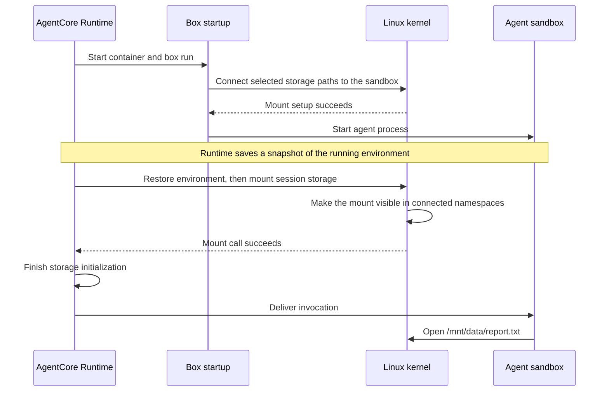

# Design: Storage mounts after Box starts

**Author**: Kevin Orellana

**Status**: Draft. The configuration and behavior below are proposed, not available in a released version.

**Updated**: November 25, 2026

> **Terminology:** Linux retains historical, non-inclusive mount terminology, including [`rslave`](https://docs.kernel.org/filesystems/sharedsubtree.html). This document uses **receiving mount** in prose and preserves exact Linux identifiers where needed.

## Overview

Strands Box restricts which files an agent and its tools can access. This proposal lets a running Linux sandbox receive storage that another service, such as Amazon Bedrock AgentCore Runtime, mounts later.

Box sets up the connection before the sandbox starts. When Runtime later mounts the storage, Linux makes it visible in each connected sandbox before Runtime's mount call finishes. Box needs no separate process to watch for the mount and expose it afterward.

This approach supports fewer permission settings than the earlier helper-based proposal. Each sandbox must allow read and write access across the whole mounted directory; the agent must also allow execution. Box rejects settings that require finer restrictions. The storage service and filesystem can still refuse operations. This permission trade-off needs approval before implementation.

## 1. Why storage can be missing

Box normally gives each sandbox a private **mount namespace**: its own arrangement of filesystems and the paths where they appear. A filesystem mounted outside it after startup does not automatically appear inside it.

[AgentCore Runtime provides configured storage when the agent is invoked](https://docs.aws.amazon.com/bedrock-agentcore/latest/devguide/runtime-filesystem-configurations.html), rather than during container initialization. In the deployment considered here, the container starts Box before storage is mounted. Runtime saves the running environment in a virtual-machine snapshot and restores it for a new session. Box must therefore receive mounts added after that snapshot is restored.

The earlier helper prototype in [PR #579](https://github.com/strands-agents/box/pull/579) prepared a restricted filesystem view after each mount arrived. Runtime could deliver an invocation before the helper finished. An application that immediately opened a storage file could fail.

The goal is to remove that extra step: once Runtime's mount call succeeds, storage must be visible in every connected sandbox. This guarantees where a new file lookup goes. It does not guarantee that all remote data has been downloaded or that every file operation succeeds.

## 2. How Linux forwards a mount

Mounting tells Linux which filesystem to use at a path. If a filesystem contains `report.txt`, mounting it at `/mnt/data` makes the file accessible as `/mnt/data/report.txt`. Mounting does not copy the file.

Linux can connect mounts across namespaces:

| Setting | What it does |
| --- | --- |
| Shared mount | Forwards mounts added beneath it to connected mounts. |
| Receiving mount | Receives mount changes from an upstream shared mount without sending its own changes back. |
| Private mount | Does not send or receive these changes. |

`rslave` configures receiving behavior recursively on an existing mount subtree. It configures the receiving side; it does not create an upstream connection by itself. It also does not inspect every file or wait for storage to arrive.

For a correctly connected set of mounts, Linux forwards and commits the new mount before the original mount call returns success. The sandboxed process need not run for this to happen. An intermediate mount can receive from upstream and share with downstream mounts; making an intermediate mount private breaks that connection. The [Linux documentation](https://docs.kernel.org/filesystems/sharedsubtree.html) and [mount implementation](https://github.com/torvalds/linux/blob/adc218676eef25575469234709c2d87185ca223a/fs/namespace.c#L2482-L2535) describe this behavior.

The connection belongs to mount objects, not matching path names. To receive a new mount at `/mnt/data`, Box must preserve the connection through the mount containing that directory. A separate bind mount of the old `/mnt/data` directory may miss a new mount placed over it. A **bind mount** makes an existing file or directory visible at another mount point. Tests must prove that the actual Runtime arrangement forwards `/mnt/data` without exposing unrelated paths such as `/mnt/other`.

“One-way” refers to mount and unmount events. It does not make files read-only: a permitted write still changes the shared filesystem.

## 3. Which permission settings are supported

Box's filesystem lists in `box.toml` control direct file access by sandboxed processes. A **grant** is a list entry that allows an operation on a path.

The [configuration reference](../../docs/user/config.md#agentfilesystem-and-toolnamefilesystem) defines nine lists: `read`, `write`, `read_file`, `write_file`, `list`, `metadata`, `exec`, `deny`, and `deny_write`. The `_file` lists select exact files; `list` and `metadata` concern directory listings and file properties. Tools do not accept `metadata` or `exec`. Existing Linux limitations remain: write access requires matching read access, and Linux rejects list-only grants.

Ordinary Box mounts can make `/mnt/data` read-only, make `/mnt/data/output` writable, and hide `/mnt/data/private`. A later mount can cover that arrangement. Linux forwards the mount without applying the Box lists again, so restrictions on the old directory do not protect the arriving filesystem.

The proposed version therefore accepts only the following settings:

| Settings for a directory listed in `receive_mounts` | Result |
| --- | --- |
| Agent: `read`, `write`, and `exec` cover the entire directory; no intersecting `deny` or `deny_write` | Accept if the other startup checks pass. |
| Tool or local Model Context Protocol (MCP) server: `read` and `write` cover the entire directory; no intersecting `deny` or `deny_write` | Accept if the other checks pass. These sandboxes can run reachable programs and load code from their own readable and writable paths; they do not take an `exec` list. |
| Box read-only access, a writable child within a read-only directory, execution limited to selected files, list-only access, or metadata-only access | Reject sandbox startup. Direct propagation cannot preserve these restrictions. |
| `deny` or `deny_write` names the directory, a parent, or anything beneath it | Reject startup, even if the denied path does not exist yet. |
| Exact-file grants without the required whole-directory grants | Reject startup. |

Whole-directory access covers all files and subdirectories, including content that arrives later. A directory grant may name the mount path or a parent directory that covers it. Redundant grants for children do not replace the whole-directory requirement. Paths outside the listed mounts retain their existing Box restrictions.

Even a read-only Runtime filesystem needs the complete Box grants in this version. Its read-only restriction comes from Runtime or the filesystem. Box does not infer that every future mount will carry the same restriction.

### Who must protect the storage?

The service or administrator that mounts storage is trusted to supply the intended filesystem. In the Runtime deployment, Runtime performs this role. Storage-service authorization, filesystem ownership checks where supported, and mount options such as read-only or `noexec` still apply. `noexec` prevents direct program execution from that mount. Box's other sandbox controls also remain in place.

At startup, Box checks configured paths and known aliases against its protected paths. These include Box's private state, protected program files such as the installed Box binaries, and configured credential sources. The service that mounts the storage must never expose those protected objects beneath a forwarded directory, including through another path to the same object. This does not prohibit ordinary executable files in storage.

Box cannot inspect storage that has not arrived or check every later mount. Deployments that cannot satisfy this trust requirement are unsupported. There is no hidden scan or later validation step that enforces it.

## 4. Proposed configuration

Box Core builds sandboxes. Its proposed `box.toml` setting, `[experimental-features] linux-passthrough-mounts`, enables this Linux-only feature. Each agent, tool, or local MCP server lists the paths it needs in its own `filesystem.receive_mounts` array. Listing a path does not grant access; the permission lists do that.

`receive_mounts` selects paths where the sandbox receives externally attached filesystems after startup. It does not tell Box to create or mount a filesystem. Linux propagation settings such as `rslave` remain implementation details, not public configuration options.

This is a configuration excerpt, not a complete runnable file. Current releases do not support it.

```toml
[experimental-features]
linux-passthrough-mounts = true

# Allow the agent to read, write, and run files in both directories.
[agent.filesystem]
receive_mounts = ["/mnt/data", "/mnt/shared"]
read = ["/mnt/data", "/mnt/shared"]
write = ["/mnt/data", "/mnt/shared"]
exec = ["/mnt/data", "/mnt/shared"]

# Give the indexer access to /mnt/data only.
[tool.indexer.filesystem]
receive_mounts = ["/mnt/data"]
read = ["/mnt/data"]
write = ["/mnt/data"]
```

A local MCP server uses `[mcp.<name>.filesystem]`. Each sandbox has its own list; it inherits no other sandbox's mounts or grants. Different sandboxes may select the same path, as the example shows. An empty or omitted list enables no forwarding.

Box CLI profiles must pass these settings to Core. No separate configuration file or named mount groups are added. The CLI's existing `[storage]` feature for persistent directories remains separate.

The earlier prototype used `linux-storage-mounts` for a different permission contract. That flag must not silently select this behavior. Either preserve the old implementation separately or reject the old flag with migration instructions.

### What fails at startup?

Box rejects startup when:

1. Mount forwarding is requested without the feature flag or on an unsupported platform.
2. A mount path is relative, malformed, `/`, or conflicts with a protected path. Within one sandbox's list, duplicate or overlapping paths are also rejected.
3. The permission lists fail the rules in section 3. Existing path and alias checks still apply; a text-prefix comparison is insufficient.
4. Box lacks the permissions or connected receiving mounts needed to forward the selected storage without exposing unlisted paths.
5. A program or other required startup file is still missing. Forwarding does not let a program start before its executable exists.
6. A sandbox has native filesystem policy checks enabled, but that Box version does not support combining them with mount forwarding. Compatibility tests must pass before a release enables this combination. The `box.toml` setting `[experimental-features] native-filesystem-policy` enables these checks on direct file operations; individual process settings can turn them off. Box must not silently disable them. See the [native filesystem policy reference](../../docs/user/native-filesystem-policy.md) for configuration.

The storage filesystem may arrive later, but the receiving mount and its parent directory must already exist or be created safely during Box startup. Box prints each sandbox's selected paths and the required whole-directory access at startup.

## 5. Startup and invocation sequence


Proposed arrangement with Amazon Elastic File System (EFS) as the example storage service. Box and Runtime integration tests are still required.

[Editable diagram](https://github.com/user-attachments/files/35392050/runtime-direct-mount-propagation.drawio)

### 5.1 Before the snapshot

During `box run`, Box validates the settings and connects the selected mounts before starting each sandboxed process. Other paths remain private. The agent receives no authority to change mounts.

To change mounts, Box needs a Linux permission named `CAP_SYS_ADMIN` in the user namespace that owns the affected mount namespace. A **user namespace** limits where a process's user identity and capabilities apply. Authority in Box's user namespace does not grant authority to change Runtime's host mounts. Tests must show that Box can use Runtime's existing setup; this proposal does not grant additional host privileges.

Runtime can then snapshot the running environment. Box adds no storage-ready message for Runtime to wait on.

### 5.2 After restore



The design uses Runtime's existing promise that storage is available when the agent is invoked. A real snapshot-and-restore test must still prove that the Box mount connections survive restoration.

A background thread can access the path before Runtime mounts storage. Its operations may fail, or may read and write the old directory that the new mount later hides. An open file descriptor, which is a process's handle to an opened file, still refers to the old file. A saved working-directory reference can likewise remain on the old filesystem. The first-invocation test must open a fresh absolute path; tests of already-open files are separate.

### 5.3 Which processes receive storage?

| Process | Required behavior |
| --- | --- |
| Agent | Connect its selected mounts before it starts. Preserve those connections across snapshot and restore. |
| Configured tool or local MCP server | Use that process's own list. A process started before attachment receives the later mount. One started afterward must see the current storage at startup. Remote MCP servers are outside this mechanism. |
| Hosted Strands Shell and Monty | These are Box's hosted shell and Python interpreters. They run in the trusted Box process outside every sandbox. Extend their allowed paths to include the agent's selected storage, while preserving the separate checks described below. |

For each hosted file operation, Box first evaluates the policy file selected by the top-level `policy` setting in `box.toml`. It then checks allowed paths and protected files. These checks are separate from the agent's filesystem grants. Selecting storage must not bypass either check.

Changing the agent's namespace alone does not give hosted interpreters access. Tests must also show that sharing an internal parent mount never exposes another sandbox's selected storage or unrelated directories.

## 6. What has been tested

A local Linux ARM64 test completed 100 mount-and-unmount cycles. Mounts passed through an intermediate mount to two receiving processes, one in a separate user namespace. Both processes remained stopped during every attachment.

Immediately after each mount call returned, the test's parent process, running as root, inspected the receivers' mount tables and read a marker through `/proc/<pid>/root`. That Linux path exposes the filesystem view of the identified process. Both views contained the marker on all 100 attempts, without waiting or retrying. Making the intermediate mount private prevented forwarding. Mounts created in a receiver did not appear upstream.

The measured bind-mount call took a median of 0.041 milliseconds and a maximum of 0.065 milliseconds. This includes the local call and Python overhead. It does not measure propagation's added cost against a baseline or predict Runtime latency.

The test used neither Box nor a virtual-machine restore nor remote storage. Root performed the file reads, so it also did not establish access under the agent's user identity. The kernel source explains the ordering; this test checks one mount arrangement. Previous tests of the helper implementation do not validate this proposal.

Forwarding mounts does not require listing every Amazon Simple Storage Service (S3) object. Work can grow with the number of mounts and connected sandboxes. Remote storage startup and later file access have separate costs. Measure Box startup, the Runtime mount call, and the first file operation separately.

## 7. Implementation plan and tests

Use four implementation pull requests. Each includes tests and documentation for the behavior it adds.

1. **Configuration and validation.** Add Core settings, CLI profile support, startup errors, and disclosure of selected paths. Test valid and invalid settings for every sandbox type, missing paths, parent/child restrictions, protected aliases, disabled flags, and unsupported platforms. Do not enable the feature until its implementation exists.
2. **Linux mount connections.** Build selective one-way connections during startup and drop mount-changing privileges before running sandboxed code. Test Linux ARM64 and x86-64, pausing and resuming sandboxed processes, same and separate user namespaces, broken connections, mounts over the selected path and beneath it, multiple paths, unlisted siblings, read-only and `noexec` source mounts, reverse isolation, and existing sandbox restrictions.
3. **All Box processes.** Integrate the agent, tools, local MCP servers, Shell, and Monty. Test actual file operations as the agent and tool users, processes started before and after attachment, multiple sandboxes, protected aliases, hosted policy denials, and cleanup after failed startup. Add runnable examples.
4. **Runtime tests and operator guide.** Start Box before snapshot and open storage on the first invocation without sleeps or retries. Test already-open files and working directories, the maximum number of mounts Runtime supports, each claimed storage provider, source permission denials, and mount failures. Record the Box revision, Linux kernel version, Runtime deployment settings, and event times. Publish reproducible setup instructions; claim support only for tested environments.

Both Linux ARM64 and x86-64 are required for the first release. macOS is follow-up work and must reject the Linux-only feature meanwhile. Use Runtime's supported mount limits in Runtime tests; larger local tests do not expand those limits.

Where practical, repeat a denied operation against equivalent unrestricted storage and confirm it succeeds. This checks that the denial came from the restriction being tested.

## 8. Limits and other options

### 8.1 Later mount changes

The trusted service can also replace or remove mounts, or add mounts below an existing one. Linux may forward those events; Box has no watcher that validates or rejects them.

Initial arrival is the first test target. Guarantees for replacement, removal, concurrent renames, already-open files, and recovery remain follow-up work. Forwarding a new mount does not revoke access through an old file descriptor. Storage services also retain their own ownership rules, unsupported operations, and failure modes.

### 8.2 Keep the helper

A helper can inspect new storage and build different restrictions for its files and directories before exposing them. The application or Runtime would then need to wait for that work before handling an invocation that uses storage. This remains an option when finer Box permissions are required.

### 8.3 Start Box after storage is mounted

Box can build its ordinary restricted view from storage that already exists. This works when the application can change its startup order. It does not meet the requirement to snapshot an already running Box workload.

### 8.4 Enforce finer rules through native checks

Separate checks on each file operation might preserve finer rules with direct propagation. That requires proof across the supported architectures, file operations, and hosted access routes. This proposal does not assume those checks are available or sufficient.

## 9. Decisions still needed

1. **Permission contract:** accept whole-directory access for this feature, or use the helper when finer Box restrictions are required? This draft recommends direct propagation with incompatible settings rejected.
2. **Configuration:** approve `linux-passthrough-mounts` with per-sandbox `receive_mounts` lists and explicit grants? The old experimental flag must not silently change meaning.
3. **Runtime feasibility:** can the actual mount arrangement forward only the selected storage without new host privileges? The Linux and Runtime tests must answer this before support is claimed.

References:

- [Runtime filesystem configuration and lifecycle](https://docs.aws.amazon.com/bedrock-agentcore/latest/devguide/runtime-filesystem-configurations.html)
- [Linux mount propagation](https://docs.kernel.org/filesystems/sharedsubtree.html)
- [Linux v6.12 mount implementation](https://github.com/torvalds/linux/blob/adc218676eef25575469234709c2d87185ca223a/fs/namespace.c#L2482-L2535)
- [Direct-propagation prototype](https://github.com/rvkandury/box-public/commit/e2ed1b5bb3352cb2c8ceea5c97e1d235c3e5765e)
- [Box filesystem configuration](../../docs/user/config.md#agentfilesystem-and-toolnamefilesystem)

## 10. Team discussion and feedback

The team agreed to measure direct propagation and review an explicit permission contract. It did not approve the interface, weaker enforcement of existing grants, or a release date.

| Topic | What the team raised | How this draft responds |
| --- | --- | --- |
| First invocation | Tests reportedly failed on immediate storage access and passed with an added delay. Applications may read stored state before calling a model. | Test the first file operation without delays or retries. Treat missing storage as a correctness problem, not just a latency measurement. |
| Permissions | The review debated whether Runtime needs Box restrictions beyond provider permissions. It also raised the risk of accepting settings that Box cannot enforce. | Propose whole-directory grants and reject finer restrictions. This is still a decision for review. |
| Integration | Direct propagation was reopened as an alternative to the watcher and helper. Its fit with Runtime needed evidence. | Set up forwarding before snapshot. Retain the helper and delayed Box startup as alternatives. |
| Performance | A 5–10 ms added-latency target was discussed without agreed measurement boundaries, percentiles, or failure limits. | Measure the relevant events in comparable deployments. The target is not a service commitment. |
| Clarity | Earlier feedback requested the startup use case and full lifecycle, and described this as extending live rule reloading to filesystems. | Separate startup, mount arrival, and invocation. Clarify that mounts change; the `box.toml` rules are not reloaded during a run. |
| Delivery | Possible launch exclusion concerned remote-storage support, not Box overall. Later delivery was discussed without a final decision or date. | Keep the feature experimental. Separate design approval, implementation, Runtime testing, and release decisions. |

The kernel inspection and local test in section 6 happened after the review. They are evidence for further work, not team approval or proof that the feature works in Runtime.
