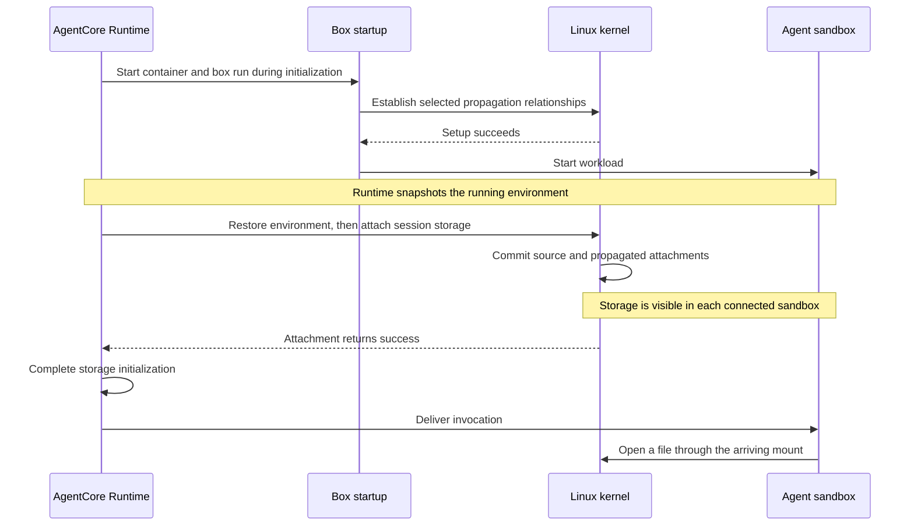

# Design: Direct propagation of trusted storage mounts

**Author**: Kevin Orellana

**Status**: Draft for review; the interface and restricted set of supported configurations below are proposals, not shipped behavior.

**Updated**: November 25, 2026

## Overview

This proposal connects selected storage mounts directly to Box sandboxes before their processes start. In a deployment that snapshots a running sandbox, the connection is established before the snapshot. Linux then makes an incoming mount visible through that connection as part of the external mount operation. Box does not run a watcher or prepare a second filesystem view after the mount arrives.

The trade-off is configuration support. Direct propagation does not apply Box's per-path read-only mounts, execution restrictions, or denied-path covers to a newly arriving filesystem. The proposed first version therefore accepts only whole-directory access and rejects configurations that require finer restrictions inside a forwarded directory. Listing a mount still grants no access: the recipient must explicitly grant the whole directory's read and write access, and the agent must also grant execution. Source filesystem restrictions can further reduce that access.

This replaces the protected-publication proposal in the earlier revision of this document. It does not establish that direct propagation preserves every existing `box.toml` filesystem configuration. The narrower contract needs review before implementation.

## 1. Problem and required outcome

Box normally builds a private mount namespace: a process-specific arrangement of mounted filesystems. A mount added outside that namespace after Box starts does not automatically appear inside it.

[AgentCore Runtime filesystem configurations](https://docs.aws.amazon.com/bedrock-agentcore/latest/devguide/runtime-filesystem-configurations.html) make configured storage available for invocation, not container initialization. A Box sandbox created during initialization must therefore receive storage added later. Starting Box after storage arrives is an alternative, but it changes when the sandbox starts and does not solve the case of an already running sandbox.

The previous design received mounts in a helper, built restricted views, and published them to the sandboxes. Runtime could finish its mount operation and deliver an invocation before that separate publication finished. Application retries accommodated this gap but did not preserve first-invocation filesystem availability.

The required outcome is that a successful external mount attachment has already reached every connected recipient when that operation returns. This requirement concerns mount visibility. It does not promise that every remote file is downloaded or that subsequent file operations cannot fail.

## 2. What direct propagation does

A mount attaches a filesystem at a path. Attaching a filesystem containing `report.txt` at `/mnt/data` makes the file reachable as `/mnt/data/report.txt`; it does not copy the file.

Linux associates propagation relationships with **mount objects**, not directory names. A shared mount can forward new child mounts to its peers and downstream receivers. A slave mount receives changes from its upstream mount without forwarding its own changes upstream. `rslave` applies this receiver setting recursively to the mount subtree that exists when the setting is made. It does not recursively inspect files or wait for a future filesystem to arrive.

In the Linux attachment path, propagation runs inside the mount operation: the kernel constructs the propagated attachments, commits them, and then returns success. The receiving process does not need to run a watcher. See the [shared-subtree documentation](https://docs.kernel.org/filesystems/sharedsubtree.html), the [attachment and commit path](https://github.com/torvalds/linux/blob/adc218676eef25575469234709c2d87185ca223a/fs/namespace.c#L2482-L2535), and [propagation through peers and receivers](https://github.com/torvalds/linux/blob/adc218676eef25575469234709c2d87185ca223a/fs/pnode.c#L304-L322).

The guarantee is conditional on the complete relationship remaining connected. Marking an arbitrary directory `rslave` is insufficient if it has no upstream shared mount. A private intermediate mount breaks the chain. In a multilevel arrangement, an intermediate mount may receive from upstream and share with its own downstream receivers.

The attachment point also matters. Mounting over `/mnt/data` is an event on the mount containing that directory. Box must preserve the appropriate upstream parent relationship; marking an unrelated bind at `/mnt/data` does not prove that an overmount at the source will arrive. The implementation must test the actual Runtime topology and prevent undeclared siblings from becoming reachable.

One-way propagation describes mount and unmount events. It does not make storage read-only: file writes still affect the shared filesystem when the source permissions permit them.

## 3. Filesystem permissions and the supported contract

Box's existing filesystem lists govern a sandbox's direct file operations. Requests through hosted Strands Shell and Monty instead pass through policy and reachable-path checks in the box's trusted process. These are separate enforcement routes.

The [Box Core configuration reference](../../docs/user/config.md#agentfilesystem-and-toolnamefilesystem) defines `read`, `write`, `read_file`, `write_file`, `list`, `metadata`, `exec`, `deny`, and `deny_write`. The agent accepts all nine lists; tools do not accept `metadata` or `exec`. Local Model Context Protocol (MCP) servers have their own filesystem configuration. Existing operating-system limitations remain relevant: for example, Linux requires read access over the complete write scope and rejects list-only grants.

With ordinary private mounts, Box can expose a directory read-only, add a writable child, and cover a denied child. Directly propagating a new filesystem can cover that arrangement with the incoming mount. The kernel does not evaluate the lists again. Applying restrictions to the old placeholder does not establish that the new filesystem has them.

The proposed contract avoids silently ignoring those lists:

| Configuration for a forwarded directory | Proposed result |
| --- | --- |
| Agent grants directory-wide `read`, `write`, and `exec`, with no intersecting `deny` or `deny_write` | Accept if the remaining startup checks pass. The source can still refuse operations. |
| Tool or local MCP server grants directory-wide `read` and `write`, with no intersecting `deny` or `deny_write` | Accept if the remaining startup checks pass. These recipients already have broader execution permissions; do not add unsupported `exec` keys to their configuration. |
| Read-only access, writable-child exceptions, execution restricted to selected files, list-only or metadata-only access | Reject sandbox startup. This first version cannot preserve that configuration through direct propagation. |
| A `deny` or `deny_write` intersects the forwarded directory, whether it names an ancestor, the directory, or a descendant | Reject sandbox startup, including when the named path does not yet exist. |
| Exact-file grants without covering directory grants | Reject sandbox startup. They do not authorize the entire arriving tree. |
| Ordinary grants and denials outside every forwarded directory | Preserve their existing behavior. |

A covering directory grant can name the forwarded directory or an ancestor. Additional child grants do not remove the requirement for complete coverage. Validation uses the existing path semantics and protected-path checks, including aliases that those checks recognize; string-prefix matching alone is insufficient.

This version does not accept a read-only Box configuration merely because today's upstream mount happens to be read-only. That would rely on an external promise about every later mount. A future design can consider that contract separately.

The trusted storage publisher remains responsible for mounting the intended storage with appropriate source permissions. Box does not grant the workload mount-administration capabilities or change storage authentication. Provider authorization, ownership checks where the filesystem enforces them, source mount flags, and Box's other sandbox controls still apply. Box checks configured paths and known aliases against its protected paths at startup. It cannot inspect an absent future filesystem or validate every later attachment. The publisher trust assumption therefore includes never mounting Box state, installed programs, protected credential sources, or aliases to those objects beneath an admitted root. A deployment that cannot satisfy this prerequisite is unsupported. This is an external trust obligation, not a new post-attachment Box check or a requirement to scan every file.

## 4. Proposed interface

Keep absolute paths in each recipient's existing filesystem table. Do not add a separate storage configuration file or named mount groups.

The proposed Box Core `box.toml` flag `[experimental-features] linux-passthrough-mounts` explicitly selects the direct-propagation contract. The `mounts` array identifies the external attachment paths that recipient needs; the ordinary grant lists authorize access. The earlier experimental `linux-storage-mounts` flag must not silently acquire these different semantics. Migration must reject the old selection with an explanation, or retain it as a separately supported implementation.

This excerpt illustrates proposed configuration fields. It is not a complete runnable `box.toml`, and current releases do not support it.

```toml
[experimental-features]
linux-passthrough-mounts = true

# The agent accepts complete access to both arriving trees.
[agent.filesystem]
mounts = ["/mnt/data", "/mnt/shared"]
read = ["/mnt/data", "/mnt/shared"]
write = ["/mnt/data", "/mnt/shared"]
exec = ["/mnt/data", "/mnt/shared"]

# The indexer receives only /mnt/data. It does not inherit the agent's list.
[tool.indexer.filesystem]
mounts = ["/mnt/data"]
read = ["/mnt/data"]
write = ["/mnt/data"]
```

A local MCP server uses the same pattern under `[mcp.<name>.filesystem]`. An empty or omitted `mounts` array establishes no propagation for that recipient. Box CLI profiles must expose the same contract and pass it to Core. The CLI's existing `[storage]` feature for persistent directories remains separate.

At startup, Box must reject:

1. The opt-in on an unsupported platform, or a nonempty mount list without the opt-in.
2. Relative paths, `/`, duplicate or overlapping roots, malformed paths, and roots that expose Box state or conflict with protected paths.
3. Missing whole-directory grants or intersecting restrictions described in section 3.
4. A missing or unsuitable attachment anchor, insufficient namespace permissions, or an upstream relationship that cannot deliver the expected attachment without exposing undeclared paths.
5. A root used for an executable or other mandatory startup input that is not available yet. Forwarding does not defer ordinary program startup requirements.
6. A combination with native filesystem policy checks unless tests establish compatible behavior. Do not silently disable those checks.

The storage filesystem itself can be absent at startup. The namespace anchor needed to receive it must exist or be constructed safely by Box. This differs from deferring checks for an arbitrary set of permission exceptions inside the arriving filesystem: those exceptions are unsupported here.

The startup disclosure must identify each recipient and mount root and state that the whole arriving tree is admitted. It must not describe the source as permission-free or claim that Box applies per-path restrictions after arrival.

## 5. Sequence and implementation


Proposed Linux arrangement, using Amazon Elastic File System (EFS) as an example provider. The namespace ordering has a local probe; this diagram does not claim completed Box or Runtime qualification.

[Editable diagram](https://github.com/user-attachments/files/35389690/runtime-direct-mount-propagation.drawio)

### 5.1 Before the snapshot

During `box run`, Box validates configuration and builds the propagation relationship for every selected recipient before starting its sandboxed process. Other paths retain private mounts. Box verifies the connection and removes mount-administration authority from the workload as part of its existing startup boundary.

Changing propagation needs mount-administration authority in the user namespace that owns the affected mount namespace. Authority inside a child user namespace does not grant authority to reconfigure the Runtime host's mounts. The design must work with Runtime's existing upstream setup; requiring additional host privileges is a qualification failure to investigate, not a permission granted to the agent.

The Runtime deployment can then snapshot the running sandbox and its namespace arrangement. Box adds no polling interval, publication process, or storage-ready response to Runtime.

### 5.2 After restore and on invocation



Runtime documents that configured filesystems are available when the agent is invoked. The proposed integration uses that existing ordering; it does not introduce a new Runtime readiness handshake. The Linux result supports the mechanism, but a real Box snapshot-and-restore test must prove that the required connections survive in Runtime.

An application background thread can still access the path before Runtime attaches storage. A mount setup call does not wait for future storage. Earlier operations may fail, or may read and write the underlying placeholder directory before the incoming mount hides it. Existing file descriptors and working-directory references do not automatically switch to the arriving filesystem. Applications must not treat container initialization as storage readiness. First-invocation qualification uses a fresh absolute-path lookup; retained-reference behavior needs separate tests before any broader guarantee.

### 5.3 Agents, tools, servers, and hosted interpreters

| Recipient | Required implementation |
| --- | --- |
| Agent sandbox | Establish its selected receivers before the agent starts and retain them across snapshot/restore. |
| Each configured tool sandbox | Use that tool's own roots and grants. A tool created before attachment receives the event; one created afterward must see the current source at startup. |
| Each local MCP server sandbox | Use that server's own roots and grants, with the same before/after attachment cases. Remote servers are outside this mechanism. |
| Hosted Strands Shell and Monty | Extend their reachable-path handling for the agent's selected roots while preserving per-operation policy decisions and protected-path refusals. They run outside the agent sandbox, so changing only its namespace is insufficient. |

The implementation must prove that an internal shared parent does not reveal another recipient's roots or unrelated siblings. Reuse validated namespace construction, configuration parsing, and test fixtures where appropriate. Do not retain a watcher, protected-view compiler, or publication receiver solely to reuse the previous implementation.

## 6. Evidence and performance

A local Linux ARM64 probe completed 100 attachment-and-unmount cycles through a shared source, an intermediate receiver/shared mount, and two downstream receivers. One downstream receiver used a child user namespace. Both receiver processes were stopped throughout each attachment. Immediately after the source operation returned, the probe checked mount tables and read a marker through each receiver's root, without sleeps or retries. Both receivers passed all 100 cycles. A private intermediate control received none, and receiver-originated mounts did not appear upstream.

The source bind-mount operation measured a median of 0.041 ms and a maximum of 0.065 ms on that machine. These measurements include the local operation and Python call overhead. They are not isolated propagation overhead, a Runtime latency prediction, or a service-level objective.

This probe did not run Box, restore a virtual-machine snapshot, use remote storage, or test access under the eventual workload identity. The kernel source supplies the ordering argument; the probe verifies the tested topology. Earlier successful tests of the helper-based implementation do not qualify this new implementation.

Direct propagation works on mount objects, not every file in the filesystem. Box does not need to enumerate an S3 bucket. Propagation work can depend on the number of mounts and recipients. Provider initialization and later remote file access still have their own costs. Measure setup time, the external attachment operation, and first-invocation file access separately.

## 7. Implementation milestones and acceptance tests

Use four implementation pull requests after this design review. Put meaningful tests and the documentation for each changed surface in the same pull request as its implementation.

| Milestone | Scope | Required evidence |
| --- | --- | --- |
| 1. Interface and validation | Core configuration and CLI profiles; explicit experimental opt-in; whole-root grants; startup errors, disclosure, and reference documentation. Keep activation unavailable until its mechanism exists. | Positive and negative cases for every recipient, missing paths, ancestor/descendant restrictions, protected aliases, disabled flags, and platform selection. |
| 2. Linux namespace mechanism | Build and verify selective one-way relationships during sandbox startup. Preserve private paths, privilege dropping, current mounts, and later attachments. | Linux ARM64 and x86-64. Stopped receivers; same/child user namespaces; broken-chain control; exact-root overmounts and child mounts; unlisted siblings; multiple roots; read-only/no-exec source controls; upstream isolation; ordinary containment regressions. |
| 3. End-to-end Box recipients | Agent, configured tools, local MCP servers, hosted Shell and Monty, startup failure cleanup, and runnable examples. | Real Box operations under workload identities, before/after attachment, multiple recipients, forbidden source aliases, policy denials on hosted operations, and absence of leaked helpers or mounts. |
| 4. Runtime qualification and operator guide | Build from the replacement series; document deployment and replication steps; enable the advertised Runtime path only after qualification. | Box started before snapshot; fresh absolute-path lookup on the first invocation with no retry or sleep; retained-reference controls; stop/resume; all supported mount slots; each claimed provider; expected source denials; mount failure; timestamped first-file access; environment and source revisions. |

Linux ARM64 and x86-64 are required for the initial release. macOS support is follow-up work and must reject this Linux feature explicitly in the meantime. Runtime's current filesystem-configuration limits determine the multiple-mount test cases; local tests can exercise larger topologies without implying Runtime supports them.

A passing source-attachment probe is not sufficient for milestones 3 or 4. A provider-specific pass qualifies that provider and environment only. A permission test must demonstrate the denied operation outside the restriction as a positive control where practical.

## 8. Limits and alternatives

### 8.1 What remains trusted or deferred?

The external mount publisher is trusted to supply the intended filesystem. Direct propagation may also carry later child mounts, replacement mounts, and unmounts where the topology permits them. Do not claim those events are rejected or delayed for validation: there is no watcher doing so.

Initial arrival is the first qualification target. Detailed guarantees for replacement, removal, already-open file descriptors, concurrent renames, and recovery remain follow-up work. An open descriptor can continue to refer to the earlier filesystem after a path is overmounted; propagation is not revocation.

Filesystem-specific ownership rules, unsupported operations, and remote availability remain provider concerns. Source restrictions are effective only where that provider enforces them. The direct-propagation design does not normalize different providers into one filesystem implementation.

### 8.2 Why not keep protected publication?

It can preserve different permissions within one arriving tree. It requires Box to inspect and prepare that view after attachment. To guarantee availability at the first invocation, deployment must then wait for publication or provide another explicit synchronization mechanism. Keep it as an alternative if fine-grained Box filesystem restrictions are required; do not claim direct propagation provides both contracts.

### 8.3 Why not set `rslave` and keep every existing rule?

The kernel forwards mounts, not Box rules. A later mount can cover existing read-only mounts and denied-path covers. Without a separately proven enforcement mechanism, accepting those configurations would promise restrictions that the workload might bypass.

### 8.4 Why not start Box after storage arrives?

That lets ordinary startup construct a protected view from existing storage. It is appropriate when the harness can change its startup order. It does not preserve the requirement to snapshot an already running Box workload.

### 8.5 Could stronger native checks preserve all rules later?

Possibly, but this proposal does not assume it. Support must be demonstrated across the required architectures, access routes, and filesystem operations. Availability on one platform or enforcement of a subset of operations does not establish a replacement for the existing mount restrictions.

## 9. Review questions and references

1. Accept the whole-directory contract for this experimental feature, or retain protected publication when per-path Box restrictions are required? The proposal recommends whole-directory propagation for the Runtime integration, with incompatible configurations rejected.
2. Approve the proposed `linux-passthrough-mounts` flag while retaining per-recipient `mounts` and explicit grants? The earlier experimental configuration must not silently change meaning.
3. Can the actual Runtime parent-mount topology provide selective receivers without exposing undeclared siblings or requiring new host privileges? Milestones 2 and 4 must resolve this with tests before support is claimed.

References:

- [Runtime filesystem configuration and invocation lifecycle](https://docs.aws.amazon.com/bedrock-agentcore/latest/devguide/runtime-filesystem-configurations.html)
- [Linux shared-subtree propagation semantics](https://docs.kernel.org/filesystems/sharedsubtree.html)
- [Linux v6.12 mount attachment and commit path](https://github.com/torvalds/linux/blob/adc218676eef25575469234709c2d87185ca223a/fs/namespace.c#L2482-L2535)
- [Ravi Kandury's direct-propagation prototype](https://github.com/rvkandury/box-public/commit/e2ed1b5bb3352cb2c8ceea5c97e1d235c3e5765e)
- [Current Box filesystem configuration](../../docs/user/config.md#agentfilesystem-and-toolnamefilesystem)

## 10. Team discussion and feedback

The team review focused on first-invocation reliability, the permission contract, and integration complexity. The agreed next step was to measure direct propagation and evaluate an explicit contract for it. The discussion did not finalize the interface, approve weaker enforcement of existing grants, or commit to a release date.

| Feedback theme | Team-level feedback | Response in this proposal |
| --- | --- | --- |
| First-invocation reliability | Reported integration failures showed why an invocation cannot rely on a later Box publication step. Adding a delay made the reported tests pass, but applications may access storage immediately, including to restore state before any model call. | Establish propagation before the snapshot and test the first file operation without sleeps or retries. Treat storage visibility as a correctness requirement, separately from average latency. Real Runtime qualification remains required. |
| Explicit permission guarantees | The review debated whether provider authorization and filesystem permissions supply the protections Runtime needs, and questioned the value of additional Box restrictions. It also identified the risk of accepting configuration that incoming mounts would not enforce. | Require complete directory grants and reject incompatible restrictions. Keep this narrower contract as an explicit review decision; do not present it as equivalent to the earlier protected-view design. |
| Integration and mechanism | Direct propagation was reopened as an alternative to the separate watcher and publication step. Its fit with Runtime's lifecycle needed evidence. | Configure propagation during `box run`, before snapshot, with no new Runtime readiness handshake. Retain protected publication and starting Box after storage arrives as alternatives with different contracts. |
| Performance evidence | Approximately 5–10 ms of added latency was discussed as a target, without a final timing boundary, percentile, or failure budget. Request-to-visibility measurements do not isolate Box's contribution. | Compare matched deployments and record source attachment, invocation delivery, and the first file operation. Separate local mechanism measurements from end-to-end Runtime results; the discussion target is not a committed service-level objective. |
| Design clarity | The discussion exposed ambiguity between existing behavior, the two proposals, and the meaning of “ready.” Earlier PR feedback requested a concrete startup use case and a complete lifecycle sequence, and described the work as extending hot reload to filesystem rules. | Show initialization, snapshot, attachment, and invocation separately. Clarify that this proposal forwards mounts under startup configuration; it does not reload `box.toml` rules during a run. State which configurations fail startup and why. |
| Qualification and delivery | Possible launch exclusion concerned remote-storage support, not Box as a whole. Later delivery was discussed, but the review did not establish a final release decision or date. | Keep the feature experimental and gate support claims on the tests in section 7. Track permission-contract approval, implementation completion, Runtime qualification, and release readiness as separate decisions. |

The kernel source inspection and local probe in section 6 are evidence collected after the review. They clarify the propagation mechanism; they do not represent team approval of the proposed interface or completed Runtime qualification.
